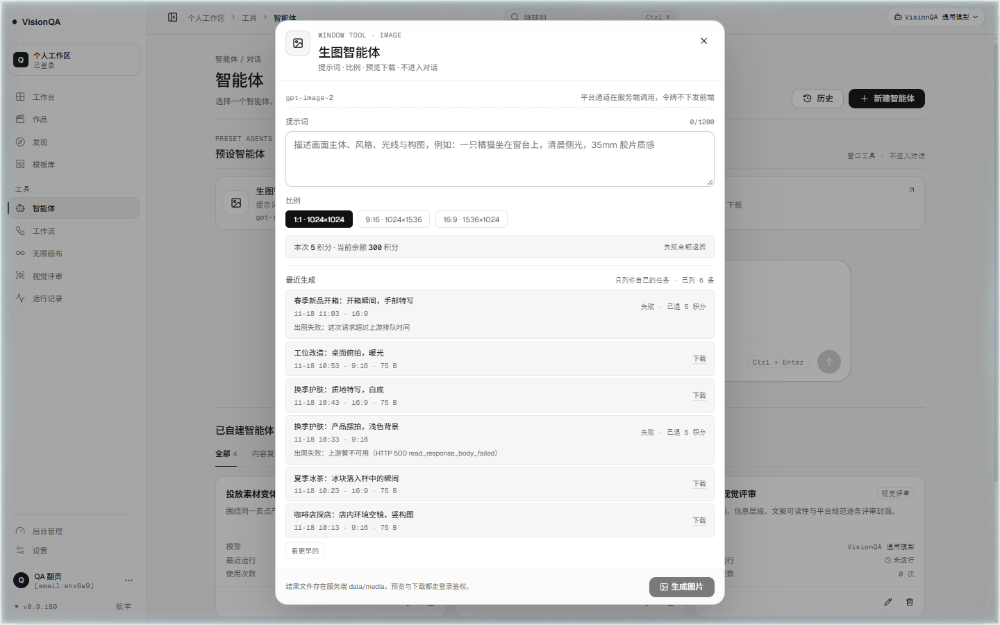

# 「最近生成」能往回翻了：一页 6 条，光标按位置走（0.9.180）

## 结论

前两轮做出来的「最近生成」一直只列 6 条，没有翻页——第十四条生成之后，更早的图还在服务端 `data/media/` 里，界面上却再也够不到。这一轮补上往回翻：清单尾部一个「看更早的」，一次 6 条往下接，翻到底就不给按钮；服务端的返回里也多了 `hasMore` 与 `capped` 两个字段，界面照着它们说话，不假装已经翻完。

## 为什么用「上一页最后一条的任务号」当光标

第一版实现拿 `createdAt` 比大小（`createdAt < before`）。写测试时立刻撞上问题：假上游很快，一次建 8 条里有同毫秒的（日志里 `03:12:25.485 / .495 / .505`），**严格小于会把同一毫秒的几条直接漏掉**——翻页不会报错，只会悄悄少几条，这比报错更难发现。

改成按位置翻：`before` 传上一页最后一条的任务号，服务端在排好序的清单里找到它的位置，从下一条开始取。不重不漏，也不受同毫秒影响。代价是那一条必须还在扫描窗口里；找不到就返回空页（`hasMore=false`），**不猜位置**。

## 改了什么

服务端 `server/routes/media-gen.mjs`：

- `listTasks(userId, { kind, limit, before })` 支持位置光标；
- 返回 `{ tasks, hasMore, capped }`：`hasMore` 是这一页后面还有；`capped` 是元数据只往回读了 240 份（`LIST_SCAN`），再早的没读——**这两件事必须分开说**，混成一句「没有更多」就是撒谎；
- 路由多了 `before` 参数，格式不对（不是合法任务号）回 400 `MEDIA_CURSOR`。

前端 `src/pages/AgentsPage.tsx`、`src/api/media-gen.ts`：

- 清单尾部「看更早的」（`.agx-media-recent-more`），点一次追加 6 条，按 id 去重、不打乱已经看到的顺序；
- 翻到底且撞上扫描上限时，写一句「只往回找最近 240 个任务，更早的不在这个清单里」；
- 标题右侧从「最多 6 条」改成「已列 N 条」——翻过之后这个数字要跟着变，不能还写 6；
- 清单自动刷新时按**已经翻出来的条数**取（`recentSizeRef`），不会把用户翻出来的更早几条冲掉。

## 验收

服务端测试 `test/media-gen.test.mjs`：**12 / 12**（+1 条翻页用例，一次建 8 条、不插等待）：

```
第一页 limit=3        -> [7,6,5]   hasMore=true
第二页 before=5号     -> [4,3,2]   hasMore=true
第三页 before=2号     -> [1,0]     hasMore=false
三页拼起来           -> 8 条不重不漏
别人的任务号当光标   -> 空清单（翻不出别人的）
before=nope!         -> 400 MEDIA_CURSOR
```

界面端到端也是真点的（本机临时实例 + 9 条样例任务，无头浏览器）：

```
PAGE1 {"head":"最近生成 只列你自己的任务 · 已列 6 条","rows":6,"more":true,"end":false}
点击「看更早的」
PAGE2 {"head":"最近生成 只列你自己的任务 · 已列 9 条","rows":9,"more":false,"end":false}
```

6 条 → 点一次 → 9 条，按钮自己消失，`innerWidth == scrollWidth == 390` 无横向溢出。

1440（第一页，尾部有「看更早的」）：



390（点过之后，9 条全在，按钮已消失）：


门禁：

| 项 | 结果 |
| --- | --- |
| `npm test` | **1345 / 1345**（+1 翻页用例） |
| `npm run lint` | 0 error / 16 warning（556 文件） |
| `npx tsc -b` | 干净 |
| `node scripts/scan-secrets.mjs` | 840 文件无命中 |
| `npm run build` | 通过，入口 `index-0IGw35-M.js` |

## 部署

| 项 | 值 |
| --- | --- |
| 版本 | **0.9.180** |
| 入口 | `index-0IGw35-M.js`（生产本地 200、公网 200） |
| 健康 | `{"ok":true,"redfox":true,"vision":true,"llm":true,"templates":26}` |
| 服务 | 6 个 active（visionqa / visionqa-internal / visionqa-demo / bdc-web / bdc-api / bdc-enterprise） |
| 回滚点 | `20261118-031416-20261118-1125-r197mediap`（`ops/rollback.sh --to 1` 回 0.9.179） |

## 边界

- **一页 6 条**是对话框的可视高度定的，不是服务端限制（接口 `limit` 上限仍是 24）。
- 元数据只往回读最近 **240** 份（`LIST_SCAN`）：超过这个窗口的更早任务，界面写「不在这个清单里」并停在那儿，不会假装翻完。文件本身还在磁盘上，按任务号仍可读。
- 光标那一条要是已经掉出窗口（被删或被挤出 240 份），这一页就是空的——**不猜位置**，也不拿时间戳兜底。
- 仍**没有删除、没有搜索**：清单只解决「找回来」，不是资产库。
- 两张截图来自本机临时实例的样例任务（9 条，含 3 条不同原因的失败），不是生产数据；本轮 **0 次真实上游调用**。

细节与门禁同 `README.md` 第二百五十八节。
