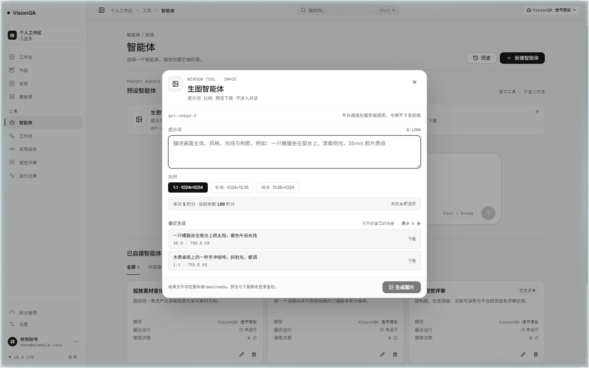
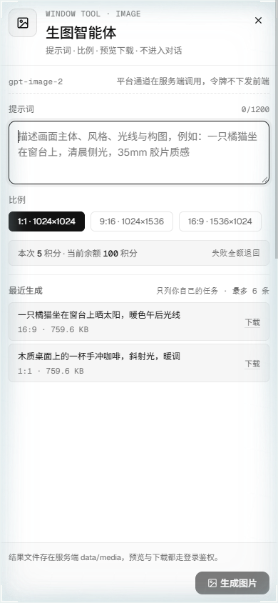
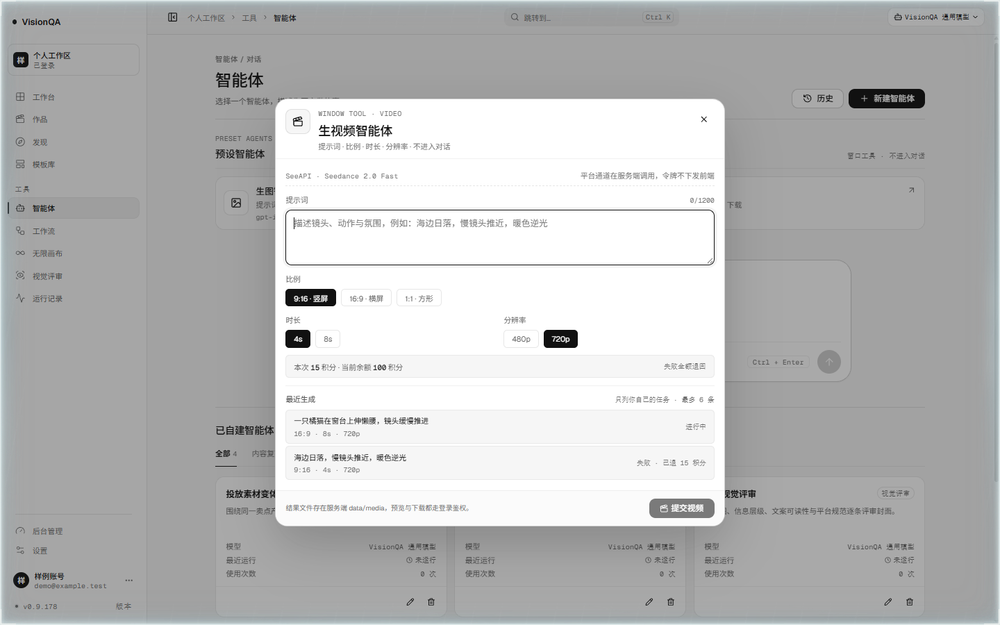

# 「最近生成」：关掉窗口也能把上一条找回来（2026-11-18，0.9.178）

**结论**：生图 / 生视频窗口以前只认「这一次」——关掉对话框，任务号就从界面上消失了。文件其实还躺在服务端 `data/media/<账号>/`，但没有任何入口再拿得到，**等于生成了没下载就白花那 5 / 15 积分**。0.9.178 在两个窗口里各加一块「最近生成」：只列自己账号的、按时间倒序、生图与生视频分开，点一下就能把上一条装回窗口预览和下载。

## 一、为什么这是缺口，不是新需求

- 积分是真扣的：一张图 5、一条视频 15，失败才退。为了「看一眼」重跑一次是实打实的重复花费。
- 服务端一直在存文件（`saveResult` 落到 `data/media/<账号>/<任务号>.<ext>`，`0600`），缺的只是**清单**：`GET /api/media/tasks/<id>` 需要你先知道任务号。
- 真调那天（16:9 视频）就是靠脚本自己记任务号才取回文件——正常用户在界面上做不到这件事。

## 二、服务端：一条只回自己的清单

| 项 | 行为 |
| --- | --- |
| 路由 | `GET /api/media/tasks?kind=image\|video&limit=N` |
| 归属 | 任务元数据里带 `userId`，不是自己的一律跳过——别人的任务不会出现在你的清单里（有单测盯着） |
| 顺序 | 先按文件 mtime 取最近动过的 240 份元数据，再按 `createdAt` 倒序截断（状态每次变化都会重写元数据，mtime 只用来缩小扫描范围） |
| 参数 | `kind` 只认 `image` / `video`，其它 400 `MEDIA_KIND`；`limit` 默认 8、上限 24 |
| 副作用 | 不打上游、不扣积分、不写任何文件；元数据坏掉或文件刚被清理的任务直接跳过 |
| 未登录 | 401 `{ loginRequired: true }` |

## 三、界面：两行就够







每行只有三段：**提示词**（一行省略）、**元信息**（`16:9 · 8s · 720p` 或文件大小；进行中写明「进行中」，失败写明「失败 · 已退 15 积分」）、**下载**。点行本身就把那条任务装回窗口：成功的给预览与下载，失败的把原因和退款说清楚。

实现上两处值得记：

1. 这块放在**滚动区里面**（`.agx-media-body`），不是悬在 body 与 footer 之间。第一版插在 footer 前面，1440 宽看不出来，390 宽就露出一段 230px 的空洞——因为它是 flex 列的兄弟节点，不在会滚动的网格里。
2. 取数用 `.then` 而不是在 effect 里 `await` 一个函数：后者会被 `set-state-in-effect` 判成「effect 里同步 setState」，本仓库的 lint 直接红。任务刚出终态时用一个 `recentToken` 触发刷新，不靠轮询列表。

## 四、门禁与部署

| 门禁 | 结果 |
| --- | --- |
| 全量测试 | **1343 / 1343**（新增 1 条：只列自己的、倒序、按 kind 分开、未登录 401、坏 kind 400、limit 有上限） |
| lint | 0 error / 16 warning（556 文件） |
| `npx tsc -b` | 干净 |
| 密钥扫描 | 839 个文件无命中 |
| 构建 | `npm run build` 通过 |

版本 **0.9.178**。截图来自**本机临时实例**（临时 `DATA_DIR` + 临时账号 + 同一份 `dist`），三条任务与图片都是样例数据，不是生产记录；临时目录已删。

## 五、边界（别把这条读多了）

- 只扫最近 240 份元数据。更早的任务不会出现在界面里，但**文件还在磁盘上**，按任务号仍能取（这是刻意不做全盘扫描）。
- 没有删除 / 清理入口：清理仍由运维按目录做，界面只负责「找回来」。
- 没有分页，只有「按 kind 分窗口」这一层筛选；接口的 `limit` 上限 24 是给以后分页留的口子。
- 清单只显示 6 条：够找回刚刚那条，不是资产库。
- 「进行中」的任务点开只显示状态，不会替你去上游催进度——进度仍由那个窗口自己的轮询驱动。

## 六、生产上拿真实数据核了一遍

上线后在生产的同一台机器上，用一个真实账号的临时会话（不传口令、跑完即撤销）打了一次这个接口，拿到的是**真实任务**，不是样例：

```text
ALL status=200 count=6
  video succeeded ratio=16:9 bytes=2895736 at=2026-11-18T02:33
  image succeeded ratio=16:9 bytes=2075773 at=2026-11-18T01:41
  video succeeded ratio=9:16  bytes=3009531 at=2026-11-18T01:38
  image failed    ratio=16:9 bytes=-       at=2026-11-18T01:36
  image succeeded ratio=9:16  bytes=2066905 at=2026-11-18T01:35
  video failed    ratio=       bytes=-       at=2026-11-18T01:30
IMAGE count=6 VIDEO count=4 BAD=400 MEDIA_KIND
SESSION revoked
```

对得上的三件事：

1. **倒序是真的**——最上面那条 2,895,736 B 就是这一轮真调的 16:9 视频，字节数完全一致。
2. **kind 分窗口是真的**——`kind=image` 6 条、`kind=video` 4 条，加起来正是全部 6 条里的两种。
3. **失败也留痕**——清单里能看见 01:30 那条 `ratio=` 空的视频失败（就是「漏传 aspect_ratio」那个真 bug 留下的），以及 01:36 那次 16:9 生图超时；前者退款、后者也退了。以前这些失败只能去积分流水里猜，现在打开窗口就看得见。

同一次核对还确认：未登录 401、`kind=audio` 400、清单里没有别人的任务。
