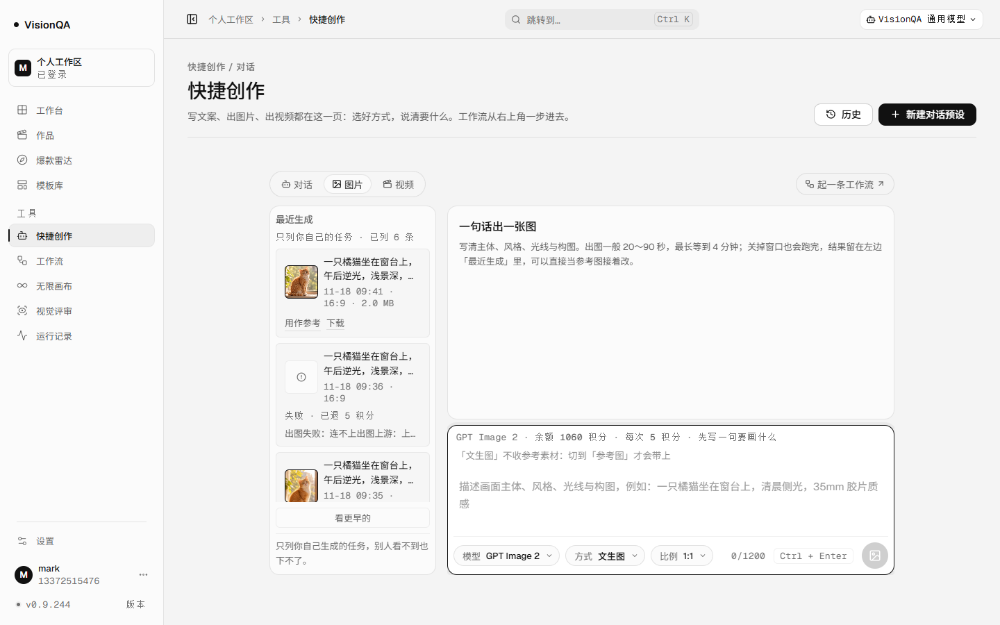
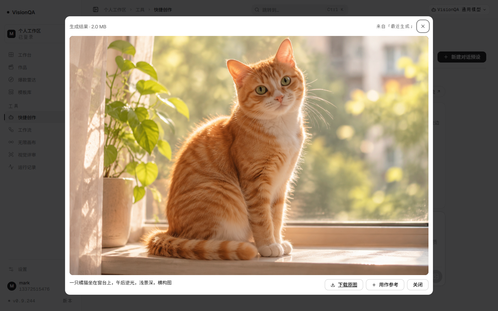
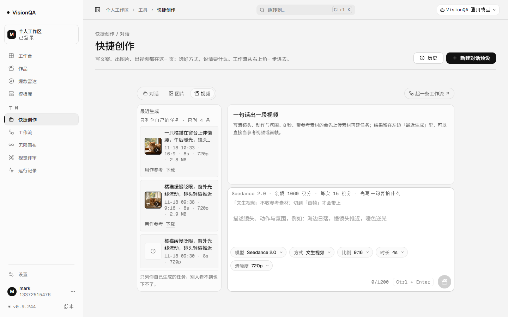
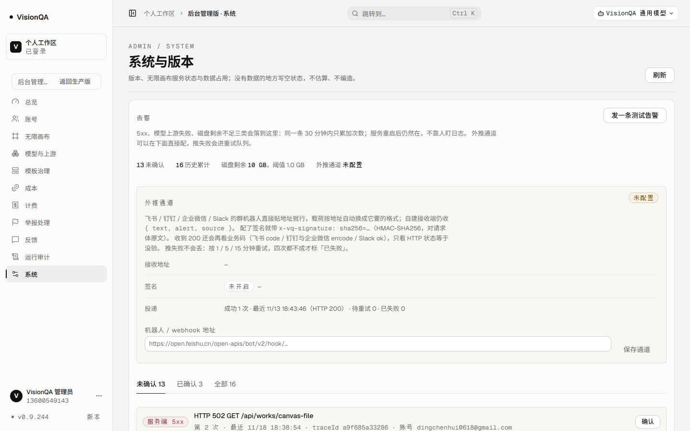
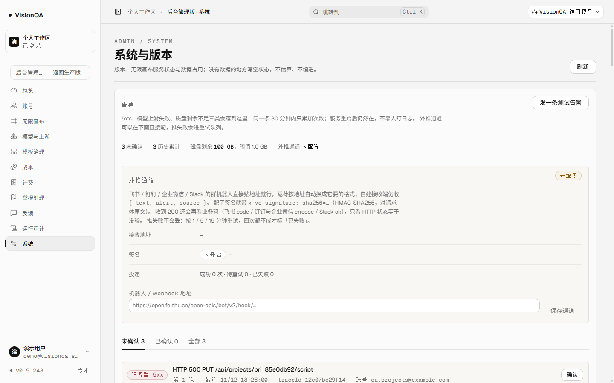
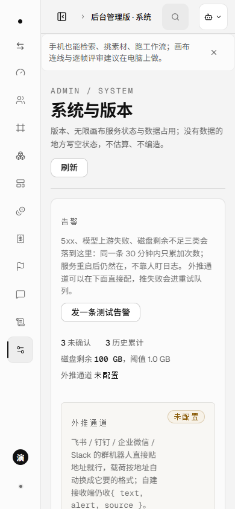

# 最近生成带缩略图 + 后台字号地板抬到 13px（r261 / v0.9.244，2026-11-19）

## 一、这轮修的是什么

用户第 4 条「字体这种都有点小了 放大点 至少让我看得清楚字是啥」还差两块没扫完，顺手把 r260 留下的边界补上：

| 问题 | 之前 | 现在 |
| --- | --- | --- |
| 左边「最近生成」只有文字 | 想找一张图得挨条读提示词，长提示词两行还被截断 | 每条左边一块 48×48 缩略图，点它开同一个看大图浮层 |
| 从「最近生成」里看大图 | 只能先「打开这一条」换到右边，再点「看大图」 | 缩略图直接点开，浮层头行标注「来自「最近生成」」 |
| 后台正文小字 | 24 处 12px、2 处 11.5px、1 处 12.5px | 全部 13px（与用户侧 `--text-2xs` 同一档） |
| 后台输入框 / 下拉 | 30–32px 高，点起来局促 | 36px（7 个控件） |

## 二、缩略图怎么来的（没有新接口）

- 图片：``，就是结果文件本身，`loading="lazy"`。
- 视频：`<video preload="metadata" muted>`，`loadedmetadata` 后把 `currentTime` 设到 0.1 秒——浏览器只拉头部那段数据就能画出一帧当封面，不下载整条片子，也没加服务端海报接口（生产没有 ffmpeg）。
- 失败 / 进行中的行：同一个尺寸的占位块（失败是警示图标、进行中是时钟），列表不会因为有的行没图而错位。
- 缩略图是「看大图」的按钮，右边文字那半仍然是「打开这一条」——是兄弟节点，点哪儿都不会误触另一个。

## 三、浮层改成「正在看哪一条」

r260 的浮层是布尔值 `lightbox`，默认看的永远是右边结果区那条。r261 起改成 `zoomTask: MediaTask | null`：

- 结果区缩略图 / 动作栏 → `setZoomTask(task)`
- 最近生成缩略图 → `setZoomTask(item)`
- 浮层渲染条件 `zoomTask && !hidden && zoomTask.status === 'succeeded'`
- 切页签时 `hidden` 变 true，新加的 effect 把 `zoomTask` 清掉：两个面板都挂着只隐藏，浮层留在屏幕上会盖住刚切过去的那一页。

## 四、量出来的数（临时实例，真实渲染）

| 视口 | 行数 | 缩略图 | 行内裁切 | 整页横向溢出 | 点开浮层里的图 |
| --- | --- | --- | --- | --- | --- |
| 1440×900 | 7（含 2 条占位） | 48×48 | 无 | 1440 = 1440 | 692×692（原图 1024²），卡片 718×806 |
| 1024×768 | 5 | 48×48 | 无 | 1024 = 1024 | 560×560，卡片 586×711 |
| 390×844 | 5 | 48×48 | 无 | 390 = 390 | 356×356，卡片 374×495，三个按钮都在屏内 |

浮层：`position: fixed`、`z-index: 70`、头行「生成结果 · 67.4 KB｜来自「最近生成」」、焦点落在关闭、Esc 关掉后 DOM 里没有 `.agx-lightbox`。

视频缩略图实测两行都是 `readyState 4`、`currentTime 0.1`、`videoWidth/Height 640×360`（样例片源），点开浮层里 `readyState 4`。

**生产同一套数字（真实账号、真实作品）**：

| 项 | 生产实测 |
| --- | --- |
| 清单 | 6 条：2 条真图（1536×1024、1024×1536），4 条失败行留占位块，行内不裁切、页面 1440 = 1440 |
| 缩略图 | 48×48；点开浮层里 **1038×692**（原图 1536×1024），卡片 1064×806，整张在窗口内 |
| 视频缩略图 | 两条都是 `readyState 4`、`currentTime 0.1`，源片 1280×720 与 720×1280 |
| 视频浮层 | 1094×615（源 1280×720），卡片 1120×729 |
| 后台 | 最小字号 13px，小于 13px 的元素 0 个，页面 1440 = 1440，版本 v0.9.244 |

## 五、后台字号体检

`src/styles/console.css`：12px / 11.5px / 12.5px 共 27 处 → 13px；30/32px 的 7 个输入框与下拉 → 36px（`.admin-edit-field input/select`、`.admin-search input`、`.admin-usage-range .vq-input`、`.admin-run-filter select`、`.admin-audit-input`、`.admin-report-actions .admin-input`）。

实测（后台「系统」页，逐元素算 computed font-size）：

| 视口 | 最小字号 | 小于 13px 的元素 | 整页横向溢出 |
| --- | --- | --- | --- |
| 1440×900 | 13px | 0 | 1440 = 1440 |
| 390×844 | 13px | 0 | 390 = 390 |

## 六、踩到的三个坑

1. **`flex: 1 0 100%` 和缩略图不能共存**：`.agx-media-recent-open` 原来整行铺满（提示词另起一行）。加缩略图时必须外面包一层 `.agx-media-recent-body`（`flex: 1 0 100%`）再把它改成 `flex: 1 1 auto; min-width: 0`，否则 48px 缩略图那行会被文字挤成两半。
2. **点在隐藏面板里的缩略图上**：图片、视频两个面板都挂着，`querySelectorAll('.agx-media-recent-thumb')[0]` 拿到的是**图片面板**里那张。点了之后 `zoomTask` 确实被设上，但渲染条件 `!hidden` 把它拦住了——屏幕上什么也没发生。探针必须写成 `.agx-media-panel:not([hidden]) .agx-media-recent-thumb`（与 r260「两个浮层同时在 DOM 里」是同一类坑）。
3. **视频封面要手动 seek**：无头 Chrome 的后台标签页不会自己解码视频帧，`preload="metadata"` 之后仍是一块黑。`loadedmetadata` 后设 `currentTime = 0.1` 才画得出来。

## 七、门禁与上线

- 测试 1713/1713（`quick-composer-unified` 8→9 条，新增「最近生成带缩略图，点开是同一个看大图浮层」）
- lint 0 error / 25 warning（626 文件）、`tsc -b` 干净、`npm run build` 入口 `index-DX7ItUW3.js`、密钥扫描 1000 文件无命中
- 生产 0.9.244：`/api/version` 本地与公网都是 `0.9.244`、health ok templates 26、服务 active、磁盘 73%；发布标签 `20261119-083653-20261119-1636-r261recent`，`ops/rollback.sh --to 1` 回 `20261119-074204-20261119-1540-v0.9.243-l`（0.9.243）

## 八、边界

- 缩略图是 48×48 居中裁切，不是等比缩略；视频封面取第 0.1 秒那一帧，暗场片子可能是一块深色。
- 浮层仍只支持看：没有缩放、拖动、左右翻；作品流页的封面还没接这个浮层。
- 后台字号抬到 13px 是「看得清」的地板，不是整体排版重做；后台大表格仍是容器内横向滚动（按设计）。
