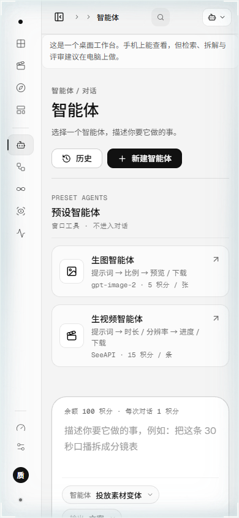
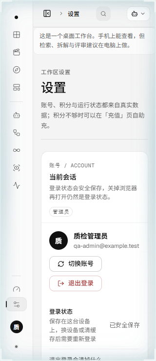
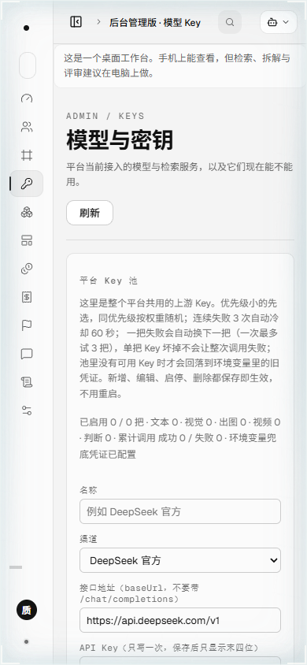

# 窄屏三处截断与溢出（v0.9.184，2026-11-18）

## 怎么找的

不靠“看着像有问题”，而是按数字扫：390 与 320 两个宽度，逐屏打开 11 个后台分节（总览 / 账号 / 模型 Key / 模型与上游 / 模板治理 / 成本 / 计费 / 举报处理 / 反馈 / 运行审计 / 系统）与 10 个用户页面（工作台 / 作品 / 发现 / 模板库 / 智能体 / 工作流 / 无限画布 / 视觉评审 / 运行记录 / 设置），每条记录两类：

- **越出视口**：元素右边界 > 视口宽 + 1，且它的祖先里没有 `overflow-x: auto|scroll`（在横向滚动表格里的不算，那是设计）；
- **被裁掉的文字**：`overflow-x: hidden` 且 `scrollWidth > clientWidth`、里面真有字。

同时读 `.vq-content` 的 `scrollWidth / clientWidth`：这是“整块内容能不能横向拖”的判据。

## 三处问题与根因

| 位置 | 修前实测 | 根因 |
| --- | --- | --- |
| 智能体页「生视频智能体」卡片说明 | 390 宽说明列只有 184px，`提示词 → 时长 / 分辨率 → 进度 / 下载` 被省略号截成 `…进度 / 下…`；320 宽 114/204（截掉 90px） | `.agx-preset-copy span` 是 `white-space: nowrap` + `text-overflow: ellipsis`。桌面上把鼠标停在卡片上还能读到，手机上根本没有 hover |
| 设置页账号卡（退出登录 / 退出其它设备） | 320 宽内容区 301/252，横向多 49px，整页能左右拖 | `.vq-card-head` 是 `display: flex` 且不换行，两个按钮按内容宽度排在标题右侧，把卡片顶出视口 |
| 后台「模型与密钥」页 | 390 宽内容区 332/322（多 10px）；320 宽 332/252 | `.admin-edit-field` 的栅格列是默认 `auto`，取子元素最大内容宽度——下拉框按最长选项算出 299px，字段只有 256px；另外网关地址是一整条没有空格的 URL，也不换行 |

## 改了什么（只动 CSS，不动 DOM、不加接口）

1. `src/styles/agents.css`：`≤720px` 时说明改为 `white-space: normal; overflow: visible; text-overflow: clip`，宁可多一行，也不截字。
2. `src/styles/shell.css`：`≤640px` 时 `.vq-card-head` 与 `.vq-account-actions` 允许 `flex-wrap: wrap`，按钮换到下一行。
3. `src/styles/console.css`：`.admin-edit-field` 的列改成 `minmax(0, 1fr)`（列跟着容器走，不跟着最长选项走），`select` 加 `max-width: 100%; min-width: 0`；`.admin-doc-row code` 加 `overflow-wrap: anywhere`。

## 验收（同一份 dist + 临时实例 + 无头 Chrome）

| 页面 / 宽 | 修前 | 修后 |
| --- | --- | --- |
| 智能体 390 | 说明 184/204，被省略号截断 | 换行成两行，截断 0 |
| 智能体 320 | 114/204、114/156 | 截断 0 |
| 设置 320 | 内容 301/252 | 252/252 |
| 后台 模型与密钥 390 | 332/322 | 322/322 |
| 后台 模型与密钥 320 | 332/252 | 252/252 |
| 后台 模型与上游 / 账号 390 | 322/322 | 322/322（未受影响） |
| 后台 模型与密钥 1440 | 1362/1362 | 1362/1362（桌面未变） |

修后同一轮扫描里，10 个用户页面与 11 个后台分节在 390 / 320 两个宽度都满足：`documentElement.scrollWidth == innerWidth`、内容区 `scrollWidth == clientWidth`、非滚动容器内没有元素越界、没有被 `overflow: hidden` 截掉的文字（`cv-sr-only` 这类给读屏用的 1px 元素除外）。

## 边界

- 只量了 320 / 390 / 1440 三个宽度；平板宽度（768 左右）没逐屏扫。
- 后台的大表格仍然是“容器内横向滚动”，这是设计，本轮没改。
- 两处都是纯 CSS，没有新逻辑，所以没有新增单测；判据是扫描数字与上面的截图。
- 截图来自临时实例（临时 `DATA_DIR` + 本地造的账号，域名用保留域 `example.test`），与生产同一份构建；截图里没有真实账号、手机号或真实邮箱。
