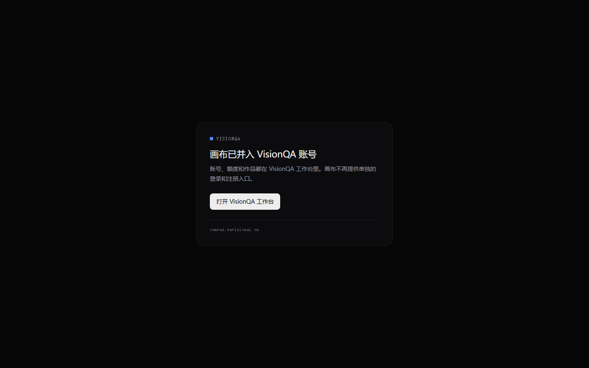
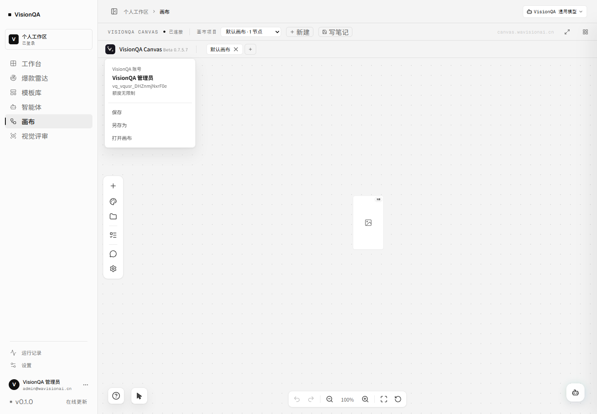
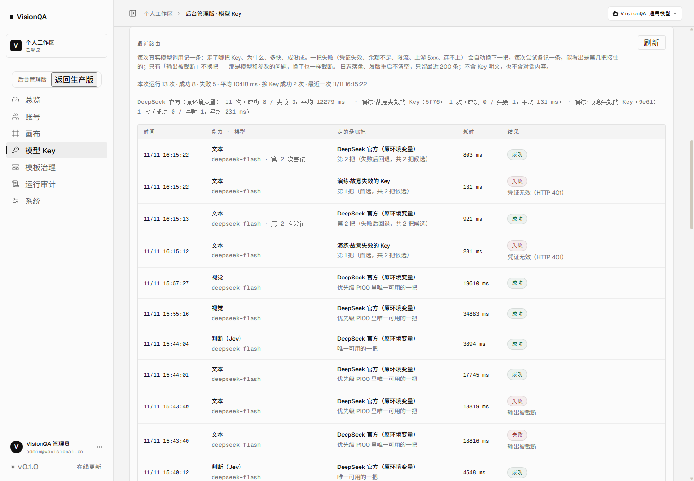
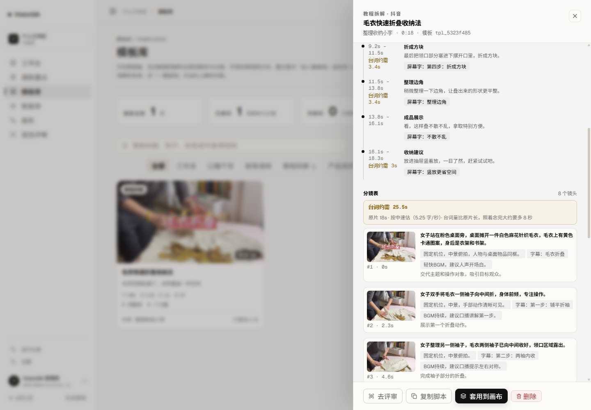
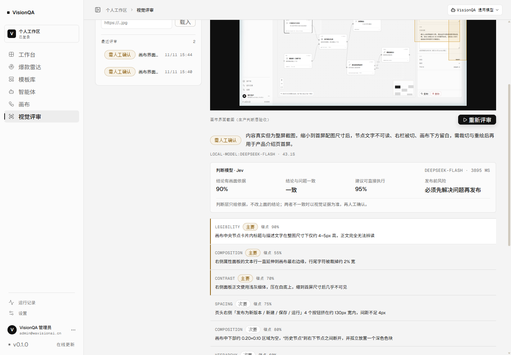

# VisionQA 平台化目标 · 验收记录

日期：2026-11-11 · 目标：「把 VisionQA 做成自有账号与自有 Key 的平台」
（①统一 VisionQA 账号登录画布 ②可扩展平台 Key 接入与路由 ③审阅 hypit 并评估融入复刻链路
④评估并把 Jev 类判断模型接入视觉评审），要求每一步都有可验证的线上结果。

## 一、结论

四项都在生产 https://visionqa.wavisionai.cn 上有可复跑的线上证据，本文逐项列出证据、数字与复验方式。
两件**需要业主出钱 / 出凭据**的事仍然待决定（hypit P0-2 是否单开 worker、是否再买一家文本供应商），
它们不改变「平台已经能用自己的账号和 Key 跑起来」这个结论：
① 账号已统一、② Key 池与回退已上线并演练、③ 语义层已融入且 P0-2 已给出实测结论、
④ 判断层已点亮并产出真实判断。

## 二、① 统一用 VisionQA 账号登录画布

| 检查 | 线上结果（2026-11-11 复核） |
| --- | --- |
| 独立打开画布 | 只剩「画布已并入 VisionQA 账号 / 打开 VisionQA 工作台」的门；**企业登录按钮 0 个**、无登录弹窗、无注册入口 |
| 画布会话来源 | 画布内 GET /enterprise/api/auth/me → 200，用户「VisionQA 管理员」，用户名 vq_vqusr_DHZnmjNxrF0e，bd-enterprise-trust = visionqa |
| 画布头像菜单 | 只有「VisionQA 账号 / VisionQA 管理员 / 额度由 VisionQA 统一管理」；登录 / 注册 / 退出条目 **0 个**，iframe 内也不再出现那道门 |
| 票据接口 | GET /api/canvas/session-token → 200，JWT iss=visionqa、aud=bd-canvas、role=admin、TTL 120 秒；匿名访问 **401 未登录** |

## 三、② 平台 Key 接入与路由

| 检查 | 线上结果（2026-11-11 复核） |
| --- | --- |
| 池内 Key | 2 把：DeepSeek 官方（text/vision/judge，P100）、SeeAPI（image/video，P10）；列表只回脱敏值 |
| 增删改 | 演练中通过管理接口新建 / 删除一把 Key（200），预演随之从 P0 回到 P100；后台有启停、编辑、测通 |
| 路由判定 | 四种能力预演都指向正确 Key（text/vision/judge → DeepSeek，image → SeeAPI） |
| 故障回退 | 生产演练：P0 坏 Key 凭证无效 401 · 131 ms → P100 真 Key 成功 · 803 ms；对话正常回「收到」，换 Key 成功 1 → 2 |
| 权重 | 预演写 25% / 75%，本地 2000 次实测 25.3% / 74.7% |
| 路由日志 | 落盘、发版不清空；最近 13 次调用 8 成功、5 失败（含截断与演练），平均 10418 ms |

细节与未验项见 [key-failover.md](key-failover.md)。

## 四、③ 审阅 hypit 并评估融入复刻链路

| 检查 | 结果 |
| --- | --- |
| 审阅 | [docs/research/hypit-2026-11-11.md](research/hypit-2026-11-11.md)：产品定位、模块、商业授权（已到位）、能否自托管、Provider 依赖 |
| 已融入（P0-1） | 语速口径整段换成 vendor 的 @hypit/speech-estimate@0.1.1 密度表（zh 4.2/5.25/6.5625，en 按音节），语速档位跟 analysis.pacing 走 |
| 线上效果 | 模板 tpl_5323f485：台词约需 **25.5 秒** / 原片 **18 秒**，fit=tight、多出 7.5 秒、8 镜 7 个偏多；抽屉与「复用此模板」提示词都带逐段对账 |
| 存量数据 | scripts/recalc-timing.mjs 不用重跑复刻就能按新口径重算（生产已执行，改前有备份） |
| P0-2（CLI 借壳）评估 | 生产机 Node v22.12.0（要求 ≥22.15）、无 Chromium、1.8 GB / 2 核、无 Provider 凭证（HypiHub/HiAPI/Pollo）→ **装上也跑不出一次真实 build**，故不硬装；要做得单开 worker 并买额度，属业主决策 |

详见 [timing-estimation.md](timing-estimation.md)。

## 五、④ Jev 类判断模型接入视觉评审

| 检查 | 线上结果 |
| --- | --- |
| 判断层状态 | GET /api/review/health → judge: {configured:true, provider:deepseek, model:deepseek-flash, protocol:chat} |
| 真实判断 | 生产评审 43.1 秒，其中判断 3.9 秒；四个判断（依据 / 一致 / 可执行 / 风险）都有值 |
| 判断失败不拖垮评审 | 视觉模型全挂时明确失败并退积分，不再静默回退纯文本给假结论 |
| Jev / TypeSafe 评估 | SystemOne 协议已在 judge.mjs 里实现；生产取不到 TypeSafe（HTTP 451 地区限制），故用 DeepSeek 的 chat 协议落地判断层 |

## 六、还没做 / 不做的，以及为什么

| 项 | 状态 | 原因 |
| --- | --- | --- |
| hypit P0-2 真出片 A/B | 未做 | 生产机硬件与 Node 版本不达要求，且没有 Provider 凭证；要单开 worker + 买额度，需业主决定 |
| hypit P0-3 出片结果回灌评审 | 未做 | 依赖 P0-2 |
| 真实多供应商回退 | 未验 | 文本只有 DeepSeek 一把能真调用；回退演练用的是故意失效的 Key。要证明「A 家挂了走 B 家」需再买一家文本额度 |
| SeeAPI 真出图 / 出视频 | 未验 | Key 额度为 0（HTTP 402），补额度后即可验 |
| 权重真实命中比例 | 只有本地 2000 次抽样 | 生产流量太小，长时间统计暂无意义 |

## 七、怎么复验（可复制）

    curl -s -o /dev/null -w '%{http_code}' https://visionqa.wavisionai.cn/api/canvas/session-token   # 401
    curl -s https://visionqa.wavisionai.cn/api/review/health

- ① 画布：独立打开 canvas.wavisionai.cn 看那道门；工作台 → 画布 → 点头像看是否只有 VisionQA 账号。
- ② Key：后台 → 模型 Key，看池内两把、预演、最近路由与「换 Key 成功」计数。
- ③ 时长：模板库 → 打开「毛衣快速折叠收纳法」，看台词约需 25.5s / 原片 18s。
- ④ 判断：后台 → 模型 Key 里 DeepSeek 那把的「测试」，或对一张图跑一次视觉评审看四问。

单元与集成测试：node scripts/test-keyvault.mjs、test-model-routes.mjs、test-chatcall-failover.mjs、
test-key-weights.mjs、test-gateway.mjs、test-judge.mjs、test-speech.mjs、test-canvas-session.mjs、
test-canvas-admin.mjs、test-model-keys-e2e.mjs。
