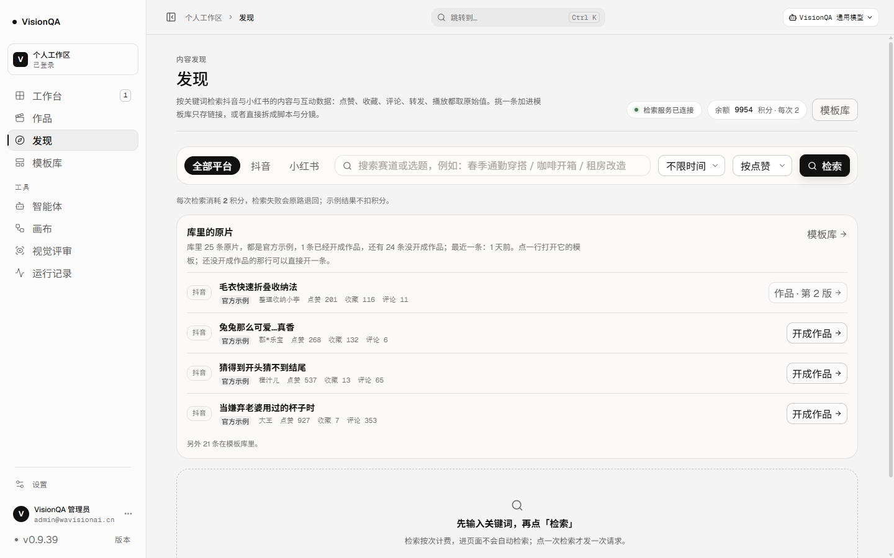
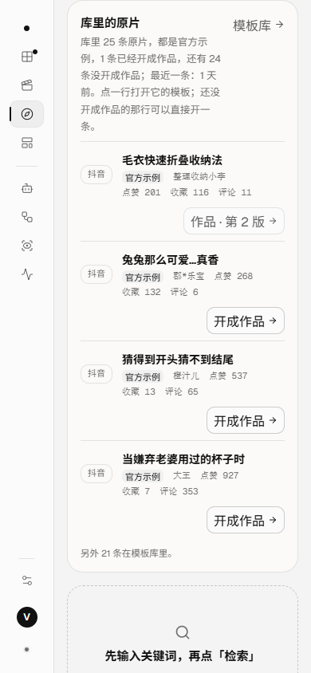
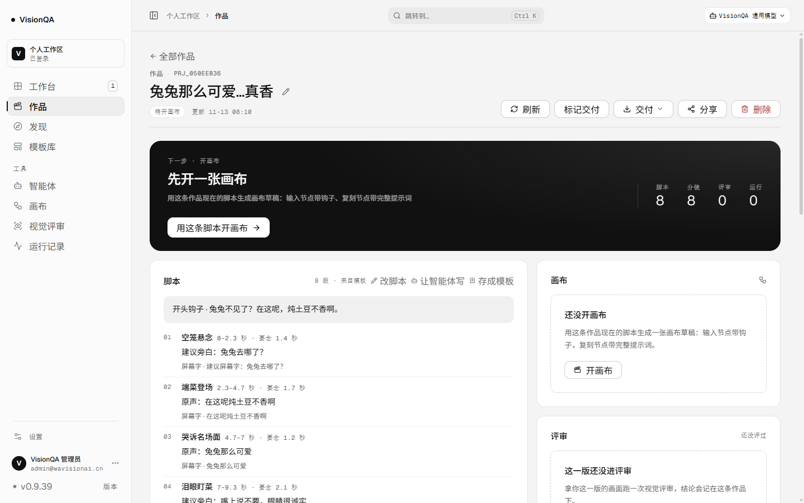
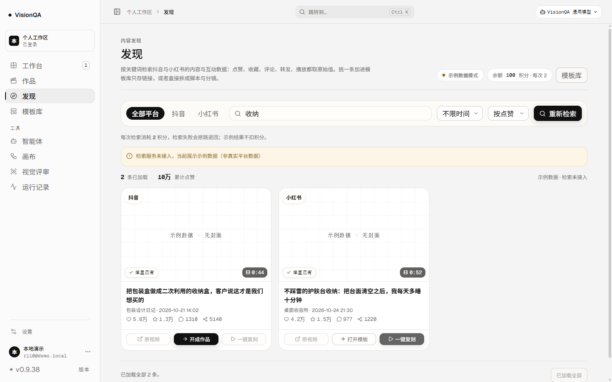
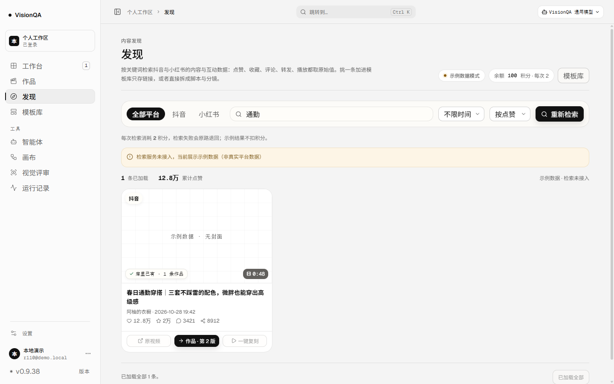
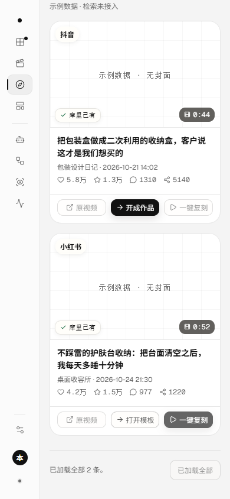
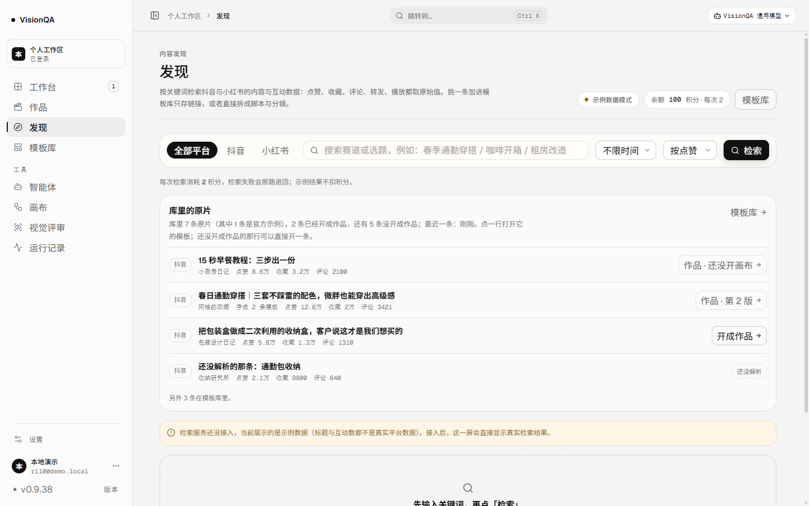

# 「开成作品」：原片往下走的一步（v0.9.39）

版本 0.9.39 / 发布包 `20261113-000948-2026-11-13-origin-entry.tar.gz` / 入口 `index-BbqLyg6N.js`（503,007 字节）

结论：直到 v0.9.38，发现页的两条路都停在「看得见」——库里已经收录的原片只写着一句
「**都还没开成作品**」，没有下一步可点；检索卡片命中后只给「打开模板」，真要做起来还得绕回模板库、
找到那条模板、再点「用它做作品」。这一轮把那句「还没开成作品」变成一枚按钮：**开成作品**——
照这条模板开一条作品，脚本与分镜跟着走，建完直接进作品页。已经开过作品的，下一步是那条作品本身。

## 一、口径：下一步是什么，由服务端算（server/origin-entry.mjs）

一条原片/一条模板的下一步只有三种，界面照着渲染，不自己判断：

| kind | 什么时候 | 给什么 |
| --- | --- | --- |
| `open-work` | 这条原片已经开出作品 | 「作品 · 第 N 版」→ 进那条作品（`projectId`） |
| `create-work` | 还没开过，且模板已解析出脚本与分镜 | 「开成作品」→ 照这条模板建一条，进作品页 |
| `blocked` | 只存了原链接（雷达「加入模板库」下来的 `kind: saved`） | 「还没解析」，点不动，理由指向模板里的「去解析这条」 |

两条硬规则：

- **能不能开作品只在一处判断**：`canStartProject(template)` 同时被界面与 `POST /api/projects` 使用。
  以前是作品页那条路由里的一段内联判断（`kind === 'saved' || 没脚本没分镜` → 400 `TEMPLATE_UNPARSED`），
  界面只能等用户点了才知道不行。现在把同一句判断提到 `origin-entry.mjs`，两边读同一份。
- **已经有作品的，下一步是作品，不是再开一条**：重复开作品不是「向前走」。
  版本 0 是「照模板开了作品、还没开画布」，写「作品 · 还没开画布」，不写「第 0 版」（与 v0.9.30 同一口径）。

官方示例的 hint 会写明「官方那条不动」，不冒充是你带回来的。

## 二、两个界面

1. **发现页 · 库里的原片**：每一行右边都有下一步——
   已经开过的「作品 · 第 2 版 →」、能开的「开成作品 →」、还没解析的一枚虚线「还没解析」。
   开场那句也多一个按**全部原片**算的数：`还有 24 条没开成作品`（不是只算列出来的 4 行）。
2. **发现页 · 检索卡片**：命中之后第二格直接给下一步（「开成作品」/「作品 · 第 N 版」），
   **一张卡片只有一个主按钮**：已经在库里、下一步清楚的，主按钮让给下一步，「一键复刻」降成次要动作；
   还没解析的仍排在「打开模板」那一格（点进去就是「去解析这条」）。

接口：`GET /api/taken-origins` 每一行多一个 `entry`、汇总多一个 `pending`；
`POST /api/library/marks` 每条命中多一个 `entry`（与「库里的原片」同一句）。
都只读现算，不检索、不扣积分；`POST /api/taken-origins` 405、未登录 401。

## 三、顺手修的三处

- **复刻完成，卡片没翻成「库里已有」**：以前存完只刷新了开场那块，卡片第二格还是「加入模板库」，
  再点一次只会被去重成一句「这条已经在模板库里了」。现在存完/复刻完都按平台 id 再问一次服务端。
- **检索费用那句话被拆成三列**：`.radar-credit-note` 是 `display:flex`，一句话变成三个格子，
  390 宽下读起来是「每次检索 / 2 积分 / 检索失败会原路退回」。改成一句正常的句子。
- **一行里两个箭头并排**：行尾本来有个「打开模板」的箭头，右边现在多了「开成作品」。
  行尾箭头改成指着这一行时才亮（保留位置不跳），静止时一行只有一个方向。

## 四、验收

- 生产 **v0.9.39**、入口 `index-BbqLyg6N.js`（503,007 字节）、release `20261113-000948-2026-11-13-origin-entry.tar.gz`、
  `/api/version` 0.9.39、`/api/health` ok（templates 26）、`visionqa` 与 `visionqa-internal` 两服务 active。
- 生产 `GET /api/taken-origins?limit=6`：**25 条原片 · 1 条已开成作品 · 还有 24 条没开成**；
  第一行 `tpl_5323f485` → `open-work`「作品 · 第 2 版」（prj_f38d68c6）；
  其余四行都是官方示例 → `create-work`「开成作品」，hint 写明「官方那条不动」。
- **生产一次可逆写入**：点第二行「开成作品」→ 建成 `prj_050eeb36`《兔兔那么可爱…真香》
  （8 段脚本从模板带过来，下一步「先开一张画布」）→ 截图 → `DELETE /api/projects/prj_050eeb36` 归零。
  核对截图前后 `/api/projects`、`/api/templates`、`/api/flows` 的 id/version/updatedAt **完全一致**（1 / 26 / 7），
  删完 `taken` 回到 1 条已开成作品、24 条没开。
- 生产 `POST /api/library/marks` 用 `tpl_5323f485` 真实的平台 id → `open-work`「作品 · 第 2 版」+
  `project: prj_f38d68c6 v2`；用另外三条没作品的 → `create-work`「开成作品」；未登录 401、GET 405。
- 1440 与 390：发现页 `scrollWidth == clientWidth`（1440/1440、390/390）；
  390 下每一行折成「标题 / 互动数 / 下一步」三行，按钮右对齐，不自叠。
- 本地演示数据（非生产，示例数据、不扣积分）：7 条原片 · 2 条已开成作品 · 还有 5 条没开成，
  四行分别是「作品 · 还没开画布」「作品 · 第 2 版」「开成作品」「还没解析」（最后一行虚线）；
  检索「收纳」两条卡片：一条主按钮是「开成作品」，另一条（只存了链接）仍是「打开模板」+ 一键复刻；
  检索「通勤」主按钮是「作品 · 第 2 版」；点「开成作品」落到 `#/projects/prj_2155cc37`，脚本 2 段跟着来。
  390 上「库里已有」胶囊与右下角时长互不重叠（实测不相交）。
- `npm test` **380/380**（新增 `test/origin-entry.test.mjs` 11 条）、oxlint **0 error / 6 warning**（既有文件）、`tsc -b` 干净。

## 五、截图

## 六、边界

- **这一轮没有发起真实检索**（按次 2 积分）：卡片的下一步在本地示例数据上验，
  生产用真实平台 id 直接打 `/api/library/marks` 验。
- 点「开成作品」是一次**真写入**（建一条作品）。作品只绑模板、不复制脚本分镜；
  建完的下一步（开画布）由作品页统一给，发现页不另写一套。生产上这次写入当场删净并核对过。
- 「还没解析」的条目不改：解析要抽帧与视觉模型，这一轮不给它一条假出口。
- 不判断「这条内容值不值得做」，只回答「下一步点哪里」。

## 七、提交与 CI

- `a39f29b`（代码 + 测试）：口径 `server/origin-entry.mjs`、两个接口、发现页两处界面、三处顺手修。
- `6b65b81`（文档 + 截图）：这一页、README 第一百零八节、产品结构文档 v0.9.39 块、7 张截图。
- CI `43335216601` **success**（6b65b81）。
