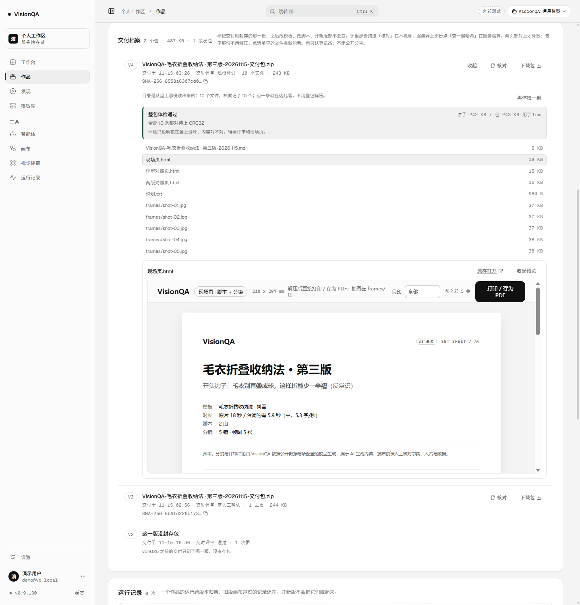
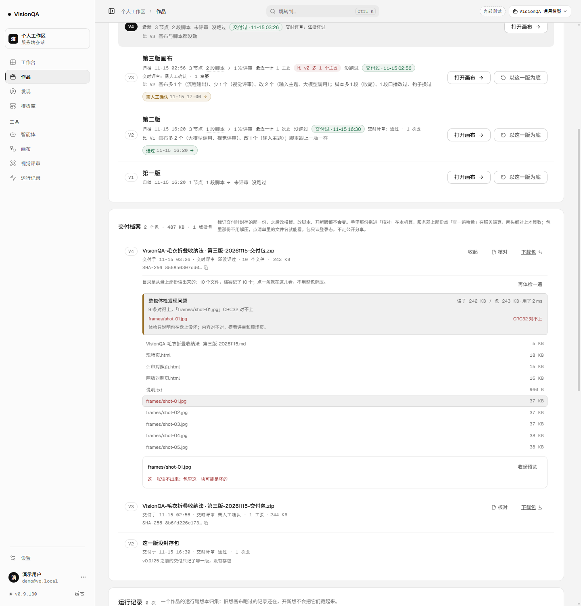
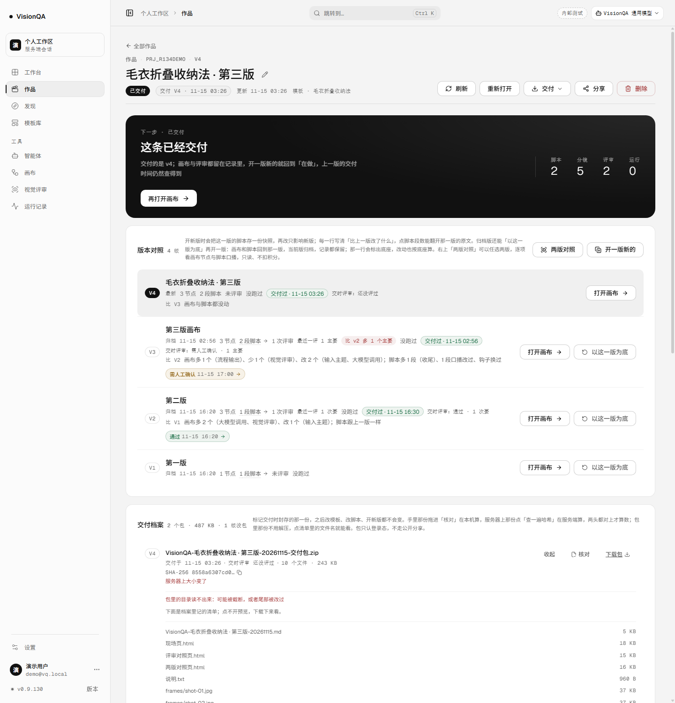

# 整包体检：封存包还靠不靠得住，点一下数给你（v0.9.130，2026-11-15）

上一版能点开包里那一份，但「点得开一条」不等于「整份包还好」：十条要一条条点，而且预览是把整包读进内存再切一条。封存包是交付凭据，最该一句话回答的是——这份包现在坏没坏、坏在哪一条、盘上这份跟当初封存的那份差多少。

## 做法

- **按偏移读包**：`server/zip-read.mjs` 把「读」抽成一层源——内存里的整份，或盘上的只读句柄。列目录只读尾部 EOCD 与中央目录；取一条只读这一条的本地头加数据；体检逐条走，内存里最多一条。原来的 `readZipDirectory` / `readZipEntry` 保持不变，新增 `readZipDirectoryAt` / `readZipEntryAt` / `verifyZipAt`。
- **一个只读路由**：`GET /api/projects/:id/delivery-packages/:pid/verify`。打开句柄 → 读中央目录 → 逐条解开、重算 CRC32 与目录里记的比 → 关句柄（`finally`）。返回 `{ ok, state, total, passed, skipped, budgetBytes, failed[{ name, bytes, reason }], bytes, readBytes, ms, manifest }`。
- **坏法分开说**：`crc` / `truncated` / `encrypted` / `method` / `too-large` / `unreadable`，不混成一句「失败」；清单里坏的那几条同时标红。
- **预算**：单条 32 MB、整包 64 MB 之外，体检另记一个「解开过多少字节」的总预算 128 MB。条目小、条数多也能撑爆内存，所以超了就把剩下记 `skipped`，明说没走完，不装作都对得上。
- **界面**：清单头右侧「体检整包」。结论块绿 / 黄 / 红三档，写清「全部 10 条都对得上 CRC32」或「9 条对得上，『frames/shot-01.jpg』CRC32 对不上」，并带「读了 242 KB / 包 243 KB · 用了 2 ms」；目录读不出来时不给体检按钮，不做无意义的尝试。
- **只读**：不解压到磁盘、不缓存结果、不改档案、不修文件；封存包仍只认登录态。

## 本地实测（真 Chrome + 真本地服务 + 真磁盘文件）

| 场景 | 读数 |
| --- | --- |
| 夹具 | `prj_r134demo` v4 封存包 248,643 B / `8558a6307cd0…`，10 个条目 |
| 体检接口 | `ok`、total 10、passed 10、skipped 0、readBytes 247,743、2 ms；POST 405、未登录 401 |
| 界面（完好） | 绿边「整包体检通过」「全部 10 条都对得上 CRC32」「读了 242 KB / 包 243 KB · 用了 1 ms」 |
| 改一个字节 | 黄边「整包体检发现问题」「9 条对得上，『frames/shot-01.jpg』CRC32 对不上」，清单里那一条标红；单条预览照旧 409 |
| 包被截断 | 目录读不出来 → 退回档案 10 条清单，体检按钮不再出现 |
| 权限 / 网络 | 未登录 verify 401、POST 405；功能写请求 **0**、页面异常 **0** |
| 1440 / 390 | 清单块 1004 / 224、行 1080 / 256、体检块 1004 / 239；两档 scrollWidth 都是视口宽 |
| 上游 | 0 次生成 / 评审 |

全仓 **1015/1015**（`test/zip-read.test.mjs` 新增 6 条：按句柄读目录与内存一致、整包全部通过、点名坏的那一条、截断、解开预算记 skipped、加密与认不出的压缩方式分开说），oxlint **0 error / 15 warning**，`tsc -b` 与 build 干净。入口 `index-LmLGWwsq.js`（640,883 B）、画布 `CanvasPage-D17fY_79.js`（242,019 B）、后台 `AdminConsolePage-BUpuo_wF.js`（201,070 B）、主样式 `index-A0hWW6mB.css`（310,319 B）、画布样式 `CanvasPage-BX48Ugxj.css`（28,926 B）、分享页 chunk `11,110 B`。

## 生产

生产部署 `20261114-210910-20261115-r140audit`（部署前快照 **1,082,736 B**，旧入口 `index-BX9QCvtm.js`）：四个 unit active，8799 / 8800 / 公网都 **0.9.130**，`/api/health` ok（模板 26，检查时 uptime 31s）；服务端与前端哈希全部与本地一致（zip-read `7db26070` / delivery-packages `10ff4129` / routes projects `48161f98` / health `d6e39c4e` / 入口 `359d5a52` / 主样式 `078ed014`）；未登录 verify / content / check / 封存包 / 交付包全 **401**；公网 `/` 200 · 729 B、入口 200 · 640,883 B；心跳 public 1501412 / internal 1501411，beatAt 21:09:43Z；盘 72%、`/tmp` 418M、日志无业务 error。

生产数据仍是 1 条作品、3 条评审、9 条运行、**0 条交付、0 个封存包**，所以「体检整包」在生产上没有真包可点；真包体检是本地同一份构建上验的，不是生产。零真实上游。

## 坑

- **多行锚点要照真实缩进**：这轮同一处改了两次，一次 16 空格、实际 14 空格，edit 直接找不到锚点；上一次「成功插入」之后又插了一遍，多出一行重复的 `setAudit`，是 grep 复查才发现的。改完要回头搜一遍关键字确认只出现一次。
- **`vq-mono` 会把单位变大写**：`1 ms` 渲染成 `1 MS`，读数看着像另一个量；把单位放在等宽 span 外面才对。
- **窄屏会把「数字 + 单位」拆行**：390 上 `用了 1 ms` 被拆成两行，得给元信息里每一段 `white-space: nowrap`。
- **预算要按解压后字节算**：只卡单条上限不够，条目小、条数多的包照样能把内存撑爆；体检记的是「解开过多少字节」。
- **句柄要在 `finally` 里关**：E2E 反复跑同一套流程，漏关一次就会攒一个句柄。
- **验收跑构建产物**：改完 UI 不 rebuild，E2E 里看到的还是上一版；这轮两次截图就是因为版本号/样式没进 dist 重跑了 E2E。

## 发现但没做

- `/content` 单条预览仍然把整包 `readFile` 进内存：同一层源已经写好了，下一条改成 `openDeliveryPackage` + `readZipEntryAt` 就够，这轮没顺手改，避免把「体检」和「预览」两条路一起动。
- 体检结果不落盘（每次现算，随时能看到「现在」这一份，但也没有历史）；没有定期体检 / 巡检告警；没把体检结论写进交付包或交付稿。
- 包超过 64 MB 直接 413，还没有分块续读。
- 生产 0 条交付，真包体检只有本地证据；等有真实交付后才能在生产上点一次。

## 回退

`bash /opt/visionqa/ops/rollback.sh --to 1` → **v0.9.129**；`--to 2` → **v0.9.128**。这一版只加一个只读路由、一个打开句柄的函数、一层按偏移读与一块结论；不改数据结构、不需要迁移；回退后旧前端不会请求 `/verify`。

## 提交与 CI

提交 `a8f1854`（功能、测试、文档与 4 张截图，15 个文件），CI **43641559965** 三个 job 全 success（安全扫描 / Node 22.12.0 / Node 24）。
