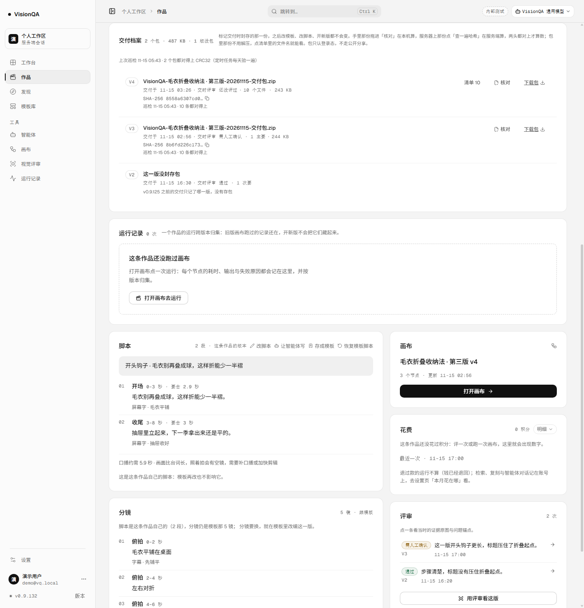
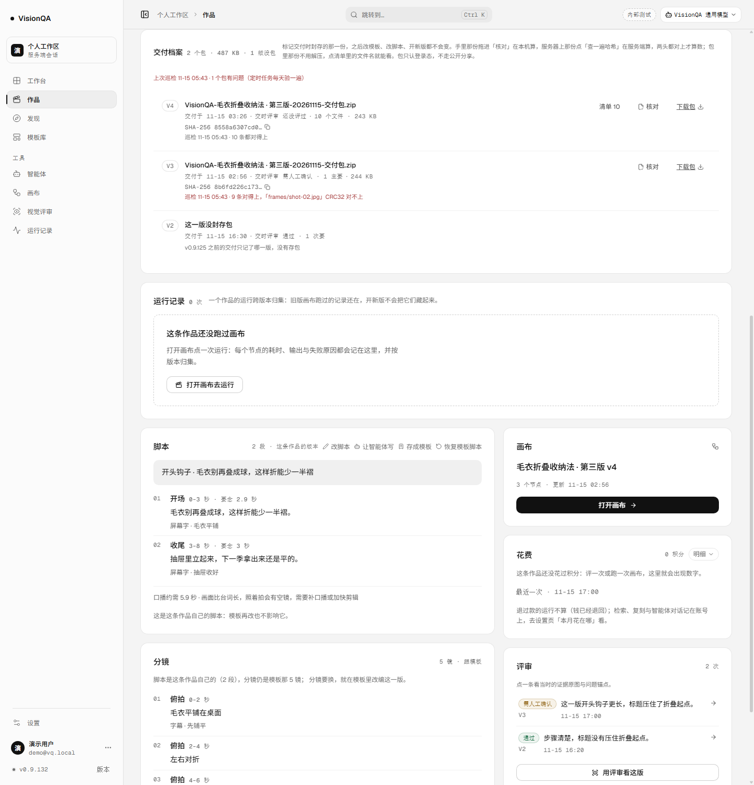
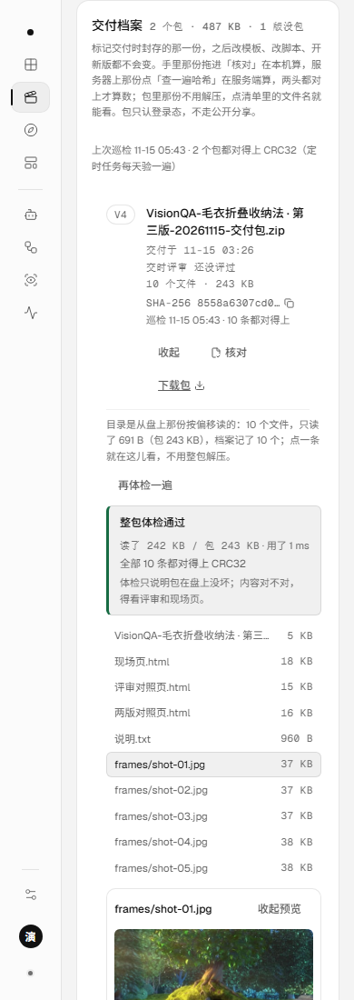

# 每天自己验一遍：封存包巡检与「上次巡检」结论（v0.9.132）

日期：2026-11-15 · 轮次：142 · 版本：v0.9.132

## 问题

v0.9.130 的「体检整包」得有人点。可封存包坏掉，多数时候不是因为有人碰它：盘坏道、
迁移时被截断、备份恢复错了版本、清理脚本误删——**没人点，就没人知道**。而封存包是交付凭据，
它出问题时最该先被看见。

这一版加的是「不需要人点」的那一半：一个每天跑的巡检脚本，把盘上每个封存包按偏移读一遍、
逐条重算 CRC32，把结论写进 `data/package-audits.json`；作品页读这份结论，在档案区顶部写
「上次巡检 …」，在每一版那一行写这一版的结论。

## 这一版怎么改

### 1. 巡检脚本（`server/package-audits.mjs` + `scripts/audit-packages.mjs`）

- 读 `projects.json`，对每条带 `package` 的交付：`openDeliveryPackage` 拿只读句柄 →
  `readZipDirectoryAt` → `verifyZipAt` 逐条重算 CRC32 → `finally` 关句柄；
- 每个包记 `state`（`ok` / `missing` / `unreadable` / `too-large`）、`ok`、`total`、`passed`、
  `skipped`、`failed[{name,bytes,reason}]`、`bytes`、`readBytes`、`ms`；
- 报告整体记 `at`、`ms`、`checked`、`problems`；写盘走「临时文件 + rename」，
  巡检跑到一半被打断不会留下半份 JSON；
- **只读包、只写这一份报告**：不碰作品、评审、账本，不解压到磁盘，也不修包；
- 退出码固定 0：某个包坏了是「结论」，不是「脚本失败」——坏没坏写在报告里；
- `--data` 指定数据目录、`--no-write` 只算不落盘、`--json` 给机器读。

### 2. 只读接口

`GET /api/projects/:id/package-audits`：登录态 + 作品归属校验，只回这一件作品的结论：

```json
{ "ok": true, "at": "2026-11-14T21:43:03.521Z", "checked": 2, "problems": 0,
  "packages": [{ "deliveryId": "81f1fbb7a92c4539", "version": 4, "state": "ok", "ok": true,
                 "total": 10, "passed": 10, "skipped": 0, "failed": [], "bytes": 248643,
                 "readBytes": 247743, "ms": 2 }] }
```

没巡检过就 `at: ""`、`packages: []`——不编一个「通过」。POST 405，未登录 401。

### 3. 界面

- 档案区顶部：「上次巡检 11-15 05:43 · 2 个包都对得上 CRC32（定时任务每天验一遍）」，
  有问题时整句转红；
- 每一版那一行（封存包才有一句）：「巡检 11-15 05:43 · 10 条都对得上」；
  坏了就写清是哪一条：「巡检 11-15 05:43 · 9 条对得上，『frames/shot-02.jpg』CRC32 对不上」；
- 没有包的旧版（v0.9.125 之前）不写这一行；
- 没巡检过（`at` 为空）时整块不出现——不拿「今天没验」冒充「验过了」。

### 4. 定时任务

`deploy/production/visionqa-package-audit.{service,timer}`，每天 04:30（备份 03:30 跑完之后），
`Persistent=true`、`RandomizedDelaySec=600`；`install-audit.sh` 幂等安装，
`scripts/deploy.sh` 里跟着发布自动装（装不上只告警、不影响发布）。

## 本地实测（真 Chrome + 真本地服务 + 真磁盘文件 + 真脚本）

夹具 `prj_r134demo`：v3 封存包 250,142 B、v4 248,643 B，各 10 条。

| 检查 | 读数 |
| --- | --- |
| 巡检脚本（两个真包） | 2 个封存包 · 都对得上 · 用了 9–12 ms；v3 10/10 读了 249,242 B、v4 10/10 读了 247,743 B |
| 报告 | `at` 有值、`checked` 2、`problems` 0；写盘后能原样读回 |
| 接口 | 只给这一件作品的 2 条；`passed` 都是 10；POST 405；作品不在 404；没巡检过回空 |
| 界面（1440） | 顶部「上次巡检 11-15 05:43 · 2 个包都对得上 CRC32（定时任务每天验一遍）」；v4 / v3 各一行「巡检 … · 10 条都对得上」；v2 无包不写 |
| 把 v3 改一个字节再巡检 | 顶部转红「1 个包有问题」；v3 那行红字「9 条对得上，『frames/shot-02.jpg』CRC32 对不上」；v4 不受牵连 |
| 复原再巡检 | 回到「2 个包都对得上 CRC32」，红行消失 |
| 不落盘 / 坏报告 | `--no-write` 不写文件；报告缺字段或 JSON 坏了，读出来是 null，不猜 |
| 390 | 顶部那句换两行仍然读得通，行内那句一行放下；`scrollWidth` 390 = 390 |
| 写请求 / 页面异常 | 功能写请求 **0**（只有前端异常上报那一条）、页面异常 **0** |

## 截图







## 生产

发布 `20261114-214549-20261115-r142audit`，部署前快照 **1,086,232 B**（旧入口
`index-DupUqULC.js`，即 v0.9.131 那一份）。四个 unit active；8799 / 8800 / 公网都 **0.9.132**；
`/api/health` ok（模板 26，检查时 uptime 20s）；本地与生产哈希一致：package-audits `ac0f8b45`、
audit-packages `96994dbe`、routes projects `8aec42a0`、zip-read `c00aa14e`、health `d6e39c4e`、
入口 `095101b3`（642,241 B）、主样式 `d76193d5`（310,617 B）；未登录 package-audits / content /
verify / 交付包全 **401**，POST package-audits 也是 401；公网 / 200 · 729 B、入口 200 · 642,241 B；
心跳 public 1502760；盘 72%、/tmp 428M、日志无业务 error。

定时任务装上并真跑过一次：`visionqa-package-audit.timer` active（下一次 2026-11-16 04:33 CST），
手动跑 `sudo -u visionqa env DATA_DIR=/var/lib/visionqa /usr/local/bin/node /opt/visionqa/scripts/audit-packages.mjs`
生成第一份报告 `/var/lib/visionqa/package-audits.json`（visionqa:visionqa）：

```json
{"version":1,"at":"2026-11-14T21:46:02.489Z","ms":1,"checked":0,"problems":0,"packages":[]}
```

`systemctl start visionqa-package-audit.service` 也走过一遍（日志里有「巡检 … 0 个封存包」、
「Finished … successfully」），说明定时任务真能跑起来，不只是文件装上了。

生产当前 1 件作品、**0 条交付、0 个封存包**，所以报告是 `checked: 0`——这是事实，不是「通过」；
真包巡检是本地同一份构建上验的（v3 / v4 两个包，坏一条点名词）。

## 坑

- **别在 GET 里写报告**：体检接口是只读的，这条不变量不能破。所以巡检是一个独立脚本
  （由定时任务驱动），接口只读它写下的那一份结论。
- 巡检结论是「最近一次」，不是审计流水：要历史就点那一版的「体检整包」，别把报告当账本。
- `vq-version-n` 的文字是 `text-transform: uppercase`，`innerText` 拿到的是 `V4` 不是 `v4`：
  E2E 里按版本号找行要忽略大小写。
- systemd 里必须写 `/usr/local/bin/node`：这台机器 `/usr/bin/node` 是旧版本，跑不了服务的模块。
- 报告存的是 UTC ISO，界面用本地时区显示——两边都写清时间，别混着看。
- 定时任务 `Persistent=true`：机器重启错过了 04:30，开机后会补跑一次。

## 发现但没做

- **没有告警**：坏了只有作品页红字与 journal 里一行，没有邮件 / webhook（告警通道本身还在等
  webhook 与 SMTP 的授权）。
- 巡检只验条目 CRC32，不重算整包 SHA-256（哈希核对仍是那一行「查一遍」手动点）。
- 巡检结论不写进交付包 / 交付稿，也不进后台系统页（只在作品页）。
- 报告只留最近一次，没有按天留档 / 趋势图。
- 生产 0 条交付，报告里 0 个包，真包巡检是本地同一份构建上验的。

## 回退

```bash
bash /opt/visionqa/ops/rollback.sh --to 1   # v0.9.131
bash /opt/visionqa/ops/rollback.sh --to 2   # v0.9.130
systemctl disable --now visionqa-package-audit.timer   # 回退后顺手停掉巡检
```

新增的是一个只读脚本、一个只读接口、一个定时任务与一块界面；不改数据结构（报告是新文件，
旧版本不读它），不需要迁移。回退后定时任务会留着但无效——停掉用
`systemctl disable --now visionqa-package-audit.timer`。

## 提交与 CI

- 功能提交 `bef854a`（13 个文件：巡检模块、CLI 脚本、两个 systemd unit、安装脚本、deploy.sh、
  路由、领域类型、接口、作品页、样式、测试、版本号）。
- 文档提交见本条记录之后的 docs 提交（README 一百九十九节、本文件与 3 张截图）。
- 测试：`node --test` 全仓 **1023/1023**（新增 5 条）；oxlint 0 error / 15 warning；
  `tsc -b` 与 build 干净；密钥扫描 705 文件 / 0。
- CI `43644630369`（`bef854a`）。

