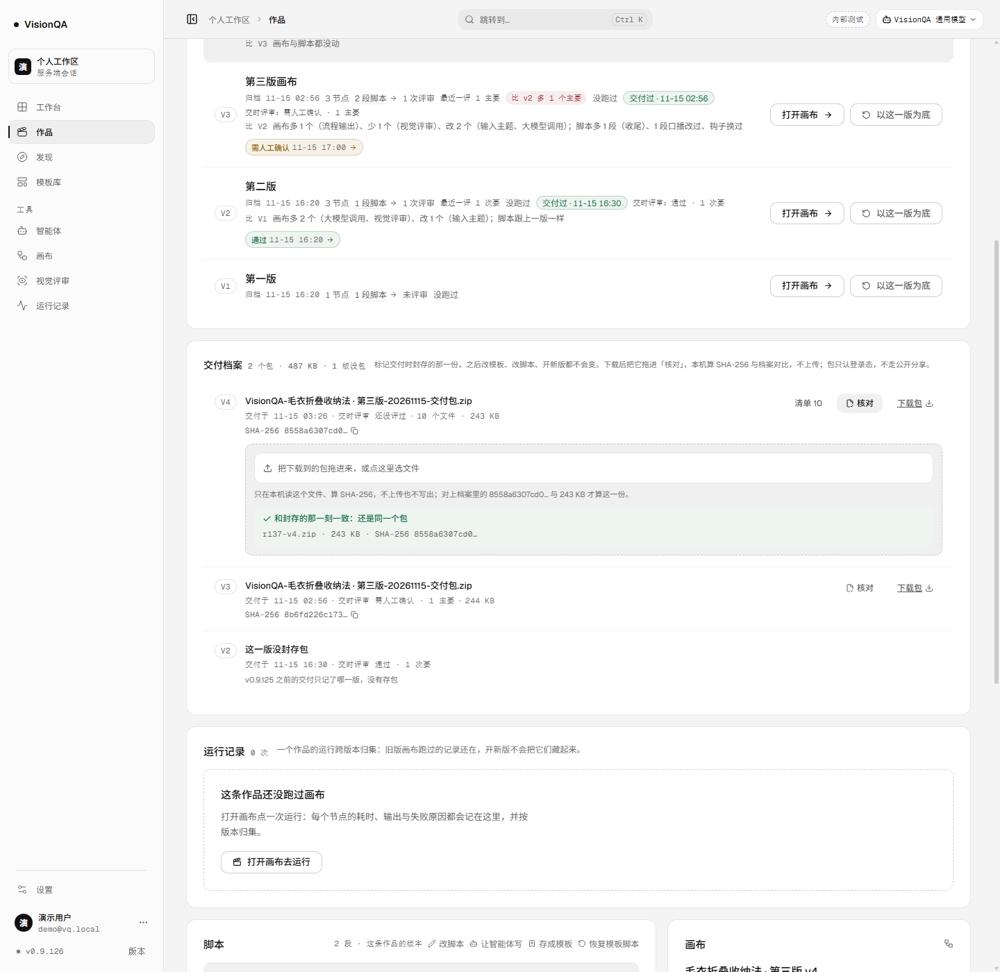
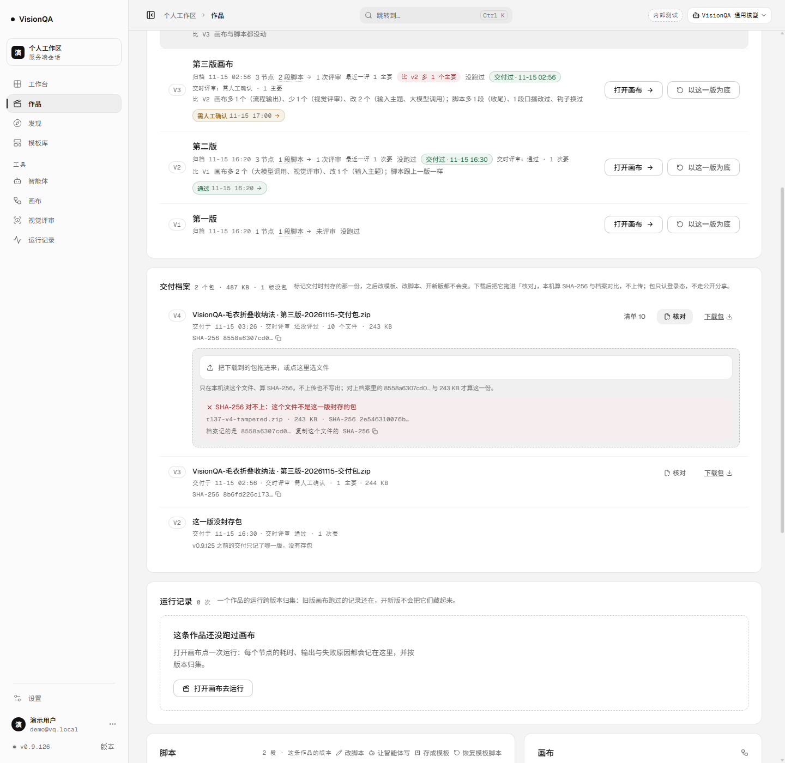
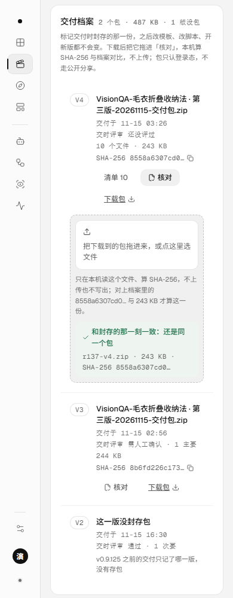

# 下载回来的包，浏览器当场就能验

2026-11-15 · v0.9.127 · 作品页交付档案

## 问题

v0.9.126 让作品页能看清单、复制 SHA-256，但核对这件事被推给了收件人：自己下载回来的包还是不是当初封存的那一份，界面没有入口。最省事的做法是加一个上传接口让服务端算哈希，但那意味着把交付包再传一遍、再存一次，还要给「上传」开一条新的受攻击面——为了一个纯本地就能回答的问题，不值得。

## 做法

浏览器本来就能读用户选中的文件，也能用 Web Crypto 算 SHA-256。于是把核对放在本机：

- **选文件**：作品页每一版封存包旁边多一个「核对」，点开是拖放区 + 文件选择；文件不出浏览器。
- **算哈希**：`sha256HexOfBytes()` 走 Web Crypto，读 `File.arrayBuffer()`，不上传、不写出、不加接口。
- **判定**：`checkPackageFile()` 分开比 SHA-256 与字节数，结论只给一句人话——对上写「和封存的那一刻一致」，对不上写「不是这一版封存的包」，大小差多少 B 也报出来。
- **失败可追**：对不上时同时显示档案值与这个文件的前 12 位，可一键复制这个文件的完整 SHA。
- **老包照样能验**：v0.9.125 封的包没有清单，但哈希当时就记了；没有清单不影响核对。
- **说清限制**：超过 64 MB 直接拒绝；非 HTTPS / 非 localhost 拿不到 `crypto.subtle`，就给「这个地址不是 HTTPS，浏览器不给算 SHA-256」，不静默失败。
- **不改边界**：不新增路由，不写盘，不碰上游；封存包仍然只认登录态。

## 本地实测（真 Chrome + 真本地服务）

夹具 `prj_r134demo`：v4 与 v3 都有封存包，v2 是升级前的记录（没有包）。

| 检查 | 读数 |
| --- | --- |
| 一致 | 选 v4 原包（248,643 B / 8558a6307cd0…）→ 绿「和封存的那一刻一致：还是同一个包」，显示 243 KB |
| 被改过 | 把第 100 个字节翻转 → 红「SHA-256 对不上：这个文件不是这一版封存的包」，实际 2e546310076b…，档案 8558a6307cd0… |
| 老包 | v3（250,142 B / 8b6fd226c173…）没有清单，照样核对一致 |
| 网络 | 核对期间 **0 个非 GET 请求、0 个包路由请求**；页面上也没有任何上传入口 |
| 1440 | 面板 1004 px、行 1080 px、卡片 1130 px；scrollWidth 1440 |
| 390 | 面板 224 px、行 256 px、卡片 290 px；scrollWidth 390，结论换行可读 |
| 上游 | 0 次生成 / 评审 |

全仓 **992/992**（新增 `test/delivery-verify.test.mjs` 7 条：粘贴口径、两个维度、老包无哈希、空值、标准向量 abc 与空串），oxlint **0 error / 15 warning**，`tsc -b` 与 build 干净。

## 坑

- `.vq-mono` 会把内容显示成大写：文件名 `r137-v4.zip` 变成 `R137-V4.ZIP`，哈希也与复制出去的小写不一致。结果行和差异行都要 `text-transform: none`。
- **「老包 = 没哈希」是想当然**：v0.9.125 的包只是没清单，哈希从封存第一天就有；界面不能因为没有清单就不给核对。
- 无头 Chrome 选不了文件，要走 CDP `DOM.setFileInputFiles`；真浏览器里点选正常。
- Web Crypto 只在 https / localhost 提供；局域网 http 打开时要给人话，不能静默失败。
- 文件输入铺满整个拖放区（opacity 0），焦点必须落在 input 上，靠 `focus-within` 给轮廓，否则键盘用户看不到焦点。
- 结论区高度会随差异行变化（539 → 561 px），但宽度不变；不要用固定高度把内容裁掉。

## 发现但没做

- 不校验 ZIP 内部 CRC、不逐条解压：整包哈希一致已经能回答「是不是同一份」，解压校验是另一个功能。
- 不记录「谁在什么时候核对过」：那需要写盘或上报，与「本机算」相冲突。
- 仍然没有下载次数、保留期、异地备份。
- 生产 0 条交付记录，核对面板只在本地真 Chrome + 本地服务验过；生产验的是部署、版本、401 与资源哈希。
- 手机上只有点选，没有拖放。

## 回退

`bash /opt/visionqa/ops/rollback.sh --to 1` → **v0.9.126**；`--to 2` → **v0.9.125**。这一版只改客户端：一个纯函数模块、作品页一块面板、一段样式与一组测试；不改路由、不改数据结构、不需要迁移。
