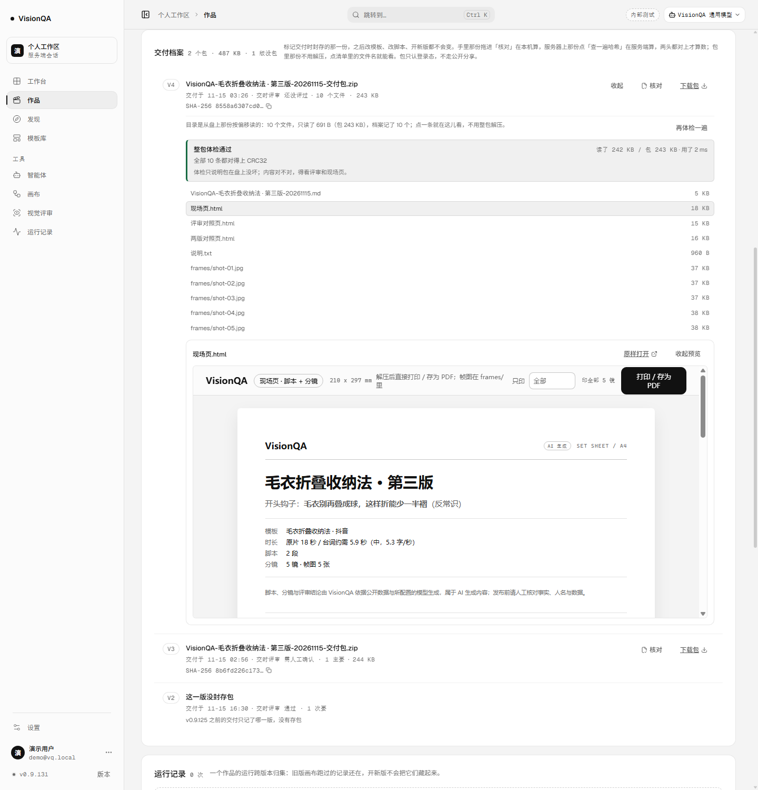
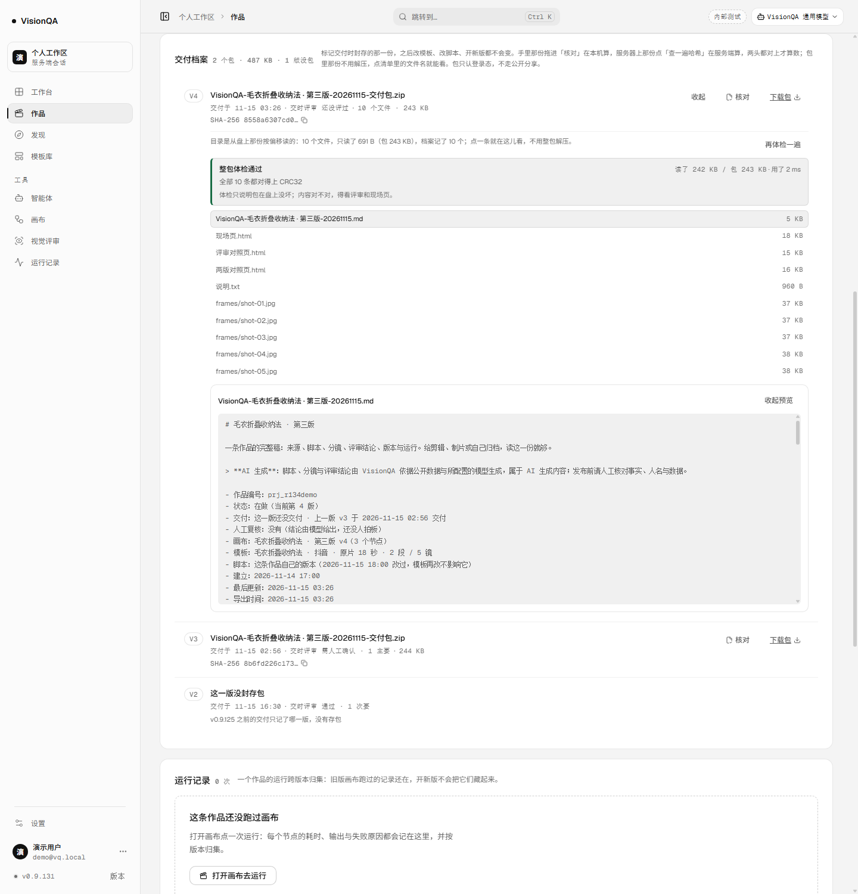

# 看一条就读一条：封存包的目录与单条内容改成按偏移读（v0.9.131）

日期：2026-11-15 · 轮次：141 · 版本：v0.9.131

## 问题

v0.9.129 让作品页能「不解压看包里的清单」，v0.9.130 又加上了整包体检。但这两步之前，
清单和单条内容走的是同一条懒路：

```
readDeliveryPackage(...)  ->  fsp.readFile(整包)   // 20 MB 的包就真读 20 MB
readZipDirectory(buffer)  ->  ...
readZipEntry(buffer, e)   ->  ...
```

也就是说，点一次「清单」，或者点开包里一张帧图，服务端都要先把**整个包**读进内存。
v0.9.130 已经把「按偏移读的源」（内存整份 / 盘上只读句柄）做出来了，体检就在用；
但清单与预览这两条路还停在 `readFile` 上——体检说「内存里最多一条」，预览却把整包摊开。

## 这一版怎么改

### 1. 读的字节数变成可数的

`server/zip-read.mjs` 的两个源都记一个 `readBytes`：

- `memorySource` / `fdSource` 每读一段就累加；
- `parseDirectory` 返回 `{ entries, total, readBytes }`；
- `readEntryFrom` 返回的 `{ data, bytes, crcOk }` 多一个 `readBytes`；
- `verifyZipAt` 改成直接取源上的计数（以前是回调另记一份）。

有了这个数，界面说「只读了 691 B」拿的是这一趟真从盘上读掉的字节，不是按条数估算。

### 2. 找 EOCD 不再一律读 64 KB

旧写法每次都读尾部 65,557 字节再往回扫；包没有注释（我们自己打的包都没有）时这一趟是白读。
现在分三档窗口：先读最后 22 字节，找不到再放到 1 KB，最后才到 64 KB。
「找到了」还要满足 `pos + 22 + 注释长度 === 窗口长度`，不把中间碰巧像签名的字节当收尾记录。

### 3. 两条路都改成盘上只读句柄

`server/routes/projects.mjs`：

- `GET .../content`：`openDeliveryPackage` 拿句柄 → `readZipDirectoryAt` → `finally` 关句柄；
  响应多两个字段 `bytes`（包多大）与 `readBytes`（这一趟读了多少）；
- `GET .../content/<条目>`：同一条句柄路，`findZipEntry` 之后只 `readZipEntryAt` 这一条；
  响应头多 `X-VQ-Read-Bytes`（目录 + 这一条）与 `X-VQ-Package-Bytes`。

两条都是只读：不解压到磁盘、不缓存、不写档案、不改文件；64 MB 整包上限与 32 MB 单条上限不动。

### 4. 界面照实写

清单头上那句从「目录是从盘上那份读出来的」变成：

> 目录是从盘上那份按偏移读的：10 个文件，只读了 691 B（包 243 KB），档案记了 10 个；点一条就在这儿看，不用整包解压。

## 本地实测（真 Chrome + 真本地服务 + 真磁盘文件）

夹具：`prj_r134demo` v4 封存包 **248,643 B** / `8558a6307cd0…`，10 个条目（3 个文本、3 个 HTML、5 张帧图里 4 张在列，另有说明）。

| 读法 | 这一趟真读了多少 | 占整包 |
| --- | --- | --- |
| 列目录（`GET .../content`） | **691 B**（22 B 收尾 + 669 B 中央目录） | 0.28% |
| 取交付稿 `.md`（4,949 B） | 5,670 B（目录 691 B + 这一条 4,979 B） | 2.3% |
| 取现场页 `.html`（18,484 B） | 19,205 B | 7.7% |
| 取帧图 `frames/shot-01.jpg`（38,078 B） | 38,799 B | 15.6% |
| 整包体检（10 条，必须全读） | 247,743 B | 99.6% |

旧写法在「列目录」这一步是 `readFile` 整包 248,643 B，再读尾部 65,557 B 去找 EOCD；
现在是 691 B。

界面读数（同一份构建，1440）：

- 清单头：「目录是从盘上那份按偏移读的：10 个文件，只读了 691 B（包 243 KB），档案记了 10 个；点一条就在这儿看，不用整包解压。」
- 体检块（v0.9.130 那条还在）：「整包体检通过 · 全部 10 条都对得上 CRC32 · 读了 242 KB / 包 243 KB · 用了 2 ms」
- 单条预览照旧：交付稿读成文字、现场页进沙箱 iframe 且 5 张帧图全画出来、帧图 480×270 直接看。

边界照样验：

| 场景 | 读数 |
| --- | --- |
| 改包内一个字节 | 取那一条 **409**「跟包里的 CRC32 对不上」，界面红字「这一张读不出来」；体检转黄边点名 `frames/shot-01.jpg` |
| 包被截断 | 目录 **409**「目录读不出来」，界面退回档案里记的 10 条，不猜；体检按钮不再出现 |
| POST / 未登录 | 405 / 401 |
| 写请求 / 页面异常 | 功能写请求 **0**（只有前端异常上报那一条）、页面异常 **0** |
| 390 | 清单块 224、预览 237、行 256；`scrollWidth` 390 = `clientWidth` 390 |

## 截图






## 坑

- 先读 64 KB 尾巴再扫 EOCD 是白读：没注释的包收尾记录就在最后 22 字节里。分档窗口后，
  「找到了」必须连带核对注释长度，否则中间某段碰巧等于 `PK\x05\x06` 就会被当成收尾。
- `readBytes` 要按「源的读」记，不要按「条目大小」估：deflate 的条目解压后比包里大，
  而体检预算、这里的读数说的都是包里的字节。
- 路由里 `return true` 写在 `try` 里时，`finally` 照样会跑：`handle.close()` 不会漏。
  但别在 `finally` 里再 `sendJson`——那时响应可能已经发出去了。
- 测试里手写正则要过一遍：TypeScript 字符串里的 `\/` 与 `\d` 会掉成 `/` 与 `d`，
  写进文件就成了 `/text/plain/` 和 `/^d+$/`，测试文件直接 SyntaxError。
- 界面上的读数改了文字就要 rebuild 再跑 E2E：这一版改了清单头那句，入口从 640,883 B 变成 641,000 B。

## 发现但没做

- 包超过 64 MB 仍直接 413：目录本身只读几百字节，这条上限现在只是防滥用，不是内存必须；
  分块 / 流式读没做，超限时也没有「只读目录」的旁路。
- `/content/<条目>` 每次都要重读一遍目录（691 B）：量小但重复，没做同请求内的目录复用缓存。
- 体检结果不落盘、没有定期体检与告警、没写进交付包（v0.9.130 起就是这样）。
- 预览里没有把「这一条读了多少」显示出来：数字在响应头里，界面只写了清单那一趟。

## 回退

```bash
bash /opt/visionqa/ops/rollback.sh --to 1   # v0.9.130
bash /opt/visionqa/ops/rollback.sh --to 2   # v0.9.129
```

只改了读法：路由换成句柄读、响应多两个字段 / 两个头、界面换一句话。不改数据结构、
不需要迁移；旧前端不认这两个字段也不影响。

## 部署

生产发布 `20261114-212857-20261115-r141read`，部署前快照 **1,085,814 B**（旧入口
`index-LmLGWsq.js`，即 v0.9.130 那一份）。四个 unit active；8799 / 8800 / 公网都 0.9.131；
`/api/health` ok（模板 26，检查时 uptime 22s）；本地与生产哈希一致：zip-read `c00aa14e`、
routes projects `991228d8`、delivery-packages `10ff4129`、health `d6e39c4e`、入口
`e80f382a`、主样式 `078ed014`；未登录 content / content/x.html / verify / check /
封存包 / 交付包全 401，POST content 也是 401；公网 / 200 · 729 B、入口 200 · 641,000 B；
心跳 public 1502039 / internal 1502037；盘 72%、/tmp 423M、日志无业务 error。
生产仍是 0 条交付、0 个封存包，所以读数只有本地证据。

## 提交与 CI

- 功能提交 `722b8a0`（8 个文件：两个服务端模块、一个页面、一个领域类型、两组测试、版本号）。
- 文档提交见本条记录之后的 docs 提交（README 一百九十八节、本文件与 3 张截图）。
- 测试：`node --test` 全仓 **1018/1018**（本版新增 3 条：按偏移读目录只读几 KB、取一条只读这一条、
  内存那一路也记读数）；oxlint 0 error / 15 warning；`tsc -b` 与 build 干净；密钥扫描 704 文件 / 0。
- CI `43643139777`（`722b8a0`）。
