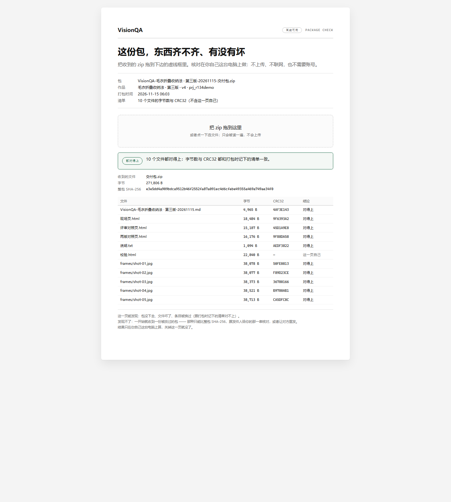
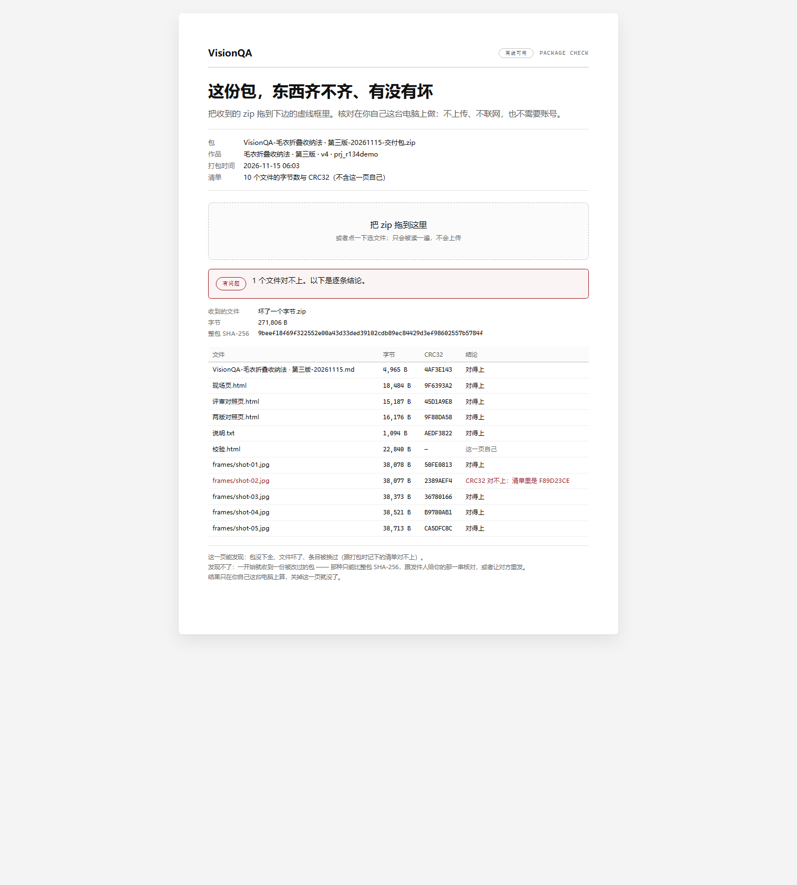
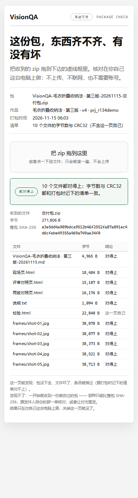

# 包里的校验页：收包人自己把 zip 拖进来，就能对一遍（v0.9.133，2026-11-15）

## 问题：包交出去了，核对还在我们这边

上一版做到「每天自己验一遍」，可那仍然是在**我们这台机器**上验。收包人（剪辑、拍摄、甲方）手上只有一个 zip，他能打开看，却回答不了两个最该问的问题：

1. 我这份下全了吗？中间坏了没有？
2. 这真的是你发给我的那一份吗？

现在这两件事都得回来找我们：要么我们点「体检整包」，要么我们复述一遍 SHA-256。一份交付物如果要靠发件人自证，它就不算自带证据。

## 做法：包里多一页，清单写进去，脚本在收包人那边跑

- 打包时多写一份 `校验.html`，紧跟在 `说明.txt` 后面。它把包内清单写进页面：文件名 / 字节数 / CRC32，**不含它自己**（哈希不能自指）。
- 页面用原生 JS 读 zip：找尾记录（注释长度要正好到头）→ 读中央目录 → 逐条按本地头取数据 → 重算 CRC32 → 跟清单比；再算整包 SHA-256。
- 核对在收包人的浏览器里做：不上传、不联网、不需要账号、不装任何东西，解压后双击就能用。
- 应用里那行清单也列得出这一条（包内目录按偏移读，不额外读整包）；`说明.txt` 多一行交代它是干什么的。
- 脚本没跑起来时（应用内预览的 CSP 会拦脚本 / 浏览器禁用脚本）留一句话，不让人对着一张空纸发愣。

页面自己写清了边界：**能发现**下不全、文件坏了、条目被换过；**发现不了**「一开始就收到一份被改过的包」——那种只能比整包 SHA-256（跟发件人给你的那一串核对），或者让对方重发。

## 本地实测：真服务、真封存、真 Chrome、真把文件喂进去

| 检查 | 读数 |
| --- | --- |
| 标记交付后封出来的包 | 271,806 B、**11 条**（原来 10 条），`校验.html` 紧跟 `说明.txt` |
| 校验页本身 | 22,840 B，清单 10 条（不含自己） |
| 应用里的包内目录 | 11 条，含 `校验.html`（只读接口，不写） |
| 把好包喂给它（1440） | 「都对得上」·「10 个文件都对得上：字节数与 CRC32 都和打包时记下的清单一致」，11 行，最后一行「校验.html · — · 这一页自己」 |
| 整包 SHA-256 | 页面上算出来 **与封存时记在交付记录里的那个一字不差** |
| 改一个字节再喂 | 「有问题」·「1 个文件对不上」；`frames/shot-02.jpg` 那行红字「CRC32 对不上：清单里是 F89D23CE」；别的条目不变红 |
| 截断再喂 | 「读不出来」·「找不到 zip 的尾记录：这个文件多半没下全」——不冒充通过 |
| 390 | 三列（文件 / 字节 / 结论）摆得下，`scrollWidth` 390 = 390，表宽 334 |
| 联网 | 页面自己只发 3 个 `file://` 请求（自己 + 两个本地字体），**一条 http(s) 都没有** |
| 页面异常 | 0 |

## 坑

- **清单不能含自己**：页面内容决定清单、清单又要进页面。先算清单、再生成页面、最后插进 zip。
- 页面里的 `` 时不转义就把页面拆坏了。
- 本地字体走 `/fonts/*.woff2`，在 `file://` 下会变成 `file:///D:/fonts/...`，取不到就回退系统字体——不影响核对，但要接受控制台里两条 404。
- 应用内预览（iframe + CSP）里脚本被拦，所以那一页**是静态的**；页面留了一句提示专门说这件事。
- `DOM.setFileInputFiles` 在同一个 input 上二次喂文件前要先清 `value`，否则 `change` 不一定触发。
- 生成页面的脚本是内联常量（不接用户内容），所以用数组拼字符串、不拼模板字符串：少一层转义。作品标题、文件名一律先 `escapeHtml` / 用 `textContent` 写进 DOM。

## 发现但没做

- **不验签名**：页面只对字节，不对「谁给的」。没有密钥体系，所以不做「防伪」这种说不了实话的承诺。
- 分享包（`project-share-bundle`）里没有这一页——这一次只动交付包。
- 整包 SHA-256 仍要人工跟对方那串比，没有二维码 / 短码。
- 老包（v0.9.132 及以前封存的）没有这一页：不回头改已经封存的字节。
- 生产 1 件作品、0 条交付、0 个封存包，所以生产上还没有任何一份带校验页的包；真包证据来自本地同一份构建。

## 回退

`bash /opt/visionqa/ops/rollback.sh --to 1` → **v0.9.132**；`--to 2` → **v0.9.131**。已封存的包不受影响：新页只是新包多一个文件，旧版本不认识它也不会读它，没有数据迁移。
