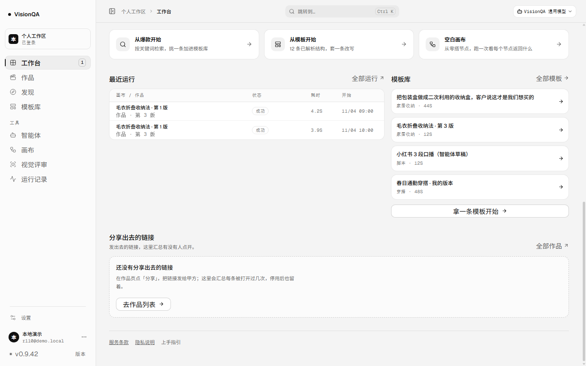
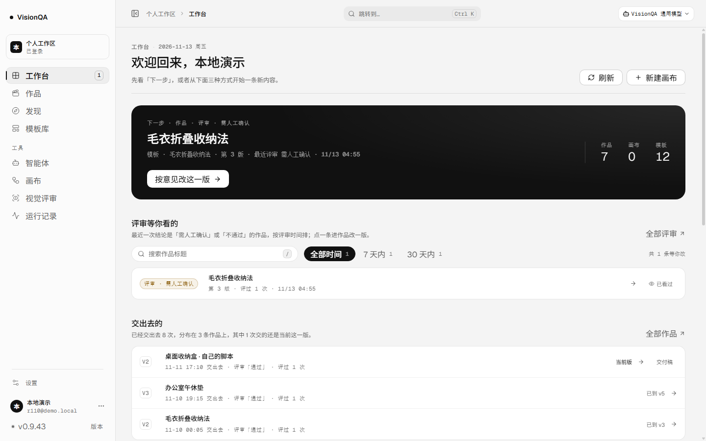
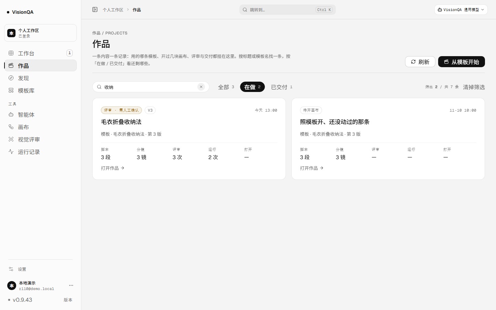
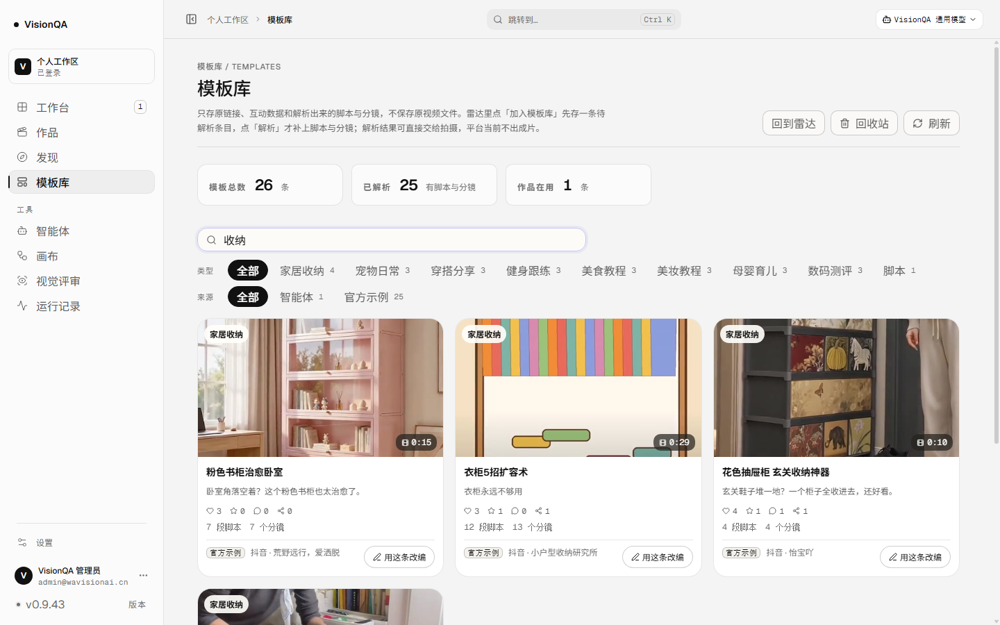
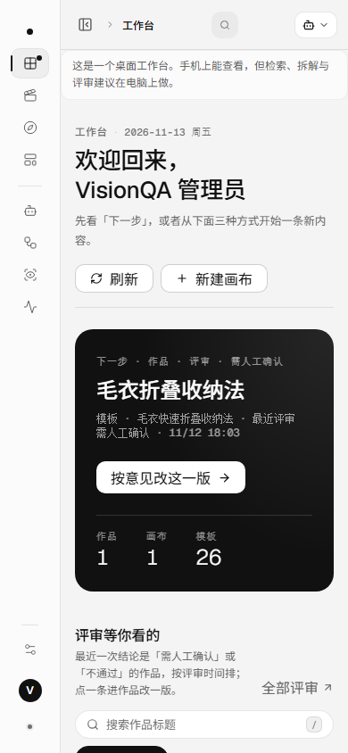

# 换页不丢位置：回页头、留筛选（v0.9.43，2026-11-13）

这一轮只做一件事：**从一个页面走到另一个页面的时候，别让人落在半截上**。
顺手把「点开一样东西再回来，列表把我筛的条件清空了」这件事一起按住了。

结论先行：
1. 换页一律从页头开始，判断收在 `src/domain/scroll.ts` 一处；抽屉与画布换流程不算换页，不动背景。
2. 错误边界按「页」隔离，不再按整条地址重挂——模板抽屉一开，底下列表的搜索词、来源筛选和滚动位置不再被清掉。
3. 作品列表的搜索词与「在做 / 已交付」跟着标签页走：点进一条作品、再退回来，条件还在。
4. 工作台、运行记录、视觉评审、后台这四种页面根节点补上和其余页面同一段淡入（以前是硬切）。

---

## 一、问题（都是实测出来的，不是设计洁癖）

外壳是 `height: 100vh + overflow: hidden`，真正滚动的只有一个元素：`.vq-content`（`flex: 1; overflow: auto`）。
换页时没人管它的 scrollTop，浏览器只按新页面的内容高度把旧值夹一下，于是**同一件事有两种结果**：

| 操作（1440 宽，7 条作品的演示账号） | 改之前 | 该是什么 |
| --- | --- | --- |
| 作品页滚到底 → 点侧栏「工作台」 | 停在 `scrollTop = 920`，页头「欢迎回来」与主卡都在上面看不到，落点是最下面的分享与页脚 | 页头 |
| 工作台滚到底 → 点「模板库」 | 停在 `scrollTop = 920`（列表中间） | 页头 |
| 模板库 → 点「运行记录」 | 新页更短，正好回到 0——所以看起来「有时正常」 | 页头 |

同一个动作、两种落点，这才是「跳转混乱」的来源。

第二件更隐蔽：`<ErrorBoundary key={routeKey(route)}>` 是按**整条地址**重挂页面的。
打开一条模板的抽屉也是地址变化（`#/templates/<id>`），于是整页重挂：

| 操作 | 改之前 | 改之后 |
| --- | --- | --- |
| 模板库搜「收纳」→ 6 条；点第一张卡片看详情 | 抽屉打开，搜索词清空、列表回到 12 条 | 抽屉打开，搜索词「收纳」还在、仍是 6 条 |
| 关掉抽屉 | 12 条、滚动位置归 0 | 6 条、滚动位置不动（`scrollTop = 200`） |
| 作品列表筛「收纳 + 在做」→ 点进一条 → 浏览器后退 | 条件清零，回到 7 条全部 | 「收纳 + 在做 2」「筛出 2 / 共 7 条」原样 |

---

## 二、改法

### 2.1 一处判断：`src/domain/scroll.ts`

```ts
planScroll(previous, next): 'top' | 'keep'
  previous 为空            → top
  任一侧不是普通页面        → top（后台 / 合规 / 只读分享 / 智能体编辑器各自整屏）
  换了 page                → top
  同一页且是 templates / canvas → keep（抽屉盖在列表上；画布自己管视口）
  其余（作品列表 ↔ 详情、评审台 ↔ 单条评审） → top
```

App 只做一件事：在 `useLayoutEffect` 里、**浏览器绘制之前**把 `scrollTop` 归零，
所以换页不会先闪一下旧位置。首次挂载本来就在顶部，不额外动。

### 2.2 错误边界按页隔离

```tsx
const pageBoundaryKey =
  route.kind === 'page' ? 'page:' + route.page
  : route.kind === 'admin' ? 'admin:' + route.section
  : route.kind === 'legal' ? 'legal:' + route.doc
  : route.kind
<ErrorBoundary key={pageBoundaryKey}>
```

换页仍然整页重挂（错误状态照样重置）；同一页里的地址变化不再重挂。
画布页与作品页各自还留着自己的 key（换画布项目、换作品仍然从头挂），评审页按作品 key，
单条评审只换参数——这些原本就是页面内部的事，外壳不再插手。

### 2.3 作品列表的筛选跟着标签页走

```ts
readProjectsView(window.sessionStorage)   // 首屏读，逐字段校验
writeProjectsView(window.sessionStorage, { keyword, bucket })  // 条件变了就写
```

- 用 `sessionStorage` 而不是 `localStorage`：同一个标签页里回来还在，关掉标签页就忘掉——
  不跨会话，避免下次打开看到一份不知从哪儿来的筛选。
- 存进去的一律当不可信：坏 JSON、`bucket` 不认识、`keyword` 不是字符串、超长关键词（截 80）都退回「全部、无关键词」。
- 没有筛选就把键删掉，不留一条空记录；隐私模式写不进去也不影响这一屏。
- 界面本来就写着「筛出 2 / 共 7 条」和「清掉筛选」，恢复的条件看得见、一键可清。

### 2.4 淡入补齐

`.page` 早在 `tokens.css` 里有 `vq-page-in`（180ms，只动透明度）。工作台、运行记录、视觉评审、后台
四种根节点不带 `.page`，以前切过去是硬切。这次把四种根节点并进同一条规则，`prefers-reduced-motion`
下照旧全部关掉。**动画放在页面根节点上、不放外壳**：外壳 `height: 100vh`，画布页靠
`.page.cv-page { height: 100% }` 撑满，中间多套一层带动画的盒子会改掉高度基准（实测画布高度 844 = 内容区高度，没被改）。

---

## 三、验收

### 3.1 本地（7 条作品的演示账号，1440）

| 检查 | 结果 |
| --- | --- |
| 作品页滚到底 → 点「工作台」 | `scrollTop = 0`，`titleVisible: true`（改之前 920 / false） |
| 工作台滚到底 → 点「模板库」 | `scrollTop = 0`（改之前 920） |
| 模板库搜「收纳」+ 开抽屉 + 关抽屉 | 搜索词「收纳」、6 条、`scrollTop = 200` 全程不变 |
| 作品页筛「收纳 + 在做」→ 进作品 → 浏览器后退 | 「收纳」+「在做 2」+「筛出 2 / 共 7 条」原样 |
| 点「清掉筛选」 | 条件清空，`sessionStorage` 里的记录被删掉 |
| 四种根节点的淡入 | 换页后 60ms 读到 `vq-page-in / 0.18s`；开抽屉不重放（opacity 保持 1） |
| 画布页 / 智能体页高度 | 844 = 内容区高度，未被外壳影响 |
| 390 宽 | 滚到底点「工作台」落点 0，`scrollWidth = clientWidth = 390` |







### 3.2 生产（只读操作）

| 检查 | 结果 |
| --- | --- |
| `/api/version` | 0.9.43 |
| 入口文件 | `index--dBiwm3v.js`（511,371 字节，与本地构建一致） |
| release | `20261113-013415-0.9.43-page-scroll.tar.gz` |
| `/api/health` | ok，templates 26；两个服务 active |
| 模板库搜索「收纳」→ 开抽屉 → 关抽屉 | 搜索词还在、仍是筛出的 4 条（改之前会被清回 26 条） |
| 工作台 / 390 | 落点 0、标题在第一屏、`scrollWidth = clientWidth = 390` |
| 生产零写入 | 截图前后各取一次快照，六路逐字段 `identical: true`（作品 1 · 模板 26 · 画布 7 · 原片 25（1 已开成作品 / 24 没开成）· 交付 0 · 余额 9954） |

生产账号只有 1 条作品，作品页根本滚不动（`max = 0`），所以**「滚到底再跳」这件事在生产上复现不了**——
那张前后对照表是本地 7 条作品的演示账号上拍的。生产上能证明的是另一支：模板库那句「搜索词与列表状态不再被抽屉清掉」
在生产真实数据（26 条模板、搜「收纳」得 4 条）上成立，以及这一版没有把已有页面改坏。





---

## 四、测试与边界

- `npm test` **400/400**：新增 `test/scroll.test.mjs` 6 条（判断矩阵 + App 真的在绘制前归零 + 错误边界按页 + 淡入规则与 reduce 分支）、
  `test/list-view.test.mjs` 5 条（空/往返/坏数据/存储抛错/页面接线）。
- `npx oxlint src` **0 error / 6 warning**（既有 6 条未变）；`npx tsc -b` 干净；`npm run build` 通过。
- 没动：计费表、接口语义、一级导航、任何写入路径；没有跑检索/解析/评审，0 积分。
- 没做：后退时恢复列表的**滚动位置**（只恢复了筛选条件）。列表首屏是异步取的，内容高度还没长出来就设 scrollTop 会被夹回 0；
  要做得多留一套「等列表渲染完再恢复」的机制，这一轮先把「回页头」这个确定的行为定死。

## 五、下一步候选

模板抽屉/卡片其余「点不动的假出口」盘点、队列按作品分组、画布与评审产出继续落进作品；
P2 的代码签名 / 自动更新 / 模型驱动记忆归纳仍等拍板。
