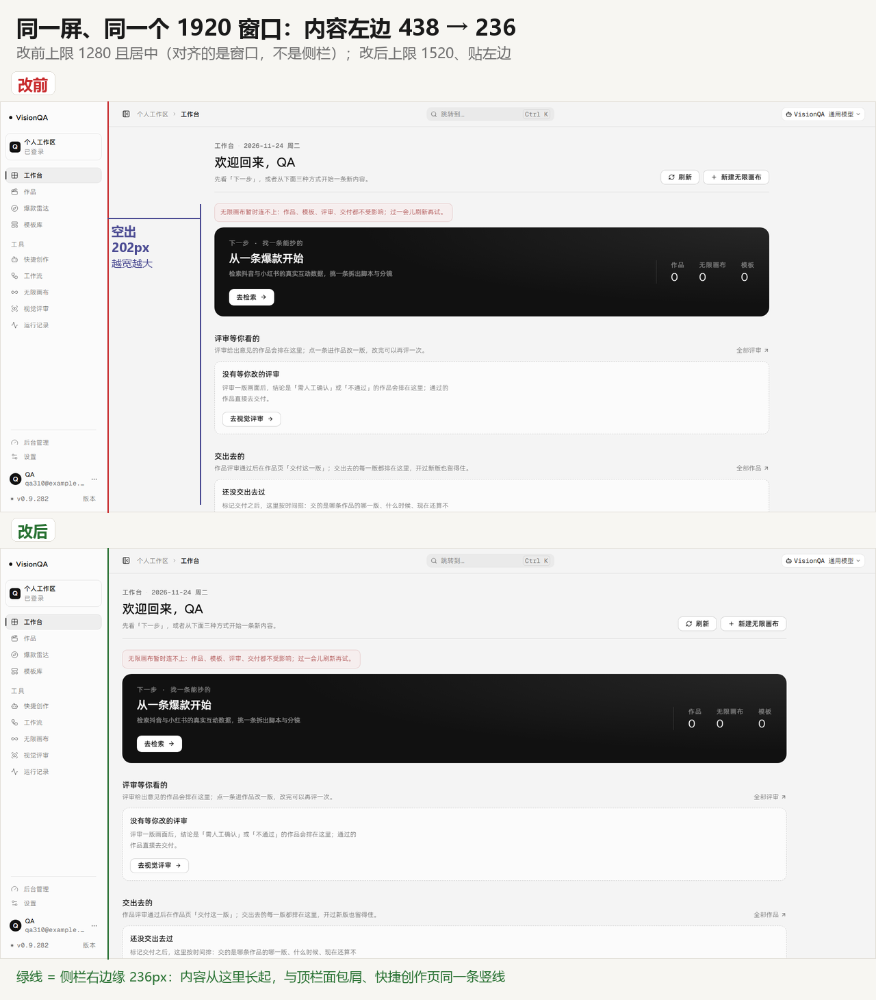
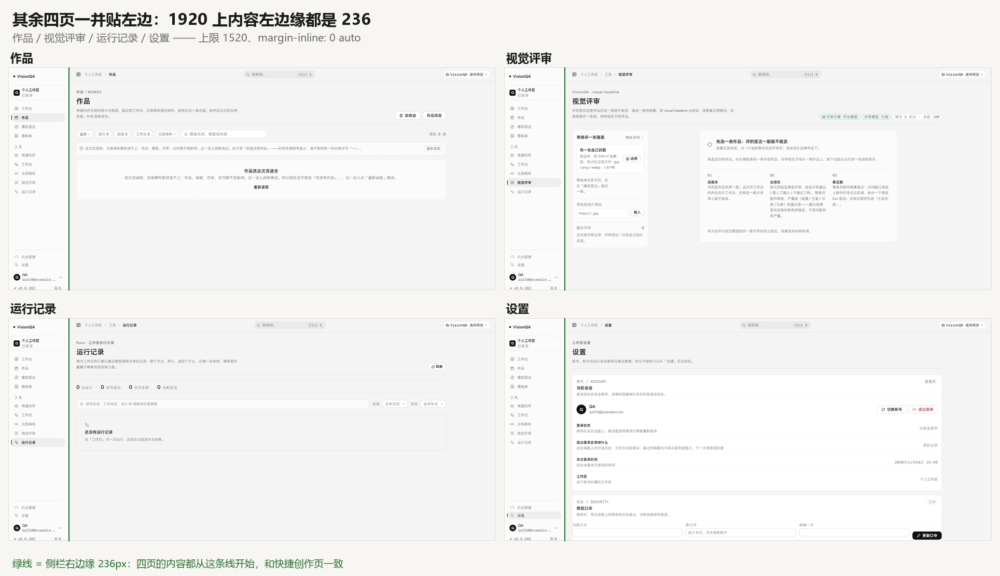
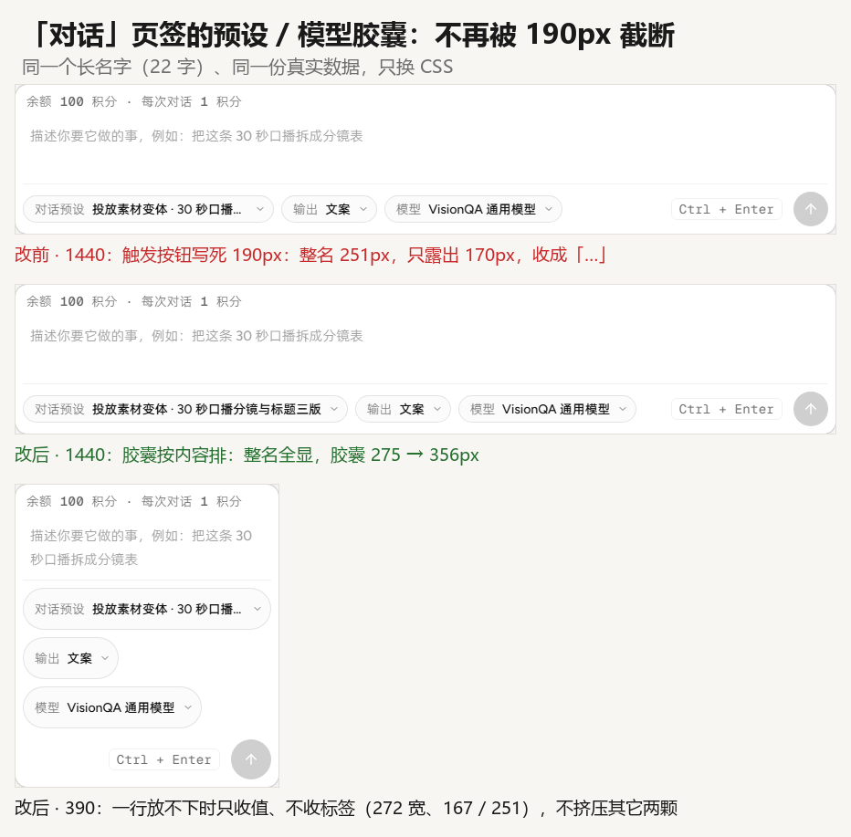

# 其余页面一并贴左边、胶囊不再被 190px 截断（r310 / v0.9.283）

2026-11-24。上一轮（r309）只把快捷创作页改成「上限 1520 + 贴左边」，其余页面还是 1280 居中。用户看完回了两句：「1 也一起改」「2.统一放宽」——① 作品 / 视觉评审 / 总览这些页面一并贴侧栏；② 「对话」页签那颗模型胶囊同样放宽。

## 一、其余页面：同一屏两个左边起点

在 1920 上量，侧栏右边缘是 236：

| 页面 | 容器 | 改前 左边 / 宽 | 改后 左边 / 宽 |
| --- | --- | --- | --- |
| 工作台（总览） | `.vq-page` | 438 / 1280 | **236 / 1520** |
| 作品（作品流） | `.page` + `.vq-page` | 438 / 1280 | **236 / 1520** |
| 视觉评审 | `.review-page` | 438 / 1280 | **236 / 1520** |
| 运行记录 | `.runs-page` | 438 / 1280 | **236 / 1520** |
| 设置 | `.vq-page` | 438 / 1280 | **236 / 1520** |
| 快捷创作（r309 已改） | `.agx-page` | 236 / 1520 | 236 / 1520 |

同一屏上，顶栏面包屑和快捷创作页都在 236 起，其余五页却在 438 起——中间空出 **202px**，而且这道缝随窗口变宽。原因就是这些容器写死 `max-width: 1280px` 再用 `margin: 0 auto` 居中：居中对齐的是**窗口**，不是侧栏。

**改法**：五个容器统一成 `max-width: 1520px` + `margin-inline: 0 auto`——上限与快捷创作、与 `.page` 同一个，左边贴住侧栏，多出来的宽度全部交给内容，留白只留在右侧。1440 及以下宽度时可用宽度本来就不足 1520，一像素都不变。

顺带把加载骨架 `.vq-skeleton` 也改成同一上限与同一个左边起点：以前骨架 1280 居中、页面 1520 贴左，懒加载那一下会横向跳一下。

## 二、胶囊：190px 的硬上限删掉

`.agx-capsule-trigger` 里写着 `max-width: 190px`——这是「对话」页签三颗胶囊（对话预设 / 输出 / 模型）、图片视频参数胶囊共用的基础规则。值短时看不出问题，值一长就收成省略号：一个 22 字的预设名，实际 251px，只露出 170px。

**改法**：删掉 190px，改成「宽度由值决定」——胶囊与触发按钮都是 `max-width: 100%` + `min-width: 0`，最宽不超过它所在那一行；只有值比整行还长时才在 `em` 上用省略号兜底。窄屏靠 `.agx-params` 的 `flex-wrap` 换行，不再靠截断。

同一颗胶囊（同一份真实数据，只换 CSS）：

| 宽度 | 改前 | 改后 |
| --- | --- | --- |
| 1440 | 胶囊 275px，值只露出 170/251px，「投放素材变体 · 30 秒口播…」 | 胶囊 356px，整名 251px **全显** |
| 390 | — | 胶囊 272px（整行宽），值 167/251px 收尾字；标签「对话预设」保持一行 |

窄屏这条补了一步：标签也吃 flex 收缩，390 上「对话预设」曾被挤成「对话 / 预设」两行——比省略号更难读。给 `.agx-capsule > span` 加 `flex: none; white-space: nowrap`，整行放不下时只收值、不收标签。

图片 / 视频页签没有回退：模型胶囊仍是 271px、「VisionQA通用图片模型 · 未真调」全显，1440 与 1920 输入卡仍 251px 高，390 图片 394 / 视频 448，与 r309 实拍一致。

## 验收

- 1920 / 1440 / 1024 / 768 / 390 五档、六页逐一量：五个容器 `x=236`（≤900 收成图标栏后 68）、`width=1520`（1440 及以下按可用宽度），全页 `documentElement.scrollWidth == innerWidth`，无横向溢出。
- 胶囊：1440 与 1920 上 22 字预设名全显（`em.scrollWidth == em.clientWidth == 251`）；390 上只在胶囊内部收尾字，标签不断行。
- 工作台 / 作品 / 视觉评审 / 运行记录 / 设置五页截图逐张看过，1520 下版式没有拉稀：卡片只往右长，行宽仍在可读区间。
- 门禁见 repo：新增 `test/page-width-unify.test.mjs` 2 条（五个容器同一上限同一左边起点、胶囊不再有 190px），全量测试、`tsc -b`、`oxlint`、`npm run build`、密钥扫描全绿。

## 生产验收（v0.9.283，2026-11-24 08:17 UTC 部署）

| 项 | 值 |
| --- | --- |
| 包内版本 | `0.9.283` |
| 快照 | `/opt/visionqa/releases/20261124-081753-20261124-1600-r310width.tar.gz` |
| 服务 | `visionqa` active、`visionqa-internal` active |
| `/api/version` | 本机与公网都是 `0.9.283` |
| `/api/health` | `ok:true, redfox:true, vision:true, llm:true, templates:26` |
| 入口 | `index-Difv8oc6.js` / `index-BAQcAtdi.css` |
| 线上 CSS | `index-BAQcAtdi.css` 里 `.vq-page{max-width:1520px;margin-inline:0 auto}`、`.review-page{…1520px…}`、`agents-w9mjdisi.css` 里 `.agx-capsule-trigger{min-width:0;max-width:100%}` |
| 回滚 | `bash /opt/visionqa/ops/rollback.sh --to 1` → `20261124-065451-v0.9.282-r309`（0.9.282） |

线上页面截图这轮没拍成：用户浏览器的 Kimi 扩展当时处于未连接（`extension_not_connected`，浏览器关闭或扩展被停用），而生产页面要登录才能进。
上面的版本、健康、两份 CSS 产物里的实际字符串都是从生产机与公网接口读到的；界面截图来自同一份源码的本机实例（1920 改前 / 改后、四页、胶囊三张）。

## 边界

- 后台管理版（`?edition=admin`）的 `.admin-page` 仍是 1220 居中，这次没动：它自己一套外壳，左侧是后台侧栏不是工作区侧栏。
- 超宽屏（>2092 = 侧栏 + 1520）时 `margin-inline: auto` 会重新居中，1920 / 2560 上贴左、留白都在右侧。
- 窄屏 390 上评审页「单独评一张画面 / 模板首帧」那块头与设置页时间戳仍有一处省略号——改前就有，属于既有问题，本轮没动。
- 数据全部来自本机临时实例（`.tmp-r310-data`，含一条 22 字预设名的真实创建），不是真实上游调用；本轮 **0 次真实上游调用、¥0**。
