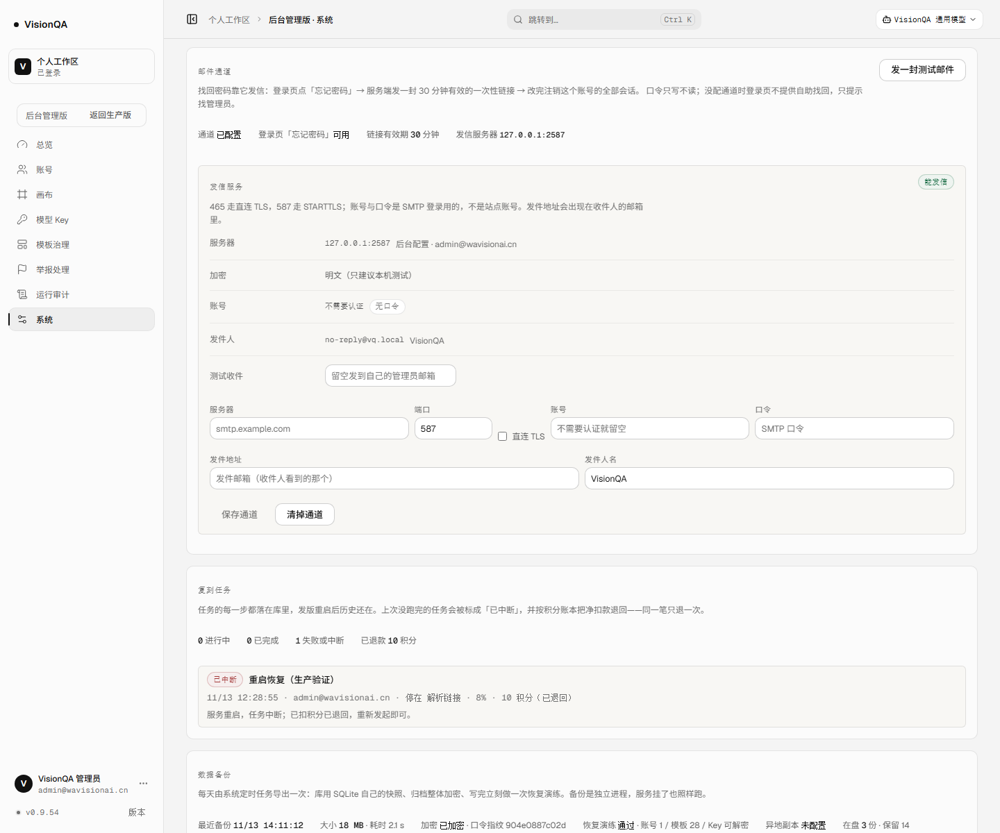
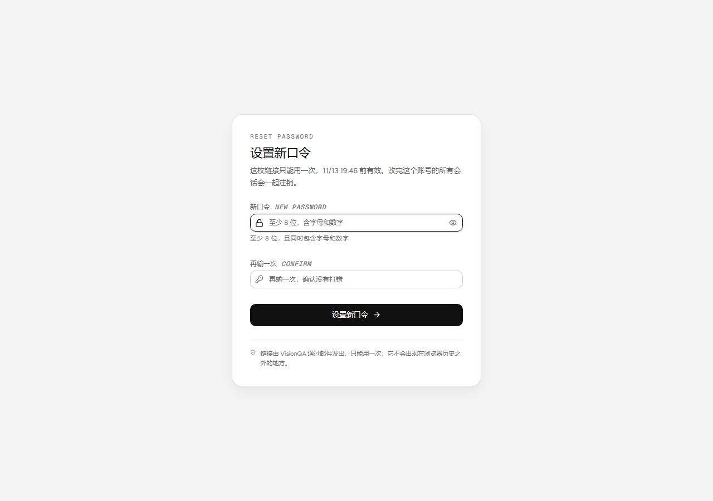
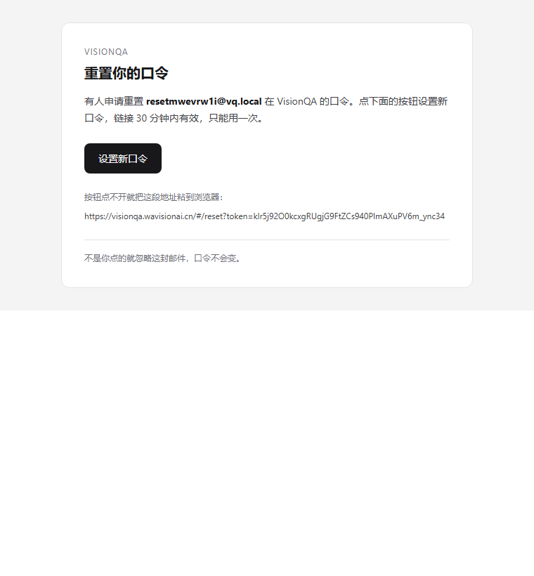

# 找回密码：邮件通道 + 一次性重置链接（2026-11-13，v0.9.54）

## 这补的是哪个缺口

上线缺口清单 A5：「无 SMTP，忘记口令只能找管理员」。

之前 `server/auth.mjs` 开头的注释就是这么写的——**不做邮件验证与找回密码**。用户忘了口令只有两条路：找管理员在「后台 → 账号」里重置，或者换号。单账号自建用户少的时候还能忍，一旦有真实外部用户，这就是「管理员不在线就进不来」。

这轮把「邮件通道」和「找回链路」一起做完了，**不需要再发版**：后台填一次 SMTP 就能用。

## 做了什么

| 层 | 内容 |
| --- | --- |
| 发信 | `server/mailer.mjs`：自己实现的 SMTP 客户端（不引依赖）。直连 TLS（465）/ STARTTLS（587）、AUTH PLAIN / LOGIN、UTF-8 报文、多行 EHLO、超时与「哪一步被拒」的报错 |
| 通道 | `server/mail-config.mjs`：配置存 `DATA_DIR/mail.json`（0600），接口只回账号掩码与「有没有口令」，后台配置优先于 `VQ_SMTP_*` 环境变量 |
| 找回 | `server/password-reset.mjs`：一次性 token（库里只存 sha256）、30 分钟有效、申请新的作废旧链接、条件更新保证同链接并发只成功一次 |
| 路由 | `POST /api/auth/password/forgot`、`GET/POST /api/auth/password/reset`；`/api/auth/config` 多一个 `passwordReset` 开关 |
| 界面 | 登录页「忘记密码」变成真的找回表单；邮件链接落到 `#/reset?token=…` 的独立页；后台「系统 → 邮件通道」卡片（服务器 / 端口 / 加密 / 账号 / 口令 / 发件人 / 发测试邮件） |
| 审计 | 保存通道、清通道、发测试邮件、找回申请、改口令都进 `logEvent` + 后台审计 |

## 关键取舍

- **不引 nodemailer**：部署机只在 lock 文件变化时才 `npm ci`，多一个包就多一处生产差异；这里需要的协议面很小（连上、认证、发一封 UTF-8 邮件），自己写约 200 行可控，测试还能直接对着协议断言。
- **「有没有这个账号」看不出来**：无账号、没配通道、发信失败都回同一句话：「如果这个邮箱有账号，重置邮件已经发出」。限流被触发时也只说「太频繁」，不透露账号是否存在。
- **发信不阻塞请求**：找回接口只回话，SMTP 在后台发，结果进日志；SMTP 挂掉不会让「忘记密码」转圈 20 秒。
- **口令只写不读**：后台保存时留空表示沿用旧口令（只改端口 / 发件人时不用重输）；换账号又没填新口令会直接报错，不留下「保存成功、发信登不上」的坑。
- **改完注销所有会话**：找回入口是「邮箱能收信」这一个因素，如果账号此前在某台机器上被登着，改完必须把它踢掉；接口返回 `signedOut` 计数。
- **没配通道就不摆死入口**：登录页从 `/api/auth/config` 拿 `passwordReset`，为 false 时点「忘记密码」显示「这个部署还没配置邮件通道，请找管理员」，而不是让人填完邮箱等一封永远不来的信。
- **限流**：同一邮箱 1 小时 3 次、同一来源 1 小时 10 次（进程内滑动窗口）。单机部署够用；重启清零，不把刷信成本变成永久状态。

## 接口

| 方法 | 路径 | 说明 |
| --- | --- | --- |
| GET | `/api/auth/config` | 多返回 `passwordReset: boolean`（邮件通道可用才为 true） |
| POST | `/api/auth/password/forgot` | `{ email }` → 200 统一话术；429 太频繁（带 `Retry-After`） |
| GET | `/api/auth/password/reset?token=` | 探活：`{ valid, expiresAt, reason, message }`，不消费 |
| POST | `/api/auth/password/reset` | `{ token, password }` → 改口令并注销该账号全部会话 |
| GET | `/api/admin/mail` | 通道视图（掩码）+ `passwordReset` + 链接有效期 |
| PUT | `/api/admin/mail/channel` | 保存通道；口令留空 = 沿用 |
| DELETE | `/api/admin/mail/channel` | 清掉后台配置（回落到环境变量或不可用） |
| POST | `/api/admin/mail/test` | `{ to? }`：真的发一封，等 SMTP 结果再回话 |

## 生产验收（2026-11-13）

在生产起一个**本机 SMTP 接收端**（127.0.0.1:2587），走完整链路，验完立刻清场：

| 步骤 | 实测 |
| --- | --- |
| 配通道前 | `GET /api/auth/config` → `passwordReset:false` |
| 保存通道 | `PUT /api/admin/mail/channel` → `configured:true, source:"admin"` |
| 配通道后 | `GET /api/auth/config` → `passwordReset:true` |
| 测试邮件 | `POST /api/admin/mail/test` → `ok:true, ms:24` |
| 申请找回 | `POST /api/auth/password/forgot` → 200，**35 ms**（不 await 发信） |
| 收到邮件 | 接收端收到 **3309 字节**真实 MIME，主题按 RFC 2047 编码为「重置 VisionQA 口令（30 分钟内有效）」，正文带 `#/reset?token=…` |
| 链接探活 | `GET /api/auth/password/reset?token=…` → `valid:true`，`expiresAt` +30 分钟 |
| 改口令 | `POST` → `ok:true` |
| 旧口令 | 登录 → **401** |
| 新口令 | 登录 → **200**，会话 `/api/auth/me` → 200 |
| 同一链接再用 | → **400**「这枚链接已经改过口令了」 |
| 清场 | 通道 `DELETE` → `configured:false`；临时账号 `DELETE`；接收端 `pkill`；`/tmp` 文件删掉 |

> 截图里的「加密：明文（只建议本机测试）」「账号：不需要认证」是这次验收用的本机接收端，换成真实 SMTP 时填 465 直连 TLS 或 587 STARTTLS + 账号口令即可；后台卡片不预填任何已有口令。

## 测试

`npm test` **497/497**（这轮新增 18 条）：

- `test/mail-smtp.test.mjs`（10 条）：RFC 2047 编码、MIME 合法性与正文还原、multipart 两段、完整会话顺序、按服务器广告选 AUTH PLAIN / LOGIN、RCPT 拒绝的报错、对方不说话时超时、`verifySmtp` 不发信、配置校验。
- `test/password-reset.test.mjs`（8 条）：未配通道时开关为关且不发信、有账号与无账号回同一句话、配好通道后真的发到接收端、弱口令拒绝 / 改完旧口令失效 / 同链接复用被拒、改完注销全部会话、申请两次只留最新一封、过期 token 不能改、限流第 4 次被挡。

## 边界（说清楚，不装作做完）

- **生产现在没有配邮件通道**：验收完清掉了。要真用，后台填一次 SMTP（主机 / 端口 / 账号 / 口令 / 发件地址）即可，不用发版。
- 发信只支持「一封纯文本 + 可选 HTML」，没有附件、退信解析、DKIM 签名、连接池；发信量是「找回密码 + 测试」级别。
- 限流是进程内窗口：多实例部署时要换成共享存储，单机足够。
- 邮件通道的健康没有接进告警：发信失败只进日志（`mail-failed`）与审计，不会主动叫你。要不要把「连续发信失败」也变成告警，等真实用户量上来再定。
- 找回邮件在后台发，因此「申请成功」只表示已排队；用户没收到时仍可以找管理员重置。

## 回滚

- 代码回滚：`/opt/visionqa/ops/rollback.sh`。
- 只关掉找回、保留其它功能：后台「清掉通道」即可（`passwordReset` 立刻变 false，登录页回到「找管理员」的口径）。
- 清掉历史链接：删除 `DATA_DIR/mail.json` 里的配置只影响发信；已发出的 token 存在账号库 `password_resets` 表，30 分钟后自然失效，也可直接清空该表。
