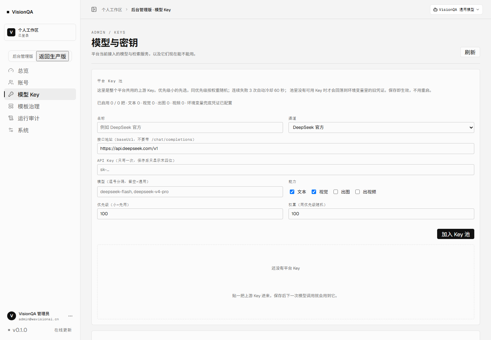

# 平台账号与 Key 路由（目标架构 + 第一期落地）

日期：2026-11-11 · 状态：第一期（VisionQA 侧 Key 池与路由）已落地并通过测试；画布账号桥与生成网关在下一期

## 一、结论先行

1. **身份只留一套**：VisionQA 账号是唯一身份源，画布不再出现登录 / 注册 / 账号管理。画布内部仍保留一条「影子用户」记录（用于它自己的任务、额度和调用日志），但由 VisionQA 自动创建与同步，用户无感。
2. **Key 只留一处**：上游 Key 由 VisionQA 后台统一管理，支持多供应商、多 Key、能力标签、优先级、权重、失败冷却。画布只负责渲染与编排，不再让用户碰 Key。
3. **第一期已上线的是 Key 池本身**：管理员在「后台 → 模型与密钥 → 平台 Key 池」增删改，保存即生效，不需要改环境变量、不需要重启。
4. 第二期做两件事：画布账号桥（VisionQA token 换画布会话）、画布生成走 VisionQA 网关。

## 二、第一期：平台 Key 池（已实现）

### 2.1 数据模型

`data/model-keys.json`（权限 600，AES-256-GCM 加密，列表只回末四位）：

| 字段 | 说明 |
| --- | --- |
| name | 展示名，例如「DeepSeek 官方」 |
| provider | 渠道标识：deepseek / bailian / volcengine / openai / custom |
| baseUrl | OpenAI 兼容根地址，不带 /chat/completions |
| apiKey | 密文；密钥来自 VQ_KEY_SECRET 或 `data/.model-keys.secret` |
| models | 可选模型白名单；留空表示该 Key 通用 |
| capabilities | text / vision / image / video |
| priority | 越小越先用 |
| weight | 同优先级内按权重随机 |
| enabled | 停用后立即不参与路由 |

### 2.2 路由规则

1. 按能力过滤（本次调用是文本、视觉、出图还是视频）。
2. 模型白名单匹配：声明了模型但都不匹配的 Key 不参与；只保留「通用 Key」。
3. 跳过冷却中的 Key。
4. 取最小 priority 的一组，按 weight 加权随机。
5. 连续失败 3 次 → 冷却 60 秒；一次成功立即恢复。
6. 池里没有可用 Key → 回落到环境变量里的旧凭证（升级不打断现有功能）。

### 2.3 管理接口（仅管理员）

| 方法 | 路径 | 作用 |
| --- | --- | --- |
| GET | /api/admin/model-keys | 列表（脱敏）+ 能力统计 + 回落状态 |
| POST | /api/admin/model-keys | 新增 |
| PATCH | /api/admin/model-keys/:id | 改名称 / 地址 / Key / 模型 / 能力 / 优先级 / 权重 / 启停 |
| DELETE | /api/admin/model-keys/:id | 删除 |
| POST | /api/admin/model-keys/:id/test | 真实请求 baseUrl/models，返回状态码、耗时、模型数 |

所有写操作都进管理员操作审计（action: model-key.create/update/delete/test）。

### 2.4 生效范围

- 智能体对话、模板解析、视觉评审、画布内置流程里的模型调用全部走同一个入口 `server/chatcall.mjs`，改一处所有功能同时生效。
- 模型下拉框会自动出现 Key 池里声明的模型，前端不写死模型名。
- 前端入口：后台「模型与密钥」页顶部新增「平台 Key 池」区块。



## 三、第二期：画布账号桥（设计）

目标：画布里没有任何账号 UI，用户从 VisionQA 进入就是已登录状态。

1. **信任模式**：画布企业服务加环境变量 VQ_TRUST_ISSUER（固定 visionqa）与共享密钥；新增 POST /enterprise/api/auth/exchange：校验 VisionQA 签发的短时 JWT（sub=VisionQA 用户 id），按 external_id upsert 一条影子用户，返回画布自己的会话 token。
2. **前端注入**：VisionQA 画布页在 iframe 加载完成后 postMessage 一次会话 token（不放 URL，避免进日志与 Referer）；画布启动时监听并交换，之后所有请求带画布 token。
3. **入口收敛**：信任模式下隐藏画布的登录、注册、账号菜单；用户管理只在 VisionQA 后台。
4. **额度与计费**：画布按影子用户记账；VisionQA 侧只做平台级用量与积分展示，两边对账以画布的 generation_records 为准。

## 四、第二期：画布生成网关（设计）

画布当前直连上游（火山 / CGCM / 百炼），Key 散在画布企业库里，既不好统一管理，也无法做跨供应商路由。目标链路：

```
画布节点 → VisionQA 网关 /api/gateway/v1/*（带 VisionQA token）
        → keyvault.resolveKey(provider/capability) 选 Key
        → 火山 / CGCM / 百炼
        → 回传结果 + 用量；VisionQA 记一次调用
```

第一期已经具备网关最核心的一块（Key 池 + 健康与冷却），网关只需补：

- 路由表（模型 → provider/feature）与 OpenAI 兼容的 images / videos / chat 三个入口；
- 用户级配额与调用日志（复用 credits.mjs 的流水）；
- 画布侧把 enterpriseBaseUrl 指到网关并带上 VisionQA token。

## 五、验收方式

**第一期（已完成）**

- `node scripts/test-keyvault.mjs`：加密落盘 / 脱敏 / 模型匹配 / 冷却恢复 / 增删改。
- `node scripts/test-model-keys-e2e.mjs`：真实 HTTP 走 Key 池、坏 Key 冷却后自动切到好 Key。
- 本地起服务实测：登录 → GET/POST/PATCH 管理接口 → `/api/models` 出现新模型 → 落盘文件不含明文。

**第二期（待做）**

- 画布不再出现登录入口，VisionQA 换号后画布自动跟着换。
- 画布生成请求全部打到 VisionQA 网关；关掉画布企业库里所有 Key 仍能出图。
- 断开一把 Key，网关自动切下一把，画布侧无感。