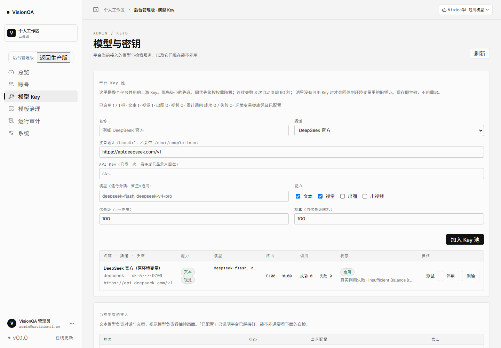
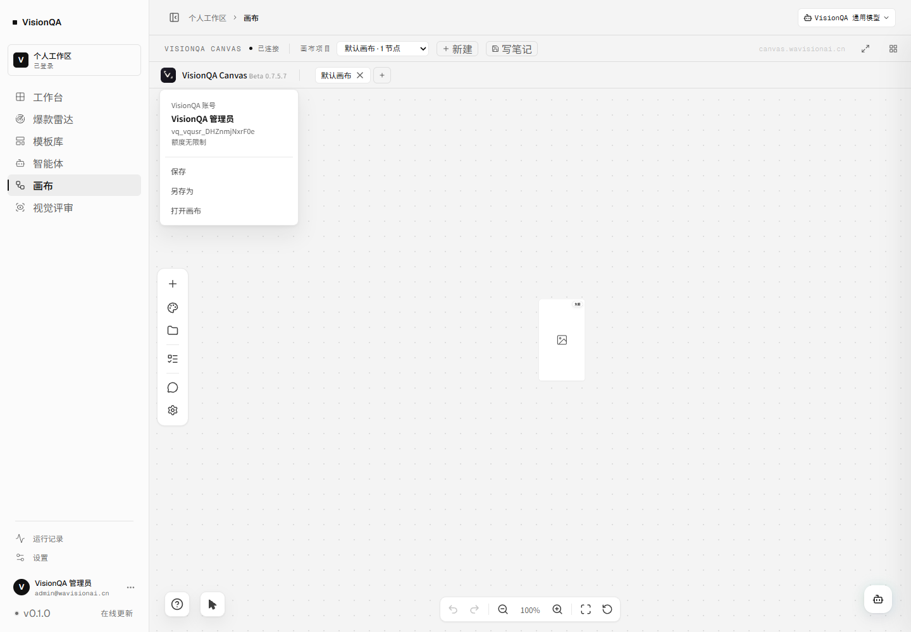

# 平台账号与 Key 路由（目标架构 + 第一期落地）

日期：2026-11-11 · 状态：第一期（VisionQA 侧 Key 池与路由）已落地并通过测试；画布账号桥与生成网关在下一期

## 一、结论先行

1. **身份只留一套**：VisionQA 账号是唯一身份源，画布不再出现登录 / 注册 / 账号管理。画布内部仍保留一条「影子用户」记录（用于它自己的任务、额度和调用日志），但由 VisionQA 自动创建与同步，用户无感。
2. **Key 只留一处**：上游 Key 由 VisionQA 后台统一管理，支持多供应商、多 Key、能力标签、优先级、权重、失败冷却。画布只负责渲染与编排，不再让用户碰 Key。
3. **第一期已上线的是 Key 池本身**：管理员在「后台 → 模型与密钥 → 平台 Key 池」增删改，保存即生效，不需要改环境变量、不需要重启。
4. 第二期做两件事：画布账号桥（VisionQA token 换画布会话）、画布生成走 VisionQA 网关。

## 二、第一期：平台 Key 池（已实现）

### 2.1 数据模型

`data/model-keys.json`（权限 600，AES-256-GCM 加密，列表只回末四位）：

| 字段 | 说明 |
| --- | --- |
| name | 展示名，例如「DeepSeek 官方」 |
| provider | 渠道标识：deepseek / bailian / volcengine / openai / custom |
| baseUrl | OpenAI 兼容根地址，不带 /chat/completions |
| apiKey | 密文；密钥来自 VQ_KEY_SECRET 或 `data/.model-keys.secret` |
| models | 可选模型白名单；留空表示该 Key 通用 |
| capabilities | text / vision / image / video |
| priority | 越小越先用 |
| weight | 同优先级内按权重随机 |
| enabled | 停用后立即不参与路由 |

### 2.2 路由规则

1. 按能力过滤（本次调用是文本、视觉、出图还是视频）。
2. 模型白名单匹配：声明了模型但都不匹配的 Key 不参与；只保留「通用 Key」。
3. 跳过冷却中的 Key。
4. 取最小 priority 的一组，按 weight 加权随机。
5. 连续失败 3 次 → 冷却 60 秒；一次成功立即恢复。
6. 池里没有可用 Key → 回落到环境变量里的旧凭证（升级不打断现有功能）。

### 2.3 管理接口（仅管理员）

| 方法 | 路径 | 作用 |
| --- | --- | --- |
| GET | /api/admin/model-keys | 列表（脱敏）+ 能力统计 + 回落状态 |
| POST | /api/admin/model-keys | 新增 |
| PATCH | /api/admin/model-keys/:id | 改名称 / 地址 / Key / 模型 / 能力 / 优先级 / 权重 / 启停 |
| DELETE | /api/admin/model-keys/:id | 删除 |
| POST | /api/admin/model-keys/:id/test | 对文本 / 视觉能力打一次真实请求（max_tokens=1）；出图 / 视频只探测凭证并写明 mode |

所有写操作都进管理员操作审计（action: model-key.create/update/delete/test）。

### 2.4 生效范围

- 智能体对话、模板解析、视觉评审、画布内置流程里的模型调用全部走同一个入口 `server/chatcall.mjs`，改一处所有功能同时生效。
- 模型下拉框会自动出现 Key 池里声明的模型，前端不写死模型名。
- 前端入口：后台「模型与密钥」页顶部新增「平台 Key 池」区块。

### 2.5 后台能看见什么（2026-11-11 增补）

管理 Key 不能只看「加进去了」，还要能回答三个问题：这把 Key 现在能不能用、为什么最近没被选中、失败是上游的什么错。

- **真实调用自检**：「测试」不再拿 `GET /models` 的 200 冒充可用——文本 / 视觉能力会真的发一次 `chat/completions`（max_tokens=1），出图 / 视频因为会产生费用，只探测凭证，并在结果里标 `credential-probe`，界面上写「凭证正常 · 只验证了凭证」，不写成「可用」。
- **每把 Key 的调用计数**：路由实际调用后累计成功 / 失败次数、最近一次错误与时间、冷却剩余秒数；失败 3 次进冷却的那把会在状态列显示「冷却中 42s」。
- **合计**：顶部一行给出 已启用 / 总数、各能力数量、累计成功 / 失败、冷却中数量、环境变量兜底状态。



图里这把是原 `.env` 里的 DeepSeek 凭证，通过管理接口迁进 Key 池；点「测试」发出的真实请求被上游以 402 `Insufficient Balance` 拒绝，界面如实显示错误原文——这正是「余额不足」这一唯一阻塞的线上证据。

## 三、第二期：画布账号桥（2026-11-11 已上线）

目标：画布里没有任何账号 UI，用户从 VisionQA 进入就是已登录状态。**线上已跑通。**

### 3.1 链路

```
VisionQA 登录 → 打开画布页 → iframe 加载画布
  → 画布向父窗口 postMessage {type:'vq-canvas:ready'}
  → VisionQA 取一张 120 秒票据（GET /api/canvas/session-token）
  → 父窗口回 {type:'vq-canvas:ticket', token}（targetOrigin 固定画布源）
  → 画布 POST /enterprise/api/auth/exchange
  → 企业服务校验 HS256 票据，按 external_id upsert 影子用户，回画布自己 30 天的 JWT
  → 之后所有画布请求都带画布 token，用户全程看不到画布登录框
```

### 3.2 实现位置

| 位置 | 作用 |
| --- | --- |
| `server/canvas-session.mjs` | 签发票据：HS256，claims 只有 iss/aud/sub/email/name/role/iat/exp/jti，时效封顶 10 分钟 |
| `server/routes/canvas.mjs` | `GET /api/canvas/session-token`（必须登录）；没配共享密钥返回 503 CANVAS_TRUST_DISABLED |
| `src/pages/CanvasPage.tsx` | 监听 `vq-canvas:ready`，校验 origin 后把票据 postMessage 进 iframe（不用 `*` 发凭据） |
| `enterprise_server/visionqa_trust.py` | 画布侧验票：aud/iss/exp/iat 全查，任何不符直接 401，不做宽松兜底 |
| `enterprise_server/auth.py` | `POST /enterprise/api/auth/exchange`：按 `external_id = vq:<visionqa 用户 id>` upsert 影子用户 |
| `enterprise_server/db.py` | `enterprise_users` 加 `external_id` 列 + 唯一索引（老库自动迁移） |
| `src/features/enterprise/visionqaTrust.ts` | 画布侧握手：只认 `event.source === window.parent` 的票据消息 |
| `src/features/enterprise/enterprise.ts` | `exchangeVisionQaTicket()`；托管模式标记 `trustMode` 进 getState，菜单据此隐藏账号入口 |

### 3.3 画布里还剩什么

- 登录、注册、改名、改头像、重置密码、登出：**托管模式下全部不渲染**，账号只在 VisionQA 后台管。
- 影子用户按 `external_id` 唯一：同一个 VisionQA 账号重进画布始终是同一条画布用户，任务、历史、额度不会串。
- 每次进画布都重新换一次票据：VisionQA 换账号，画布跟着换，不会沿用上一个人的画布 token。
- 额度：影子用户初始 unlimited（画布不拦），等生成网关接入后由 VisionQA 按次记账。

### 3.4 线上验证（2026-11-11）

- 票据：`GET /api/canvas/session-token` → 200，TTL 120 秒。
- 兑换：`POST /enterprise/api/auth/exchange` → 200，返回画布 JWT；同一张票重复兑换返回同一个用户 id（幂等）。
- 身份：iframe 内 `GET /enterprise/api/auth/me` → 200，`display_name` 为 VisionQA 账号的显示名，`username` 为影子用户。
- 失败路径：`not-a-jwt` / `a.b.c` 都被 401 `TICKET_INVALID` 拒绝。
- 单测：`node scripts/test-canvas-session.mjs`（签名/过期/篡改/受众/角色/时效上限）、画布 `npx vitest run src/__tests__/enterprise-visionqa-trust.test.ts`（3 项）。



画布头像菜单只剩「VisionQA 账号 + 保存/另存为/打开画布」，没有任何登录、注册、改密、登出入口。

### 3.5 回退出

- VisionQA 侧删掉 `VQ_CANVAS_SHARED_SECRET` 并重启：票据接口回 503，画布自动回落到它自己的登录。
- 画布侧删掉 `VISIONQA_TRUST_SECRET` 并重启：兑换接口回 503 `TRUST_DISABLED`，行为同上。

## 四、第二期：画布生成网关（设计）

画布当前直连上游（火山 / CGCM / 百炼），Key 散在画布企业库里，既不好统一管理，也无法做跨供应商路由。目标链路：

```
画布节点 → VisionQA 网关 /api/gateway/v1/*（带 VisionQA token）
        → keyvault.resolveKey(provider/capability) 选 Key
        → 火山 / CGCM / 百炼
        → 回传结果 + 用量；VisionQA 记一次调用
```

第一期已经具备网关最核心的一块（Key 池 + 健康与冷却），网关只需补：

- 路由表（模型 → provider/feature）与 OpenAI 兼容的 images / videos / chat 三个入口；
- 用户级配额与调用日志（复用 credits.mjs 的流水）；
- 画布侧把 enterpriseBaseUrl 指到网关并带上 VisionQA token。

## 五、验收方式

**第一期（已完成）**

- `node scripts/test-keyvault.mjs`：加密落盘 / 脱敏 / 模型匹配 / 冷却恢复 / 增删改。
- `node scripts/test-model-keys-e2e.mjs`：真实 HTTP 走 Key 池、坏 Key 冷却后自动切到好 Key；文本 Key 的「测试」必须打到 `/chat/completions`（不许用 /models 冒充），出图 Key 只探测凭证且标注 `credential-probe`。
- 本地起服务实测：登录 → GET/POST/PATCH 管理接口 → `/api/models` 出现新模型 → 落盘文件不含明文。

**第二期（待做）**

- 画布不再出现登录入口，VisionQA 换号后画布自动跟着换。
- 画布生成请求全部打到 VisionQA 网关；关掉画布企业库里所有 Key 仍能出图。
- 断开一把 Key，网关自动切下一把，画布侧无感。