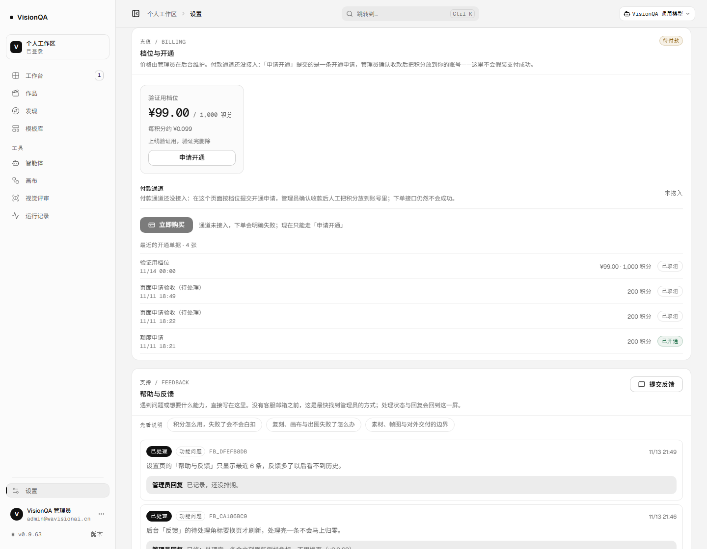
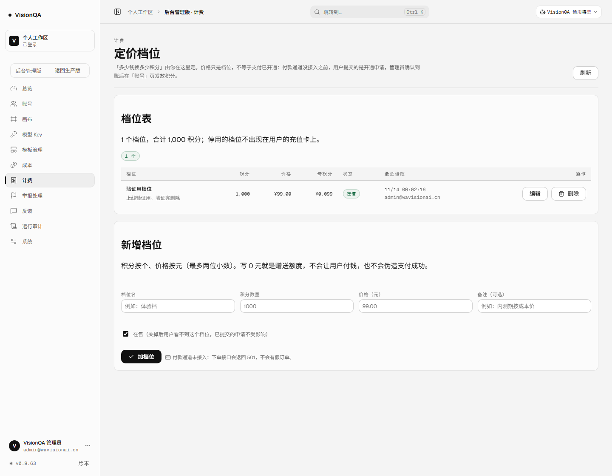

# 定价档位：价格由你定，代码不写死（v0.9.63）

> 2026-11-13。A4「收钱」的代码部分：把「多少钱换多少积分」从代码常量变成后台可维护的数据，
> 并让用户在付款通道接入之前也有一条走得通的路径——按档位提交开通申请，管理员确认收款后人工开积分，
> 每一步都留一张带档位与金额的单据。**支付仍未接入**，下单接口依旧是明确的 501，不伪造订单。

## 一、修之前什么样

- `server/routes/billing.mjs` 里 `const PLANS = []`：想定价只能改代码 + 重新发版。
- 设置页「余额与充值」只有一句「计费方式与价格还没定」，用户看不到任何档位、也不知道该找谁。
- 额度申请（v0.9.5x 就有）只有「要多少积分」一个数字，没有价格、没有档位、没有单据号语义：
  管理员发放时不知道这一笔谈的是多少钱，用户事后也说不清自己申请的是哪一档。

## 二、这一版做了什么

1. **档位落盘**：`server/plans.mjs` → `DATA_DIR/plans.json`（0600）。字段是
   `name / credits / priceCents / note / enabled / sort`，价格存「分」（整数，避免 0.1+0.2 的浮点尾巴）。
   上限 40 个档位、积分 1–100000、价格 0–100000 元（0 元是赠送额度，不是免费送钱）。
2. **后台「计费」页**（后台侧栏新增一项）：档位表 + 新增/编辑表单 + 删除。改完下一次刷新就生效，不用发版。
   每次增删改都进 `admin_audit`（`plan.save` / `plan.delete`）。
3. **设置页按档位渲染**：每张卡是「¥价格 / 多少积分 / 每积分约多少 / 备注」，动作是「申请开通」而不是「立即购买」；
   「立即购买」保持不可用，旁边写清「通道未接入，下单会明确失败」。
4. **申请带档位**：`POST /api/credits/request { planId }`——**积分与价格由服务端从档位取**，客户端传的 `amount` 不作数；
   档位不存在或已停用直接 404，不落脏单据。
5. **单据是快照**：申请时把 `planId / planName / priceCents` 抄一份存进那条申请里。
   之后档位改名、改价、甚至删掉，用户看到的历史单据还是当时谈定的那一笔。
6. **状态闭环**：待确认（已提交）→ 已开通（管理员发放，记发放人与金额）/ 已取消（管理员忽略）。
   后台「账号 → 额度申请」多两列：档位与金额，发放按钮仍按同一笔账本发放。

## 三、生产实证（v0.9.63，2026-11-13）

| 动作 | 结果 |
| --- | --- |
| `/api/version` | `0.9.63`（入口 `index-BPfWKYLU.js`） |
| 创建前 `GET /api/admin/plans` | `0` 个档位（真实现状：价格还没定） |
| 后台建一个档位 | **201**，`plan_dfb3cc9a`，`priceCents 9900 / credits 1000` |
| `GET /api/billing/overview` | `enabled: false`、档位 1 个、价格 `99`、文案「付款通道还没接入…」 |
| 设置页刷新后 | 卡片渲染「验证用档位 ¥99.00 / 1,000 积分 · 每积分约 ¥0.099」，按钮「申请开通」 |
| 点「申请开通」 | 单据一行：`验证用档位 · 11/14 00:00 · ¥99.00 · 1,000 积分 · 待确认` |
| 后台待处理申请 | 1 条，带 `planName 验证用档位 / priceCents 9900 / amount 1000` |
| 管理员「忽略」 | 200 `ignored`；积分余额 **9950 → 9950**（忽略不动钱） |
| 删除档位后 | `/api/admin/plans` 0 个、overview `plans 0`；那张单据仍是 `验证用档位 / 9900`（快照生效） |
| 下单接口 | 仍是 **501** `BILLING_NOT_CONFIGURED`，`GET /api/billing/orders` 仍是空列表 |
| 控制台报错 | 0 |

**关于截图里的「验证用档位」**：那是为了验证渲染与流程临时建的，备注就写着「上线验证用，验证完删除」，
验证完已删除（`DELETE` 返回 200，删除后档位 0 个）。**真实价格仍待你定**，本文不编任何价格。

## 四、测试与质量

- 新增 `test/plans.test.mjs` 10 条：整数分入库与排序、五种非法输入的拒绝、改价与停用、overview 永远 `enabled:false`、
  下单 501 且订单列表为空、按档位申请时客户端 `amount` 无效、档位不存在/停用 404 且不落库、单据快照、发放后状态、
  后台路由的 401/403/400/404。
- 全仓 **559/559** 通过；`oxlint` 0 error / 7 warning（与上一版持平）；`tsc -b` 干净；`npm run build` 通过。
- 手机 390 宽自查：`documentElement.scrollWidth 390`、无超宽节点、档位卡单列铺满。

## 五、边界（这一版没做什么）

- **支付没接**：没有订单表、没有回调验签、没有对账脚本；`POST /api/billing/orders` 仍返回 501。
- **发票没有**：先人工，等主体与客服邮箱（A7）。
- **档位不等于配额**：没有按账号的额度上限与 429（A8 的另一半），也没有并发档位。
- **「忽略」与「开通」的语义**：忽略只是关掉这条申请，不会通知用户；开通才动积分账本。
- **单据只留最近 5 张**：更早的仍在 `credit-requests.json` 里，界面不列。

## 六、回滚

`bash /opt/visionqa/ops/rollback.sh 20261113-155831-v0.9.63b`（或任意更早快照）。
回滚只换代码，`plans.json` 会留在数据目录里；旧版本的 overview 不读它，界面回到「档位与价格待定」。
