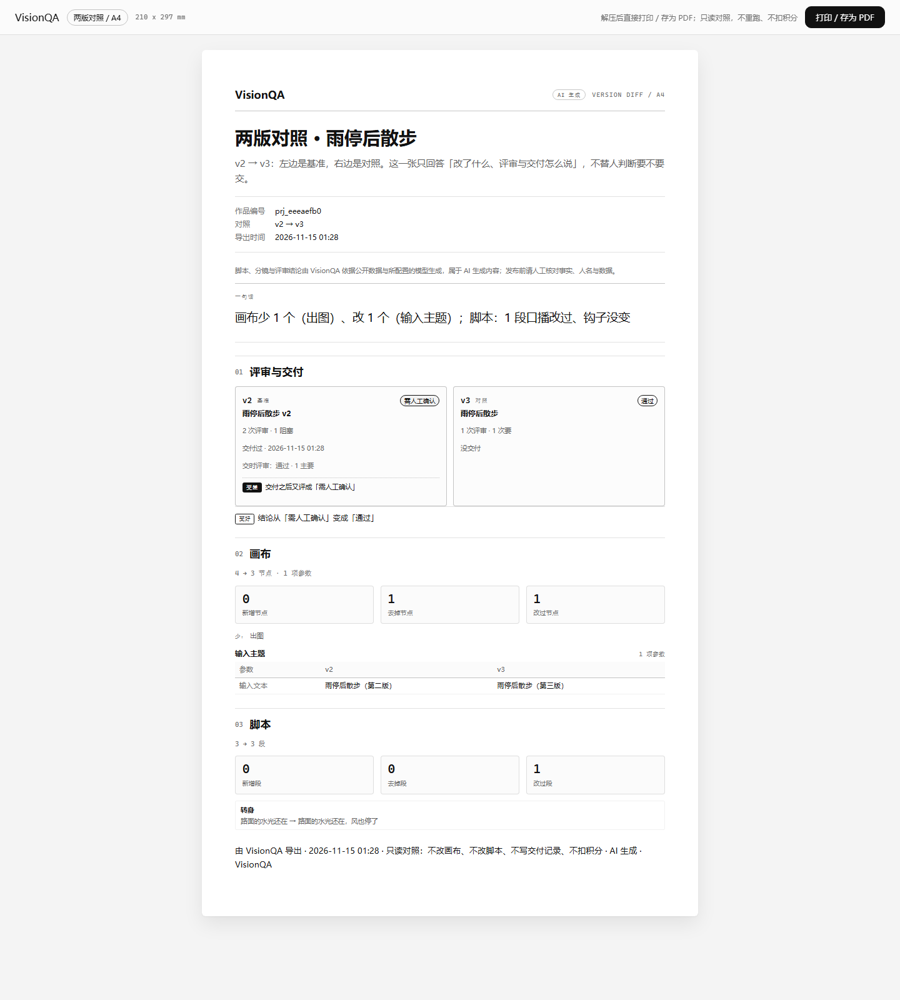

# 交付包里多一张两版对照：拿到 zip 就能看见这一版改了什么（v0.9.122，2026-11-15）

> 一句话：v0.9.121 把两版对照排成了 A4，但纸只在作品页弹窗里打印；把交付包发给剪辑、拍摄或甲方时，收件人还是看不到「这一版改了什么」。这一轮把同一张对照纸装进交付包，解压就能看、能打印，不用登录、不用联网。

## 问题

交付包已经有三样东西：交付稿（全文）、现场页（脚本 + 分镜 + 帧图）、评审对照页（问题框在画面上）。缺的是版本之间的那句话：

- 这一版比上一版少了哪个节点、改了哪项参数、换了哪段口播，只有作品页的弹窗知道；
- 收件人没有账号，打不开弹窗；把屏幕截图塞进群里，又和交付包对不上号；
- 评审会上讨论「这一版值不值得交」，手里没有一张能翻、能标记、能带走的纸。

这不是再做一个新页面能解决的。交付包本来就是「拿到就能用」的一整套，版本变化也应该在里面。

## 改了什么

### 打包时多生成一张只读对照页

server/routes/projects.mjs 的交付包路由在生成现场页、评审对照页之后，新增一段：

- 当前版 >= 2 时，取 base = 当前版 - 1、target = 当前版；
- 调 versionCompareView（与弹窗、打印页同一个函数）拿同一份 view；
- 调 compareSheetHtml 排成 A4，写进包里的「两版对照页.html」；
- 当前版只有 v1 时跳过：没有上一版可 compare，不塞一张空纸。

只打当前版与上一版，是因为交付包回答的是「这次交出去的东西」，不是一条作品的完整版本史。任意两版仍然在作品页弹窗里选。

### 离线页不带联网入口

打包时给 compareSheetHtml 传 offline: true：

- 品牌图从 /brand/visionqa-lockup.svg 改成文字 VisionQA；
- 不印「返回作品」——file:// 下那个地址会死；
- 页面里没有任何 http(s) 外链；
- 打印按钮仍由浏览器自己的 PDF 引擎工作。

### 说明里写清文件对应关系

packageNote 新增可选参数 compareSheet: { base, target }。传了才写：

两版对照页.html  v2 → v3 的画布参数、脚本口播、评审与交付并排；只读，双击打开就能打印

没传就不写这行——读者不会在包里找一个不存在的文件。现场页与两版对照页的离线说明也补了一句「同一套数字，同一次导出」。

### 入口文案

交付菜单里的交付包说明从「交付稿 + 现场页 + 评审对照 + 帧图」改为「交付稿 + 现场页 + 评审对照 + 两版对照 + 帧图」，标题提示也同步。

## 本地实测

环境：本地 8954，一次性数据目录，真 Chrome；评审记录由脚本直接写入 reviews.json，没有调用评审上游。v2 先以「通过」交付，交付后补一次「需人工确认（1 阻塞）」；v3 评成通过（1 次要）、没交付。

| 检查 | 读数 |
| --- | --- |
| 作品 / 版本 | prj_eeeaefb0；v1 flow_4e039f24 → v2 flow_edbcd26a → v3 flow_ea942605 |
| 数据 | 1 条作品、3 块画布、4 条评审（v2 两次）、0 个模板 |
| 交付包 | 53,229 B；5 个文件：交付稿 4,103 B、两版对照页 16,896 B、现场页 15,549 B、评审对照页 15,153 B、说明 926 B |
| 包里的方向 | v2 → v3；画布少 1 个（出图）、改 1 个（输入主题）；脚本改 1 段口播、钩子没变 |
| v2 评审 / 交付 | 2 次评审 · 1 阻塞；交付过 11/15 01:28；交时评审：通过 · 1 主要；交付后重评标「变差」 |
| v3 | 通过 · 1 次评审 · 1 次要 · 没交付 |
| 离线页 | 1440 × 1600；0 个 http(s) 外链、0 个 /brand/visionqa-lockup.svg、0 个「返回作品」 |
| 只读 | 下载前后 projects.json / reviews.json / flows.json / auth.db 的 mtime 一致；0 写请求 |
| 上游调用 | 0 次生成 / 评审 |

截图是 Chrome 直接打开解压后的两版对照页.html，不是设计稿。页面宽 1440，纸宽约 794；内容高超过一屏时按区块续页，不为了「一页」把字号压小。

## 生产实况

部署 20261114-173008-r132package（部署前快照 20261114-173008-r132package.tar.gz 1,058,186 B）。

| 检查 | 读数 |
| --- | --- |
| 版本 / 健康 | 8799 / 8800 / 公网都 0.9.122；/api/health ok（模板 26，部署后 uptime 16s） |
| 四个 unit | visionqa / visionqa-internal / visionqa-demo / visionqa.socket 全 active |
| 入口 / 画布 / 后台 | index-BHxFogvj.js 617,146 B；CanvasPage-DeRlKjNG.js 242,014 B；AdminConsolePage-CRGLcAgP.js 201,077 B |
| 样式 | index-DKcGBP6S.css 299,225 B；CanvasPage-BX48Ugxj.css 28,926 B |
| 文件一致 | project-compare 4f8e1fec / project-compare-sheet 52d36e79 / projects c3a96d89 / project-set-sheet 6a7f9bbe / project-deliverable-html 6130c71f / 入口 7a3deea8 / 画布 58817960 / 后台 5dea7dff / 主样式 71a3fc38 / 画布样式 b49e8586 |
| 未登录 | /api/projects/<id>/deliverable.zip、/api/projects/<id>/versions/compare、/print/projects/<id>/versions/compare 都是 401 |
| 心跳 / 盘 | pid 1494969 / 1494968，beatAt 17:30:40Z；盘 72%；/tmp 373M；日志没有业务 error |
| 数据 | 9 条运行、0 条带 graph；1 条作品、3 条评审、0 条交付记录 |

生产没有登录账号做真实作品两版对照，也没有真实交付记录上的打包验证；离线页的证据来自本地真浏览器 + 本地服务，零真实上游。

## 踩到的坑

1. 离线页不能引用服务器品牌图：第一版直接把线上打印页的 HTML 装进包，/brand/visionqa-lockup.svg 在 file:// 下会变成破图；现在 offline 时品牌改文字。
2. 不能印「返回作品」：同一个地址在本地打开会指向不存在的页面；测试专门断言包里没有这个入口。
3. 说明只在有纸时写：没有上一版时包不生成对照页，说明也不能写文件名，否则收件人会找一个不存在的文件。
4. v1 不能生成空对照页：版本 1 没有 base，不调用 compareSheetHtml，不塞占位。
5. 当前版与上一版只是交付包的默认口径：任意两版选择仍留在弹窗，不把这个选择塞进打包流程。
6. 不能另算一套对照：打包时再算一遍，纸和弹窗迟早各说各话；复用 versionCompareView。
7. 时区与导出时间要跟交付包同一次：now 与 zipTz 一路传下去，纸上的时间不会和说明差一分钟。
8. 下载前后数据文件 mtime 必须一致：只读不是口号，zip 路由不写作品、评审、交付记录，也不扣积分。

## 发现但没做

- 只读分享页仍没有两版对照纸：收件人没有账号时，只能看现场页与评审对照。
- 交付包固定打当前版 vs 上一版，不能选任意两版。
- 没有跨作品对照、保存一份对照结果或独立分享链接。
- 对照页还不能点进那一次评审记录；要看问题原文得回评审页。
- 没有「只印摘要 / 只印画布」的纸型选择。
- 生产没有真实作品两版对照，也没有真实交付记录上的打包验证。

## 提交与 CI

提交与 CI 见仓库记录。

## 回退

bash /opt/visionqa/ops/rollback.sh --to 1 → v0.9.121；--to 2 → v0.9.120。

这一版只在打包时多生成一张只读 HTML、在说明里多一行、在交付菜单文案里多四个字；不改作品 / 评审 / 交付 / 运行落盘结构，回退不需要改数据。
