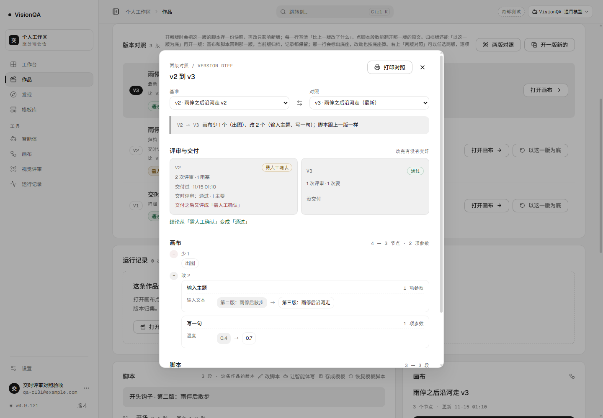
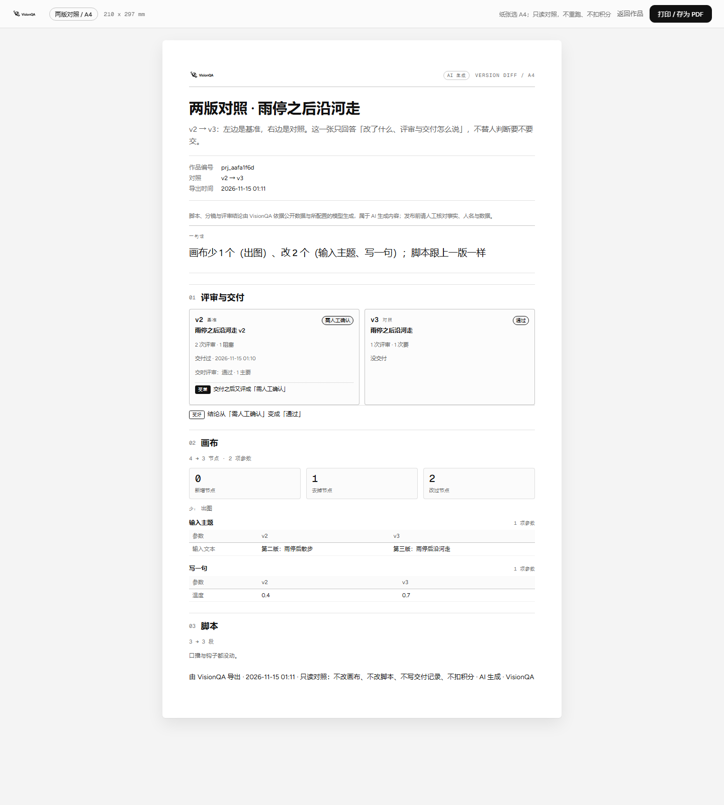
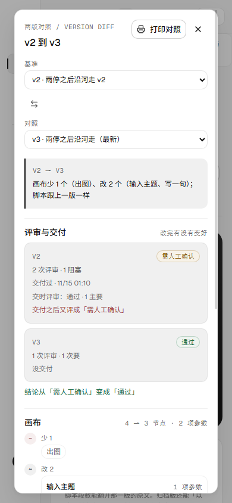

# 两版对照排成一张纸：改完的结果能打印、能带走（v0.9.121，2026-11-15）

> 一句话：v0.9.120 的两版对照能回答「改完有没有变好」，但答案只活在作品页的弹窗里。这一轮把同一份对照排成 A4：评审与交付左右各写各的，画布参数与脚本口播逐项列出来，点「打印对照」就能存 PDF 带走；只读，不重跑、不扣积分。

## 问题

两版对照已经做了四轮：任意两版、参数级差异、评审与交付并排、交时快照与后来重评分开。但所有结论都锁在一个 680px 的弹窗里：

- 评审会上要讨论「这一版值不值得交」，只能把屏幕转过去，或者截一张不完整的图；
- 发给导演、剪辑、甲方时，对方没有账号，也没有这个作品的地址；
- 已经有的三张纸（交付稿、现场页、评审对照）都只能印单一版本，没有一张纸能把两版并排说清。

这不是再加一个筛选器能解决的。需要的是一个**只读、可打印、与弹窗同源**的产物。

## 改了什么

### 取数只留一份：`server/project-compare.mjs`

原来「两版对照」的取数逻辑只写在 `GET /api/projects/<id>/versions/compare` 的路由里。这一轮把它抽成 `versionCompareView(project, user, base, target)`：

- 当前版读现在的画布与脚本，归档版读开版时存下的快照；
- 评审按版次统计，版本划分前的老评审折进 v1；
- 交付只认这一版的记录，交时评审照写当初，不拿后来重评覆盖；
- 哪一侧读不到就返回 `null`，notes 说清哪一侧不比。

弹窗和打印纸都调这一个函数。纸上的「少 1 个（出图）」「交时评审：通过 · 1 主要」不会和弹窗各说各话。

### A4 对照纸：`server/project-compare-sheet.mjs`

`GET /print/projects/<id>/versions/compare?base=2&target=3&tz=480` 返回一张排版好的 HTML（打印时浏览器按 A4 出纸 / 存 PDF）：

| 区块 | 写什么 |
| --- | --- |
| 抬头 | 作品名、方向 v2 → v3、导出时间、AI 生成标识 |
| 一句话 | 与弹窗同一个 `summary`：画布多 / 少 / 改，脚本多 / 少 / 改、钩子换没换 |
| 评审与交付 | 左右两张卡：最近一评、问题数、交付时间、交时评审快照、交付后重评；下方一句两版结论变化 |
| 画布 | 多 / 少 / 改的节点数，去掉的节点名，改过节点的参数表（参数、v2、v3） |
| 脚本 | 多 / 少 / 改的段数，新增 / 去掉的段名，改过的口播前后原文，开头钩子前后 |
| 这张纸没比的部分 | 缺画布、缺脚本快照、没评过等缺口，原样写 |
| 纸脚 | 只读说明、导出时间、AI 生成标识 |

边界写死在纸里：

- 参数最多列 6 个节点 / 12 项，脚本最多列 6 段；超出就写「还有 N 项没印」，不偷偷截断。
- 没有快照、没评过、没交付就照实写；不拿别的版本顶，不编「没变」。
- 打印页未登录返回一张「登录已过期」的提示纸，不吐 JSON；版次不对 / 同一版返回 400，归档缺失返回 404。
- 纸脚写明「不改画布、不改脚本、不写交付记录、不扣积分」。

### 弹窗入口

「两版对照」弹窗右上多一个「打印对照」按钮：只有当前两版读完、不是加载 / 错误态时才可点；新标签打开当前选中的两版，浏览器拦弹窗时由作品页现有的 toast 提示，不静默失败。选哪两版，纸上就是哪两版；交换方向后打印的也是交换后的方向。

## 本地实测

环境：本地 8954，一次性数据目录，真 Chrome；评审记录由脚本直接写入 `reviews.json`，没有调用评审上游。v2 先交付（交时通过），交付后补一次「需人工确认（1 阻塞）」；v3 评成通过（1 次要）。

| 检查 | 读数 |
| --- | --- |
| 作品 / 版本 | `prj_aafa1f6d`；v1 `flow_daa45fd2` → v2 `flow_2ea17cfe` → v3 `flow_60098c09` |
| 默认对照 | v2 → v3；画布少 1 个（出图）、改 2 个（输入主题、写一句）；脚本跟上一版一样 |
| v2 评审 / 交付 | 需人工确认 · 2 次评审 · 1 阻塞；交付过 11/15 01:10；交时评审：通过 · 1 主要 |
| v2 交付后 | 交付之后又评成「需人工确认」，纸上标「变差」 |
| v3 | 通过 · 1 次评审 · 1 次要 · 没交付 |
| 1440 弹窗 | 宽 680；页面 `scrollWidth` 1440；打印按钮在标题右侧 |
| 390 弹窗 | 宽 342（left 24 / right 366）；页面 `scrollWidth` 390；两张卡 407–543、551–641，纵向排开 |
| A4 纸 | 宽 794、高 1347；视口 1440 下 `scrollWidth` 1440；「打印 / 存为 PDF」按钮在顶栏 |
| 纸上内容 | v2 → v3、交时评审：通过 · 1 主要、交付之后又评成「需人工确认」、输入文本与温度的前后值 |
| 浏览器请求 | 6 次对照 `GET`（含打印页）；写请求 0 |
| 上游调用 | 0 次生成 / 评审 |

打印页的内容高 1347px，超过 A4 单页可印高度；打印时由浏览器自然续页，各区块 `break-inside: avoid`，不会把一个节点或一张评审卡劈成两半。这张纸不承诺「永远一页」——内容多时续页比缩成 6pt 看不清更诚实。

## 生产实况

部署 `20261114-171140-r131sheet`（快照 `20261114-171140-r131sheet.tar.gz` **1,051,427 B**）。

| 检查 | 读数 |
| --- | --- |
| 版本 / 健康 | 8799 / 8800 / 公网都 **0.9.121**；`/api/health` ok（模板 26，部署后 uptime 16s） |
| 四个 unit | 全 active |
| 入口 / 画布 / 后台 | `index-C8_A_JOb.js` 617,110 B；`CanvasPage-BiJnEoNr.js` 242,014 B；`AdminConsolePage-BlN_oY0j.js` 201,077 B |
| 样式 | `index-DKcGBP6S.css` 299,225 B；`CanvasPage-BX48Ugxj.css` 28,926 B |
| 文件一致 | `project-compare 4f8e1fec` / `project-compare-sheet eb84eceb` / `projects a000b155` / `routes 0fe6c558` / `version-diff b4e395d8` / 入口 `82806599` / 画布 `caf1e64e` / 后台 `8be1498f` / 主样式 `71a3fc38` / 画布样式 `b49e8586` |
| 上线标记 | `deliveryOfVersion` 2 处（在 `project-compare.mjs`）、`versionCompareView` 1 处、`compareSheetHtml` 1 处、`COMPARE_PRINT` 2 处、`vq-vcompare-print` 1 处、`VERSION_COMPARE` 5 处 |
| 未登录 | 对照接口本地 / 公网 **401**；打印页本地 / 公网也 **401**（返回提示纸，不是 JSON） |
| 心跳 / 盘 | pid 1494305 / 1494304，beatAt 17:11:53Z；盘 72%；`/tmp` 372M；日志没有业务 error |
| 数据 | 9 条运行、0 条带 graph，`run-graphs` 还没有目录；1 条作品、3 条评审、0 条交付记录 |

生产没有登录账号做真实作品的两版对照，也没有真实交付记录；打印页的真实排版证据来自本地真浏览器 + 本地服务，零真实上游。

## 踩到的坑

1. **不能复制一份对照逻辑给打印页**：一开始路由里已经有一整套取数，如果打印页再算一遍，页面说「主要少 1 个」、纸说另一个数，比没有纸更糟。先抽 `versionCompareView`，两个入口都只调它。
2. **交付快照三种状态不能压成一种**：对象、`null`、字段不存在分别写「通过 · 1 主要」「还没评过」「没记（升级前的交付记录）」；打印页也一样。
3. **时区要跟着地址走**：纸上的交付时间与导出时间都按 `tz` 写；不能把服务端本地时区印给另一个时区的人。
4. **打印页的未登录不能回 JSON**：这个地址是在新标签里打开的，吐一段 JSON 会让人以为页面坏了；沿用交付稿 / 评审纸的 `printNoticeHtml` 提示纸。
5. **版次与同一版要单独校验**：打印页可以手改地址，`base=2&target=2` 必须 400；归档版缺失必须 404，不能拿当前版顶。
6. **A4 内容可能超过一页**：各区块加 `break-inside: avoid`，让浏览器在区块之间续页；不为了「一页」把字号压到 7pt 以下。
7. **参数太多的纸要说得清**：最多 6 个节点 / 12 项参数，超出的写「还有 N 项没印」，不静默截断。
8. **打印按钮要一直在视野里**：放在弹窗底部时，用户要先滚到底才看得到；这一轮把按钮放到标题右侧，加载中 / 错误时禁用。

## 发现但没做

- 只读分享页没有两版对照纸：现在打印页要走登录态，收件人没有账号就打不开。
- 没有跨作品对照，也不保存一份「对照结果」或生成独立分享链接。
- 对照纸没有并进交付包 `.zip`：交付包仍是交付稿 + 现场页 + 评审对照页。
- 对照弹窗仍不能点进那一次评审的记录；要看问题原文得回评审页。
- 内容多时打印会续页，还没有「只印摘要 / 只印画布」的纸型选择。
- 生产没有真实作品两版对照，也没有真实交付记录上的打印验证。

## 回退

`bash /opt/visionqa/ops/rollback.sh --to 1` → **v0.9.120**；`--to 2` → **v0.9.119**。

这一版只新增两个只读服务端模块、一个打印路由和一个弹窗按钮；对照接口结构不变，交付 / 评审 / 作品落盘结构不变，回退不需要改数据。
