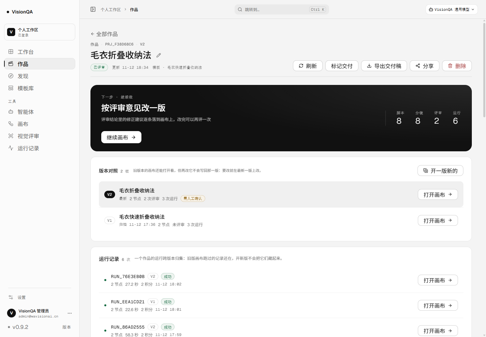
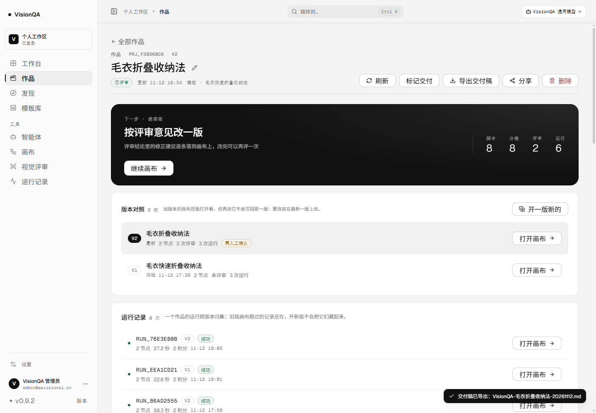
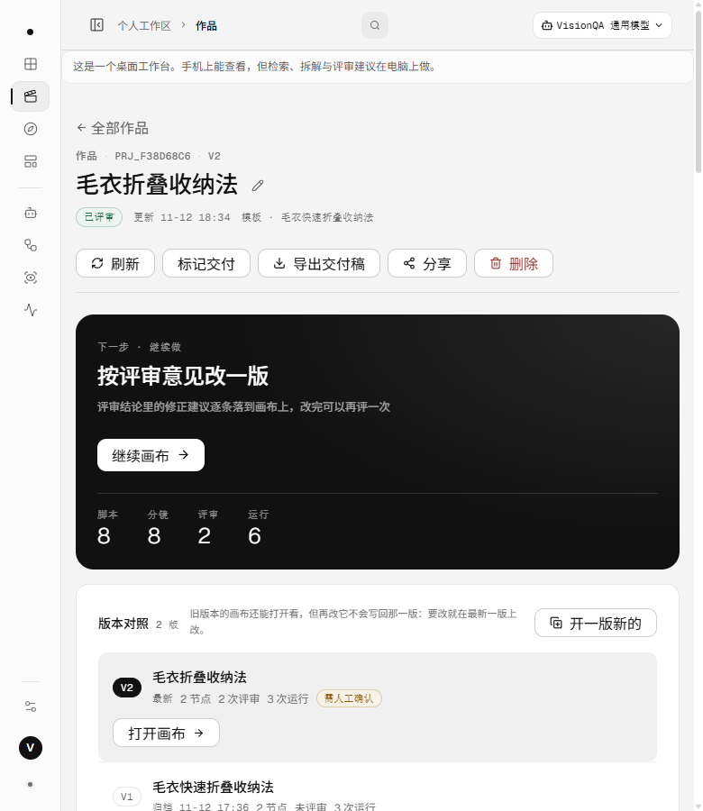

# 作品交付稿：一条内容终于能拿出工作台了（2026-11-12）

结论先行：作品页以前只能「标记交付」，标记完手上什么也没有——脚本、分镜、评审结论都留在屏幕里。
这一片补上最后一公里：**一键把这条作品压成一份 Markdown 交付稿**，脚本、分镜、评审的问题与修正建议、
版本对照、运行记录（含失败原因）全在里面，直接发给剪辑、贴进文档、打印成纸质稿都行。

对应 `docs/product-structure-2026-11-12.md` 里「从发现到审片的流水线」的最后一环：
作品串起了来源与脚本，评审给出了结论，但**交付物**一直是空的。

## 一、之前 / 现在

| 项目 | 之前 | 现在 |
| --- | --- | --- |
| 交付 | 只有「标记交付」按钮，改的是作品状态 | 页头「导出交付稿」：点一下落盘一个 `.md` |
| 内容 | 屏幕上能看的，拿不走 | 脚本表、分镜表、评审结论、版本对照、运行记录、交付状态 |
| 分享 | 只能生成只读链接（要联网、谁都能打开） | 交付稿是文件，不需要对任何人开权限 |
| 时间 | — | 按导出人所在时区写（东八区就是本地时间，不是 UTC） |
| 文件名 | — | `VisionQA-毛衣折叠收纳法-20261112.md`（作品名 + 日期，非法字符替换掉） |

## 二、稿子里有什么

按阅读顺序，一份稿子从头到尾：

1. **抬头**：作品编号、状态（已交付 / 评审 · 通过 / 评审 · 需人工确认 / 评审 · 不通过 / 在做 / 待开画布，v0.9.19 起直接写结论）、画布与节点数、模板（平台 · 原片时长 · 段数/镜数）、
   脚本来源（自己的版本还是跟随模板）、建立与更新时间、导出时间。
2. **时长对账**：「台词约需 X 秒，原片 Y 秒，按语速档「中」估（5.25 字/秒）+ 一句结论」。
3. **脚本**：钩子 + 表格（时间 / 段落 / 口播 / 屏幕字 / 目的 / 念完），偏多的段落标「偏多」。
4. **分镜**：逐镜的时长、画面、机位、字幕、音频、用途、念完几秒；注明分镜来自哪条模板（改过的脚本不会自动重排镜头时间）。
5. **评审**：最新一次这一版的结论、用的模型与耗时、结论原文、判断层（依据一致 / 可执行 / 发布风险）、
   问题清单（严重度 + 维度 + 依据强度）、修正建议、这次没判断的。
6. **版本对照**：每一版的画布、节点数、评审次数、运行次数、最近结论、归档时间；版本划分之前的历史记录折进 v1。
7. **运行记录**：最近 8 次（共几次会写明），状态、节点、耗时、积分（退了会标「已退」），失败的单独列原因。
8. **交付**：标记交付了没有、只读分享开着没有。

## 三、三条边界（这一片最花时间的部分）

1. **不写凭证**：只读分享的 token 不进稿。token 等于一把钥匙，稿子是会被转发出去的。
   稿子里只写「已开启」，链接去作品页复制。测试里有一条专门断言 token 不出现。
2. **只写发生过的事**：这一版没送评审就写「这一版还没送评审」，不拿上一版的结论凑数、不替模型编一句总结。
   上一版评过的话，写清楚「评审按版本记，结论不混到这一版」。
3. **口径跟页面一致**：脚本用作品自己的版本（copy-on-write）优先；版本 0 的历史评审与运行折进 v1；
   详情组装从路由里提成了 `projectDetailView()`，作品页和导出读同一个函数，不会两处各说一套。

## 四、生产实测（2026-11-12，v0.9.2）

作品「毛衣折叠收纳法」（`prj_f38d68c6`，v2，2 次评审 / 6 次运行）：

- 点「导出交付稿」→ 网络面板 `GET /api/projects/prj_f38d68c6/deliverable?tz=480` **200**、`text/markdown`，
  浏览器落盘 **9,245 B**，文件名 `VisionQA-毛衣折叠收纳法-20261112.md`（中文名走 RFC 5987，老浏览器退回 ASCII 名）。
- 稿子 174 行，实测内容包括：8 段脚本（7 段标「偏多」）、8 个镜头、一条 5 个问题的评审 + 3 条修正建议、
  版本对照 v1/v2、6 次运行（其中 4 次失败，失败原因逐条在稿里）。
- 时长对账：「台词约需 25.3 秒，原片 18 秒，按语速档「中」估（5.25 字/秒）。台词量比原片长，照着念完大约要多 7 秒」。
- 点导出后控制台 **0 异常**，按钮没有卡在「正在整理…」。

## 五、顺手修掉的两个问题

1. **页头挤标题**：多了第五个按钮之后，780 宽下标题被压成「毛衣 / 折叠收 / 纳法」三行。
   改成页头允许换行（`.vq-head` 加 `flex-wrap`，标题区给 24rem 的基准宽）：放不下时动作整行下移，
   1440 宽完全不变（截图逐像素一致）。全站页头共用这套样式，作品列表 / 模板库 / 运行记录同样受益。
2. **「按快速估」读不通**：时长对账那句在模板详情、分享页、模板导出里都写成「按快速估 / 按中速估」，
   快的档位读起来像病句。统一改成「按语速档「快」估」，四处（含服务端交付稿）口径一致；
   `docs/timing-estimation.md` 里引用的那句同步更新。

## 六、验收

- `npm test` **107/107**（新增 `test/project-deliverable.test.mjs` 10 条：完整稿、时区、时长口径、没评审不编结论、
  上一版结论不串版、版本 0 折进 v1、运行截断、空脚本与空分镜、竖线与换行不拆表、文件名清洗）。
- oxlint **0 error / 7 warning**（既有 warning，无新增）；`npm run build` 通过。
- 生产 **v0.9.2**、入口 `index-LpbTI6B9.js`、release `20261112-134609-20261112-214608-0.9.2.tar.gz`、
  `/api/health` ok（templates 26）。
- 桌面端不用重装：外壳加载的就是这套网页，0.9.1 装好的客户端里同样能看到这个按钮（安装包本身没有代码变化，
  所以这一轮没有重打安装包）。

## 七、下一步

- 代码签名、自动更新：仍要你先定证书与更新源，定下来各接一小片。
- 模型驱动的记忆归纳：要额外一次补全与积分，等你授权。
- 交付稿可以再往前走一步（都还没做，先记着）：打印成 A4 / PDF（现在给的是 Markdown）；
  一次导出**全部版本**的脚本用于对照；把评审截图帧图一起打包。
