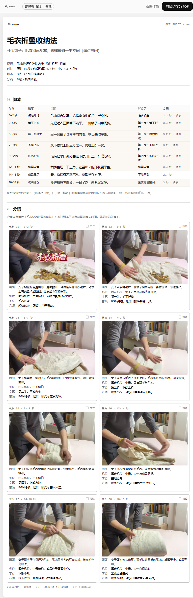
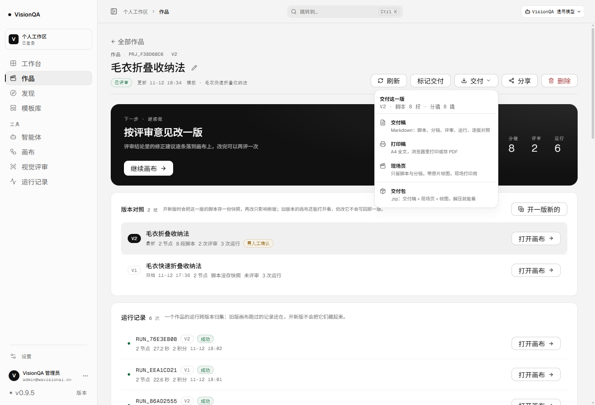

# 交付包里带帧图：现场页（只印脚本 + 分镜）与 .zip（v0.9.5）

结论：前面几片解决了「稿子」和「纸」，但两个人拿到手还是不好用——编导要的是一张能带进现场的纸（念什么、拍什么，
最好还看得见原片那一帧），剪辑 / 甲方要的是一个能直接打开的文件包（不能让他们为了看帧图登录系统）。
这一片加两个出口：现场页（线上 A4，只留脚本 + 分镜，带帧图）和交付包（.zip：交付稿 + 现场页 + 原片帧图）。

| 之前 | 现在 |
| --- | --- |
| 交付稿 7 个小节、5 页纸，现场翻到「分镜」要跨过评审与运行 | 现场页只有两节：脚本、分镜，两页看完 |
| 帧图只在系统里（/media/frames 要登录），发出去对方看不到 | 交付包把 8 张帧图按镜头编号落地成 shot-01.jpg…，解压就能看 |
| 发给剪辑是一个 .md + 一句「图在系统里」 | 一个 .zip：稿子、现场页、帧图，说明文件写清对应关系 |
| 页头四个交付按钮（导出、打印、分享…）挤成一条 | 四种产物收进一个「交付」菜单，标题写清这是哪一版 |

## 一、现场页：一张纸只回答「念什么」和「拍什么」

GET /print/projects/:id/deliverable?only=script&tz= —— 同一套纸张、字体、编号，内容是交付稿的子集：

- 抬头：作品名、开头钩子（带钩子类型）、模板来源 / 原片时长 / 台词约需 / 段落与镜头数。
- 01 脚本：时间、段落、口播、屏幕字、念完；「偏多」的段落整行浅底标出，表下一句说明怎么办。
- 02 分镜：两列镜头卡片，镜头号 + 起止、帧图、「拍过」勾选框、画面 / 机位 / 字幕 / 音频。
- 纸脚：VisionQA · 现场页 · v2 · 2026-11-12 22:31 · prj_f38d68c6。

几个刻意的取舍：

1. 不印评审与运行。现场不需要「AI 说了什么」，需要「第 3 镜拍什么」；要多的人去开交付稿。
2. 帧图按 16:10 裁切。原片多是竖屏 9:16，整张塞进卡片只有指甲盖大；裁成横向缩略图才看得清机位。
   完整原图在交付包的 frames/ 里（480×854 原样，未再压）。
3. 「念完」按台词估，与作品页、交付稿同一个 speech.mjs 口径；标「偏多」就是念完比画面长。
4. 勾选框是给笔用的：现场拍一条划一道，不需要交互。

## 二、交付包：一个 .zip，解压就能看

GET /api/projects/:id/deliverable.zip?tz= —— 生产实测（作品「毛衣折叠收纳法」v2）：

    frames/shot-01.jpg   66,526 B      VisionQA-毛衣折叠收纳法-20261112.md   10,018 B
    frames/shot-02.jpg   61,386 B      现场页.html                          18,974 B
    frames/shot-03.jpg   57,243 B      说明.txt                                664 B
    …（共 8 张，39,115 – 66,526 B）   整包 421,750 B / 11 个条目

- 交付稿与线上 .md 同一次导出的同一份（deliverablePayload 只组装一次）。
- 现场页由同一个 setSheetHtml 渲染，只是 frameBase 换成 frames/：帧图改成相对路径，没有「返回作品」那种
  在本机打不开的链接，品牌换成文字（离线取不到 /brand/ 的 SVG）。
- 说明.txt 写清三个文件是什么、帧图几张、口径是什么；没帧图就直说「模板是待解析的，或者原片抽帧没有落盘」。

为什么自己写 ZIP 而不是装 archiver / jszip：包里只有十来个已经压过的 JPEG 和两份文本，用 store（不压缩）
体积差不到 1%，却省掉一个十几 MB 的依赖；最小可读结构就四段（本地头 / 数据 / 中央目录 / 尾记录），
写死在 server/zip-store.mjs 里，测试能逐字段验（CRC32 与 zlib.crc32 比对、条目偏移、UTF-8 文件名标记）。
边界：单文件与整包 < 4 GB、条目 < 65535，超了直接报错，不写 ZIP64、不出坏包。

解压一侧全靠系统自带：Windows 资源管理器（Expand-Archive 同一套引擎）读出 5 个中文文件名，
Python zipfile 的 testzip() 返回 None（CRC 全对）。顺带记一笔：Windows 自带的 tar.exe（bsdtar）读不了中文文件名——
用 Compress-Archive 打的包它也一样读不了，是它自己的毛病，不是包的问题。

## 三、三条边界

1. 不编：没脚本写「还没写脚本」，没分镜写「模板没有分镜表」，帧图读不到写「没存帧图」——
   交付包里 availableFrames 只含真正打进去的那几张，纸上不会留一个打不开的地址。
2. 不写凭证：分享 token、ownerId 不进纸、不进包（和交付稿同一条规矩）。
3. 离线可用范围：解压后的现场页不需要登录、不需要联网；字体与品牌图取不到就走系统字体 / 文字品牌，
   数字与口径不变（同一次导出）。

## 四、生产实测（2026-11-12，v0.9.5）

- 现场页 200、19,285 B text/html、2 小节、8 个镜头卡片、8 张帧图全部加载（naturalWidth 480），
  控制台 0 异常；服务端出 PDF 3 页 / 641,903 B → 样张 PDF 见 docs/sample-set-sheet-2026-11-12.pdf。
- 交付包 200、application/zip、421,750 B、11 条目（上面那张清单就是它解压后的样子）；
  文件名走 RFC 5987：VisionQA-毛衣折叠收纳法-20261112-交付包.zip。
  包里的纸脚带导出时间，所以每次导出的字节数会差几个字节（同一份内容，不是两份不同的稿）。
- 浏览器里点（不是 curl）：fetch 交付包 200、application/zip、421,750 B；现场页 200、标题与 8 个镜头卡片都在。
- 作品页「交付」菜单：4 项（交付稿 / 打印稿 / 现场页 / 交付包），面板 300×286，完全在视口内，
  头行写「交付这一版 · v2 · 脚本 8 段 · 分镜 8 镜」；点空白处与 Esc 都收起。
- 窄屏实测：现场页 390 宽 scrollWidth 390 = 视口宽、表格不撑页（334/334）、卡片 162 宽、0 异常；
  交付菜单 390 宽贴底浮层 358×286、480 宽 448×286、700 宽仍走右对齐 300×286，**四档都完整在视口内**。
- 这一轮没有在生产写任何演示数据（只读），作品数仍是 1（prj_f38d68c6），画布 7 张。
- 本地预检（临时 DATA_DIR）：现场页 13,222 B / 2 帧 + 1 张「没存帧图」，交付包 18,258 B / 5 条目，
  解压后离线打开现场页 A4 一页 / PDF 144,452 B，帧图走相对路径全部加载。

## 五、顺手改的三处

1. 纸张外壳复用：交付稿的 toolbar / pageShell 抽成 printToolbar / paperShell 并导出，
   两种纸共用一套纸张、字体、顶栏与打印按钮——不复制粘贴第二套排版。
2. 页头不再一排按钮：原来「导出交付稿」「打印稿」两个按钮 + 分享 + 删除 + 刷新 + 标记交付已经六件，
   再加两件就成工具条了；改成「交付 ▾」一个入口，四种产物按用途排（稿 / 纸 / 现场 / 包）。
3. 窄屏菜单：`right: 0` 右对齐在 390 宽上把面板顶到屏幕外（x = −109，四项有一大半看不见）；
   560 宽以下改成贴底浮层（左右各 16，宽 = 视口 − 32），390 / 480 / 700 / 1440 四档都在视口内。

## 六、下一步

- 交付包还能再往前走：把评审里引用的帧图打包成对照图；印刷版允许只选「脚本 + 分镜」的页码范围。
- 代码签名（要证书）与自动更新（要更新源）仍各等一个决定；模型驱动的记忆归纳需要积分授权。
