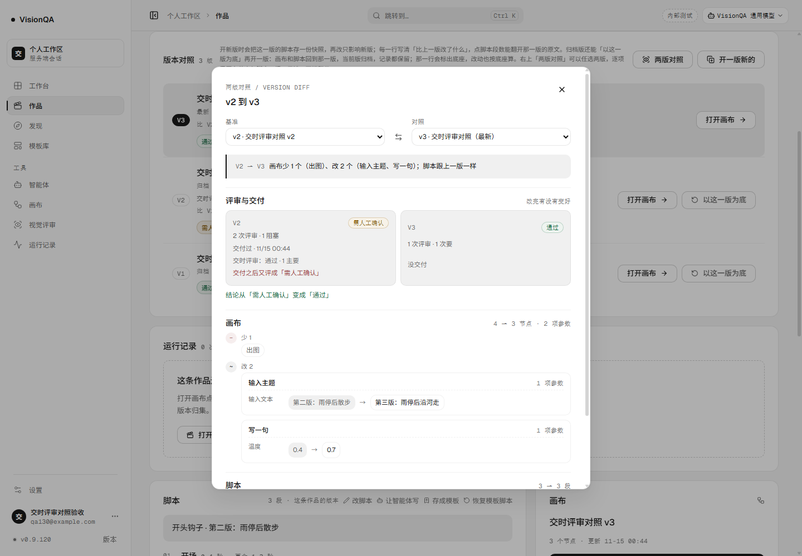
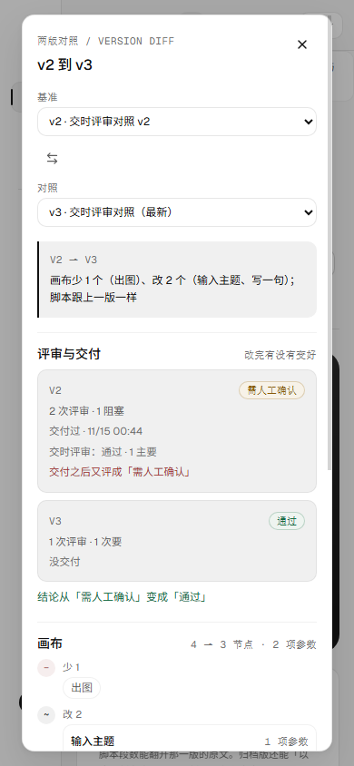

# 交时评审照写当初：两版对照把交付那一刻与后来重评分开（v0.9.120，2026-11-15）

> 一句话：v0.9.119 已经能在两版对照里并排看评审与交付，但交付卡只写「交付过 · 时间」。这一轮把交付记录里早就存着的**交时评审快照**带到弹窗，并和这一版最近一评比：交时是什么结论、交付后有没有被重评、重评后变好还是变差，分开写，历史不被改写。

## 问题

上一轮的两版对照：

- v2：通过 · 1 次评审 · 1 主要 · 交付过 11/15 00:26
- v3：需人工确认 · 1 次评审 · 1 阻塞 · 1 主要 · 没交付

看起来已经很清楚，但「交付过」三个字只说了交过，没有说**交付的那一刻评审是什么结论**。如果 v2 在交付后又被评了一次，卡片上只剩这一版最新的结论；人会把「后来重评」误读成「交时结论」，或者反过来以为交付记录被改了。

交付记录里其实从 v0.9.85 起就存了交时快照（结论、时间、问题数），只是一直没进两版对照。这一轮不新增写入、不改交付记录结构，只把已有事实读出来。

## 改了什么

### 接口：交付记录带出交时评审

`GET /api/projects/<id>/versions/compare?base=2&target=3` 的每一侧，`delivery` 多一个 `review`：

```json
{
  "at": "2026-11-15T00:44:09.000Z",
  "review": {
    "verdict": "pass",
    "at": "2026-11-15T00:43:00.000Z",
    "issues": { "blocker": 0, "major": 1, "minor": 0, "info": 0, "counted": 1, "observations": 1 }
  }
}
```

三种状态必须分得清：

| `review` | 含义 | 页面 |
| --- | --- | --- |
| 对象 | 交付时评过，快照记下了结论与问题数 | 交时评审：通过 · 1 主要 |
| `null` | 交付时确实还没评过 | 交时评审：还没评过 |
| 没有这个字段 | 升级前的交付记录，当时没记 | 交时评审：没记（升级前的交付记录） |

老数据没有交付条目、但作品状态是 done 且指当前版时，仍按上一轮口径写「交付过 · 时间没记录」，不补一个假的交时评审。

### 弹窗：交时与后来分开写

「评审与交付」卡片在交付状态下面加两行：

- **交时评审**：交付那一刻的结论与前三档问题数，照写当初。
- **交付之后又评成「…」**：只有交时快照与这一版最近一评都记着认得出的结论时才出现；结论变了说结论，结论没变、前三档问题数变了说问题数，信息级不参与。变差用失败色、变好用通过色；老记录、交时没评过、认不出的结论都不编「后来变了」。

卡片上方的结论仍是**这一版最近一评**，所以两边可以同时看到「现在」与「交时」。这不是重复：一个是现在，一个是历史。

### 只读边界

- 仍只读 `GET`，不写作品、不写交付记录、不写评审、不扣积分。
- 交付记录里的 `review` 原样读，不在读接口里拿最新评审覆盖；重新标记交付才写新快照。
- 不新增 JSON 字段到作品本身，不改版本、画布、脚本结构。

## 本地实测

环境：本地 8954，一次性数据目录，真 Chrome；评审记录由脚本直接写入 `reviews.json`，没有调用评审上游。v2 先交付（交时通过），交付后补一次「需人工确认（1 阻塞）」；v3 评成通过（1 次要）。

| 检查 | 读数 |
| --- | --- |
| 作品 / 版本 | `prj_6278b424`；v1 `flow_e1171d74` → v2 `flow_c99c0d89` → v3 `flow_4da3960d` |
| v2 最近一评 | 需人工确认 · 2 次评审 · 1 阻塞 |
| v2 交付 | 交付过 · 11/15 00:44；交时评审：通过 · 1 主要 |
| v2 交付后 | 交付之后又评成「需人工确认」，语气变差 |
| v3 | 通过 · 1 次评审 · 1 次要 · 没交付 |
| 默认变化 | 结论从「需人工确认」变成「通过」，语气变好 |
| 任意两版 / 反向 | v1 通过 · 2 主要；v1 → v3 说「主要少 2 个」，v3 → v1 说「主要多 2 个」 |
| 1440 / 390 | 弹窗 680 / 342（left 24 / right 366）；页面 `scrollWidth` 1440 / 390；390 两张卡 407–543、551–641 |
| 浏览器请求 | 5 次对照 `GET`；写请求 0 |





## 生产实况

部署 `20261114-165222-r130delivery`（快照 `20261114-165222-r130delivery.tar.gz` **1,051,564 B**）。

| 检查 | 读数 |
| --- | --- |
| 版本 / 健康 | 8799 / 8800 / 公网都 **0.9.120**；`/api/health` ok（模板 26，uptime 15s） |
| 四个 unit | 全 active |
| 入口 / 画布 / 后台 | `index-eZsFMYP9.js` 616,369 B；`CanvasPage-Bt_T17Bu.js` 242,014 B；`AdminConsolePage-BNhoQP6R.js` 201,077 B |
| 样式 | `index-CMjTruwh.css` 298,772 B；`CanvasPage-BX48Ugxj.css` 28,926 B |
| 文件一致 | `projects a000b155` / `routes 3845f004` / `version-diff b4e395d8` / 入口 `0207be11` / 画布 `88e37275` / 后台 `864c6f8a` / 主样式 `7e9e1c2c` / 画布样式 `b49e8586` |
| 上线标记 | `deliveryOfVersion` 2 处（函数声明与调用）、`vq-vcompare-review-snapshot` 1 处、`vq-vcompare-review-drift` 1 处、`VERSION_COMPARE` 6 处 |
| 未登录 | 本地与公网对照接口都 **401** |
| 心跳 / 盘 | pid 1493650 / 1493648，beatAt 16:52:35Z；盘 72%；`/tmp` 367M；日志没有业务 error |
| 旧记录 | 9 条运行、0 条带 graph；`run-graphs` 还没有目录 |

生产只有 1 条作品、0 条交付记录，没有登录账号做真实作品的两版对照，也没有在真实交付记录上验证「交付后重评」；证据来自本地真浏览器 + 本地服务，零真实上游。

## 踩到的坑

1. **交付快照不是这一版最近一评**：不能为了页面方便拿最新评审覆盖。交时是历史，最近一评是现在；两者要分开显示。
2. **三种状态不能压成两种**：`null` 是「交付时还没评过」，字段不存在是「升级前没记」；都写成「没评过」会冤枉老记录，都写成「没记」会把真的没评过说成记录缺失。
3. **只在两边都认得出结论时才说「后来变了」**：老记录、坏结论、最近一评没结论时，宁可只说交时快照，不编漂移。
4. **信息级不算问题**：与版本对照、交付流水同一套比法，只比阻塞 / 主要 / 次要。
5. **交付之后重评不改写交付记录**：重新标记交付才写新快照；页面上的「交时」不能跟着最新评审跑。
6. **390 会多两行**：卡片变高，但 342px 弹窗仍能纵向排开；不要为了省高度把「交时」和「现在」并成一句。

## 发现但没做

- 交付卡仍不能点进那一次评审的记录；要看问题原文得回评审页。
- 没有人工拍板（通过 / 不通过）入口，也没有评分。
- 没有跨作品对照，也不保存对照结果或生成分享链接。
- 没有把运行输出、评审证据图、交付稿放进同一张对照纸。
- 生产没有真实作品两版对照，也没有真实交付后重评的验证。

## 回退

`bash /opt/visionqa/ops/rollback.sh --to 1` → **v0.9.119**；`--to 2` → **v0.9.118**。

这一版只给只读对照接口多带一个已有字段、给弹窗多两行展示；不改交付记录结构、不迁移数据。回退不需要改数据。
