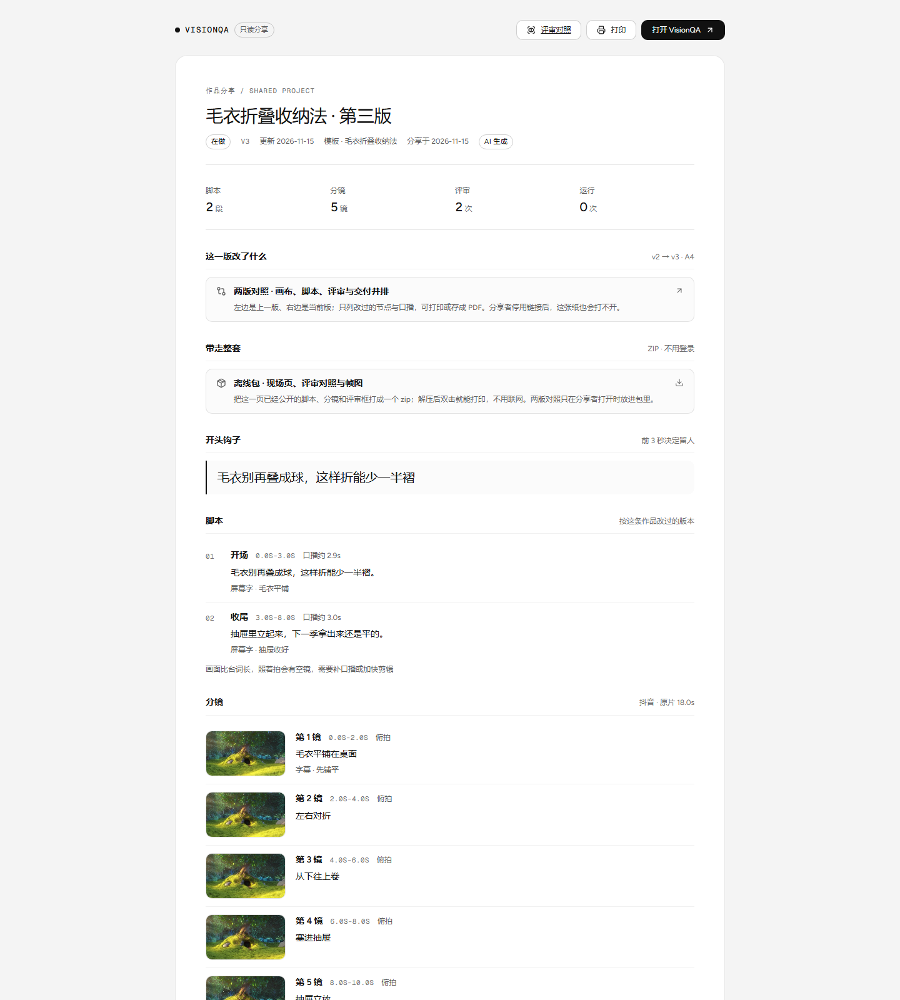
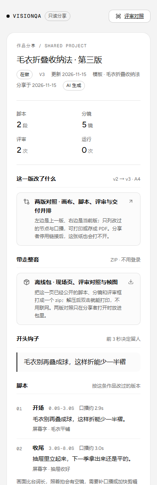
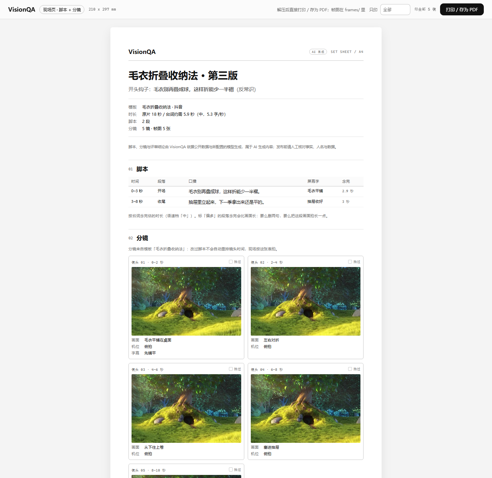

# 只读分享能带走一个离线包（v0.9.124）

## 问题

v0.9.123 让分享页可以带一张两版对照纸，但拿到链接的人仍然只能在浏览器里看：现场页、评审对照和帧图要一张张另存，交给拍摄、剪辑或存档时不方便。分享页本来就是给没有账号的人看的，不能要求他们登录后再去作品页导出。

## 做法

新增一条只读下载地址：

`GET /download/share/project/<token>/bundle.zip?tz=480`

它把分享页已经公开的内容打成一个 zip：

- `现场页.html`：脚本 + 分镜 + 原片帧图，离线双击可打印；
- `评审对照页.html`：评审说的问题框在画面上（有评审时才有）；
- `两版对照页.html`：只在分享者已经打开 `shareCompare`、且上一版已归档时才有；
- `frames/shot-01.jpg …`：分享页展示的前 12 镜帧图；
- `说明.txt`：包里有什么、来自哪条链接、AI 标识与口径。

三条边界：

1. **不是新权限**：离线包不新增开关，凭据仍是同一条分享 token；停用分享后下载地址一起 404。它只打包分享页已经展示的内容，不把作品编号、账号、画布、模板 id、flow id、原始素材路径与 token 放进包。
2. **只放前 12 镜**：与分享页同一个上限；超过 12 镜时说明里写「原片共 N 镜，离线包只放前 12 镜」，不拿别的镜头顶。
3. **两版对照跟随原开关**：分享者没打开两版对照，包里就没有 `两版对照页.html`；不会因为「能下载」而多给上一版内容。

复用原有生成器：`setSheetHtml`、`reviewSheetHtml`、`compareSheetHtml` 与 `versionCompareView`，不另写一套纸；ZIP 仍走 `server/zip-store.mjs` 的 store 实现。分镜帧图读取抽到 `server/project-frames.mjs`，交付包与分享离线包共用同一份路径校验。

公网这一层也要放行：Nginx 的 `/download/` 原本不在反代前缀里，未知路径被 `try_files` 兜成 SPA 的 `index.html`——**状态 200、类型 text/html、大小 729 B**，看起来成功，下载下来却是一张应用壳。补 `location ^~ /download/`，先 `nginx -t` 再 `reload`；本地 404 与公网 404 必须一致。

## 本地验收

本地 8954，一次性数据目录，真 Chrome；评审记录脚本直写，零真实生成 / 评审。

| 检查 | 读数 |
| --- | --- |
| 作品 | `prj_r134demo`，v3；v2 已交付，v3 需人工确认（1 主要） |
| 分享页 | 1440 宽；「带走整套」卡片 782 × 72；页面 `scrollWidth 1440` |
| 390 宽 | 卡片 308 × 129；`innerWidth 390` / `clientWidth 390` / `scrollWidth 390`，无横向溢出 |
| 离线包 | 200 · **244,946 B**；9 个文件（4 个根文件 + 5 张帧图），解压 243,932 B |
| 包里文件 | 现场页 18,468 B、评审对照 15,098 B、两版对照 17,725 B、说明 879 B、frames 5 张 |
| 方向 | v2 → v3；画布与脚本按同一份数据；5 镜 / 5 张帧图 |
| 隐私 | 0 个 `prj_r134demo` / `u_demo` / `flow_r134` / `tpl_r134` / token；0 个 `/media/` |
| 两版对照 | 打开时包里有；关掉后同一个包少这一页；再打开又回来 |
| 只读 | 下载前后 projects / reviews / flows / share-visits 的 mtime 全不变；0 个写请求 |
| 失效 | 停止分享后下载 404；POST 405 |
| 离线打开 | `file://` 打开解压后的 `现场页.html`，5 张帧图全部加载，无外链、无破图 |
| 上游 | 0 次生成 / 评审 |
| 公网 | 修 Nginx 前坏 token 返回 **200 的 729 B HTML**；补 `^~ /download/` 后坏 token **404**，`/` 200 · 729 B、入口 200 · 619,154 B |

## 生产

部署 `20261114-182854-r134sharebundle`（快照 `20261114-182854-r134sharebundle.tar.gz` **1,061,635 B**）：四个 unit active，8799 / 8800 / 公网都 **0.9.124**，`/api/health` ok（模板 26，部署后 uptime 21s）；入口 `index-DTJ3WazC.js` **619,154 B**、画布 242,019 B、后台 201,074 B、主样式 300,469 B、画布样式 28,926 B、分享页 chunk 11,110 B；本地与生产哈希全一致。未登录 zip / 对照接口 / 对照打印页仍 **401**；坏 token 下载 **404**、POST **405**。生产数据仍是 1 条作品 / 3 条评审 / 0 条交付 / 0 条分享 / 9 条运行 / 0 条 graph；没有真实账号开着分享做下载验证，也没有真实甲方下载记录，证据来自本地真 Chrome + 本地服务，零真实上游。

## 踩到的坑

1. **不能把 zip 当页面渲染**：下载地址走 `/download`，响应头写 `Content-Disposition: attachment`；出错时才回一张 HTML 说明。
2. **包里不能出现作品编号**：现场页与评审纸的 `project` 只传标题与版次，`projectId` 传空；现场页纸脚原本会留下「·  ·」，要把空 id 的分隔点一起省掉。
3. **分享页只展示 12 镜，包里不能悄悄多给**：帧图按前 12 镜读取；超过时在说明里写清原片总镜数。
4. **两版对照不能因为「能下载」而默认带上**：仍只看 `shareCompare`；没开就少一个文件。
5. **评审帧图不一定在分镜里**：在分镜里就复用 `frames/shot-XX.jpg`，不在才复制进 `评审/`；只认当前模板，不跨模板取图。
6. **下载也可能被直接打开**：坏 token / 停用后返回 404 说明页，不吐 JSON；非 GET 返回 405。
7. **文件名不能带路径字符**：下载名只留作品名与版次，中文走 RFC 5987 的 `filename*`。
8. **只读要用文件证明**：下载前后四个数据文件 mtime 不变；分享页打开本身仍按既有规则记一次打开，下载不再另记。

## 发现但没做

- 离线包只放前 12 镜，不能选「只打某几镜」再下载（现场页打开后可以在纸内改选区）。
- 包里没有 Markdown 交付稿与运行记录；要完整交付稿仍走登录后的交付包。
- 没有单独的离线包下载次数 / 访问记录，和分享页共用同一条 token 的打开记录。
- 没有跨作品、任意两版或「保存为模板」的离线包。
- 生产没有真实账号开着分享做下载验证，也没有真实甲方下载记录；证据来自本地真 Chrome + 本地服务，零真实上游。

## 回退

这一版只多一个只读下载路由、一个分享页卡片、一个公共帧图读取模块与一处纸脚空 id 处理；不改作品 / 评审 / 交付 / 运行落盘结构。

- `bash /opt/visionqa/ops/rollback.sh --to 1` → **v0.9.123**
- `--to 2` → **v0.9.122**
- Nginx 回退：`cp /etc/nginx/conf.d/visionqa.wavisionai.cn.app.inc.bak-r134-* /etc/nginx/conf.d/visionqa.wavisionai.cn.app.inc && nginx -t && nginx -s reload`（那份是加 `/download/` 之前的线上原文）

提交 `0a706f6`（功能、测试、Nginx、文档与截图）；CI **43627514020** 三个 job 全 success（安全扫描、Node 24、Node 22.12.0）。
