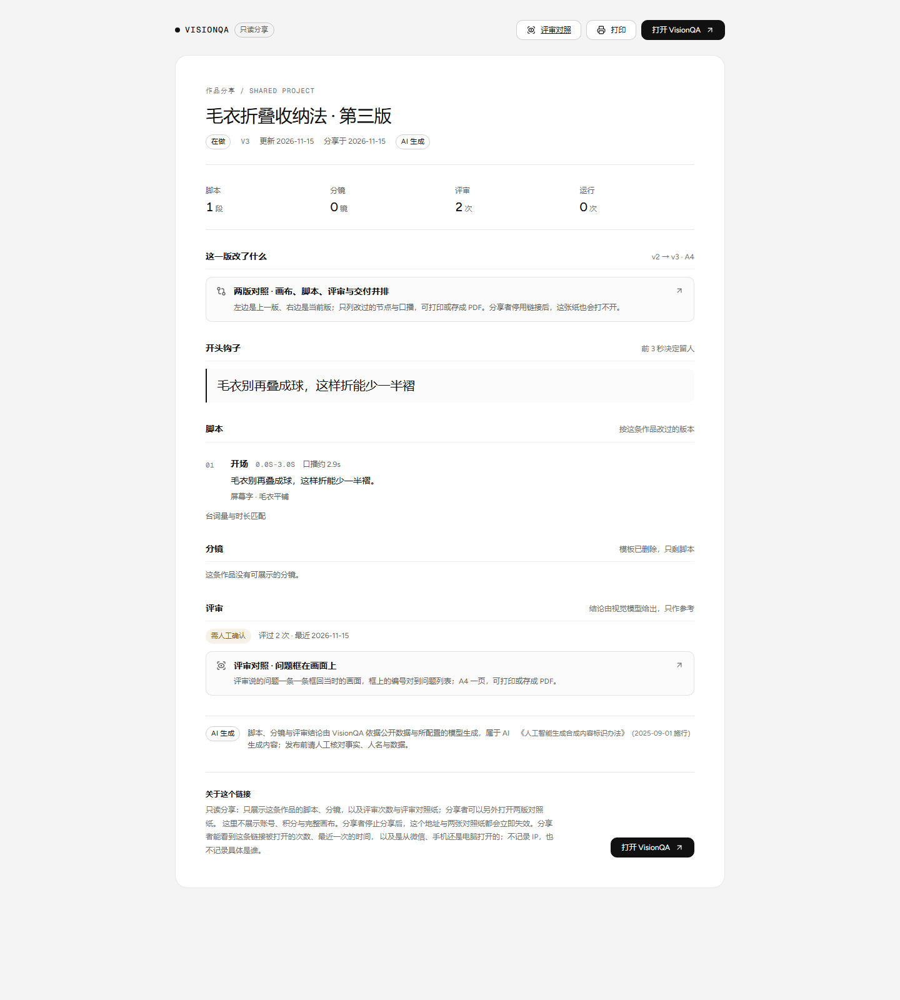
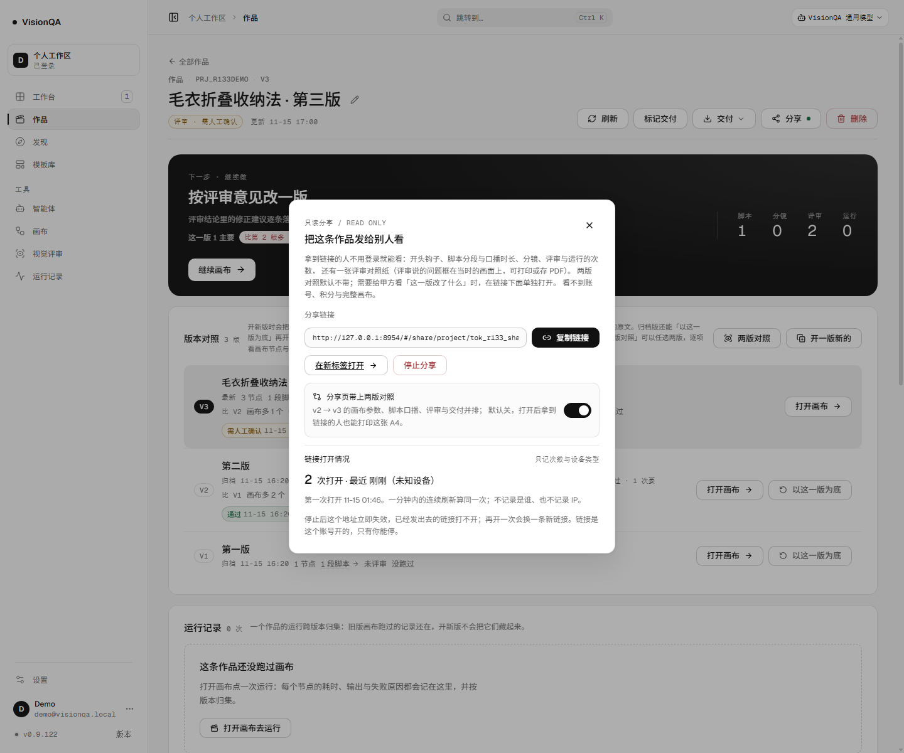
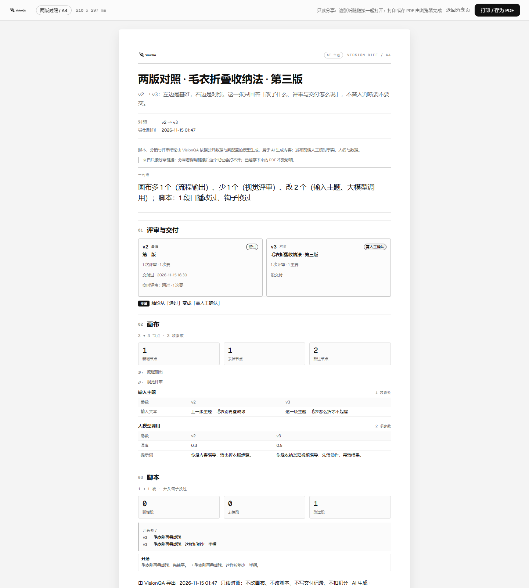

# 分享页也带一张两版对照（v0.9.123，2026-11-15）

## 问题

v0.9.122 已经把两版对照装进交付包，但只读分享链接里仍然只有现场页与评审对照。甲方、剪辑拿到链接时，看不到「这一版到底改了什么」：只能看当前脚本，或者回作品页转屏幕。

只读分享是给没有账号的人看的，不能要求对方登录；但两版对照会带上一版的脚本与画布参数，不能默认对所有旧链接开放。这一轮补的是「分享者主动打开后，拿到链接的人也能打印这张纸」。

## 做法

- **分享开关默认关**：作品上多一个 `shareCompare` 布尔字段；旧链接没有这个字段就是不带对照，行为不变。开关打开才公开最近两版。
- **开关不换 token**：`PATCH /api/projects/:id/share` 只改这一个字段；已经发出去的地址继续有效。停止分享时连字段一起清掉，旧地址与对照纸同时失效。
- **固定当前版 vs 上一版**：分享页不提供任意两版选择，也不接受地址里的 `base` / `target`；路由只按作品当前版本与上一版取值，上一版没有归档就不进入口。
- **公开纸只给能公开的**：`GET /print/share/project/<token>/versions/compare` 走同一份 `versionCompareView`；纸上的评审、交付、画布参数与作品页对照同源。纸不带作品内部 id、归属账号、模板 id、画布 flow id 与 `/media` 原始路径。
- **纸能回分享页**：顶栏显示「返回分享页」，并写一句「来自只读分享链接：分享者停用链接后这个地址会打不开；已经存下来的 PDF 不受影响」。
- **分享页只在可用时显示入口**：公开视图新增 `versionCompare: { base, target } | null`；只有「开关打开 + 上一版已归档」时才有值，前端据此显示「这一版改了什么」卡片，不摆一个点进去 404 的按钮。
- **只读**：对照纸不写作品、不写评审、不写交付、不扣积分、不调上游；分享页打开本身按既有规则记一次打开，对照纸不另记。

## 本地验收

环境：本地 8954，一次性数据目录，真 Chrome；作品数据与评审记录由脚本直接写入，没有调用生成或评审上游。

| 检查 | 读数 |
| --- | --- |
| 本地作品 | `prj_r133demo`，v3；v2 已交付（交时通过 · 1 次要），v3 需人工确认（1 主要） |
| 分享视图 | `versionCompare: { base: 2, target: 3 }`；`shareCompare: true` |
| 对照纸 | 200，17,961 B；标题「两版对照 · 毛衣折叠收纳法 · 第三版」；方向 v2 → v3 |
| 纸上的内容 | 画布多 1 个（流程输出）、少 1 个（视觉评审）、改 2 个；脚本 1 段口播改过、钩子换过；v2 交时通过、v3 未交付 |
| 隐私 | 0 个 `prj_r133demo` / `u_demo` / `flow_r133`；0 个 `/media/`；0 个 `http(s)` 外链 |
| 匿名 | 不登录直接打开 200；POST 405；关掉开关同一地址 404 并给一张说明纸 |
| 只读 | 连打 3 次对照纸：200 / 17,961 B × 3；`projects.json`、`reviews.json`、`flows.json`、`share-visits.json` 的 mtime 全部不变 |
| 开关 | 页面开关从 `false` 切到 `true` 再切回 `true`；token 不变（存储测试另验） |
| 390 宽 | `innerWidth 390` / `clientWidth 380` / `scrollWidth 380`；正文右边 364，无横向溢出；顶栏只留「评审对照」 |

对照纸内容多时仍按区块续页，不为了「一页」压低字号。

## 生产实况

部署 `20261114-180812-r133sharecompare`（快照 `20261114-180812-r133sharecompare.tar.gz` **1,058,970 B**）：四个 unit 全 active，8799 / 8800 / 公网都 **0.9.123**，`/api/health` ok（模板 26，部署后 uptime 40s）；入口 200 · `index-CUIU9smR.js` **619,028 B**、画布 242,026 B、后台 201,078 B、主样式 300,469 B、画布样式 28,926 B、分享页 chunk 10,282 B；服务端与前端哈希全部与本地一致（`projects 18051d1f` / `routes projects b67abacd` / `project-share 4c9d70de` / `routes share 7ab8fd51` / `compare-sheet 68fa7db3` / `compare 4f8e1fec` / 入口 `da7104d4` / 画布 `c532b773` / 后台 `ebc6729a` / 主样式 `14cda366` / 画布样式 `b49e8586`）；`shareCompare` 7 处、`PRINT_COMPARE` 2 处、`versionCompare` 1 处；未登录 zip / 对照接口 / 对照打印页都是 **401**，坏分享 token 与坏对照地址都是 **404**；心跳 pid 1495774 / 1495773，beatAt 18:09:05Z；盘 72%，`/tmp` 374M，日志没有业务 error。生产 9 条运行、0 条带 graph；1 条作品、3 条评审、0 条交付记录，**0 条作品正在分享**，没有真实账号做分享对照，也没有真实甲方打开记录；证据来自本地真 Chrome + 本地服务，零真实上游。

## 踩到的坑

1. **不能默认打开**：上一版脚本可能是不该给甲方看的旧文案，分享者必须自己点开关。
2. **开关不能换 token**：重新开分享会换 token、旧链接失效；切换对照必须走同一 token 的 PATCH。
3. **旧链接不能突然多出内容**：没有 `shareCompare` 字段的旧条目一律按 false 处理。
4. **POST 的请求体是可选的**：原来开分享没有 body；新增 `compare` 后，脚本或测试里的非流式 req 不能因为读 body 而挂掉。
5. **公开纸不能印内部 id**：作品 id、归属账号、flow id 都不进纸；纸上的「作品编号」一行直接不传。
6. **地址里的 base/target 不能改方向**：分享页固定最近两版，避免有人借 query 翻旧版本。
7. **没有上一版就不放入口**：只按版本号猜会得到一个点进去 404 的按钮；必须查归档记录。
8. **分享页入口放在正文里，不塞顶栏**：390 宽顶栏已经只剩一个「评审对照」，再加一颗会挤掉品牌与标题。
9. **只读要看文件**：对照纸连打 3 次，projects/reviews/flows/share-visits 的 mtime 都不变；分享页打开本身仍会按既有规则记一次打开。

## 发现但没做

- 分享页只能看当前版 vs 上一版，不能选任意两版；任意两版仍在作品页弹窗里。
- 分享页没有单独的「对照纸访问记录」；打开链接与打印纸共用同一条分享凭证。
- 没有跨作品对照、保存对照结果、独立分享对照链接。
- 对照纸还不能点进那一次评审记录；没有「只印摘要 / 只印画布」的纸型。
- 生产没有真实账号做分享对照，也没有真实甲方打开记录；证据来自本地真 Chrome + 本地服务，零真实上游。

## 回退

这一版只多一个可选布尔字段、一个只读打印路由、一个分享页卡片与一个弹窗开关；不改作品 / 评审 / 交付 / 运行落盘结构。

- `bash /opt/visionqa/ops/rollback.sh --to 1` → **v0.9.122**
- `--to 2` → **v0.9.121**

`shareCompare` 字段留在旧数据里没有副作用：v0.9.122 不读它。

提交 `61590a4`（功能、测试、文档与截图）；CI **43625084052** 三个 job 全 success（安全扫描、Node 24、Node 22.12.0）。
