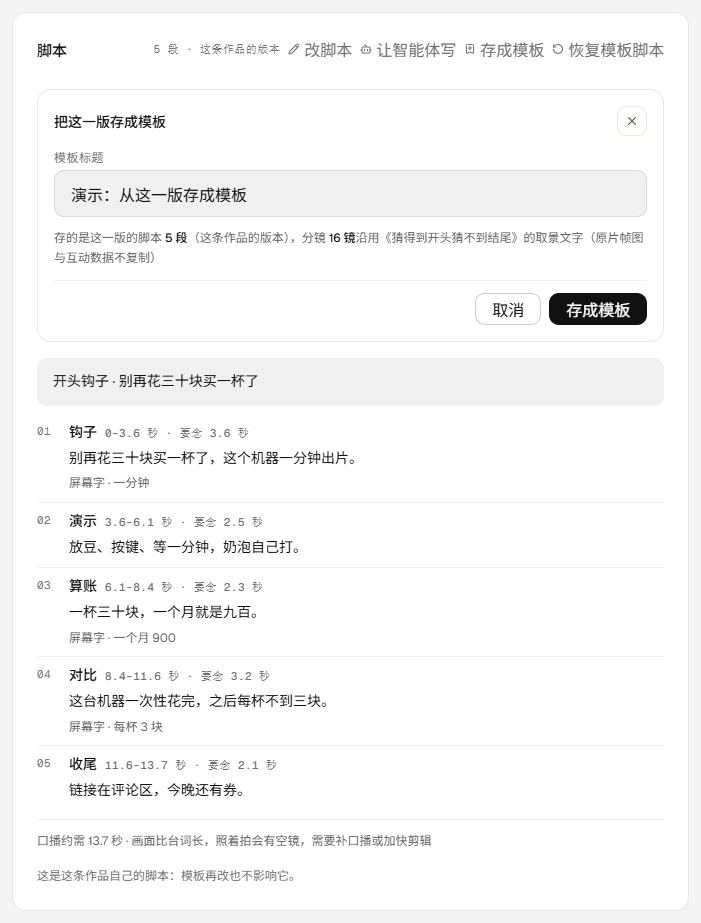
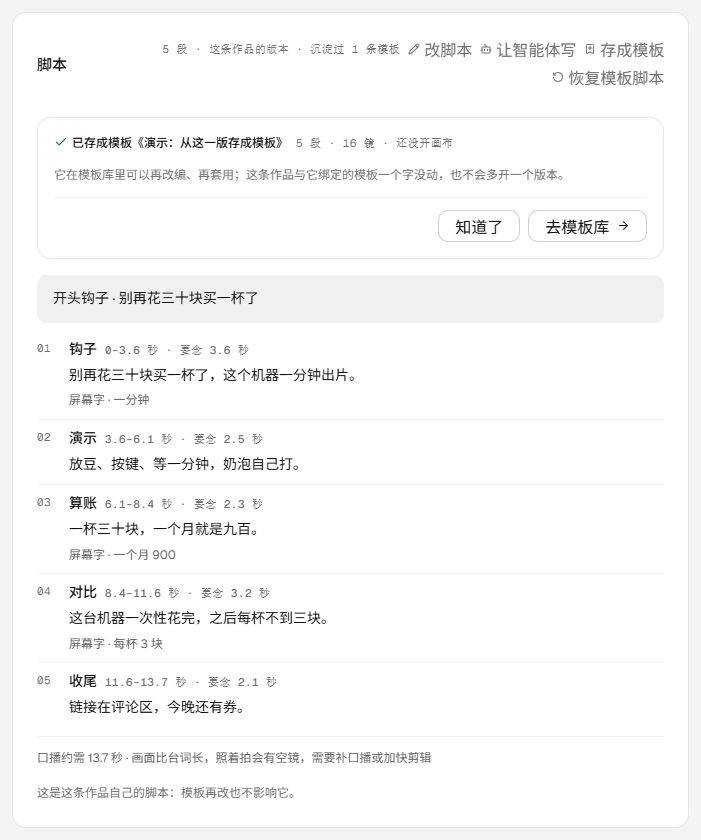
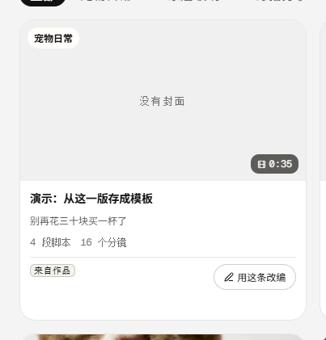
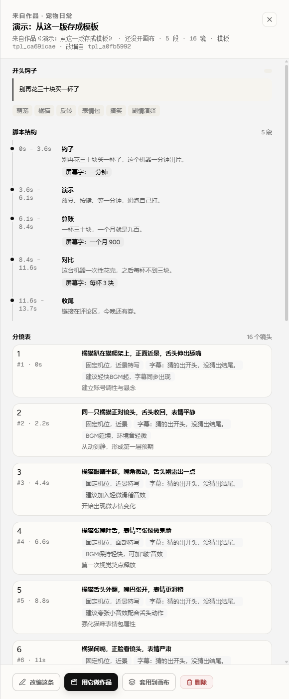
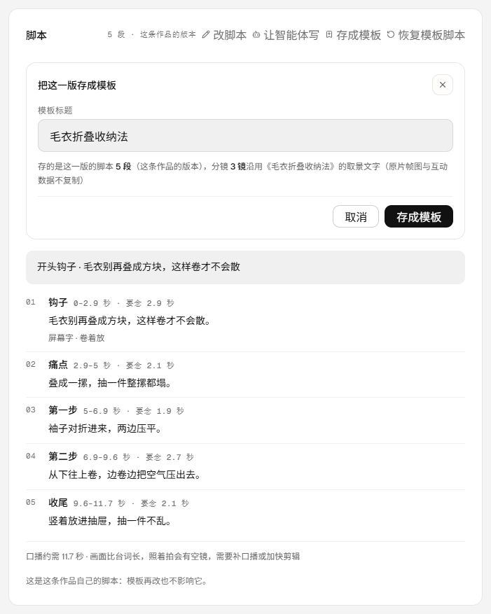
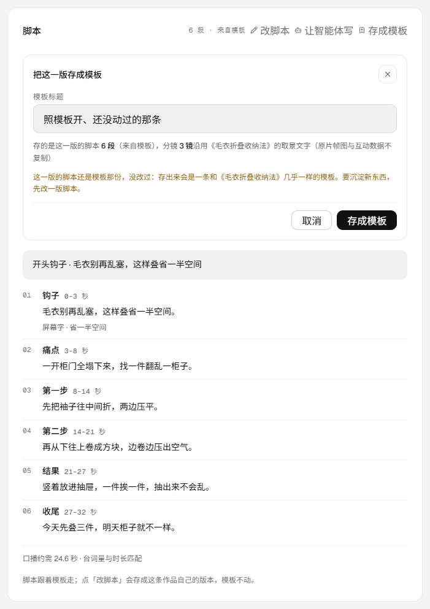
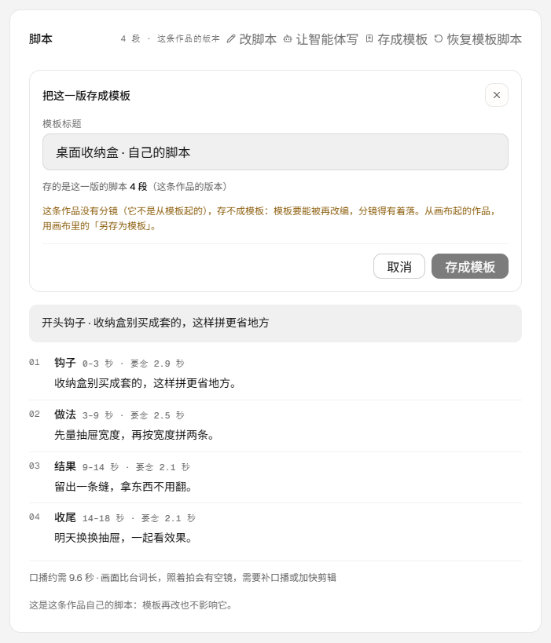

# 作品「存成模板」：做完的这一版沉淀回模板库（v0.9.31）

- 版本：**0.9.31**
- 发布包：`20261112-214438-v0.9.31-project-template.tar.gz`
- 前端入口：`index-8WxmRoT1.js`（486,250 字节，含「存成模板」「把这一版存成模板」「来自作品」）
- 提交：`afa0083`（代码）+ `文档提交见文末`；CI 见下
- 生产：`https://visionqa.wavisionai.cn`，两服务 active，`/api/health` ok（templates 26）

## 一、为什么要做

产品结构定下的价值链是「找选题 → 拆结构 → 改成我的 → 编排/生成 → 审片 → **沉淀模板**」。
前五格早就有路：发现能进模板库、模板能改编、改编能开作品、作品能送评审、评审能拍板与交付。
最后这一格一直是断的——**模板库只会从「发现」和「智能体」里长，做完的作品流不回去**。

于是有了这一轮：作品页脚本头多一个「存成模板」，把这一版做完的脚本沉淀成模板库里一条新模板；
模板库从此能被自己的作品喂大，而不是只进不出的仓库。

## 二、现在能做什么

| 之前 | 现在 |
| --- | --- |
| 作品做完只能交付、导出，沉淀不了 | 脚本头「存成模板」：这一版的脚本 + 沿用绑定模板的分镜文字 → 模板库新一条 |
| 不知道存进去的是哪几段、分镜从哪来 | 面板先写「存的是这一版的脚本 N 段（这条作品的版本 / 来自模板），分镜 M 镜沿用《X》的取景文字（原片帧图与互动数据不复制）」 |
| 脚本没改过也存得出，跟原模板几乎一样 | 先把「几乎一样」说出来：「这一版的脚本还是模板那份，没改过：存出来会是一条和《X》几乎一样的模板」 |
| 没有分镜的作品点了才发现存不了 | 面板直接写清原因（模板要能被再改编，分镜得有着落），按钮置灰，并指到画布里的「另存为模板」 |
| 模板库分不清哪条是从自己作品沉淀的 | 卡片脚注写「来自作品」，详情抬头「来自作品 · 类型」，副标题写「来自作品《X》· 第几版（还没开画布）· N 段 · M 镜」 |
| 存完就找不到了 | 作品页脚本头写「沉淀过 N 条模板」，刷新还在；面板写「去模板库」 |

## 三、三个实现决定

1. **存的是这一版的脚本 + 绑定模板的分镜文字，原片的东西一概不复制**。
   新模板的 `structure` 来自作品这一版（`scriptView` 已经按模板语速档重算过时长），`storyboard` 来自绑定模板的
   取景文字；`author` / `sourceUrl` / `stats` / 帧图全部留空——它们属于那条原片，不属于这一版。
   与「改编」共用同一套字段上限（30 段 / 60 镜），所以「用这条改编」「用它做作品」都直接可用。
2. **没有分镜就不落库**（两道闸）。模板要能被再改编，改编要脚本 + 分镜两个都有着落；存一条只有脚本的模板，
   等于把人引到一个点开就报错的入口。从画布起的作品本来就有出口——画布里的「另存为模板」。
   判断在 `server/project-template.mjs`（纯函数），落库函数自己再挡一次。
3. **不碰作品、不开版本、不动原模板**。只往模板库写一条新条目；`kind` 仍是 `adapted`（它确实是以绑定模板为底改出来的），
   `adaptedFrom` 指向原模板，另加 `origin: 'project'`、`projectId`、`projectTitle`、`projectVersion` 四个字段说明来历。

接口：`POST /api/projects/:id/template` `{ title? }`

- `201` `{ ok, template: { id, title, kind, origin, adaptedFrom, projectId, projectTitle, projectVersion, beats, shots, scriptSource }, sameAsTemplate }`
- `400 SCRIPT_REQUIRED`：还没有脚本段落；`400 STORYBOARD_REQUIRED`：没有分镜（文案里指到画布「另存为模板」）
- `404 PROJECT_NOT_FOUND`：没有这条作品 / 别人的作品；`405`：不是 POST；`409 TEMPLATE_SAVE_FAILED`：落库时脚本或分镜刚好被清掉
- 作品详情多返回 `templateSaves`（最多 5 条：id / title / createdAt / beats / shots），作品页据此写「沉淀过 N 条模板」

## 四、顺手修的两处

1. **卡片标题被挤成两行**：脚本头多一个入口之后，「脚本」两个字在 1440 下折成「脚 / 本」。
   `.vq-project-panel-head` 改成可换行、`h2` 加 `flex: 0 0 auto` + `white-space: nowrap`，标题不再参与挤压。
2. **卡片脚注重复**：新模板最初把 `platformLabel` 写成「作品沉淀」，卡片脚注就成了「来自作品 作品沉淀」。
   现在 `platformLabel` 留空、脚注只留「来自作品」一句；没有封面时封面上写「没有封面」，不留一个空框。

## 五、验收

**生产**（v0.9.31、入口 `index-8WxmRoT1.js` 486,250 字节、release `20261112-214438-v0.9.31-project-template.tar.gz`、
`/api/version` 0.9.31、`/api/health` ok templates 26、两服务 active）：

一次可逆写入并当场撤销：写前作品 1 条、模板 26 条、智能体 4 个、运行 7 条、评审 3 条、队列 1 条；
照模板 `tpl_a0fb5992`（《猜得到开头猜不到结尾》，12 段 / 16 镜）建临时作品 `prj_25a35c96`（v0）→ 写入 5 段自己的脚本 →
页面点「存成模板」→ 面板「存的是这一版的脚本 5 段（这条作品的版本），分镜 16 镜沿用《…》的取景文字（原片帧图与互动数据不复制）」→
存成 `tpl_ca691cae`：`kind: adapted`、`origin: project`、`adaptedFrom: tpl_a0fb5992`、`projectId`、`projectVersion: 0`、
5 段 / 16 镜、帧图 0 张、`author` 与 `sourceUrl` 与 `platformLabel` 全空；
原模板仍是 12 段 / 16 镜、钩子与第一镜帧图一字未动；作品仍是 v0、脚本来源 `project`、`templateSaves` 记着这一条。
撤销：`DELETE /api/templates/tpl_ca691cae` → 200、`POST …/purge` → 200、`DELETE /api/projects/prj_25a35c96` → 200
（解绑评审 0 / 便利贴 0 / 拍板 0）→ 作品 1、模板 26、智能体 4、运行 7、评审 3、队列 1，与写前逐项一致。
为拍「模板库列表里的那张卡」再做了一次同规模往返（`prj_14dd151f` + `tpl_a6a63a94`，4 段 / 16 镜），拍完同样删净归零。

**本地演示数据**（`.tmp-qa/r111data`：1 条模板 6 段 / 3 镜、4 条作品）：
`prj_follow`（5 段自己的脚本）存成 `tpl_ea16c799`——模板库 1 → 2 条，卡片脚注「来自作品」、脚注里没有平台与作者；
详情副标题「来自作品《毛衣折叠收纳法》 · 第 1 版 · 5 段 · 3 镜 · 模板 tpl_… · 改编自 tpl_demo」；
作品页脚本头「5 段 · 这条作品的版本 · 沉淀过 1 条模板」；原模板 6 段 / 3 镜不动；390 面板按钮各占一行、`scrollWidth == clientWidth`。

**测试与检查**：`npm test` **319/319**（新增 8 条 `test/project-template.test.mjs`：能存的两种脚本来源 / 没脚本 400 /
没分镜 400 且指到画布 / 落库字段与不复制原片 / 原模板与作品不动 / 再存一条不覆盖 / 落库函数第二道闸 / 路由 201·404·405 与详情字段），
oxlint **0 error / 6 warning**、`tsc -b` 干净、`npm run build` 通过。这一轮不调模型、不扣积分。

## 六、边界

- 不自动沉淀：存不存由人点；也不批量、不后台跑。
- 不写作品、不开版本：作品这一版一个字不动（版本只跟画布走）。
- 不碰原模板：新模板是另一条条目，改编自它但不改它。
- 不复制原片：作者、原链接、互动数据、帧图都不跟着走；模板详情里「来源」一节会如实写「原链接缺失」。
- 不改判分镜归属：作品自己没有分镜，分镜永远跟绑定模板走（v0.9.30 已写明）。
