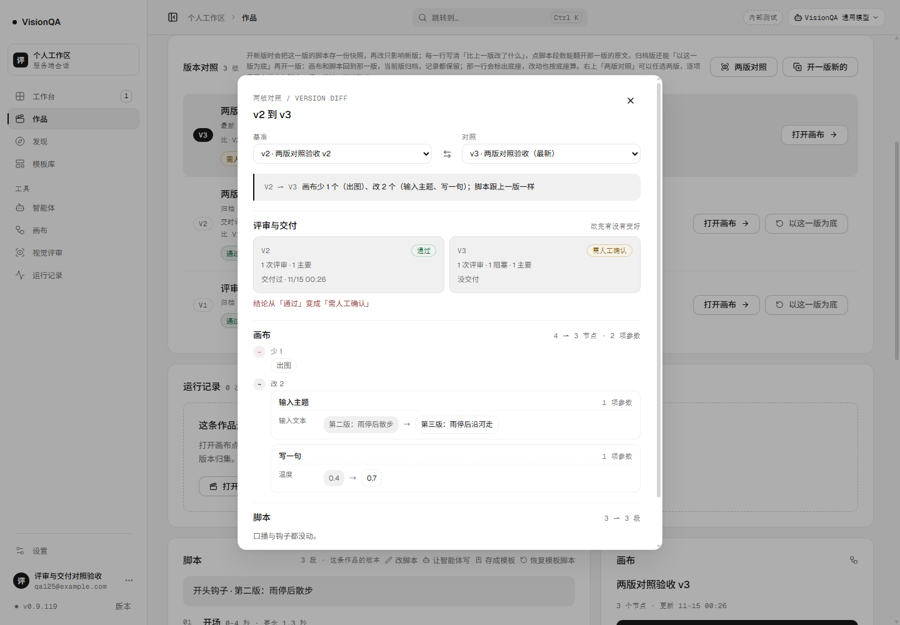
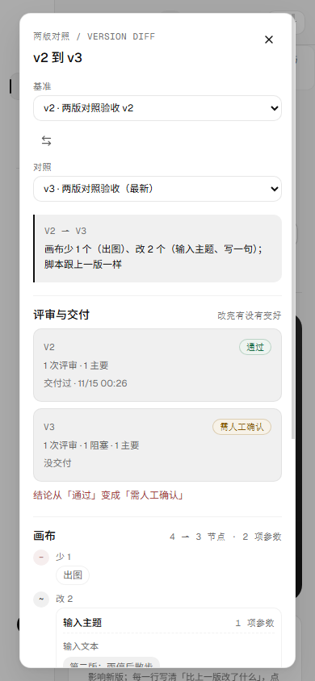

# 改完到底有没有变好：两版对照把评审与交付摆在一起（v0.9.119，2026-11-15）

结论：v0.9.119 起，「两版对照」不只回答画布和脚本改了什么，还回答**改完有没有变好**——基准与对照各自列出这一版最近一评的结论、按严重度的问题数、交付过没有，再补一句「结论从通过变成需人工确认」或「主要少 1 个」。仍然只读：不写版本、不改画布与脚本、不扣积分。

## 问题

前面几版已经把「两版对照」补到能逐项列节点参数（v0.9.118）和脚本口播（v0.9.117）。但打开对照的人真正想确认的下一件事是：

> 我按意见改的这一版，评审到底变好了没有？交出去的是哪一版？

作品页的版本列表其实已经有「这一版评过几次 / 最近一评 / 交付过」，可它只按相邻版本看，也没有把交付记录和任意两版放在一张纸上。任意两版对照里只有内容差异，评审结论与交付状态仍是空白，人得关掉弹窗回去翻版本列表。

这一轮补的就是这两块：**评审概况**与**交付状态**，以及一句只描述变化、不替人下判断的结论。

## 改法

### 接口

`GET /api/projects/:id/versions/compare?base=2&target=3` 每一侧新增：

```json
{
  "base": {
    "n": 2,
    "review": {
      "count": 1,
      "verdict": "pass",
      "at": "2026-11-14T16:26:00.000Z",
      "issues": { "blocker": 0, "major": 1, "minor": 0, "info": 0, "counted": 1, "observations": 1 }
    },
    "delivery": { "at": "2026-11-14T16:26:00.000Z" }
  },
  "target": {
    "n": 3,
    "review": {
      "count": 1,
      "verdict": "needs_review",
      "at": "2026-11-14T16:26:00.000Z",
      "issues": { "blocker": 1, "major": 1, "minor": 0, "info": 0, "counted": 2, "observations": 2 }
    },
    "delivery": null
  },
  "reviewChange": {
    "text": "结论从「通过」变成「需人工确认」",
    "tone": "worse"
  }
}
```

- **评审按版次取**：与作品页同一套 `reviewsForVersion`——版本划分前记在 0 上的老评审折进 v1；同一版重评多次只取最近一次，不把两次问题相加。
- **交付按版次取**：只认这一版的交付记录。交付了 v2 又开 v3，v2 仍写「交付过」，v3 写「没交付」。
- **老数据兜底**：交付记录是后来才有的；状态是 done、没有记录、且指的就是当前这一版时，写「交付过 · 时间没记录」，与作品页 `deliveredCurrent` 同一口径。
- **`reviewChange` 只描述变化**：先比结论（通过 / 需人工确认 / 不通过），结论相同再按阻塞 → 主要 → 次要比问题数；信息级不参与。任何一侧没评过、没记结论、没记严重度，都写「不比」，不编一句「没变」。

### 界面

- 弹窗在摘要下面新增「评审与交付」：两版并排，各一张软底卡片，左边版次，右边结论胶囊；下面两行「N 次评审 · 问题数」「交付过 · 时间 / 没交付」。
- 卡片下面一句变化：变差用失败色，变好用通过色，没变用灰色，比不了用弱化色。只写事实，不写「建议再改一版」这类判断。
- 1440 下两张卡片并排；720 以下收成一列，390 下两张卡片纵向排开，弹窗不横向溢出。
- 底部只读说明补上评审与交付的口径：评审读这一版最近一次，交付只认这一版的记录，没评过的一侧不猜「没变」。

## 本地实测

环境：本地 8953，一次性数据目录，真 Chrome；评审记录直接落盘（不经过上游），三版各一条，v2 标记交付；零真实生成 / 评审调用。

| 检查 | 读数 |
| --- | --- |
| 作品 / 版本 | `prj_553050c0`；v1 `flow_ce4c4d85` → v2 `flow_eba3eec9` → v3 `flow_4189035d` |
| 默认两版 | v2 → v3；画布少 1 个（出图）、改 2 个；脚本没动 |
| v2 评审 | 通过 · 1 次评审 · 1 主要；交付过 · 11/15 00:26 |
| v3 评审 | 需人工确认 · 1 次评审 · 1 阻塞 · 1 主要；没交付 |
| 变化一句 | 结论从「通过」变成「需人工确认」，语气变差 |
| 任意两版 | v1 → v3：v1 通过 · 2 主要 · 没交付；v3 需人工确认 · 1 阻塞 · 1 主要 · 没交付；结论仍是从通过到需人工确认 |
| 反向 | v3 → v1：结论从「需人工确认」变成「通过」，语气变好；温度等参数也翻回前值 |
| 只读 | 对照前后版次、脚本、归档、`updatedAt`、交付记录全不变 |
| 1440 / 390 | 弹窗 680 / 342（left 24 / right 366）；页面 `scrollWidth` 1440 / 390；390 两张评审卡纵向排开（top 407 / 506，bottom 498 / 597） |
| 浏览器请求 | 5 次对照 `GET`；写请求 0 |





## 生产实况

部署 `20261114-163354-20261115-003500-r129outc`（发布脚本把标签截到 31 字符，完整意图 `20261115-003500-r129outcome`；快照 `20261114-163354-20261115-003500-r129outc.tar.gz` **1,048,799 B**）。

| 检查 | 读数 |
| --- | --- |
| 版本 / 健康 | 8799 / 8800 / 公网都 **0.9.119**；`/api/health` ok（模板 26，部署后 uptime 6s） |
| 四个 unit | 全 active |
| 入口 / 画布 / 后台 | `index-4ooxC8Bi.js` 616,090 B；`CanvasPage-CxTW7MwT.js` 242,014 B；`AdminConsolePage-vPqeJweh.js` 201,077 B |
| 样式 | `index-DAfRRSgt.css` 298,526 B；`CanvasPage-BX48Ugxj.css` 28,926 B |
| 文件一致 | `projects a000b155` / `routes c11403a9` / `version-diff b4e395d8` / 入口 `13baa40e` / 画布 `3a0f35c5` / 后台 `fbdc43f2` / 主样式 `b30b141d` / 画布样式 `b49e8586`，全部与本地一致 |
| 上线标记 | `versionCompareOf` 1 处、`reviewChangeOf` 3 行、`reviewSideOf` 5 行、`VERSION_COMPARE` 6 处、`vq-vcompare-review-card` 1 处 |
| 未登录 | 本地与公网对照接口都 **401** |
| 心跳 / 盘 | pid 1493017 / 1493013，beatAt 16:33:56Z；盘 72%；`/tmp` 清理后 363M；日志没有业务 error |
| 旧记录 | 9 条运行、0 条带 graph；`run-graphs` 还没有目录 |

生产没有登录账号做真实作品的两版对照，也没有在真实评审 / 交付记录上验证这块展示；功能证据来自本地真浏览器 + 本地服务，零真实上游。

## 踩到的坑

1. **评审数不能按「作品」取，必须按「版次」取**：直接读作品的 `versionCounts` 会把别的版本算进来；而且要复用 `reviewsForVersion`，否则版本划分前的老评审不会折进 v1，v1 会被写成「没评过」。
2. **0 不等于「0 个阻塞」**：没评过时整张卡片写「未评审 / 还没评过」，不摆一排 0；老记录没记严重度时写「没记问题数 / 另有 N 条没记严重度」。
3. **结论相同不等于问题数相同**：结论都是通过、但阻塞从 1 变 0，也要说「阻塞少 1 个」；信息级不参与，因为它本来就是「看到但不确定算不算问题」。
4. **没有严重度就不比**：老评审只记了 observations、没记 severity，`counted` 是 0；这时不能把 0 当「没问题」，只能写「不比」。
5. **交付是「哪一版」的事，不是作品的全局状态**：项目上有 `status=done` 时只说明「按过标记交付」，不能给所有版本都写「交付过」；只有一条记录指向这一版才算。老数据没有记录时才用「当前版 + done」兜底。
6. **本地验收不能直接写 reviews.json 就完事**：服务端有评审缓存，外部脚本写盘后要重启一次本地服务，否则对照读到的是空缓存。生产里评审由同一个服务写，不存在这个问题。
7. **390 不要硬塞两张并排卡**：342px 弹窗里两张卡各 151px，结论胶囊和「1 次评审 · 1 阻塞 · 1 主要」会挤成多行；720 以下收成一列，阅读顺序更清楚。
8. **E2E 的「画布标题」选择器要指名道姓**：新增「评审与交付」也是 `.vq-vcompare-section`，原来的 `.vq-vcompare-section-head .vq-mono` 会先抓到「改完有没有变好」；要按 h3 文本找「画布」那一节。

## 发现但没做

- 没有把交付时的评审快照放进对照卡：现在只写「交付过 · 时间」，要看「交时评审」还得回版本列表。
- 评审卡不能点进那一次的评审记录，也没有人工拍板（通过 / 不通过）的入口；对照里只读。
- 不显示评分，只显示结论与按严重度的问题数；没有「这一版比上一版好多少分」。
- 不支持跨作品对照，也不保存对照结果或生成分享链接。
- 没有把运行输出、评审证据图、交付稿放进同一张对照纸；这轮只补评审概况与交付状态。
- 生产没有登录账号做真实作品的两版对照，证据来自本地真浏览器 + 本地服务，零真实上游。

## 回退

```bash
bash /opt/visionqa/ops/rollback.sh --to 1   # v0.9.118
bash /opt/visionqa/ops/rollback.sh --to 2   # v0.9.117
```

这一版只给只读接口加字段、给弹窗加一块展示，不改已有 JSON 落盘结构，也不改交付 / 评审的写入逻辑；回退不需要改数据。
