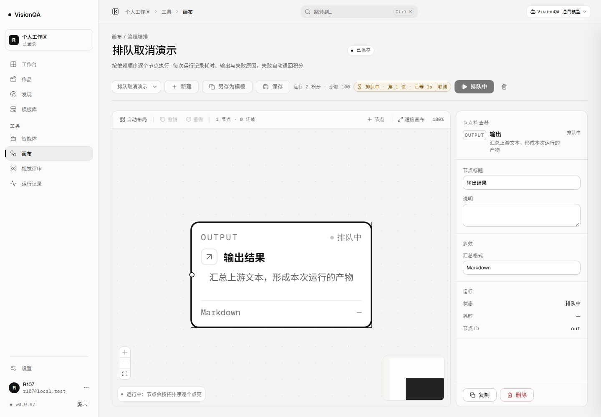
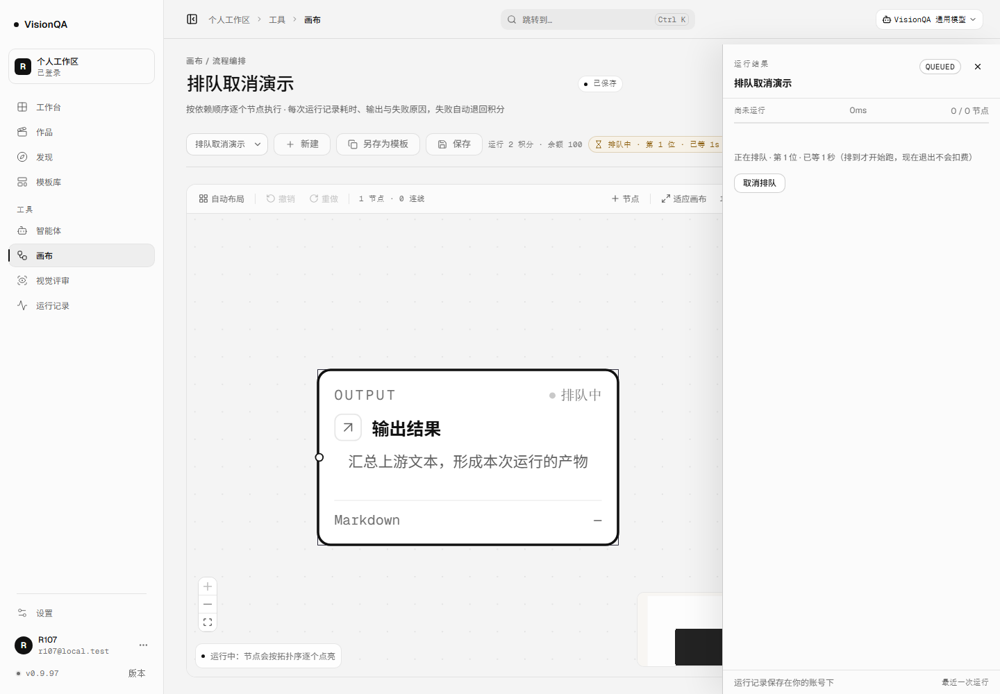
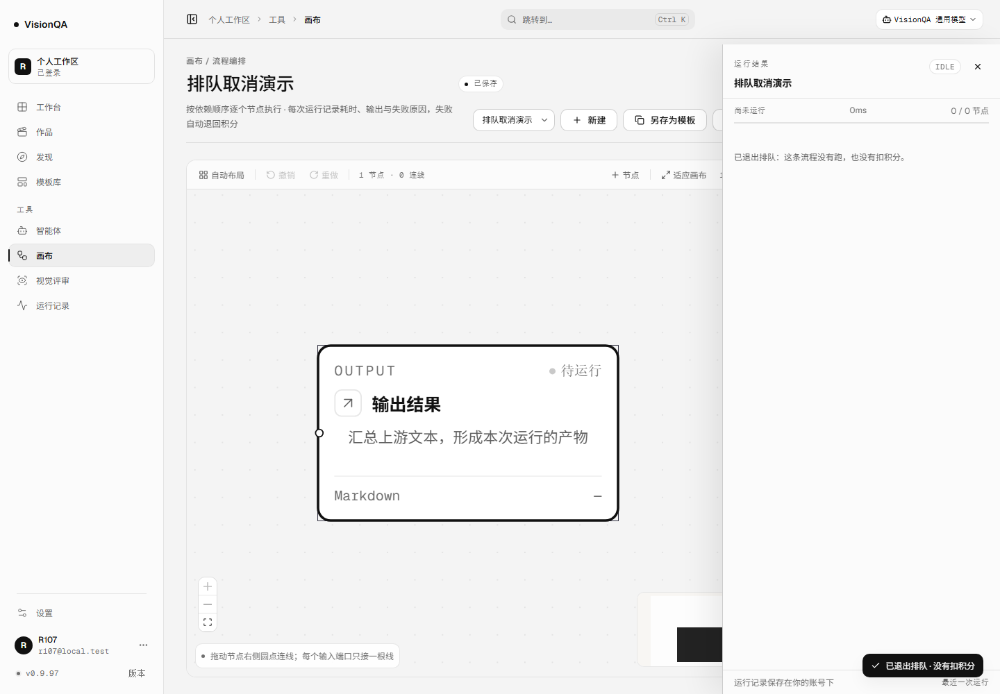
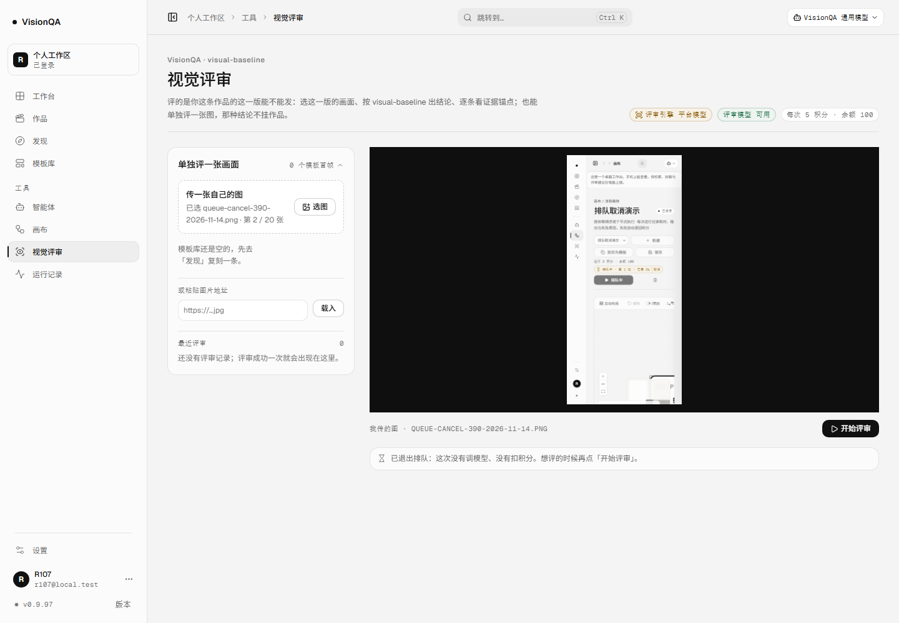
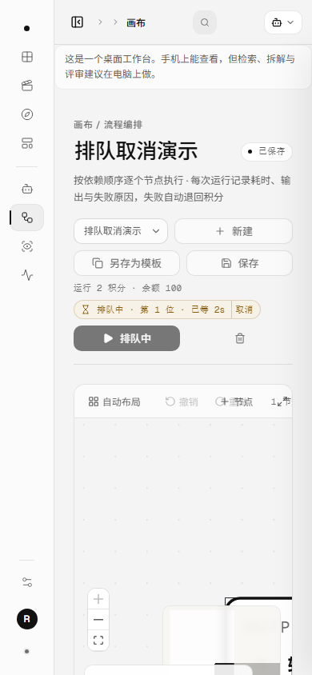

# 排错队可以自己退出来（v0.9.97，2026-11-14）

## 为什么

v0.9.80 把画布出图接进整机的排队位，v0.9.95 接评审，v0.9.96 接运行。三条队回答的都是「第几位、等了多久」，
没有回答「我不想等了怎么办」——唯一的出口是关掉页面。而名次是整机口径（共享目录 + 同一把锁）：
一条已经没人要的等待还占着位置，后面的人就得多等一轮。

这一版把出口做出来：名次条上直接一个「取消」。点下去等于关掉这条连接——服务端认的正是这件事：
退出排队、票退掉、不占名额、不扣积分、不碰上游。运行给到顶栏胶囊与运行抽屉两处，
评审给到名次条；文案说的是「没有扣积分」，不是「失败，请重试」。

## 做法

1. 两个前端 API 多一个 `signal`：`runFlowStream(id, onEvent, ticket, signal)`、`runReview(payload, ticket, signal)`。
2. 画布页用 `runAbortRef` 管这一条连接，`runQueuedRef` 记住「上一次问名次时还在不在排队」——
   取消之后靠它把两句实话分开（退出排队 ≠ 中断一条已经开跑的运行）。
3. 评审页 `queueAbortRef` 同一套；取消后给一条静默提示（`role=status`、中性色、没有「重试」），因为这不是失败。
4. 入口只在「名次条还在」时渲染：排到之后条子收起，按钮跟着消失，不会把一条正在跑的运行/评审 abort 成「已取消」。
5. 取消后画布把节点退回「还没跑」（`status` 清空），不当成一条失败标红。
6. 服务端只动一处判据（见坑 ①）：`watchClientGone` 不再把「响应正常写完」当成「人走了」。
7. 样式：胶囊里的取消走 8px 间距、整个胶囊高度都能点（24px），圆角跟着胶囊走，颜色只用 tokens；
   名次放不下时省略的是「已等 Xs」，取消按钮整块留着。

## 本地实测

真进程（8922）+ 共享租约目录里占满整机 3 条名额 + 真 socket；画布只有一个 `output` 节点，
评审用一张本地截图，**零上游调用**。

| 动作 | 读数 |
| --- | --- |
| curl 起一条运行（1.2 秒后自己挂断） | 排队中 `position 1 · ahead 0 · waiting 1 · waitedMs 1224` |
| 挂断 0.9 秒后 | `waiting 0 · position null`；`entered 1 · served 0 · timedOut 0`（既没排到，也不是等超时） |
| 余额 / 运行记录 | `100`（一分没扣）· `total 0`（占位记录撤掉） |
| 浏览器：点运行 → 抽屉里点「取消排队」 | 胶囊 `排队中 · 第 1 位 · 已等 1s / 取消`；抽屉 QUEUED +「正在排队 · 第 1 位 · 已等 1 秒（排到才开始跑，现在退出不会扣费）」 |
| 取消之后 | 抽屉「已退出排队：这条流程没有跑，也没有扣积分。」；提示条「已退出排队 · 没有扣积分」；节点回「待运行」；`balance 100 · waiting 0 · runs 0` |
| 评审页：传一张图 → 开始评审 → 点「取消」 | 名次条 `排队中 · 第 1 位 · 已等 1s / 取消` → 静默提示「已退出排队：这次没有调模型、没有扣积分。想评的时候再点「开始评审」。」；`balance 100`（评审 5 积分一分没扣）· `waiting 0` · `reviews 0` |
| 390 宽 | 胶囊独占一行、取消按钮整块留着；`scrollWidth 390` 不溢出；窄屏上取消同样把队退干净（`balance 100 · waiting 0`） |

## 生产只读

发布标签 `20261114-115500-r107-cancel`，两个实例都是 **0.9.97**；
公网 `https://visionqa.wavisionai.cn/api/version` 回 0.9.97，入口 `index-DRgO9ONA.js`（200 · **570,432 B**，旧入口 404）。

| 项 | 读数 |
| --- | --- |
| `GET /api/runs/queue`（登录态） | `waitMs 60000 · maxWaiting 4 · scope lease · waiting 0 · position null` |
| `GET /api/review/queue`（登录态） | `waitMs 60000 · maxWaiting 4 · scope lease · waiting 0` |
| 临时会话 | 本机一次性会话，读完立刻销毁——销毁后同一份 cookie 访问 `/api/credits` 回 401 |
| 模块与本地逐字节一致 | `waterline 4bd75a95` / `routes/flows 0dfa32cf` / `routes/review 8f1b043d` / `config 403c6615` / `wait-queue 76c95733` / 入口 `index-DRgO9ONA.js 986840ab` |
| 服务 | 两个 unit active，盘 72%（27G/40G） |

## 踩到的坑

1. **`watchClientGone` 把「响应正常写完」也当成「人走了」**（v0.9.95 起就潜伏）：判据里带着
   `|| res.writableEnded === true`，于是正常结束与客户端取消混成同一件事；它只在排队期间被调用，
   所以一直没出事。新用例「正常写完再关不算走」当场抓到，判据收紧成 `gone || res.destroyed`——
   被提前关掉的连接才算人走了。
2. **CDP `Runtime.evaluate` + `returnByValue` 遇到 DOM 节点会报 `Object reference chain is too long`**：
   等元素的表达式忘了套 `Boolean(...)`。真浏览器脚本里每个等待条件都要返回标量。
3. **evaluate 的字符串里不能引用 Node 变量**（`session is not defined`）：页面侧只认浏览器环境，
   要把值用 `JSON.stringify` 注进去；Node 侧只看到一句「页面脚本报错」。
4. **「取消」入口只在名次条在时渲染**：评审不是流式的，abort 一条已经开跑的评审只会让页面拿不到结论，
   服务端照跑照扣。因此按钮随名次条出现/消失；abort 分支按「上一次轮询还在不在排队」分两句文案——
   还在排队就是「没有扣积分」，已经开跑就是「按记录结算」。
5. **运行抽屉在 1440 会盖住顶栏右半**（106 的老坑）：取消入口同时在抽屉里给一份；
   截图分别给「抽屉开着」与「抽屉关着」两种真实状态。
6. **点取消到服务端真退队有 ≤ 一轮轮询（约 0.5 秒）的延迟**：页面先回空闲，服务端下一轮 tick 才发现连接没了。
   curl 立刻查还是 `waiting 1`，0.9 秒后归零——这是连接关闭被感知的时间，不是用户要等的时间。

## 发现但没做

- **排到之后想停**：需要一条真正的中断协议（服务端要在节点边界停下来、按已跑部分算账），
  一条被关掉的连接表达不了这件事。
- 不估计还要等多久（ETA）；轮询仍是 1.2 秒、一次只问自己那张票；票号绑账号不绑标签页。
- 运行记录在排队期间仍写 `running`（页面抽屉写 QUEUED），列表还没有独立的 `queued` 状态。
- 队列仍只跨进程不跨机器（B2 的最后一项）。
- 评审页没有全局提示条机制，取消用一条静默提示条代替（画布页才有 toast）。

## 回退

整版 `bash /opt/visionqa/ops/rollback.sh --to 2`（v0.9.96），无 schema、无配置改动。
只退前端也行：换回 r106 的 dist 即可——服务端这一轮只收紧了 `watchClientGone` 的判据，老前端不受影响。

## 数字

测试 **888/888**（+6 条新文件 `test/queue-cancel.test.mjs`），oxlint 0 error / 15 warning，
`tsc -b` 干净，构建入口 `index-DRgO9ONA.js`（570,432 B），密钥扫描 633 文件 0。
