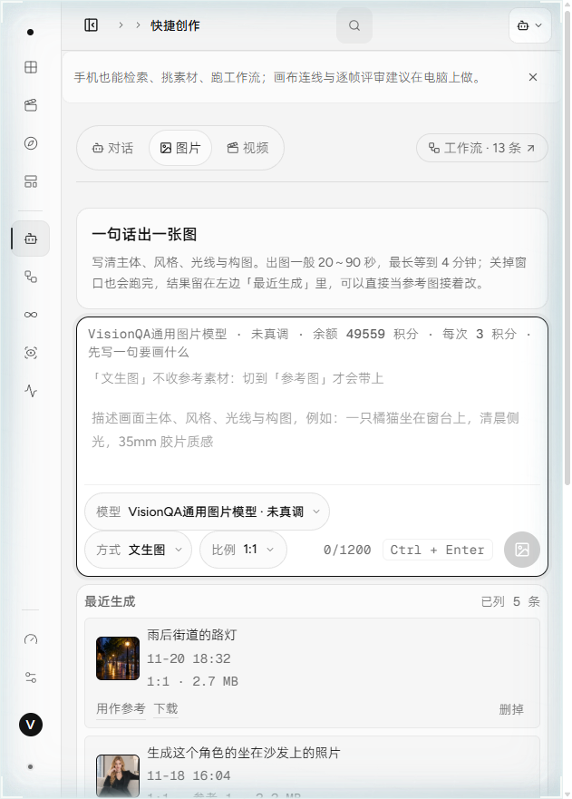

# 快捷创作页的适配与参数排列（r309 / v0.9.282）

2026-11-24。用户指着「侧栏 → 内容」之间那条竖着的空带说：做一下页面的适配性，不管什么分辨率都在这个位置附近；其次把图片 / 视频的参数展示排列调一调。

## 量出来的三件事

在 1920 / 1600 / 1440 / 1366 / 1280 / 1100 / 1024 / 768 / 700 / 560 / 390 十一档宽度上，图片与视频两个页签各量一次：

| # | 现象 | 数字 |
| --- | --- | --- |
| ① | 页面上限 1200 且**居中**，顶栏面包屑却贴着侧栏 | 1920 上侧栏右边缘 236、内容左边缘 478，中间空出 **242px**；1600 上 82px；1440 上 2px。窗口越宽这道缝越宽，内容与顶栏不在一条竖线上 |
| ② | 图片 / 视频的模型胶囊和参数挤在同一行，触发按钮被 190px 上限截断 | 1440 与 1920 上都显示「VisionQA通用图片模型 ·…」；视频页签五颗胶囊 247+133+103+93+124+32 = 732px，加上右侧动作组 200px 正好把 932px 占满，一点余量都没有 |
| ③ | 最近生成那列（208px）的元信息在每个「 · 」处折行 | 1920 上断成三行：`11-24 13:04` / `· 1:1 ·` / `224 B`——第二行只剩两个分隔符，第三行把「224 B」也拆开了 |

## 改法

**① 页面左边缘跟着顶栏走。** `.agx-page` 的 `max-width` 从 1200 抬到 1520（与 `.page` 同一个上限），并加 `margin-inline: 0 auto`：右边可以留白，左边不再随分辨率空出一条缝。1920 上内容从 236 起（面包屑 260），右边缘 1756，右侧留白 164 —— 比原来的 242 / 242 两侧对称空着更贴合「工作台」：内容贴着侧栏长，留白集中在一侧。

**② 模型单独一行，参数另起一行。** `.agx-media-modelbar` 排在 `.agx-composer-bar` 之前：左标签、右值、最右边箭头，`max-width: 100%` 解掉了 190px 的上限——模型名是这一页最该看清的一项，不再用省略号交代。参数行只剩方式 / 比例（图片）与方式 / 比例 / 时长 / 清晰度（视频），四颗之间有整行宽度可用。分隔线只画一条：模型那行画在输入框下面，参数行的 `border-top` 在 `--media` 作用域里去掉。

代价是输入卡高了 30px（1440：221 → 251）。换来的是模型名在 1920 上也不再被截。

**③ 短标签内部不断行。** `formatBytes` 的「数字 + 单位」与 `shortTimeOf` 的「日期 + 时间」改用不断行空格（U+00A0）；最近生成的元信息拆成两行——时间一行、参数一行，参数那一行 `white-space: nowrap` + 省略号。不再出现只剩「· 1:1 ·」的行。

**④ 390 上参数排成两列等宽。** `≤560` 里 `.agx-composer--media .agx-params` 改成 `display: grid; grid-template-columns: repeat(2, minmax(0, 1fr))`，模型那行拉满一列宽。以前是「能挤几颗算几颗」，右边缘参差不齐；现在上下两条边对齐，点按区仍是 44px。

顺带：最近生成的头一行「只列你自己的任务 · 已列 N 条」只留「已列 N 条」——「只列你自己生成的」那句话底部已经写了一遍。

## 验收

- 十一档宽度逐一重量：页面左边缘 236（≤900 收成图标栏后 68），内容区 `scrollWidth == clientWidth`，全页无横向溢出（`documentElement.scrollWidth == innerWidth`）。
- 模型胶囊：1440 与 1920 上都显示完整「VisionQA通用图片模型 · 未真调」，触发按钮不再出省略号。
- 图片页签参数：1440 一行（方式 / 比例），390 两列等宽；视频页签：1440 一行四颗，390 两行两列。
- 最近生成：时间与参数各占一行，「1:1 · 224 B」不再拆开。
- 测试 1976/1976（新增 `test/quick-create-adapt.test.mjs` 5 条）、`tsc -b` 干净、`oxlint` 0 error、`npm run build` 通过、密钥扫描无命中。

截图见 `docs/quick-create-adapt-wide.png`（1920 改前 / 改后）、`docs/quick-create-params-1440.png`（输入卡参数区）、`docs/quick-create-params-390.png`（390）。

## 边界

- 只动了快捷创作页：作品流 / 视觉评审 / 总览仍然是 1280 居中（这次没改，宽屏上它们与顶栏之间还是有一段空档）。
- 超宽屏（>2092，即侧栏 + 1520 之外）才居中，1920 / 2560 上贴左、留白都在右侧。
- 「对话」页签的输入卡（对话预设 / 输出 / 模型三颗）没动，它那颗模型同样有 190px 的截断，属于下一轮。
- 数据来自临时实例 `.tmp-r309-data` 里手写的三条样例任务，不是真实上游调用；本轮 0 次真实上游调用、¥0。

## 生产实拍（v0.9.282，用户浏览器真实窗口 631px 宽）

窄窗（≤900 收成图标栏、最近生成落到输入卡下面）下同样没有截断：模型那行是「VisionQA通用图片模型 · 未真调」全称，
最近生成每行是 `11-20 18:32` + `1:1 · 2.7 MB` 两行（真实任务数据，不是样例），右上是「已列 5 条」。
