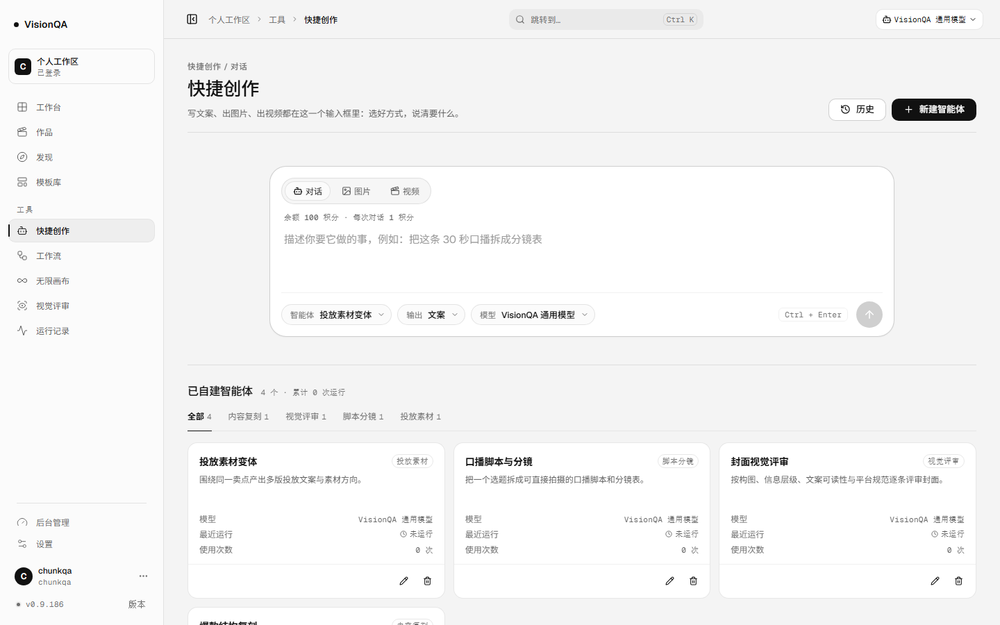
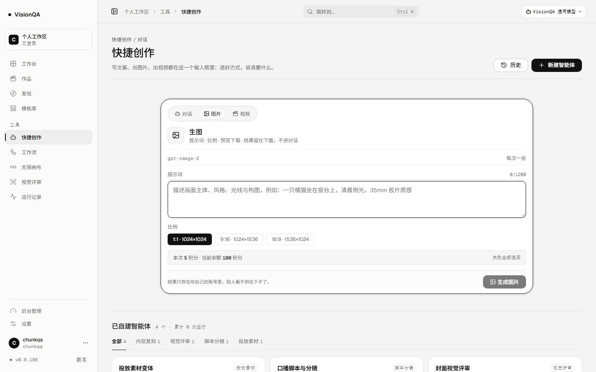
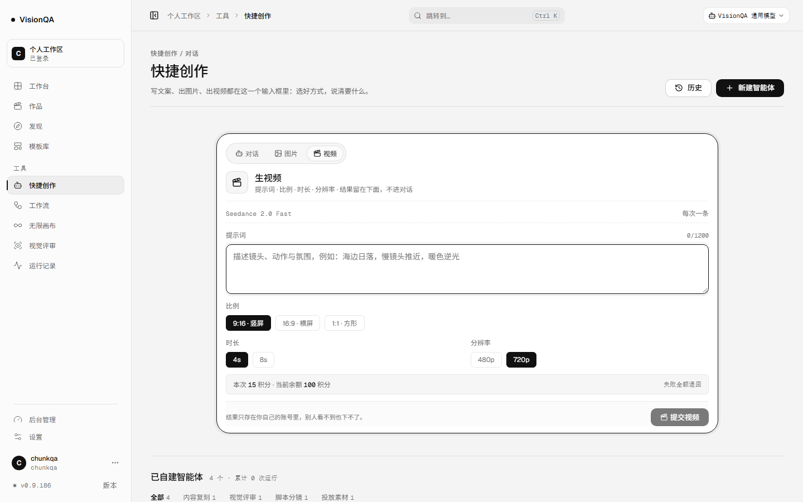
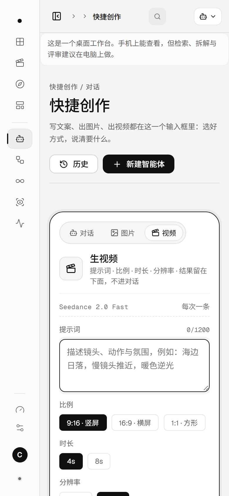

# 快捷创作：一个输入框里出图、出视频（r206 / 0.9.187）

## 为什么改

原来的「智能体」页把出图、出视频做成了两张「预设智能体」卡片，点开各自弹一个窗口。问题有两个：

1. 名字不对：出图出视频不是智能体，它们没有系统提示词、不进对话、不调模型推理；
2. 入口分裂：用户要在「先去找那个窗口」和「就在这里说一句」之间二选一。

改成：侧栏与页面都叫**快捷创作**，一个输入框，顶部三个方式页签 `对话 / 图片 / 视频`。
选图片或视频时，输入框原地变成生成表单（提示词、比例、时长、分辨率、本次积分），发送后结果就落在下面，不再弹窗。

## 改了什么

| 文件 | 改动 |
| --- | --- |
| `src/nav.ts` | 侧栏 `智能体` → `快捷创作`，说明与搜索关键词补上生图 / 生视频 |
| `src/domain/types.ts` | 面包屑 `agents` → `快捷创作` |
| `src/pages/AgentsPage.tsx` | 删掉两张预设卡片与弹窗；`MediaGenDialog` 改成内嵌的 `MediaGenPanel`；composer 增加方式页签 |
| `src/styles/agents.css` | 删掉预设卡片与弹窗（遮罩 / 定位 / 阴影）样式，新增方式页签与内嵌面板样式 |
| `src/editions.ts` | 用户版说明里的名字跟着改 |

保留的部分：自建智能体（`已自建智能体` 分区）、对话、历史、模型 / 输出参数都与原来一致；
生图 / 生视频的扣费、失败全额退回、最近生成（含往回翻页、processing 自动刷新）全部沿用服务端已有的接口，没有新增接口。

## 截图（真实渲染，本机临时实例 + 同一份 dist）

## 边界

- 只改了入口与页面结构，没有动 `server/routes/media-gen.mjs`，也没有动计费；
- 三个方式页签是单选，切走再切回来不保留上次填的提示词（和原来关窗重开一致）；
- 生成面板里的模型行（`gpt-image-2` / `Seedance 2.0 Fast`）是只读的：一条能力当前只走一条路由，
  需要换模型时改服务端 Key 与路由，不在前端给选择；
- 390 与 1440 都截图验证过，无横向溢出；平板宽度这一轮没单独扫。
