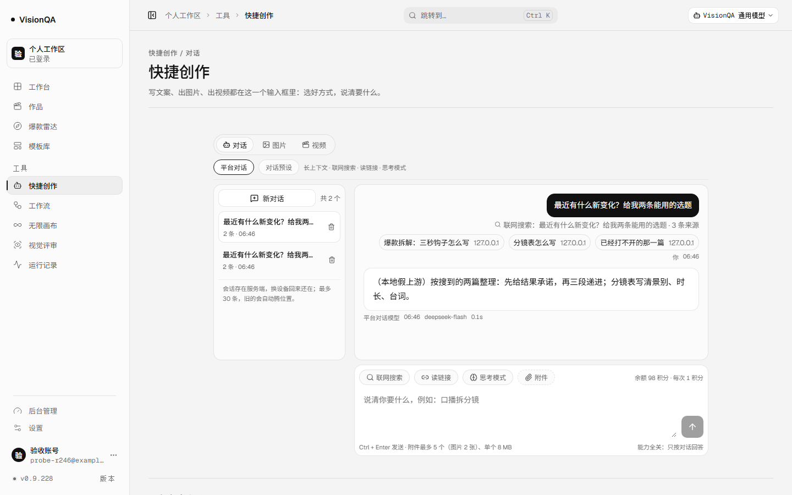
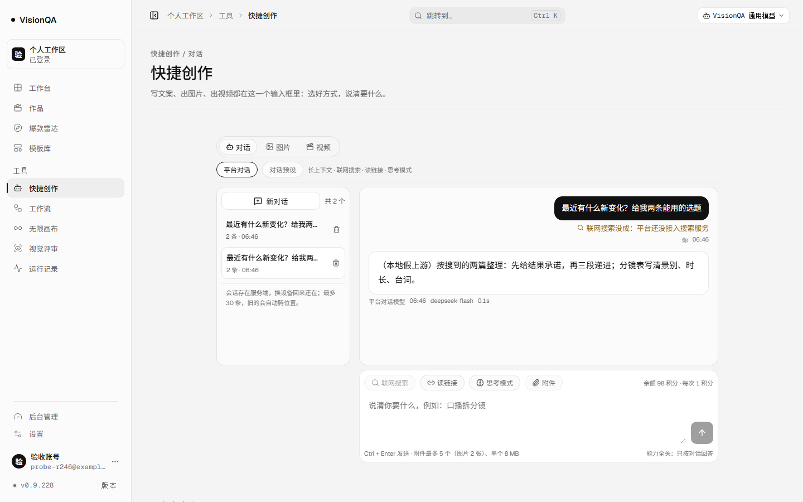
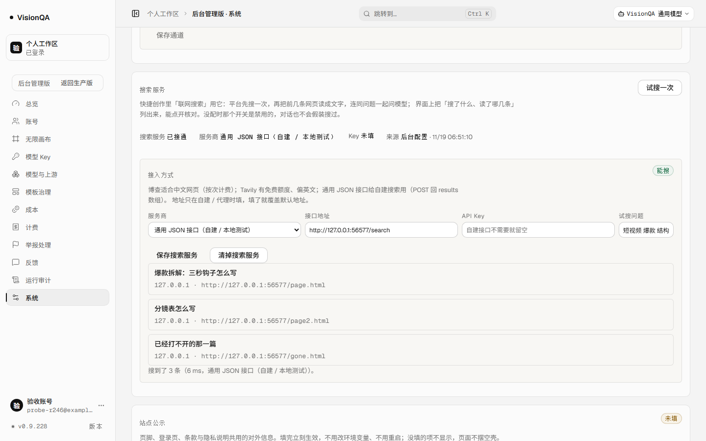
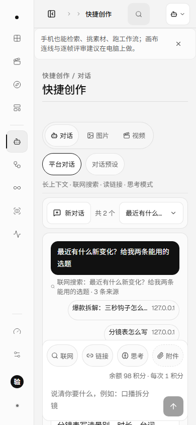
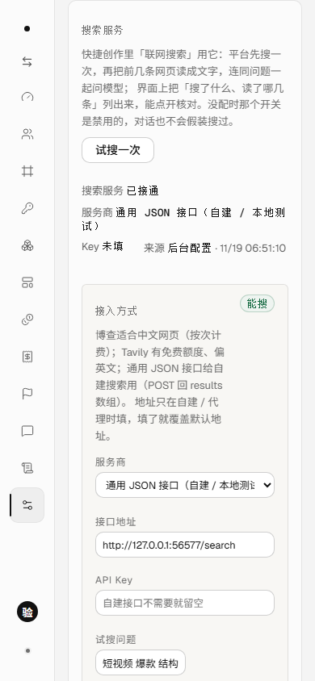

# 联网搜索改成平台自己搜（r246 / v0.9.229）

日期：2026-11-19 · 版本：0.9.229 · 轮次：r246

## 结论

以前快捷创作的「联网搜索」是把 `deepseek_web_search` 当服务端工具塞进上游请求：上游认这个工具才有搜索，
不认就是**整条请求 400**——用户点一下开关，换来一句「这次没有回上来，积分已退回」，而他自己并不知道上游根本没这个能力。
（读链接在 r219 已经因为同样的原因改成平台自己在本地读，联网搜索一直漏着。）

这一轮把联网搜索接到平台自己这一侧：

1. 平台用自己的搜索服务搜一次（博查 / Tavily / 通用 JSON 接口），拿到标题、地址、摘要；
2. 再用读链接把前 3 条网页读成文字（内网地址、超时、字数上限都在那一层）；
3. 搜索结果与正文一起进这一轮上下文，界面上把「搜了什么、搜到哪几条」列出来，能点开核对；
4. **没配搜索服务时不假装搜过**：界面上的开关是禁用的、写明原因，服务端也只往上下文里写一句
   「这次没搜成、别编」，让模型老实说不确定。

## 三个刻意的设计决定

| 决定 | 为什么 |
| --- | --- |
| **不再带上游工具** | 上游不认 `deepseek_web_search` 就是整条 400。搜索、读页面都在平台这一侧，上游只负责回答 |
| **用户自己给了链接就不再自己搜** | 先把他的页面读准；同时再搜一遍只会多读三张网页、多花十几秒，还可能把他要问的那件事带偏 |
| **搜失败也写进上下文** | 「没有最新信息」和「没搜成」是两件事：写一句「先说明不确定、不要编造链接与数据」，比让模型凭记忆编一条强 |

## 契约

| 项 | 规则 |
| --- | --- |
| 服务商 | 博查 Bocha（`POST /v1/web-search`，Bearer）、Tavily（`POST /search`，body 带 api_key）、通用 JSON（自建 / 本地测试） |
| 配置在哪 | `DATA_DIR/search.json`（0600）；没配过读环境变量 `VQ_SEARCH_PROVIDER / VQ_SEARCH_KEY / VQ_SEARCH_ENDPOINT` |
| Key | 只写不读：接口只回掩码与「有没有」；留空保存 = 沿用旧 Key |
| 数量上限 | 一次最多 6 条结果、读前 3 条网页，正文合计 12000 字（进上下文会算 token） |
| 搜索服务返回多大都收 | 单次响应 512 KB 封顶；非 JSON、HTTP 非 200、业务码不对都给人话错误，不让整次对话失败 |
| 界面上能看到什么 | 查询词、来源条数、每条标题与站点（点开新标签）；摘要与网页正文只在上下文里，不重复存 |
| 后台自检 | `POST /api/admin/search/test` 真发一次请求（花一次搜索服务额度），只回标题与地址 |
| 后台入口 | 系统 → 搜索服务卡片：服务商 / 接口地址 / API Key / 试搜一次 / 清掉 |
| 用户侧状态 | `GET /api/chat/search` 只回「通没通」与一句说明，Key 不出现 |

## 顺手修的一个权限不一致

`VQ_ADMIN_EMAILS` 里的账号在接口上是管理员（能发积分、能改配置），但后台页面显示「这个账号没有后台权限」——
因为 `/api/auth/me` 只回库里的 `kind`。现在对外报的 kind 走同一套判定，两边一致；新增单测 `test/admin-kind.test.mjs` 钉住。

## 三层验收

1. **单测**（`test/web-search.test.mjs` 9 条 + `test/chat-send.test.mjs` 新增 3 条 + `test/admin-kind.test.mjs` 1 条）：
   三家的请求体与返回字段、去重与只认 http(s)、Key 掩码与沿用、各家失败都给人话、
   搜完读前 3 条网页、搜失败写「别编」、用户给了链接不再搜、没配时上下文如实写。
2. **本机临时实例 + 假上游 + 假搜索服务**（同一份 `dist`，临时数据目录）：真的走了一遍
   注册 → 首轮（未接通，界面写「联网搜索没成」）→ 后台配一个通用接口 → 第二轮（搜到 3 条、读了 2 条、第 3 条 404 照实说）。
3. **无头浏览器真点**：快捷创作打开那条对话看到 3 条来源；后台点「试搜一次」拿到 3 条。

## 量测（无头 Edge，按宽度重新加载后量）

| 页面 | 宽度 | 小字 < 13px | 点按区 < 40px | 内容溢出 | 整页宽度 |
| --- | --- | --- | --- | --- | --- |
| 快捷创作（带来源） | 390 | 0 | 0 | 0 | 390 = 390 |
| 快捷创作（带来源） | 320 | 0 | 0 | 0 | 320 = 320 |
| 后台系统（搜索服务卡） | 390 | 108（既有：12px 的 admin-mono/label） | 54（既有：32px 按钮、27px 标签） | 0 | 390 = 390 |

后台这一页的小字与 32px / 27px 控件是既有样式，不是本轮新增；我的卡片沿用 `.vq-button`（32px）。
本轮新加的东西在第一轮量测里被抓到两处，已修：

- 来源 chip 原来是 12px / 站点 11px（390 下报 7 处小字）→ 统一 13px，复测归零；
- 搜索服务卡 390 下 `.admin-channel` 260/254、`.admin-mail-form` 244/222：两个按钮并排挤出去 →
  允许 `.admin-doc-actions` 换行、表单字段与下拉可收缩，复测溢出归零。

## 改了哪些文件

| 文件 | 改动 |
| --- | --- |
| `server/web-search.mjs`（新） | 服务商适配、配置读写与校验、`searchWeb` / `searchAndRead`、对外视图 |
| `server/config.mjs` | `VQ_SEARCH_PROVIDER / KEY / ENDPOINT` 读进 `config.search` |
| `server/chat.mjs` | 撤掉上游工具；`runSearch` 接进 `beginChat`；消息落 `search`；meta 记一笔 |
| `server/chat-store.mjs` | `safeSearch` 存来源；上下文标签写「联网搜索 / 联网搜索（没搜成）」 |
| `server/routes/chat.mjs` | `GET /api/chat/search`（通没通，不含 Key） |
| `server/routes/admin.mjs` | `GET/PUT/DELETE /api/admin/search` 与 `POST /api/admin/search/test` |
| `server/auth.mjs` | 对外报的 `kind` 与管理员判定一致 |
| `src/api/chat.ts` | `ChatSearch` / `ChatSearchStatus` 类型与 `getChatSearch()` |
| `src/components/QuickChat.tsx` | 开关按「通没通」启用；来源列表；运行态文案；空状态说明 |
| `src/styles/agents.css` | `.qc-search*` 样式（13px、≤560px 40px 触控） |
| `src/pages/admin/SystemSection.tsx` | 「搜索服务」卡片 |
| `src/styles/console.css` | 390 下表单可收缩、按钮可换行 |
| `test/web-search.test.mjs` `test/admin-kind.test.mjs`（新）· `test/chat-send.test.mjs`（+3） | 单测 |

## 边界

- **一次真实的搜索服务调用都没发生**：本地全程用假搜索服务与假上游。博查 / Tavily 的真实请求体与返回字段按公开文档写，
  拿到 Key 之后要先在后台点一次「试搜一次」确认；这一步会花一次搜索服务额度。
- 结果是搜索引擎给的，**不保证每条都能打开**：读不到的那条会写「没读到」，不会当成读过。
- 只读前 3 条、不翻页、不做多轮追问式检索；正文超过 12000 字截断。
- 搜索服务按次计费（博查约 ¥0.03/次），**对话仍然只扣 1 积分**——差价属于待定的定价决定（D1），这一轮没有改价。
- 后台这一页在 390 下仍是 32px 按钮、27px 标签（既有样式），没有按移动端重排。
