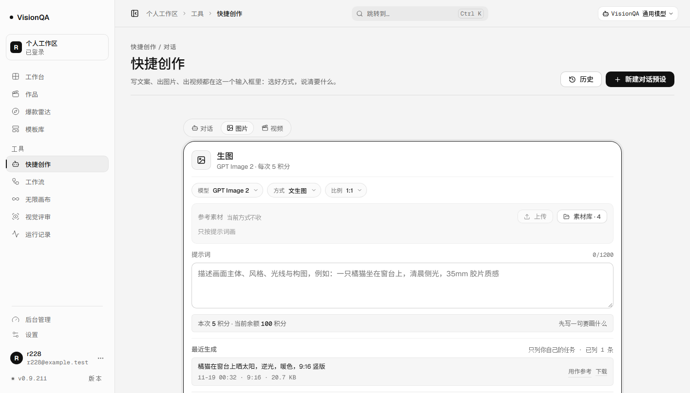
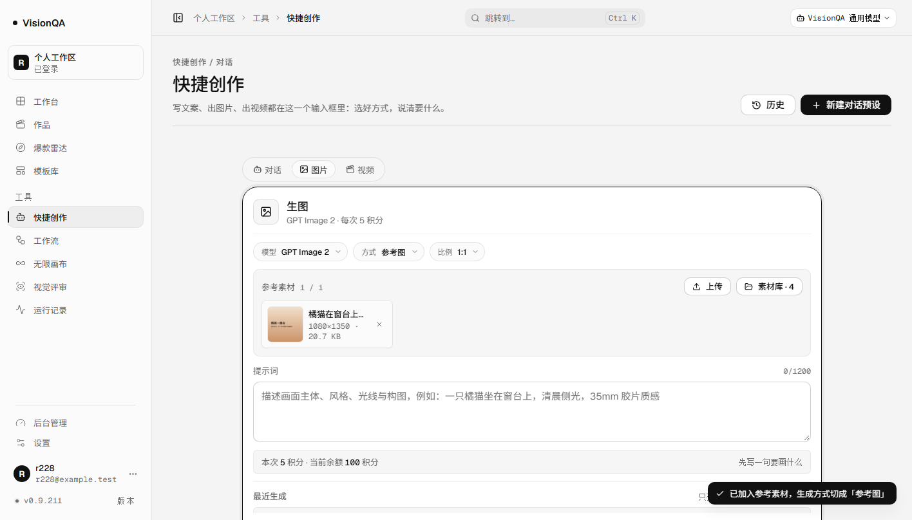
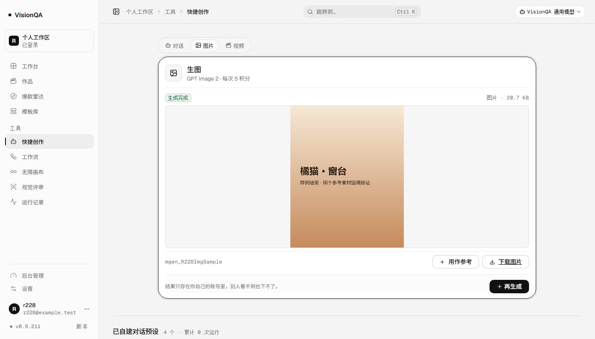
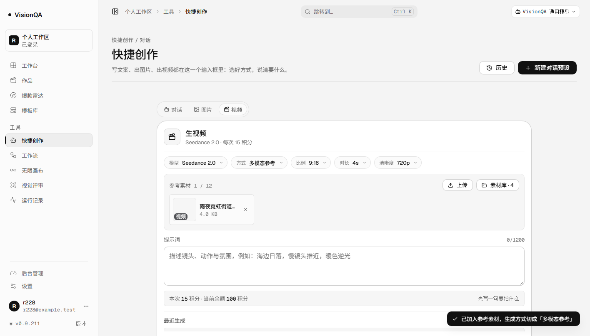
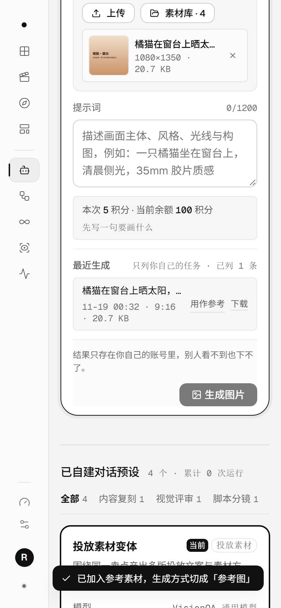

# 最近生成的结果，现在能一键当参考素材（r228 / v0.9.212，2026-11-19）

上一轮把「工作流」在手机上的样子修好了。这一轮回到创作闭环，补的是中间最容易断的一步：
**刚生成出来的那张图 / 那条视频，下一步通常就是拿它接着改、或者当首帧/参考去出视频**——
而界面以前只有「下载」，想复用要人手把文件再传一遍。

## 一、体检：三处「看起来能用、实际接不上」

| 现场 | 问题 | 改法 |
| --- | --- | --- |
| 「最近生成」每行只有 **下载** / 打开 | 想拿刚出的结果当参考，得先下载到本地再回「上传」里找一遍 | 每行加 **用作参考**，结果卡下面也加一个 |
| 参考素材只判「这个方式收不收」（`maxRefs === 0`） | 视频当参考时「首帧」只收图，界面先收下、等服务端 400 才知道不行；素材规则散在三个入口里各写一遍 | 规则收敛到 `src/domain/media-refs.ts`：按 `imageRefs / videoRefs` 判收不收，不收就自动切到同一模型下第一个收它的方式 |
| 托架放满只说「最多 N 个」 | 不说同一模型里哪个方式还放得下（首帧 1 张 → 多模态参考 9 张），只能一个个试下拉 | 放满时点名：「「首帧」最多 1 张参考图：想多放几个，先切到「多模态参考」」 |
| 上传成功之后才判放不放得下 | 白等一次上传，还要再删一次 | 上传前先判，能放才传 |

## 二、规则（可单测的结论，界面只照结论改状态）

| 输入 | 结论 | 人话 |
| --- | --- | --- |
| 文生图 + 一张图 | 切到「参考图」 | 已加入参考素材，生成方式切成「参考图」 |
| 首帧 + 一段视频 | 切到「多模态参考」 | 同上 |
| 多模态参考 + 第 9 张图 / 第 4 段视频 | 拦住 | 「多模态参考」最多 9 张参考图：先移除一个 |
| 图模型 + 一段视频 | 拦住 | 当前模型没有收参考视频的方式 |
| 同一个素材点第二次 | 不重复加 | 这个素材已经在参考里了 |

「用作参考」自己不扣积分、不打上游：它走的是**已经存在的** `POST /api/media/assets`——
取回结果字节 → 浏览器读出真实宽高 / 时长 → 上传成素材，再挂进托架。没有新接口、没有新模型、没有新计费。

## 三、真机数字（临时实例 + 磁盘上种的两条任务，0 次上游调用）

| 验的事 | 结果 |
| --- | --- |
| 图片页签：文生图 → 点「用作参考」 | 方式 `参考图`，托架 `1 / 1`，素材库 +1，余额 **100 → 100** |
| 视频页签：文生视频 → 点「用作参考」 | 方式 `多模态参考`，托架 `1 / 12`，素材带「视频」标 |
| 结果卡 | 两个动作并排：`+ 用作参考` / `下载图片`，点它也进同一条路径 |
| 重复用同一条结果 | 素材库已有同名那份就直接复用：文件数 **3 → 3 → 3**，不再传副本 |
| 托架放满再点 | 行上给 `「参考图」最多 1 张参考图：先移除一个` |
| 390 宽 | `innerWidth = clientWidth = scrollWidth = 390`，页高 2174，「用作参考」按钮高 **24px** |
| 页面异常 | CDP 捕获 **0** 条 `Runtime.exceptionThrown` |

素材名规则也顺带修了：`橘猫在窗台上晒太阳，逆光，暖色，9:16 竖版` →
`橘猫在窗台上晒太阳，逆光，暖色-Sample.png`（截断后把两端剩下的标点削掉，任务号尾巴防撞名）。
390 宽素材卡那行小字「1080×1350 · 20.7 KB」原来会把单位拆到下一行（`20.7` / `KB`），
改成数字与单位之间用不换行空格粘住：宁可整组换行，也不让「KB」孤零零掉在下面。

## 四、门禁

| 项 | 结果 |
| --- | --- |
| `npm test` | **1498/1498**（新增 `test/media-refs.test.mjs` 11 条：7 条挂载规则 + 2 条上限/种类 + 1 条文件名 + 1 条界面结构） |
| lint / 类型 / 构建 | 0 error / 26 warning（604 文件）；`tsc -b` 干净；`vite build` 干净 |
| 密钥扫描 | 930 文件无命中 |
| 真实上游 | **0 次**，0 元 |

## 五、截图

## 六、边界

- **参考图出图（`/images/edits`）与参考素材生视频仍未真调**：这两条要花约 $0.05 + ¥1.4，等你授权；
  这轮只证明「素材能挂上去、请求会带出去」，没有替你发起真实生成。
- 一条结果变成素材会占账号配额（60 个 / 400 MB）；同名复用避免重复那一条，但不同结果仍是不同文件。
- 「同名就复用」的窗口是素材库最近 20 条，更早的那份不在窗口里时会再传一次。
- 视频当参考只有「多模态参考」收（首帧只收图），这是模型规格，不是这一版能改的。
- 截图来自本机临时实例（临时 `DATA_DIR` + 磁盘上种的两条任务 + 样例图），不是真实生成结果。
