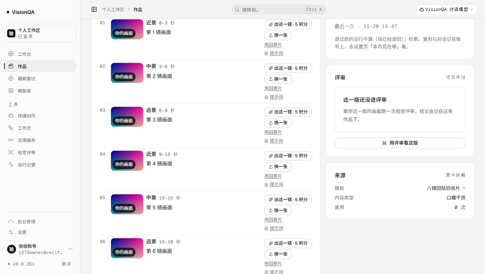
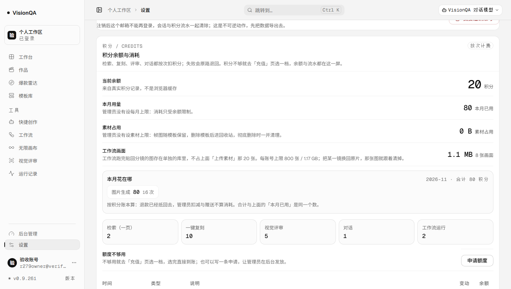
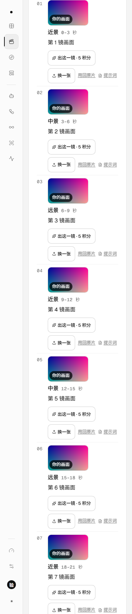

# 分镜画面有自己的库：贴回分镜不再占上传额度（r279 / v0.9.261）

## 结论

工作流跑完按分镜画的图，从这一版起存进**分镜画面库** `shotframes/<账号>/<作品>/`，
不再借用「上传素材」那 20 个位置。一条 8 镜作品来回贴几次，也不会再把用户自己传进来准备评审的图顶掉。

## 为什么改：这不是洁癖，是数据丢失

r278 的回贴流程是「读运行目录 → `saveUpload` 复制一份 → 记到作品上」。而上传素材是每账号
**20 张 / 160 MB 的环形空间**，超出就顶掉最早上传的那一张：

- 一条 8 镜作品贴一次占 8 张；贴两次（换一次运行）就占 16 张；
- 实测「贴回 8 张之后上传占用仍是 20 张」——不是没占，是**又顶掉了 8 张用户自己的图**；
- 评审记录还在，那张原图已经没了，评审页只能显示破图。

上传素材的语义是「用户传给我的东西」，分镜画面是「工作流的产物」。两者不该共用一个配额。

## 现在的规则

| 项目 | 规则 |
| --- | --- |
| 存哪 | `DATA_DIR/shotframes/<账号 id>/<作品 id>/<时间戳-随机串>.<png/jpg/webp>` |
| 文件名 | 服务端起名，只认这个形状；请求里的字符串永远不拼进路径 |
| 单张上限 | 8 MB，按文件头认类型（改名 / Content-Type 骗不过去） |
| 一条作品 | 最多 60 个文件（分镜上限 48 镜，留余量） |
| 一个账号 | 800 张 / 1.2 GB 封顶；满了回 409 并说明怎么办，**不悄悄顶掉别人的画面** |
| 读法 | `GET /media/shotframes/<账号>/<作品>/<文件>`，必须登录、只给本人（管理员排障可读）；未登录 401、别人的 404 |
| 什么时候清 | 换图 / 「用回原片」之后，这一作品目录里没人引用的文件立刻删；彻底删除作品、回收站过期、注销账号时整棵清 |
| 老记录 | r278 记下的 `uploads/…` 路径照旧能读、能显示，不迁移、不改写 |

手贴那条路**没有变**：它引用的是用户自己上传的那张图（`uploads/…`），只是记一个引用，不复制字节。

## 顺手补的两件事

1. **设置页看得见**：`/api/storage` 多回一个 `shotFrames`（张数 / 字节 / 账号上限），
   设置页「素材占用」下面多一行「工作流画面」。有上限就必须有读数，否则贴满的那一刻只会收到一句「到上限了」。
2. **删干净**：彻底删除作品、回收站过期、注销账号，都会把这条作品 / 这个账号的画面一起清掉；
   进回收站**不删**——恢复要连画面一起回来。

## 实测（临时实例 + 假上游 + 无头 Chrome，0 次真实上游调用、0 费用）

| 检查 | 结果 |
| --- | --- |
| 先传 3 张自己的图 | 上传占用 3 张 / 418,164 B |
| 贴回 8 镜 | 200，applied 8、failed 0；分镜目录 8 个文件；8 个 media 全是 `shotframes/` |
| 上传占用 | 仍是 3 张 / 418,164 B；3 张原图逐一 `GET /media/uploads/…` 全 200 image/png |
| 8 镜画面能不能读 | 8/8 `GET /media/shotframes/…` 200 image/png 139,388 B |
| 再贴同一次运行 | applied 0、kept 8、目录仍 8 个文件 |
| 第 2 镜「用回原片」 | shots 7、目录 7 个文件；上传占用仍 3 张 |
| 换第二次运行重贴 | applied 8、overwritten [1,3,4,5,6,7,8]；目录仍是 8 个文件（旧 8 张被清掉） |
| 设置页读数 | 8 张 / 1.1 MB，上限 800 张 / 1.17 GB；正文 13px |
| 归属 | 未登录 401；别的账号 404 |
| 浏览器真渲染 | 分镜 8 行、8 张 `/media/shotframes/` 图全部 naturalWidth 256、8 个「你的画面」标签、0 个「原片帧」 |
| 390 宽 | `scrollWidth 390 = innerWidth 390`、内容区 322/322、正文 16px、行内按钮 95×44 |

## 边界

- **字节还是两份**：`runs/<runId>/` 一份（运行记录自己要能回看）、`shotframes/` 一份（分镜的寿命比运行目录长）。
  换来的是「运行目录被清，分镜画面不受影响」。
- **账号总量满会拒**：800 张 / 1.2 GB 是硬上限，满了这次回贴会有几镜进 `failed`（原因写「存到上限了」）。
  现在只能靠「撤掉几镜画面」或「彻底删除不用的作品」腾地方，还没有一键清理入口。
- **每作品 60 个文件**：正常只会等于分镜数；这个数是给「换图那一刻的短暂重叠」留的余量。
- **老数据不迁移**：r278 那批记在 `uploads/` 下的画面继续显示，但它们仍占着上传额度（那是当时的事实）。
- 分享页 / 交付包里没有分镜画面（和 r278 一样），只带模板原片帧。

## 踩坑

1. 作品页地址是 `#/projects/<id>`（复数）——写成 `#/project/<id>` 会静静落在工作台，截图里就是「正在读取…」。
2. 分镜里的 `` 不进视口就不加载，量「几张图画出来了」之前先改成 `eager` 再滚到分镜区。
3. 上手引导遮罩按账号记 `vq_welcome_seen:<账号 id>`：种完 cookie 要 `Page.reload`，否则遮罩盖满整张截图。
4. 390 宽必须按真宽重载再量；从 1440 缩过去那一帧量出来的布局不算数。
5. 重载期间 `Runtime.evaluate` 会报 `Inspected target navigated or closed`，要当重试，不能当失败。
