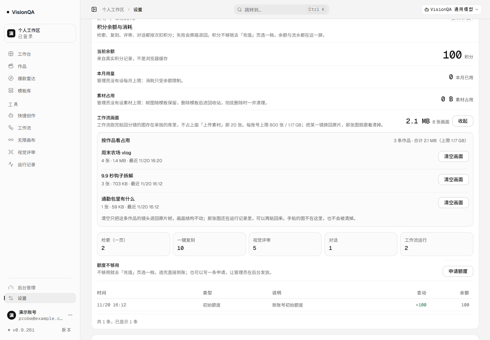
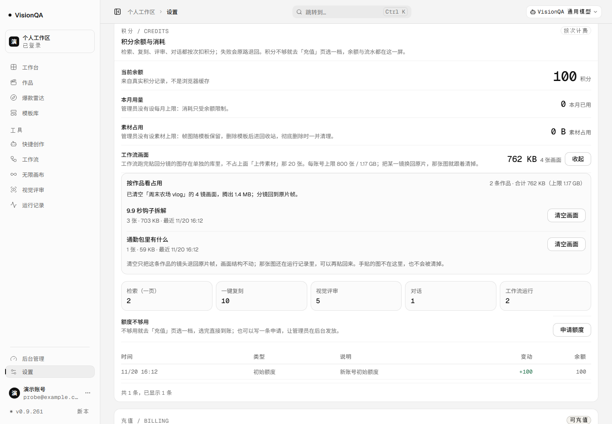
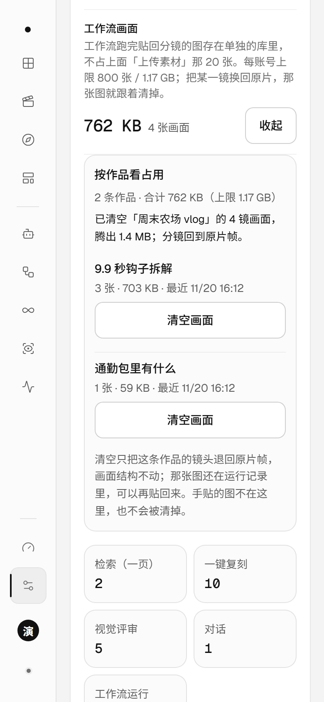

# r280 / v0.9.262：工作流画面有定额了，就得有对账和腾地方的地方

日期：2026-11-20 · 生产版本 0.9.262

## 这一轮补的是 r279 自己留下的死胡同

r279 给工作流画面单独划了库、单独划了定额：每账号 800 张 / 1.2 GB，满了回 409，
**不顶掉任何人的东西**。当时的边界写得很清楚，其中一条是：

> 账号总量满会拒这次回贴（几镜进 failed），且没有一键清理入口。

到上限之后，页面只给一句「工作流画面存到上限了（已有 N 张 / M MB）」，用户能做的事只有两件：
一镜一镜点「用回原片」（8 镜就点 8 次），或者把整条作品彻底删掉（连分镜、脚本、评审一起没）。
两件都很重，等于把一个「清理文件」的需求推成了「重做一条作品」。

有定额就必须有对账的地方：**哪条作品占了多少、有没有白占的文件、要腾地方该按哪儿**。

## 现在能做什么

设置 → 积分那一块，原来只有一行「工作流画面 8 张 / 1.1 MB」，现在右列多一颗「管理」按钮，
点开是这张表：

| 面板上看到的 | 含义 |
| --- | --- |
| 按作品看占用 · N 条作品 · 合计 X（上限 1.17 GB） | 顶层数字，和「工作流画面」那一行是同一口径 |
| 没人引用的 N 张 · X | 盘上还在、作品记录里已经没有地方指着它（贴图中途断掉留下的）；只有一个「清掉」 |
| 每条作品一行：标题 · N 张 · X · 最近时间 | 按字节从大到小排，最占地方的排最上面 |
| 行右：「清空画面」 | 两步：先点变「确认清空」，再点才真清 |

清空一条作品会发生什么（页面上就写着这句）：

- 这条作品里**指向分镜画面库**的镜头记录被摘掉，分镜回到「原片帧」，画面结构、镜头数、脚本都不动；
- 那条作品的画面文件整个目录清掉，额度立刻释放；
- **手贴的图（uploads/…）一张都不动**——那不是工作流的产物，也不是这次要腾的空间；
- 那张图还在运行记录里，想用回去再贴一次就行（判定沿用 r278 的 from 运行号）。

## 实测（临时实例 + 无头 Chrome，0 次真实上游调用、0 费用）

样例：3 条作品 10 张画面 4.2 MB（其中 1 张是故意留下的孤儿文件 8 KB）。

| 检查 | 结果 |
| --- | --- |
| 打开「管理」 | 3 条作品 + 1 行孤儿；顶部「3 条作品 · 合计 4.2 MB（上限 1.17 GB）」 |
| 点「清空画面」（只点一次） | 该行按钮变「确认清空」，**没有提交** |
| 再点「确认清空」 | 面板剩 2 条作品 762 KB；顶部那行同步变「762 KB / 4 张画面」 |
| 提示 | 「已清空「周末农场 vlog」的 6 镜画面，腾出 3.4 MB；分镜回到原片帧。」 |
| 作品本身 | GET /api/projects/prj_… 200，标题还在，`shots: {}`（记录摘干净了） |
| 接口 | /api/storage/shotframes 回 { usage, projects:[{title,files,bytes,newestAt}], orphans } |
| 孤儿 | 单列且只有一个「清掉」；清完 orphans 归 0，被引用的那张仍在 |
| 归属 | 清别人的作品 → 404，一个字节都不动（单测） |
| 未登录 | /api/storage/shotframes 401（curl 实测） |
| 390 宽 | innerWidth 390 = scrollWidth 390；说明列从被挤成 40px 竖排改为整行 256px 宽 |
| 触控 | 390 下每颗按钮 230×44；1440 下 40 高（这一页 1080 起按 40px 走） |
| 字号 | 面板标题 14px、说明 13px、正文 16px（守住 13px 地板） |

## 边界（照实写）

- **只能看在用自己账号的那一份**：画面库按账号分目录，别人的画面不在这张表里，管理员也只是看自己的。
- **没有批量**：一条一条点。批量清空等于一次删掉几十条作品的画面，那不是「顺手点一下」该有的后果。
- **回收站里的作品算「还在用」**：恢复要连画面一起回来，所以它的画面不会被当孤儿清掉；面板上标「回收站」。
- **作品已经不在、目录还在的**：如实写「已删除的作品」，清孤儿时一起收掉。
- **孤儿只在两种时机产生**：先写文件后落记录之间断掉、或目录没删成；面板不主动扫盘，点「管理」时才数。
- 分享页 / 交付包仍不带分镜画面（r279 的边界没变）。

## 踩坑

1. **390 上这一行被挤成竖排**：`.vq-row` 左列 `flex` 收缩，右列 `flex: none` 按内容宽度占掉大半，
   说明文字退到 40px 宽。`≤720px` 把说明整行留下、占用与按钮换到下一行两端对齐才正常。
2. **按钮别用 quiet**：`vq-button--quiet` 无边框无底色，混在正文里看不出是能点的；
   换成 `ghost`（描边 + 浅底）后，清空/收起一眼是按钮，确认态转 `danger` 仍然说得清。
3. **改数据文件后要重启临时实例**：`projects.json` 在服务端有缓存，直接往盘上塞一条作品，
   界面会把它显示成「已删除的作品」（画面在、记录读不到）。验收脚本里种数据之后必须重启。
4. **清空要「先摘记录、后删文件」**：顺序反了会留下一批读不出来的破图（镜头还指着已删的文件）。
5. **孤儿判定要和清理用同一套**：单独写一份判定，迟早出现「面板说 0、清的时候删了 3 张」。
