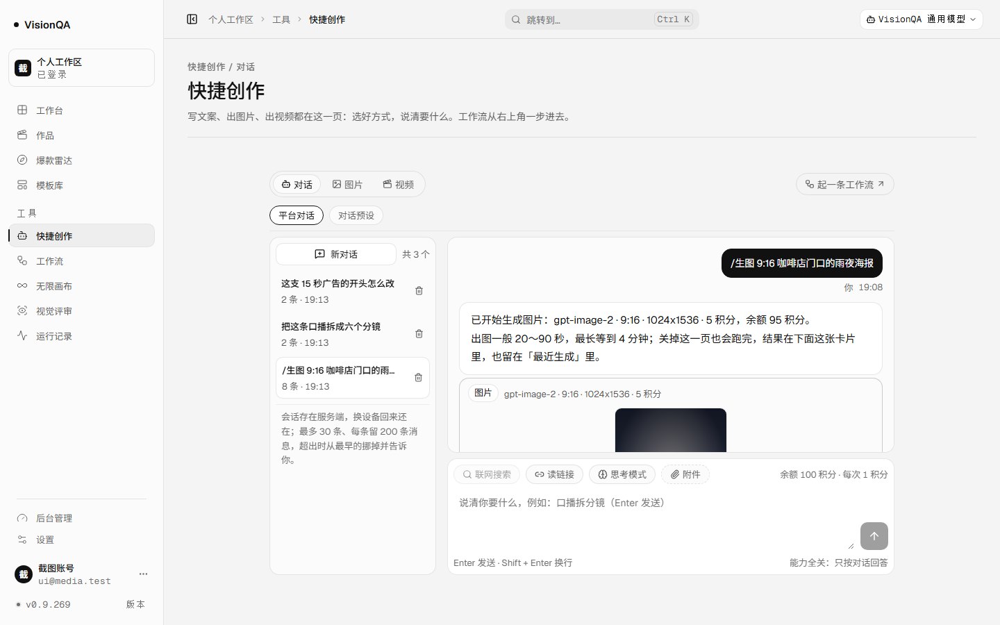
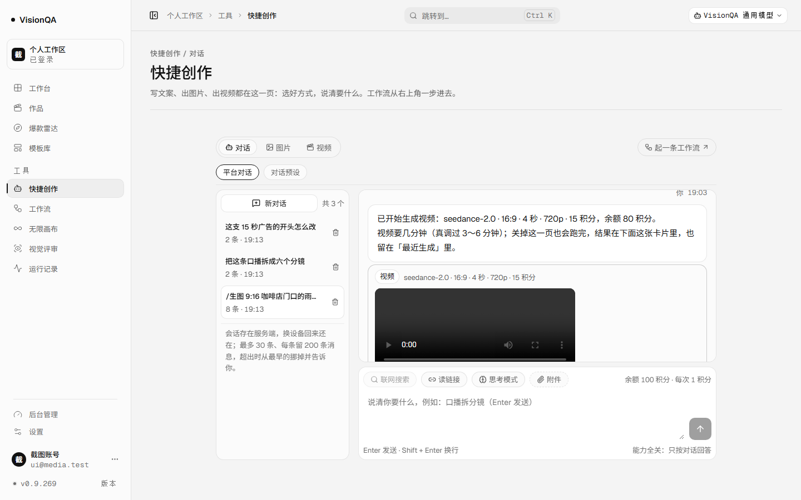
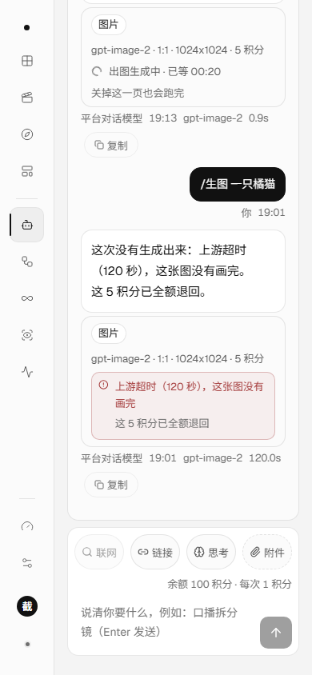

# r288：对话框里一句话直接生图 / 生视频（2026-11-20）

r287 把「对话框直连生成」按 A/B 两条路摆到桌面上，并建议先上 B。这一轮按 B 落地：
**在「快捷创作 → 对话（平台对话）」里，消息开头就是生成指令时，这一轮不走文本模型，
直接接上现成的生图 / 生视频管线**（扣费、失败全额退、任务落盘、最近生成全是原来那套），
结果以一张卡片挂在回答下面。

## 1. 用户能看到什么

- 输入 `/生图 9:16 咖啡店门口的雨夜海报`，回车 → 回答里立刻出现一条任务卡片，5 积分一次；
- 输入 `/生视频 16:9 8秒 480p 海边日落` → 视频卡片，15 积分一次，比例 / 时长 / 清晰度真的发给上游；
- 卡片跟着回答走：图片给缩略图（点开看原图）与下载，视频给播放器与下载，
  进行中只写「出图生成中 · 已等 00:30 / 关掉这一页也会跑完」，失败写原因与「这 5 积分已全额退回」；
- 关掉页面、换设备回来，卡片还在（会话里存任务号，卡片按任务号查）。

## 2. 三种写法（`server/media-intent.mjs` 是唯一真源）

| 写法 | 例子 |
| --- | --- |
| 斜杠指令 | `/生图 9:16 …`、`/图 …`、`/画图 …`、`/生视频 …`、`/视频 …` |
| 自然语言 | `生成一张图 …`、`画一张 …`、`生成一段视频 …`、`做一段视频 …`、`帮我生成一张图 …` |
| 参数 | 比例 `9:16 / 16:9 / 1:1`、时长 `4秒 / 8秒`、清晰度 `480p / 720p`、`seedance 2.0 fast / 极速` |

参数词从提示词里摘出去再发给上游（否则上游会把「9:16」也当画面描述）。
不支持的参数不偷偷改：`4:3` 会说「这个模型没有 4:3，这次按 1:1 生成」，`10秒` 会说「视频只能 4 秒 / 8 秒，这次按 4 秒生成」。

## 3. 为什么不会误扣积分

生成是要花钱的动作，所以判定写得很窄：

- **只认开头**：一句话中间出现「生图」不算（`我想知道平台怎么生图` 走对话）；
- **自然语言触发词后面必须有断点**（空格 / 标点 / 比例数字），否则 `生成视频教程的文案` 会被当成要出视频；
- **问句不触发**：`怎么生成图？`、`生成一张图要多久`、`生成视频能有多长`、`生图工具怎么用` 全部当对话回答；
  斜杠指令是例外（`/生图 要多久` 就是「画一张叫『要多久』的图」——用户明确敲了指令）；
- **只有指令没有提示词**（`/生图`）→ 400 教用法，一分钱不扣；
- 带附件下生成指令 → 明确拒绝并引导到「图片 / 视频」页签（对话只做文生图 / 文生视频）。

## 4. 扣费与失败

- 这一轮**不扣对话那 1 积分**（没走文本模型），只扣生成积分（图片 5 / 视频 15，价格仍在 `config.credits.prices`）；
- 与「图片 / 视频」页签共用同一个账号级限流桶（10 次/分钟），不能靠换入口绕过；
- 余额不足 402、限流 429，都发生在打上游之前；
- 失败照旧走管线自己的退款：`outstandingCharge` 判断，重复查询不会多退；卡片上的退款状态以**刚查到的任务**为准，
  不用会话里建任务那一刻的快照（否则会出现「上面写已全额退回、下面还让找管理员」的自相矛盾——本轮实测抓到并修掉）。

## 5. 诚实边界：这不是「模型自己决定去生成」

`AGENT_TOOLS` 里的 `image-gen` 仍是 `state: 'planned'`，`server/chatcall.mjs` 仍不透 `tools` / `tool_calls`。
也就是说：**用户说人话、平台认指令、平台执行**，不是「模型读完这句话决定画一张图」。差别在：

- 模型不会在闲聊里顺手画图（少花钱，也不会「理解得很热情」）；
- 模型也不会在你描述完一段画面后主动提议生成——要你自己用指令开头。

要走到「模型自己决定」，就是 r287 文档里的 A 方案：把 `tools` 透给上游、执行 `tool_calls`、把结果回灌。
它需要一次真实文本调用（约 ¥0.05）确认 deepseek-flash 认不认 function calling，**这轮没花**。

## 6. 实现（三个文件 + 一处复用）

| 位置 | 作用 |
| --- | --- |
| `server/media-intent.mjs` | 纯函数：一句话 → `{ kind, prompt, model, ratio, duration, resolution, notes }` 或「不是指令」或「缺提示词」 |
| `server/chat-media.mjs` | 把解析结果收敛成 `resolveSelection` 认识的形状，调 `runImage` / `runVideo`，把 402 / 429 翻成带 status 的错误 |
| `server/chat.mjs` | `beginChat` 里认出指令 → 不扣对话费、落用户那句 → `finishMediaChat` 开任务、落回答并写 `meta.media` |
| `src/components/MediaTaskCard.tsx` | 会话里那张卡片：按任务号轮询 `/api/media/tasks/:id`（只读元数据、不打上游、不扣积分），成功 / 失败后停止轮询 |

`server/routes/media-gen.mjs` 只多导出三个已有的东西（`publicTask` / `runImage` / `runVideo`）与一个限流入口
`mediaRateLimit`，行为没改。领域部分（约 400 行）以后该搬去 `server/media-tasks.mjs`，本轮刻意没搬：
搬迁与接线混在一次改动里出问题不好定位。

## 7. 验收

- 门禁 **1930/1930**（+13：`test/media-intent.test.mjs` 7 条 + `test/media-gen.test.mjs` 里 6 条端到端）、
  lint 0 error / 24 warning（664 文件）、`tsc -b` 干净、入口 `index-BsQwlhEV.js`（783,236 B）、密钥扫描 1061 文件无命中；
- 端到端（假上游，0 真实调用）：`/生图` → 任务 processing → 落盘 PNG、只扣 5；`/生视频 16:9 8秒 480p` →
  上游真的收到 `aspect_ratio=16:9`、`duration=8`、`resolution=480p`、扣 15；失败任务全额退回且会话里那句话还在；
  余额不足一个字节都不发给上游；带附件拒绝且不扣费；`怎么生成图？` 照旧走对话；
- 界面：本机临时实例 + 无头 Edge（真登录态 cookie）截图 1440×900 与 390×844，四条消息四种状态都核对过；
  390 宽整页滚到底，最后一条不会被贴底输入框压住（`scrollTop + innerHeight = scrollHeight`）。

## 8. 边界与下一步

- 卡片上的「已等多久」从打开卡片算起，不是上游真实耗时（真实耗时在任务元数据里）；
- 任务记录被删（「最近生成」里删掉）→ 卡片显示「这条生成记录已经不在了（可能被删掉了）」；
- 对话里**不能带参考图**生成：参考素材要先入媒体素材库，请用「图片 / 视频」页签（下一步可以接）；
- 图片默认 1:1、视频默认 9:16 / 4 秒 / 720p，与模型表第一档一致；
- 下一步候选：A 方案（tools 透传 + 一次真调验上游）；把「最近生成」里的结果一键带进对话当参考；
  对话里生成的图直接「用作参考」接着改。
