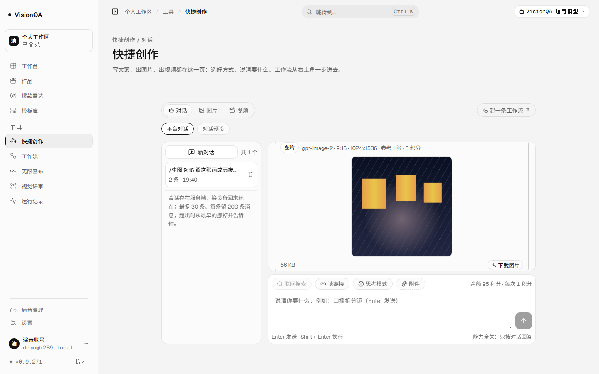
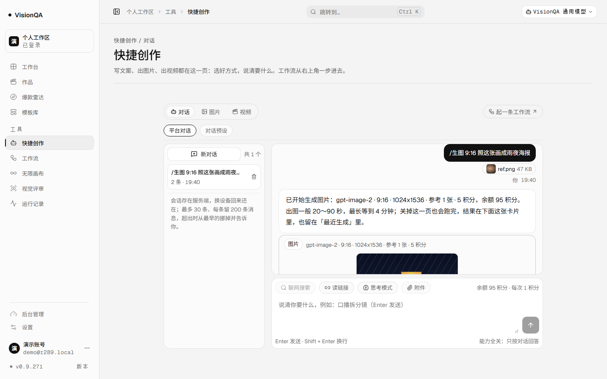
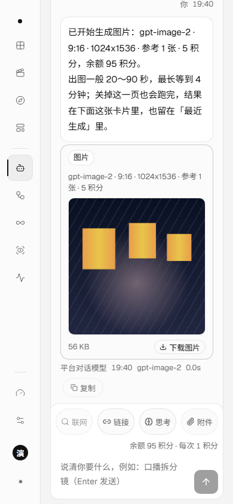

# r289：对话框里带一张图就能「按它出图 / 当视频首帧」（2026-11-20）

## 一句话

上一轮（r288）对话框已经能用一句话生图 / 生视频，但**带附件就被拒**，还要用户自己跳去「图片」页签重新上传参考图。
这轮把这条路补上：在对话框里挂一张图，再打 `/生图 …` 或 `/生视频 …`，平台直接按这张图生成——
生图走参考图（`/images/edits`），生视频拿它当首帧（`image2video`）。仍然不扣对话那 1 积分，只扣生成积分，失败全额退回。

## 用户看到的变化

| 打什么 + 带什么 | 以前 | 现在 |
| --- | --- | --- |
| `/生图 9:16 照这张画成雨夜海报` + 1 张图 | 400「请用「图片」「视频」页签」 | 按这张图出图，回话与卡片都写「参考 1 张」 |
| `/生视频 16:9 4秒 480p 让这张动起来` + 1 张图 | 同上 | 拿这张图当首帧，上游收到 `mode=image2video` |
| 生成指令 + 文档（txt/Word/PDF） | 同上（文档被忽略） | 400 说清「脚本.txt 这份文档没算进去」，并提示可以单独用对话问 |
| 生成指令 + 2 张图 | 同上 | 400 说清「一次最多带 1 张参考图，要按哪张重画就留哪一张」 |

带图那条消息上仍能看到自己传的那张图（点开是大图），下面回答里写「gpt-image-2 · 9:16 · 1024x1536 · 参考 1 张 · 5 积分」。

## 为什么只收 1 张、文档直接拒

- 生图只有两种方式：文生图（不带图）与参考图（**恰好 1 张**）；生视频带图就是首帧（**1 张**）。多收几张前端也给不出「用哪张」的语义。
- 文档静默丢掉是最糟的：用户会以为模型读了那份脚本。宁可回一句「这份文档没算进去」，也不假装用过。
- 图**不进素材库**：对话附件本来就在 `data/chat-files` 里，字节只在内存里传给生成管线，任务元数据只留形状（名字 / 类型）。
  这样既不用占用户的 60 个 / 400 MB 素材额度，也不会把同一张图在磁盘上存两份。

## 接线（改动很小，复用 r210 / r288 的现成管线）

- `server/chat.mjs`：新增 `mediaReferences()`——按归属读对话附件、只收图、读字节；`beginMediaChat()` 把附件留在那条用户消息里，
  把读好的参考图放进 `ctx.media.refs`。`mediaMeta()` 多回 `assets`（只有 kind / name），`mediaReply()` 在规格行加「参考 1 张」。
- `server/chat-media.mjs`：`startChatMedia(user, plan, references)`——带图时把生成方式从 `text` 换成 `reference`（生图）
  或 `first`（生视频），参考图作为 `assets` 传给 `runImage` / `runVideo`。扣费、退款、落盘、最近生成全是原来那套，一行没改。
- `src/components/MediaTaskCard.tsx`：规格行加「参考 N 张」，不然用户看不出这张是照自己传的图画的。
- `src/components/QuickChat.tsx`：输入框下方的提示在带附件时改成「会带上这 N 个附件；生成一次最多用 1 张参考图」；
  空状态那句补上「带一张图就按它出图 / 当视频首帧」。
- 生成指令的识别规则一个字没动：仍是只认开头、问句不认、教程不认（`server/media-intent.mjs`）。

## 验证

- 单测 1933/1933（v0.9.271）：本文件新增 4 条、删掉 1 条旧的「带附件一律拒」——
  - 带 1 张图 `/生图`：`mode=reference`、上游 multipart 里真的是我们那张（`filename="reference.png"`）、只扣 5 积分、附件留在会话里；
  - 带 1 张图 `/生视频`：`mode=first`、`lastVideoBody.mode=image2video`、`reference_image_urls=['asset://image']`、扣 15；
  - 带 2 张图：`MEDIA_CHAT_REF_MANY`，一分不扣、一次都不打上游；
  - 带文档：`MEDIA_CHAT_REF_DOC`，消息里点名那份文档，一分不扣。
- `npx oxlint src test server scripts`：0 error / 24 warning（664 文件）；`npx tsc -b` 干净；`npm run build` 入口 `index-DygFCEaN.js`。
- 密钥扫描 1066 文件无命中。
- 界面：本机临时实例 + 假出图上游（8810）+ 无头 Edge 真点（真登录 cookie、真上传一张 640×480 参考图、真按发送）——
  卡片最后是「图片 · gpt-image-2 · 9:16 · 1024x1536 · 参考 1 张 · 5 积分 · 56 KB · 下载图片」，1440 与 390 都见过、无横向溢出。
- **本轮 0 次真实上游调用、0 费用**（出图用的是本地假上游返回的图）。

## 没说成的事

- 视频**参考视频**（不是首帧）在对话里还不支持：对话附件本来只收图与文档，视频上传仍要走「视频」页签。
- 带图生成仍只有一条主路由模型 `gpt-image-2` / `seedance-2.0`，没加别的型号。
- 一次最多 1 张：真要多图参考（seedance 上限 9 张）请用「图片」「视频」页签，那里可以选多张、也能反复挑素材。
