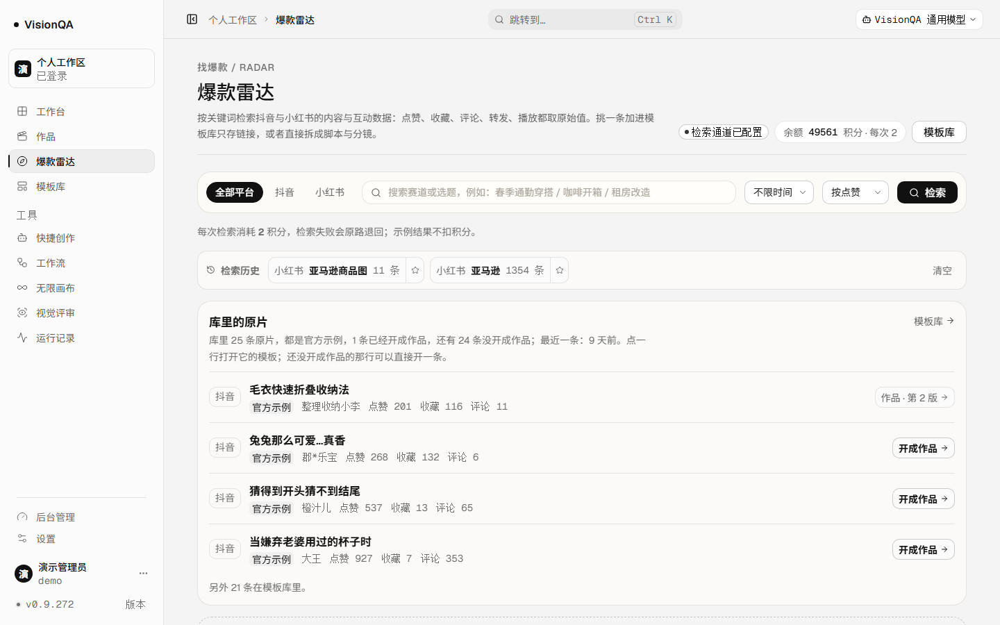
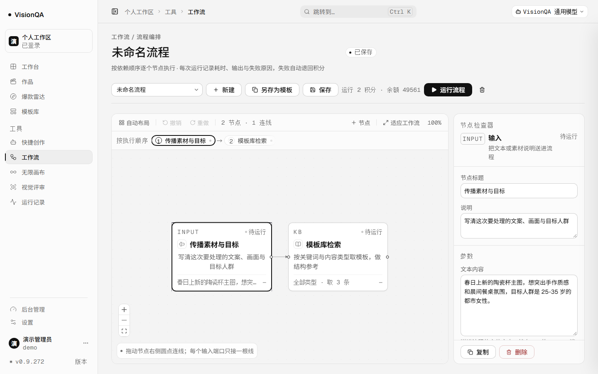
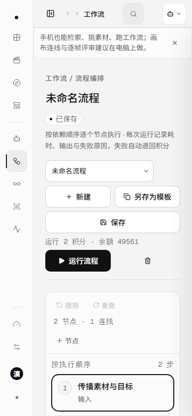

# r290：全站字阶整体抬 1px（2026-11-20）

## 一句话

用户从上线角度说过「整体页面看起来挺协调，但字体这种都有点小了，放大点，至少让我看得清楚字是啥」。
这一轮把全站字阶**整体**抬 1px：正文 13 → 14、说明 14 → 15、卡片标题 15 → 16、更大的档 16 → 18。
层级一个都没拆，只是每一档一起长 1px——所以看上去还是同一套设计，只是字一眼能看清了。

## 改之前是什么样（生产实测，1440 宽）

在线上按页面统计**计算后**的字号（只列出现最多的几档）：

| 页面 | 13px | 14px | 15px | 16px | 更大 |
| --- | --- | --- | --- | --- | --- |
| 作品 | 152 | 26 | 5 | — | 22 / 28 |
| 模板库 | 331 | 6 | 31 | — | 22 / 28 |
| 爆款雷达 | 96 | 5 | 9 | 2 | 22 / 28 |
| 工作流 | 88 | 11 | 7 | 3 | 22 / 28 |
| 视觉评审 | 80 | 5 | 6 | 1 | 22 / 28 |
| 工作台 | 110 | 16 | 7 | 5 | 22 / 24 / 28 |

也就是说**一页的主体文字几乎全是 13px**。13px 的英文还行，13px 的中文在 1x 屏上确实偏挤。

## 改了什么

1. **一套刻度，一起 +1**（src/styles/tokens.css）：

   | 用途 | 旧 | 新 |
   | --- | --- | --- |
   | 最小档 / 元数据（--text-2xs） | 13 | **14** |
   | 元信息半档（--text-xs） | 13.5 | **14.5** |
   | 说明正文（--text-sm / --text-body） | 15 | **16** |
   | 面板小标题（--text-md） | 16 | **17** |
   | 卡片标题（--text-lg） | 17 | **18** |
   | 阅读面（--text-copy / --text-meta） | 15 / 14 | **16 / 15** |
   | 胶囊（--chip-font） | 13 | **14** |
   | 按钮（--btn-font / --btn-font-sm） | 14 / 13 | **15 / 14** |

2. **写死的字号也一起走**：全站 font-size: Npx 与上面这些变量用**一次扫描、一张映射表**批量替换（不做链式替换，
   否则 13→14 再 14→15 会变成 +2）。共 32 个文件、约 700 处，src/App.css 里那份老样式也在内——
   漏了它会出现「一半页面变大、一半没变」。
3. **字号冻结测试跟着走**：仓库里 13 个 *-mobile.test.mjs 是「字号刻度」的规格测试（r221 起为了盯住手机字号慢慢加上来的），
   里面写死了 13px / 14px 这些数字。断言与用例标题一起更新到新刻度（112 处），规则一条没放宽；
   两条手写的下限断言（「不低于 14px」）按新刻度写成「不低于 15px」。
4. 行高、间距、圆角**一个都没动**——这次只碰字号。

## 为什么敢一次改 700 处

改之前先在**生产页面**上做了一次「如果整体 +1 会怎样」的模拟：把所有计算字号 13/13.5/14/15/16/17 的元素临时 +1px，
再量同一套指标（横向溢出、单行/多行被裁的文字、破图、控制台报错）。9 个用户页 + 5 个后台页，1440 / 768 / 390 三档：

- 横向溢出：**全部 0 → 0**；
- 只有「作品 @1440」多出 2 处**单行省略号**标签（VisionQA 通用模型、一条很长的英文作品标题），其余页面被裁数量不变；
- 手机与平板一档没有新增压字。

所以这不是「感觉能行」，是先在生产上试过再改源码。

## 改完之后的实测（生产 0.9.272，同一套探针）

- 1440 与 390 各 12 个页面：**横向溢出 0、控制台报错 0、接口 4xx/5xx 0、破图 0、小于 11px 的字 0**；
- 字号分布：作品 13px×152 → 14px×153；模板库 13px×331 → 14px×332；按钮从 14 变 15、卡片标题从 15 变 16、面板小标题 16 变 17；
- 门禁：**1933/1933** 测试、lint 0 error / 24 warning（664 文件）、tsc -b 干净、构建入口 index-DIdk3iSK.js、
  密钥扫描 1067 文件无命中；
- 截图用**生产数据副本**（本机临时实例 + 无头 Edge），账号名已换成演示账号，不含任何手机号/邮箱。

## 边界（说清楚没做的）

- 只量了 1440 / 768 / 390 三档，2x / 3x 高分屏没有逐屏过（字号是 CSS px，跟 dpr 无关，理论上更稳）；
- 行高没改：字大了以后个别长段落看起来比之前略紧，这轮不动行高是刻意的（改了会把卡片高度整体推高一截）；
- 交付包 PDF、两版对照 A4 纸仍是原来的印刷字号，这轮没跟着放大；
- 后台「模型与上游」那种密集表格在 390 宽仍是容器内横向滚动，按设计没动。
