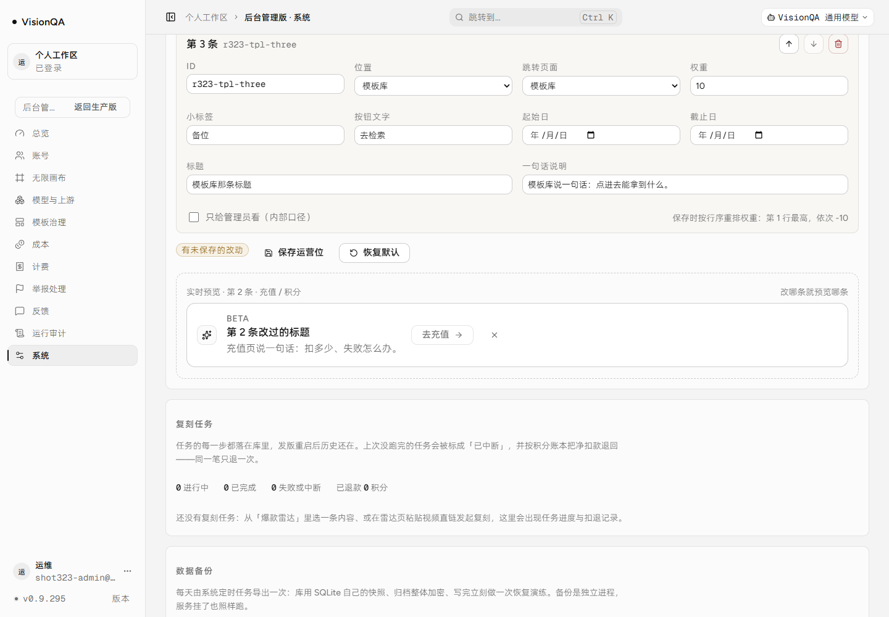
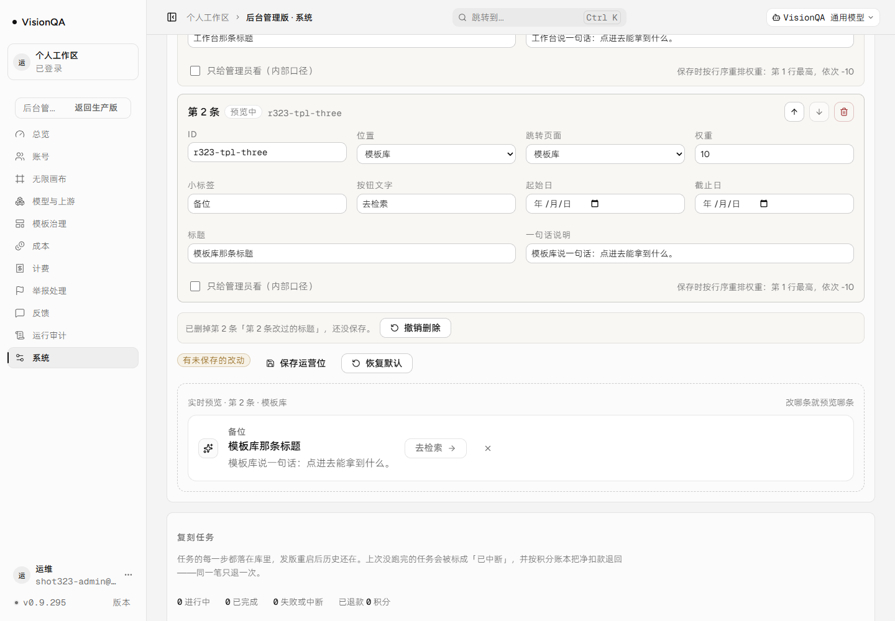
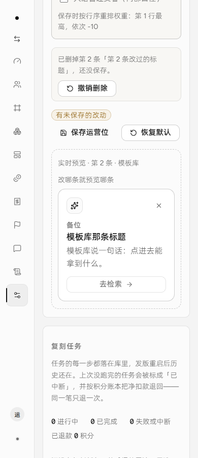

# r323 / v0.9.295：后台「运营位」编辑卡 —— 改的是哪一条看得见，改动不会白写

2026-11-26。上一版（r322）修的是**用户侧**：充值页挂上运营位、关掉一条先塌下去再移除。
这一版转向**配置侧**：后台「系统 → 运营位」是用户自己每天要开的屏（r320 起运营位内容搬到了服务端），
它的手感直接决定「敢不敢改、改完放不放心」。四件事都是读代码 + 真渲染量出来的，不是想出来的。

## 四件事，各自原来错在哪

| 位置 | 原来 | 后果 | 现在 |
| --- | --- | --- | --- |
| 实时预览 | `const preview = list[0]`，标题写死「第 1 条」 | 改第 3 条时预览纹丝不动，看起来像预览坏了；只有第 1 条能被预览 | 预览跟着**焦点进到哪一行**走（`onFocus` 挂在 `<li>` 上，事件冒泡兜住整行所有字段与行内按钮）；行头给当前那条一个「预览中」徽标；预览头写明「第 N 条 · 位置名」 |
| 未保存标记 | 草稿只在内存里，没有任何指示 | 打了十来行字，切到别的后台分区再回来，草稿没了却毫无提示 | 草稿与已保存内容**按内容比**（`promosDirty`），不一样就在「保存运营位」旁挂「有未保存的改动」；改回原样徽标自己消失 |
| 新增一条 | 新行追加到列表最末尾 | 列表一长，点「新增一条」等于没反应（新行在屏幕外），还得自己滚下去再点 ID 框 | 滚到新行眼前（`scrollIntoView`，系统开了「减弱动态效果」就直接跳）+ 光标直接放进它的 ID 输入框 |
| 删除一条 | 一按就消失 | 删错只能刷新页面（草稿全丢）或者手动把十个字段再填一遍 | 行上出现「已删掉第 N 条「标题」，还没保存。」+「撤销删除」，撤销按**原位置**放回，十个字段原样 |

`promosDirty` 放在 `src/domain/promos.ts`，是纯函数、有单测。几个刻意的口径：

- **顺序也算内容**：列表顺序就是权重（保存时按行序重排 weight），把第 2 条挪到第 1 条是实打实的改动。
- **文本先 trim 再比**（保存时也会 trim），没填的日期与空串等价，weight 归一成数字、internal 归一成布尔
  ——不这样处理，后台一打开就会一直喊「有未保存的改动」。
- 它的入参是一个**只看字段、不看白名单**的结构类型（`PromoComparable`）：草稿行里可能正打着一个还没选完的位置，
  这种行同样要能比「和已保存的一样不一样」。

## 真渲染量到的数字

独立脚本 `scripts/shot-r323.mjs`（临时 DATA_DIR + 真 SQLite + 真管理员会话 + headless Chrome/CDP，
0 次上游调用、0 积分），断言写在页面上，不是接口：

| 断言 | 实测 |
| --- | --- |
| 预览默认停在第 1 条 | `实时预览 · 第 1 条 · 工作台`，预览标题 = 第 1 条标题 |
| 点进第 2 条的标题框真打字后 | 预览头 `实时预览 · 第 2 条 · 充值 / 积分`；预览标题与刚打进去的 8 个字逐字相同；「预览中」徽标从第 1 行移到第 2 行 |
| 未保存标记 | 打开时 `.admin-promo-actions` 只有「保存运营位 / 恢复默认」→ 打字后多出「有未保存的改动」→ 点保存（真 PUT）后消失，note `已保存 3 条运营位；用户刷新页面后生效。`，服务端回的标题里确实是改过的那个 |
| 新增一条 | 行数 3→4；`document.activeElement` 就是新行的 ID 输入框（value 空、placeholder `例如 rooms-beta`）；新行 rect `top 434 / bottom 770`，视口高 1000（整行都在视口内）；滚动容器 `.vq-content` 的 `scrollTop` 3322 → 4216（真的滚了 894px）；预览切到 `第 4 条 · 工作台` 并显示占位文案 |
| 删除 + 撤销 | 行数 3→2，DOM 里确实没有那条（反证，防止撤销断言空转）；撤销行文案 `已删掉第 2 条「第 2 条改过的标题」，还没保存。`；点「撤销删除」后行数回到 3，第 2 行 **10 个字段逐一相同**（diff 空），撤销行消失 |
| 反证：比的是内容不是「动过没有」 | 把标题逐字符改回原值 → 「有未保存的改动」消失（撤销删除后同内容也是不显示） |
| 390 宽 | `scrollWidth 390 === innerWidth 390`；编辑卡内检查 170 个元素，越界 0 个；撤销行与预览头重叠面积 0 |
| 页面本身 | 脚本来自本轮 dist `index-3jw-5dtJ.js`，侧栏 `v0.9.295`；exception 0 / console.error 0 |

## 门禁

| 门禁 | 结果 |
| --- | --- |
| `npm test` | 2107 / 2107（新增 1 条 `promosDirty` 用例） |
| `npx tsc -b` | 干净 |
| `npx oxlint src server test scripts` | 0 error / 30 warning（744 文件，改动文件 0 warning） |
| `npm run scan:secrets` | 1192 个文件，没命中 |
| `npm run build` | 入口 `index-3jw-5dtJ.js`（867,813 B） |

## 边界（如实说）

- **撤销只留最近一条**：连着删两条，第一条的撤销点被顶掉；要退两次得先退最近这次。
- **预览跟的是「位置」不是「那一条」**：预览按行号记，把正在预览的那行上移之后，预览留在同一行号（
  内容会换）。行头徽标与预览头的「第 N 条」永远说的是同一行，不会出现两张嘴。
- **草稿仍然只活在内存里**：切到别的后台分区、刷新、关标签页，草稿会丢——这一版没做 beforeunload 拦一次，
  只把「有没有未保存的改动」显示出来。要不要拦（会打断切分区）留给用户定。
- `promosDirty` 按界面顺序比：如果哪天服务端回的数组顺序与按 weight 排序的结果不一致，一打开就会显示
  「有未保存的改动」。现在不会发生（后台保存的就是界面顺序），但这是一条隐含前提，记在这里。
- 这一版**没有**再动用户侧运营位的展示与关闭动效（r322 已定）；也没有真实上游调用。
