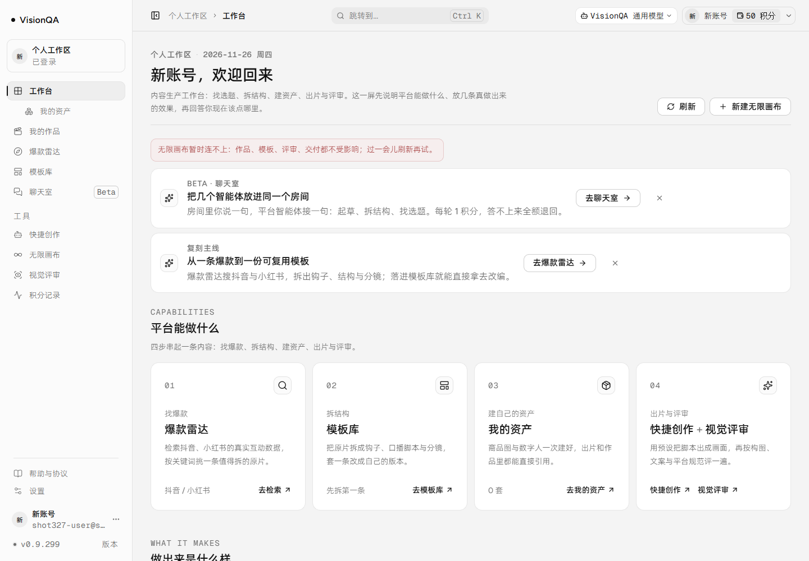
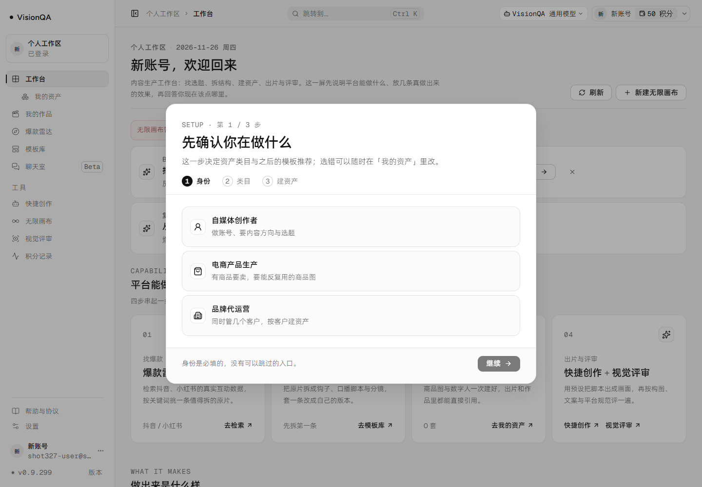
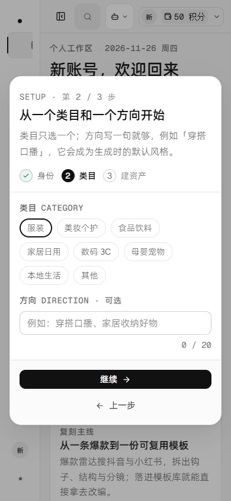

# r327：注册后的第一屏——卡片淡上来，键盘也关在里面（v0.9.299，2026-11-26）

结论：身份引导弹窗是「账号」注册之后看到的第一屏，它以前是「啪」一下出现，并且按 Tab 能一路走到遮罩后面的
侧栏上。这一轮给它补上进场动效，并把这个阻塞弹窗的键盘真正关在里面。

## 一、为什么是它

用户这一轮的原话是「主要是在一些小的细枝末节上，比如某些小的动效、某些广告模块、某些用户 ux 体验上的感觉」。
上一轮（r326）做的是运营位，这一轮换到「第一屏」：它出现得最早、每个新注册的账号都躲不开，
而且是全站唯一一个**关不掉**的弹窗——第一步没有关闭入口，Esc 也被拦掉。

也就是说，这一屏出错时用户连「退出去重来」都没有。

## 二、改之前，真页面上量到什么

临时实例 + 真 SQLite + 真账号 + headless Chrome（`scripts/shot-r327.mjs`）：

| 量什么 | 改之前 |
| --- | --- |
| 打开之后焦点在哪 | `BODY`（`activeInGate = false`） |
| 连按 Tab 十次 | 十次全落在 `BUTTON.vq-nav-item` 上——**遮罩后面的侧栏** |
| 卡片 `animation-name` | `none` |
| 遮罩 `animation-name` | `none` |

遮罩把背景压暗、`body` 也锁了滚动，所以那时背景**是点不动的**：用户按 Tab，看到的只是「什么都没发生」。

## 三、改了什么

### 1. 进场

- 卡片：`animation: vq-rise var(--dur-2) var(--ease-out)`（动效层那一套，位移 4px + 淡入）
- 遮罩：`animation: vq-fade var(--dur-2) var(--ease-out)`（**新加**的一条纯淡入关键帧：
  整屏压暗不该跟着上浮，位移只留给卡片与内容）
- 换步：`.vq-gate-body` 按 `step` 换 key，带 `is-step-in` 时放同一套进场

三个取舍：

- **不用 `forwards`**：动画结束后若还持有最后一帧的 `transform`，卡片就永久变成一层包含块
  （r326 的教训换了个地方）。门禁里专门有一条反证盯着它。
- **时长用 `--dur-2`（180ms）**：与全站 `.create-modal` 的 200ms 一档，而不是列表进场的 `--dur-3`（260ms）
  ——弹窗该比列表脆一点。
- **打开时的第一步不让内容动**：卡片自己已经在进场，两层一起上浮会显得晃。所以 `stepSeq` 只在真的换步时加，
  并且与 `setStep` 在同一个提交里，key 与类一起变，动画从挂载那一刻就开始放（不是晚一帧才补上）。

### 2. 键盘

- 打开时把焦点放到卡片上（`tabIndex={-1}` + `focus({ preventScroll: true })`）——读屏会念出标题
- Tab / Shift+Tab 在弹窗首尾之间循环；**挂在捕获阶段**（`addEventListener('keydown', onKey, true)`），
  页面上别的处理器抢不走
- 换步之后把焦点重新收回卡片：点「继续」的那颗按钮属于刚被换掉的那一步，它一卸载焦点就掉回 `body`
- 判可见性用 `getClientRects()` 而不是 `offsetParent`：这个弹窗自己是 `position: fixed`，
  `offsetParent` 在这种祖先下一律是 `null`，会把所有元素都判成隐藏（写的时候踩到的）

## 四、动效怎么量的

headless 里 `requestAnimationFrame` 只在「真有帧被产出」时才走（截图、输入会催帧），按帧采样的结果时有时无
——第一版就是这么拿到一个空数组的。改成确定性的办法（沿用 r325 的 `pause()` 手法）：

1. 把动画按 CSS 重来一遍（`style.animation = 'none'` → 强制 reflow → `''`）
2. 立刻 `getAnimations().forEach((a) => a.pause())`
3. 读 `getComputedStyle` —— 拿到的就是第 0 帧
4. 截图，再 `play()` 放回去

于是「有没有进场」不看代码里有没有写 `animation`，只看第 0 帧的计算值：

| 元素 | 第 0 帧 |
| --- | --- |
| `.vq-gate-card` | `opacity: 0`、`transform: matrix(1, 0, 0, 1, 0, 4)`、animations `["vq-rise"]` |
| `.vq-gate-backdrop` | `opacity: 0`、animations `["vq-fade"]` |
| 第二步的 `.vq-gate-body` | `opacity: 0`、`transform: matrix(1, 0, 0, 1, 0, 4)`、animations `["vq-rise"]` |

## 五、改之后，真页面上量到什么

- 打开之后焦点 `DIV.vq-gate-card`、`cardFocused = true`
- Tab ×10、Shift+Tab ×1：**0 次**跑出弹窗
- 换到第二步之后焦点回到卡片，Tab ×12 仍 **0 次**跑出
- Esc 仍然关不掉（设计如此）
- 390：卡片 `l16 t128 358×589`（底边 716）落在视口内，`scrollWidth == clientWidth == 390`，卡片 `356 / 356`

`scripts/shot-r327.mjs` **21/21**：0 次上游调用、0 条页面异常、4 张图落进 `docs/`。

## 六、门禁

新增 `test/onboarding-gate.test.mjs`：真源码扫描 + 三组反证——进场被拿掉、**用 `forwards` 留在最后一帧**、
遮罩不淡入、换步没规则；焦点没收进卡片、Tab 没兜住、没挂捕获阶段、换步后没收回来、少加一处 `stepSeq`。

写反证的时候先被自己的检查绊了一下：`motion.includes('@keyframes vq-fade')` 在把关键帧改名成
`vq-fade-gone` 之后**仍然为真**（子串比对）。加上结尾的 `{` 再比，反证才真的会红——
门禁的价值在于它真能红，而不是写出来好看。

- `npm test` **2135 / 2135**（+3）
- `tsc -b` 干净
- `oxlint` 0 error / 30 warning（757 文件）
- 密钥扫描 1208 个文件无命中

## 七、部署

- 入口 `index-CX7A3WQT.js`（871,689 B）；线上样式表 `index-CiUEHUA3.css`（429,908 B）
- 生产标签 `20261126-2101-r327gate`，快照 `/opt/visionqa/releases/20261126-130115-20261126-2101-r327gate.tar.gz`
- `ops/rollback.sh --to 1` 回 0.9.298
- 公网 `/api/version` = 0.9.299、`/api/health` ok templates 27、新入口 200、旧入口 `index-DiDduOYK.js` 404
- 线上样式表里确实有 `.vq-gate-body.is-step-in`、`vq-rise`、`vq-fade`、`.vq-gate-card:focus`

## 八、边界

- 只修了身份引导这一个弹窗。它是全站唯一**阻塞且关不掉**的；其余弹窗（新建作品、看大图、命令面板、
  版本脚本…）仍然可以用 Tab 走到背景上——那是一次要动十几个组件的改造，没在这一轮做。
- 截图来自本机临时实例，跑的是**与生产同一份 dist**（入口 `index-CX7A3WQT.js` 与线上一致）。
  生产上没有「引导还没做完的普通账号」，要在生产拍到这一屏得先建一个临时账号再删掉；
  这一轮用「线上样式表里确确实实有这几条规则」来代替。
- 只在 1440×1000 与 390×844 量过，平板没逐屏扫。
- 卡片自己不给画焦点圈（它是容器不是控件）；弹窗里的按钮仍走全站 `:focus-visible`。
- 减动效：`motion.css` 的总闸（`prefers-reduced-motion` 时 `animation-duration: 1ms`）自动管住这一轮新加的两条。
