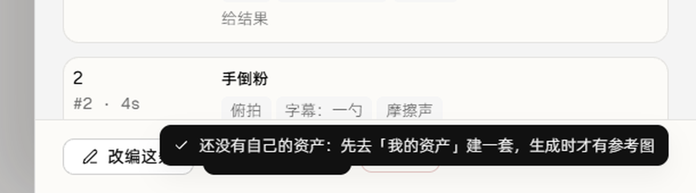
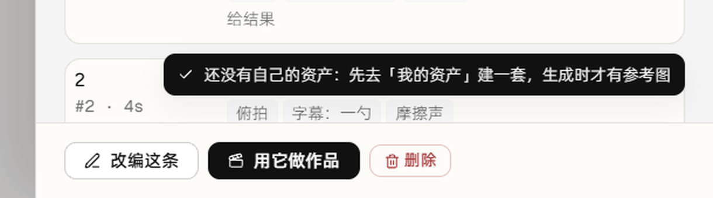
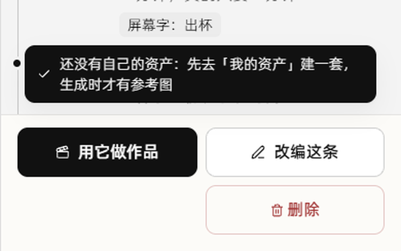

# r330 / v0.9.302：通知不吃点击，按下去要有反应

用户这一轮要的还是「小的细枝末节」。三件小事都不是想出来的，是 r329 的巡检顺手量出来的，
这一轮把它们按同一把尺子（真浏览器 + CDP 真输入 + 前后同一份脚本）修掉。

## 三件事

| # | 现象 | 量出来的数字（before） |
| --- | --- | --- |
| ① | 右下角提示条把模板抽屉底部的主按钮压住了 3.3 秒，那 3 秒里点它就是点提示条 | `elementFromPoint(1081,968)` = `DIV.vq-toast`，提示条 `pointer-events: auto`、`z-index: 60`；提示条 446×36 @ y940–976，底栏 y935–1000 |
| ② | 后台「保存运营位」悬停一个属性都不变 | idle `rgba(0,0,0,0)` → hover `rgba(0,0,0,0)`；按下只有 `transform: none → matrix(1,0,0,1,0,1)` |
| ③ | `#/agents` 预设卡的「选择」按下去什么都不变 | idle / hover / press 三个态全是 `rgba(0,0,0,0)` |

②③ 的根子是同一件事：**默认档 `.vq-button`（不带语气 = 透明底、深色字）只有按下那 1px，没有悬停**。
四个语气（primary / ghost / quiet / danger）各自写了 `:hover`，默认档漏了——而默认档恰恰是后台里用得最多的一档。
③ 的预设卡是整块 `<button>`，连 `.vq-button` 都不是，悬停靠外层卡抬起、按下什么都没有。

## 做法

**① 提示条**：`src/styles/shell.css` 里给 `.vq-toast` 加 `pointer-events: none`，再单独放行条里的交互元素：

```css
.vq-toast { pointer-events: none; }
.vq-toast :is(a, button, [role='button'], [tabindex]) { pointer-events: auto; }
body:has(.drawer-backdrop) .vq-toast { bottom: 88px; }
@media (max-width: 640px) { body:has(.drawer-backdrop) .vq-toast { bottom: 144px; } }
```

为什么是 `pointer-events` 而不是「抽屉打开时不弹提示条」：提示条讲的是刚刚发生的事，
挡掉它等于把反馈藏起来；而**纯通知本来就不该是 hit target**。条里将来真放了「撤销」这类动作，
那颗按钮自己 `pointer-events: auto`，照样能点。

只让它「不吃点击」还不够：按钮仍在提示条底下，**看得见却按不到的按钮比按不动更让人迷惑**。
所以抽屉打开时把提示条抬到底栏之上。两个数是量出来的，不是猜的：
桌面底栏 65px（16 + 32 + 16 + 1px 描边）→ 抬到 88；≤640 底栏是两行 48px 按钮
（12 + 48 + 8 + 48 + 16 + 1 = 133，390 实测 `footerBox390.h = 133`）→ 抬到 144。

**② 默认档按钮补悬停**：`src/styles/shell.css`

```css
.vq-button:hover:not(:disabled) { background: var(--line-faint); }
```

同权重按源码顺序决胜负，这条写在四个语气**之前**，语气各自的 `:hover` 盖住它；
ghost 的底色是实色（`--surface-raised`），必须在自己的 `:hover` 里写回同一条，
否则会被这条半透明底色顶掉、悬停时从实色变成透出来的一块。这条被门禁钉住了。

**③ 预设卡补按下**：`src/styles/agents.css`

```css
.agx-card-main { transition: background-color var(--dur-1) var(--ease-out); }
.agx-card-main:active { background: var(--line-faint); }
```

整块按钮自己就是热区，不需要 r329 那套 `.vq-card-open` 的 `::after` 铺满（那套是给「卡里只有一颗小按钮」用的）。

## 前后（同一份脚本 `scripts/shot-r330.mjs` 跑两份 dist）

真 Chrome + CDP 真输入，1440×1000（提示条那组再在 390×844 量一次几何），前后各 0 次上游调用：

| 量什么 | before（`index-DvhCcfhI.js` / 0.9.301） | after（`index-BdLqYHxS.js` / 0.9.302） |
| --- | --- | --- |
| 提示条在场时命中按钮中心 | `DIV.vq-toast`（`pointer-events: auto`） | **`BUTTON.vq-button.vq-button--primary`**「用它做作品」 |
| 提示条中心命中什么 | `DIV.vq-toast` | 抽屉正文里的 `STRONG`（条已透明） |
| 提示条 ∩ 底栏（1440） | **16,056 px²**（整块落在底栏里） | **0**（提示条 y876–912、底栏 y935–1000） |
| 提示条 ∩ 底栏（390） | **19,152 px²**（底栏 133 高） | **0**（提示条 y644–700、底栏 y711–844） |
| 提示条在场时点主按钮 | 落到提示条，`vq-toast-in` 计数 1→1，**写请求 0**，路由仍 `#/templates/tpl_r330_probe` | **落到按钮上 → 1 个写请求、跳到 `#/projects/prj_8b5f8571`**（作品真建出来了，按钮随之消失） |
| 「保存运营位」悬停 | `rgba(0,0,0,0)` → `rgba(0,0,0,0)` | `rgba(0,0,0,0)` → **`rgba(17,17,17,0.06)`** |
| 预设卡「选择」按下 | `rgba(0,0,0,0)`（三态相同） | 立刻 `rgba(17,17,17,0.05)` → 稳定 `rgba(17,17,17,0.06)` |

6/6 check 通过、自检 5/5（页面脚本确实来自这次指定的构建、`/api/version` 与 dist 版本一致、
0 次上游、0 页面异常、0 console.error）。before 那轮三条红、一条绿（绿的是「两次点击都不产生写请求」——
旧行为确实不会误建作品，它只是什么都不做）。







## 门禁

新增 `test/toast-and-press.test.mjs`：3 条断言 + **9 组反证**（拿掉 `pointer-events`、拿掉条内放行、
拿掉抬起规则、把抬起值改回 24px、删掉窄屏那条、默认档悬停改回无背景、ghost 不写回底色、
把默认档悬停挪到语气后面、拿掉预设卡按下态）。三组前提各钉一条：

- `.vq-toast` 必须 `pointer-events: none`，且条里的 `button` / `a` 要能点；
- 抽屉打开时的抬起值 ≥ 底栏高度 + 16（桌面 ≥ 81）且落在 8pt 栅格上，窄屏 ≥ 141；
- 默认档 `:hover` 必须有背景，且**源码里排在四个语气之前**；ghost 必须写回 `--surface-raised`；
- `.agx-card-main:active` 必须有底色变化。

顺手修了**两条守卫的脆弱写法**：`test/design-grid.test.mjs` 与 `test/login-a11y.test.mjs`
原先都只取 shell.css 里**第一段** `@media (max-width: 640px)`（`indexOf` 一次 / 正则非全局）。
这一轮新加了一段 640 断点，两条守卫当场变红，而它们盯的规则一条没少——
现在改成取该断点的**所有**块再断言，规则少了照样红，但不会再被「新加一段」误判。

`npm test` **2145 / 2145**、`tsc -b` 干净、`oxlint` 0 error / 30 warning（765 文件）、
密钥扫描无命中、入口 `index-BdLqYHxS.js`（873.53 kB）。

## 自己踩的三个坑

1. **CSS 解析器要按块的上界递归**。写测试里的 `@media` 展开时只传了下界，内层把文件剩下的全解析了一遍，
   外层再解析一遍——shell.css 六十多个断点直接指数级重解析，单文件 80 秒后 OOM。
   补上 `to`（块尾）参数即好。
2. **注释会喂饱断言**。`.vq-toast` 的声明体里就有一句注释写着「pointer-events:none 让它…」，
   反证把声明删掉之后正则仍命中注释，红不了。所有声明断言改成先剥注释（`decls()`）。
3. **选择器前面挂着注释**。`split('}').pop()` 会把两条规则之间的注释一起带进选择器，
   `^\.vq-toast$` 这类锚定就永远匹配不上。改成从最后一段 `*/` 之后算起。

## 边界

- 只把提示条抬到**抽屉底栏**之上。底部有别的固定条（画布 `.cv-next` 那条，早就单独处理过）不重叠；
  弹窗（`z-index: 40`）里的主按钮在中间，没有这个冲突。
- 提示条依旧浮在弹窗之上（`z-index: 60` 是有意的：弹窗里做的事也要有反馈）。它现在不吃点击了，
  但**视觉上仍会盖住弹窗右下角**——那里没有主按钮，暂不处理。
- 默认档悬停是**全站生效**的一条规则（这正是它的意思），只量了后台运营位与智能体两屏的 computed 值。
- `.agx-card-main:active` 的底色只在本机临时实例的 300ms 内量到，真机上按下即抬起、退场有 120ms 过渡。
- 预设卡按下之后卡片会变成「当前」（深色描边 + 一枚「当前」），这是 r226 的行为，这轮没动。
