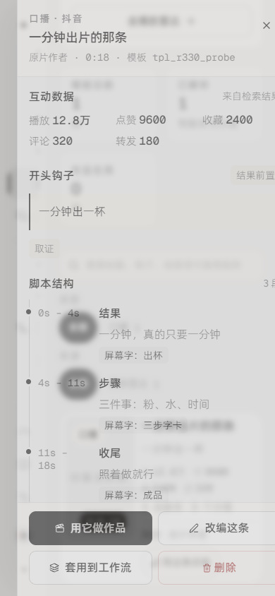
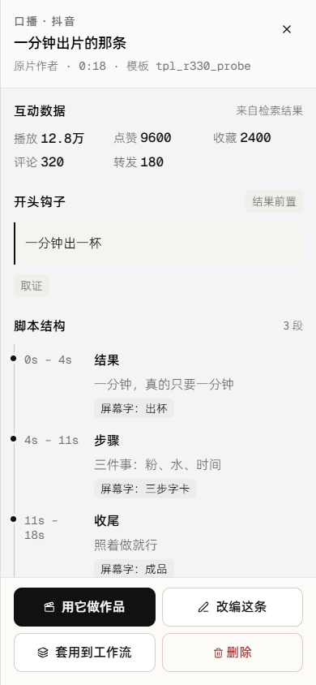
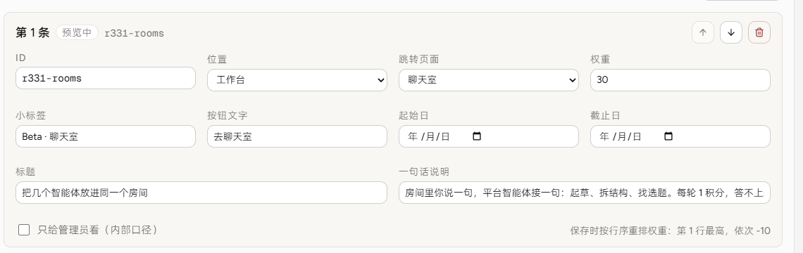
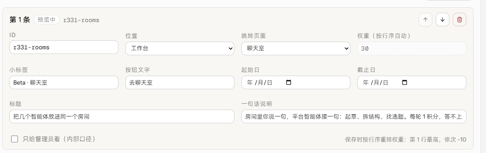

# r331：运营位两处手感，外加撤回上一轮一句量错的话（v0.9.303 / 2026-11-26）

用户要的一直是「小的细枝末节：某些小的动效、某些广告模块、某些 UX 上的感觉」。这一轮三件事里
两件在运营位（广告模块），还有一件是**上一轮我自己写错的一句话**，先在开头撤回。

## 结论

1. **撤回**：上一轮结尾写的「抽屉底栏比容器宽 6–15px、『删除』右边框被切几个像素」**不成立**。
   那是**在抽屉入场动画（`drawer-in`，220ms，translateX 24px→0）没跑完时量的**，布局没有溢出。
   稳态：1440 下抽屉与底栏右沿都是 **1440 = innerWidth**，390 下都是 **390**，`transform: none`，
   `scrollWidth == clientWidth`（无横向溢出）；四个底栏按钮右沿 1000.05 / 1137.86 / 1290.42 / 1368.98（1440）
   与 374 / 191.5 / 191.5 / 374（390），「删除」的右边框没有被切。
2. 运营位的 **✕「关掉这条」按下去一点反应都没有**（它不属于 `.vq-button`，全站那条按下反馈覆盖不到它）
   → 补 `:active` 底色与描边，按下 computed 值真的变了。
3. 这颗 ✕ 在**手机上只有 28×28**，是运营位里最小的目标，而它正好是「关掉这条」这个动作
   → 平板段 40×40、手机段 44×44（与全站触控口径一致）。
4. 后台「权重」是个**能填、但保存时被按行序覆盖**的数字输入框（用户改完保存，值自己变回去）
   → 改成只读展示，数字照旧看得见，顺序交给上移 / 下移。

## 一、先撤回「抽屉比容器宽」

上一轮是拿 `scripts/shot-r330.mjs` 里那条「提示条 ∩ 抽屉底栏」的检查顺手记下的底栏矩形：
1440 下 `r=1446~1448`、390 下 `r=401~405`，两次跑还有 2–4px 抖动。这一轮用
[`scripts/shot-r331-drawer.mjs`](../scripts/shot-r331-drawer.mjs) 对同一颗抽屉重量，结论是 **A：不是布局**。

稳态（等 `document.getAnimations()` 的 `finished` 与 `animationend` 之后，不是拿 sleep 当判据），
连量 6 次一模一样：

| | 1440×1000 | 390×844 |
| --- | --- | --- |
| innerWidth / clientWidth / scrollWidth | 1440 / 1440 / 1440 | 390 / 390 / 390 |
| 动画中 `drawer.right` / `foot.right` | **1464 / 1464**（tx = +24，opacity .5） | **414 / 414**（tx = +24，opacity .5） |
| 稳态 `drawer.right` / `foot.right` | **1440 / 1440**（`transform: none`） | **390 / 390**（`transform: none`） |
| 还原 translateX = 右沿 − 稳态右沿 | 1464 − 1440 = **24 = 当时 tx** | 414 − 390 = **24 = 当时 tx** |

上一轮那四个数字全在这一根 24→0 的曲线上（在 0..220ms 上二分，两个视口数值完全一致）：

| 上一轮的读数 | 动画时刻 | 当时 tx | opacity |
| --- | --- | --- | --- |
| +24px | 3.44ms | 23.821 | 0.5037 |
| +15px | 51.56ms | 15.033 | 0.6868 |
| +11px | 68.75ms | 11.100 | 0.7688 |
| +8px | 85.94ms | 7.945 | 0.8345 |
| +6px | 99.69ms | 5.963 | 0.8758 |

也就是 before 的 +6/+11 与 after 的 +8/+15，正好是这根曲线上四个不同的采样点；
两次之间的 2–4px 抖动就是采样时刻差。窗口为什么够大：底栏是插入后 91ms（1440）/ 58ms（390）才挂上的，
动画在插入后 25/26ms 才启动、`animationend` 在插入后 322/243ms——「抽屉 → 等提示条 → 立刻量」的一个往返
探针落在插入后 102/131ms，量到的正好是 tx = 22.4 / 7.39 这一档。

其余硬证据：插入后逐帧时间线里 **|右沿位移 − computed tx| 最大 0**（390 舍入后 0.001）；
`.drawer-backdrop` 每帧 `right == innerWidth`（偏移 0/0）；抽屉的祖先链只有 BODY + HTML，
`transform/filter/backdrop-filter/will-change/contain` 全是 `none/auto` → fixed 的包含块就是视口，
排除「包含块不是视口」这条真溢出通道；对照实验把 `translateX(6/8/11/15/24px)` 直接写在抽屉上，
抽屉与底栏的位移精确等于该 px、backdrop 不动、scrollWidth 不变。

**教训**：「元素刚出现就量几何」和「元素稳定了再量几何」是两种量法。这一条与 r330 记的
「180ms 过渡静帧先 pause 再拍」是同一类坑的两面——那边是**拍照**要停帧，这边是**量几何**不能撞帧。
上一轮那 6 条检查的结论不受影响（提示条交集判的是 y 区间与 x 区间，底栏矩形换成稳态值后交集仍是 0）；
要引用底栏矩形，用稳态：1440 → 861..1440（579×65），390 → 1..390（389×133）。

## 二、✕ 按下去没反应

`.vq-promo-close` 是运营位卡片右上角那个「关掉这条」。它有 `:hover`（描边 + 近白底）、有 `:focus-visible`，
唯独没有 `:active`；而全站那条「按下去 1px / 一圈柔光」的规则只写在
`tokens.css` 的 `:where(.vq-button, .cv-bdc-action, .cv-palette-item)` 上——这颗 ✕ 一个都不沾。
于是鼠标按住它时，computed 值和悬停时一模一样。

| | 悬停 | 按住 | 按下改了哪几个属性 |
| --- | --- | --- | --- |
| 改之前 | bg `rgb(251,251,251)` / border `rgba(17,17,17,.1)` | bg `rgb(251,251,251)` / border `rgba(17,17,17,.1)` | **没有**（`:active` 命中了，但零属性变化） |
| 改之后 | 同左 | bg `rgba(235,235,235,.47)` / border `rgba(17,17,17,.157)` | `background-color`、`border-color` |

反馈用的是**底色深一档**，与同一张卡上的 CTA（`.vq-promo-cta:active`）同一套口径，**不走 1px 位移**：
位移会给绝对定位后代造出包含块，r326 那张「整卡可点」的热区就是这么在按下的一瞬间塌回按钮的。

## 三、✕ 在手机上是 28×28

全站的触控口径是「平板段 40、手机段 44」（`board-mobile` / `works-wall` / `review-mobile` 等一整套测试盯着），
运营位这块从来没被抬过。实测四个宽度的 `.vq-promo-close` 实际尺寸：

| 视口宽 | 改之前 | 改之后 |
| --- | --- | --- |
| 1440 | 28×28 | 28×28（桌面保持紧凑） |
| 760 | 28×28 | **40×40** |
| 560 | 28×28 | **44×44** |
| 390 | 28×28 | **44×44** |

## 四、后台「权重」是个会自己变回去的输入框

`PromosCard` 保存时会把整份列表按行序重排权重（`withOrderWeights`：第 1 行最高、依次 −10），
所以「权重」这一栏**手填的数字一律被覆盖**——一个改完保存又自己变回去的输入框，比看不见它更费解。
改成只读展示（虚线框，与旁边的输入框同高 32px），数字照旧显示，行尾那句「保存时按行序重排权重」的提示保留。

| | 控件 | 显示的值 | 能填吗 |
| --- | --- | --- | --- |
| 改之前 | `input[type=number]` ×2（step 10） | 30 / 20 | 能（但保存后被覆盖） |
| 改之后 | `SPAN.admin-promo-weight`（`cursor: auto`） | 30 / 20 | 不能，页面上 `type=number` 的数量是 **0** |

## 五、差点写进仓库的一条（自查）

一开始还想给「撤销」条补一个进场动画，理由是「这一块里只有它是硬弹出来的」。写完才去实测：
**它本来就有**——它是 `.vq-promos.vq-stagger` 的孩子，父容器那条 `.vq-stagger > *` 早就给它挂了 `vq-rise`。
证据是 before 那一版（v0.9.302）里它的 `animationstart` 就是 `vq-rise`（500ms 起、748ms 止）。
所以我加的那条是重复声明，**撤掉了**，并在 `promos.css` 与测试里各留一条「别再重复声明」的注释与断言——
这条不算修复，写在这里是为了不让下一个人再为它花一轮。

## 六、全站「按下去有没有反应」巡检

这一轮顺手把 r330 那次手工量 3 个元素的做法做成了可复用工具
[`scripts/audit-press.mjs`](../scripts/audit-press.mjs)：10 屏（外壳 / 工作台 / 能力卡 / 后台运营位 /
模板库 / 模板详情抽屉 / 设置 / 作品 / 智能体 / 智能体预设卡）共 **136 个按钮**，
对每个按钮发**真实的** `mousePressed`、两帧后读 8 个属性，然后**把鼠标移到中性点再松开**
（不在原处松开就不会合成 click：这一趟 0 次业务写请求，只有页面自己的 `POST /api/client-errors` 2 次）。

| | 有按下反馈 | 无按下反馈 | 禁用 |
| --- | --- | --- | --- |
| before（0.9.302） | 53 | 74 | 9 |
| after（0.9.303） | 54 | 73 | 9 |

这一趟里「无反馈」少掉的那一行是运营位第二张卡的 ✕；第一张卡的 ✕ 在这一趟**取样为空**
（`press: null`，上一趟 after 里它有数据、判为 has-feedback，专门的 `closePress` 探针两趟 after 都是
has-feedback）——记为**测量抖动**，不当成回归，也不当成还没修好。

剩下的 73 条不是都要改：其中一大坨是「按下本来就不该有属性变化」的纯文字链接。
最有价值的一簇是**侧栏 18 个导航项一个都没有按下反馈**（`button.vq-nav-item`，整站用得最多的控件），
下一轮从这里接着来。

## 七、门禁与发布

- 改动面：`src/styles/promos.css`（✕ 的 `:active`、760/560 两段触控区、撤掉重复的 `animation`）、
  `src/pages/admin/PromosCard.tsx` + `src/styles/console.css`（权重改只读）、
  `test/promo-undo.test.mjs`（+3 条断言 + 4 组反证），两个新工具
  [`scripts/audit-press.mjs`](../scripts/audit-press.mjs) 与 [`scripts/shot-r331-drawer.mjs`](../scripts/shot-r331-drawer.mjs)。
- `npm test` **2148 / 2148**（+3）、`tsc -b` 干净、`oxlint` 0 error / 30 warning（768 文件）、
  密钥扫描 1222 个文件无命中。
- 打包入口 `index-D9Wtr6mf.js`（873.53 kB）。构建出来的 CSS 里实测有
  `.vq-promo-close:active{color:var(--ink);border-color:var(--line-strong);background:var(--line-faint)}`、
  760 段的 `width:40px;height:40px`、560 段的 `width:44px;height:44px`、
  `.admin-promo-weight{min-height:32px;…}`，而 `.vq-promo-undo` 里**没有** `animation`（撤干净了）。
- 发布标签 `20261126-2333-r331promo`；当前快照
  `/opt/visionqa/releases/20261126-153219-20261126-2333-r331promo.tar.gz`（第一次发布的产物快照是 `…153150…`，
  回滚演练前系统自动打了 `20261126-153211-before-rollback.tar.gz`）。`ops/rollback.sh --to 1` 演练过：
  回 0.9.302 并确认入口也退回去了，再发布回 0.9.303。
- 生产端（公网 `visionqa.wavisionai.cn`）：`/api/version` **0.9.303**、`/api/health` ok（templates 27）、
  新入口 **200**、上一版入口 `index-BdLqYHxS.js` **404**；`visionqa` / `visionqa-demo` 两个服务 active。
- 一条运维上的坑：**应用服务器自己那条 `127.0.0.1:8799` 对未知路径回的是 200 + index.html（SPA 兜底）**，
  所以「旧产物还在不在」不能拿它测（这一轮就拿它测出过一次假警报：`old=200`、`content-type: text/html`、875 字节）。
  要么走公网 vhost，要么直接看 `/opt/visionqa/dist/assets` 里到底剩哪几个 index 文件。

## 八、边界

- 抽屉只在 1440×1000 与 390×844 两个视口重量；触控区是 computed 值（四个宽度），没有逐机型截图。
- 巡检判的是「按下时有没有属性变化」，不判「该不该有变化」；有变化也可能是错的，没变化也可能是故意的。
- 「权重只读」是小改：真正的排序仍然只有「上移 / 下移」一条路（这一轮没有做拖拽排序）。
- 上一轮那条「抽屉底栏」结论在 [README](../README.md) 与 [r330 记录](r330-notice-and-press-2026-11-26.md)
  里已经改成稳态数值，避免下一个人照着一个不存在的缺陷去改宽度。
