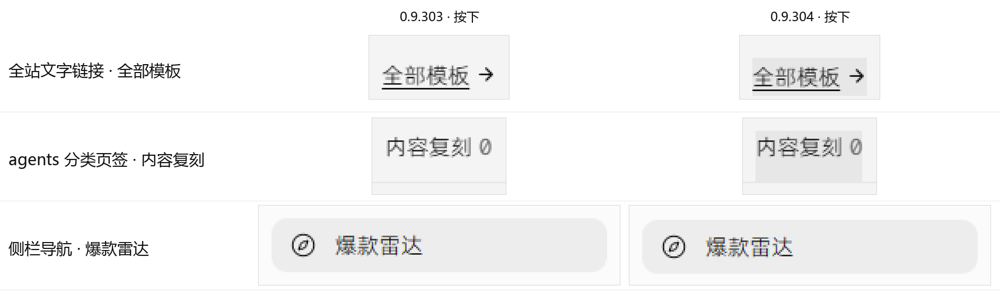

# r332：按下反馈第二批 —— 外壳 16 条、文字链接 6 条、agents 22 条（v0.9.304 / 2026-11-27）

## 结论

- r331 用 [scripts/audit-press.mjs](../scripts/audit-press.mjs) 量出 136 个按钮里 **73 个「按下去和悬停一模一样」**。
  这一轮修掉 **44 条**，同一份脚本、同一批屏、同一套口径复量：**73 → 29**（其中 1 条是采样抖动，真正剩 **28**）。
- 逐簇清空：**外壳 16 → 0**、**overview 的 6 个文字链接 → 0**、**agents 9 → 0**、**agents-presets 13 → 0**（22 条由队友 agents-chat 做，见下）。
- 顺手把工具两条口径补齐：巡检新增「还按着、等过渡走完再读一次」的终值（`pressedSettled` / `changedSettledVsHover` /
  `summary.settledRescued`），把「过渡还没走到」和「真的没反应」分开；截图新增 `--shots all` 与贴元素 8px 的裁法。
- **更正上一轮一句话**：r331 结尾我写「侧栏 18 个导航项按下无反馈」——实际是 **12 个导航项 + 4 个触发器 = 16 条**。
  18 是外壳那一趟的按钮总数，其中 2 颗（侧栏收起按钮、搜索触发器）本来就有反馈。

## 一、这一轮改了什么

| 位置 | 条数 | 按下前的样子 | 现在 | 口径 |
| --- | --- | --- | --- | --- |
| `.vq-nav-item`（含 `.is-active`、`--utility`、`--nested`） | 12 | `transform: none`，底色与悬停一模一样 | `translateY(1px)`，权重 (0,3,0) | 与 `.vq-button` 同口径：只位移，不换色 |
| `.vq-sidebar-account-row` / `.vq-version-trigger` / `.vq-model-trigger` / `.vq-topbar-account-trigger` | 4 | 同上 | 同上 | 同上 |
| `.vq-link`（overview 上 6 处） | 6 | 与悬停同为 `color: var(--ink)` + 下划线 | 加一层 `--line-faint` 底色 | 行内元素**不位移**（位移看着像抖一下） |
| `.agx-mode-tabs button` / `.agx-surface-switch button` / `.agx-page .agx-capsule-trigger` / `.qc-new` / `.qc-tool` / `.vq-content .agx-page .agx-tabs button` | 22 | 与悬停一模一样 | 底色 `--line-faint`，文字/边框 `--ink` | 只改 background / border-color / color，不用 transform |

写在哪：外壳那 16 条在 [src/styles/shell.css](../src/styles/shell.css) 的 `.vq-nav-item:hover` 之后（一条分组规则 + 一条
`prefers-reduced-motion` 关掉位移）；agents 那 22 条在 [src/styles/agents.css](../src/styles/agents.css) 末尾。
两处都带注释写清了「为什么不是 `.vq-button`」「为什么权重必须是 `:not(:disabled):active`」。
四家的 `transition` 里补上了 `transform`（以前只写了 background/color），按下与松开的 1px 才有过渡而不是瞬跳。

`.vq-link` 为什么要专门分开：它是 `display: inline-flex` 的行内元素，1px 位移在段落里看起来像手抖；
压一层 `--line-faint`（`rgba(17,17,17,.06)`）的底与 `.vq-button` 的悬停底色同一档，读起来是「按到了」。

## 二、证据：同一份巡检，两份产物

- **before**：v0.9.303 / 入口 `index-D9Wtr6mf.js`（r331 发布的那份）
- **after**：v0.9.304 / 入口 `index-CDUNYuqb.js`（**就是这次发布上去的那份**，见 §五）
- 视口 1440×1000、10 趟、每颗都真 `mousePressed` 后读 8 个属性，松开一律挪到中性点（不合成 click）
- 0 次上游调用；2 个 `POST`（页面自己的 `/api/client-errors` 上报）；`anomalies: 0`

| | 按钮 | 有反馈 | 无反馈候选 | 禁用 | active 没匹配 | 读不到 |
| --- | --- | --- | --- | --- | --- | --- |
| before（0.9.303） | 136 | 54 | **73** | 9 | 0 | 0 |
| after（0.9.304） | 136 | **98** | **29**（抖动 1） | 9 | 0 | 0 |

逐趟（有反馈 / 候选）：

| 趟 | before | after |
| --- | --- | --- |
| shell（侧栏与顶栏） | 2 / **16** | **18 / 0** |
| overview | 11 / **13** | 17 / 7 |
| overview-cap | 0 / 5 | 0 / 5 |
| admin-promos | 7 / 0（4 禁用） | 7 / 0（4 禁用） |
| templates | 3 / 6 | 3 / 6 |
| templates-drawer | 9 / 1 | 9 / 1 |
| settings | 15 / 0（2 禁用） | 15 / 0（2 禁用） |
| projects | 2 / 10 | 2 / 10 |
| agents | 0 / **9** | **9 / 0** |
| agents-presets | 5 / **13** | **18 / 0** |

外壳那 16 条的按下前后（同一颗按钮的 computed `transform`，两帧 ≈33ms 处采样）：

| 家族 | before 悬停→按下 | after 悬停→按下 |
| --- | --- | --- |
| `.vq-nav-item`（工作台） | `none` → `none` | `none` → `matrix(1, 0, 0, 1, 0, 0.440142)` |
| `.vq-sidebar-account-row` | `none` → `none` | `none` → `matrix(1, 0, 0, 1, 0, 0.427481)` |
| `.vq-version-trigger` | `none` → `none` | `none` → `matrix(1, 0, 0, 1, 0, 0.420441)` |
| `.vq-model-trigger` | `none` → `none` | `none` → `matrix(1, 0, 0, 1, 0, 0.138741)` |
| `.vq-topbar-account-trigger` | `none` → `none` | `none` → `matrix(1, 0, 0, 1, 0, 0.427124)` |

两个中间值都是在 140ms 过渡里被两帧采样抓到的（不是终值）。终值这一拍这次也读到了：还按着等 200ms，
`pressedSettled.transform` 为 `matrix(1, 0, 0, 1, 0, 1)` —— 与 `shell.css` 里声明的 `translateY(1px)` 对上。



三行分别是 `overview` 的「全部模板」（`.vq-link`）、`agents-presets` 的「内容复刻」（`.agx-tabs button`）、
侧栏的「爆款雷达」（`.vq-nav-item`），都是**先按住不松**再截的图（`--shots all` + 贴元素 8px 裁，3 倍最近邻放大）。
逐像素比：文字链接 1723/3520 个像素不同、页签 2139/4032 不同；侧栏那行 1192/11350 —— 差别只在**邻行**：
截图是按元素矩形裁的，元素自己下移 1px 时裁框跟着下移，所以位移本身在两张图里对齐了，
剩下的是上下邻行相对它的 1px 错位。这一条**只看数字**，图片只能证明「看着一样不等于没改」。

## 三、那 1 条「两帧读不出」的：采样抖动，不是回归

after 这趟有 1 条候选是运营位上的 ✕（`button.vq-promo-close`）。它在**同一趟**里的终值读数是：

```
changedSettledVsHover: ["background-color", "border-color"]
pressedSettled.backgroundColor: rgba(17, 17, 17, 0.06)   // = var(--line-faint)
hover.backgroundColor:          rgb(251, 251, 251)
```

也就是说按下之后底色确实变了，只是**两帧那一拍还没走到**：`.vq-promo-cta:active` / `.vq-promo-close:active` 的
`background-color` 带 transition，采样落点在过渡开始之前时，读到的就是悬停值。r331 结尾也记过一次同样的现象。

顺带一个能骗过眼睛的细节：before 那趟这几颗读到的中间值是 `rgba(238, 238, 238, 0.47)`，
看着完全不像 `--line-faint`（`rgba(17,17,17,.06)`）—— 那是 CSS 在**预乘 alpha** 空间里插值的结果
（白 → `rgba(17,17,17,.06)` 走到 56%），不是另一条规则。

两次跑**同一份 0.9.304 产物**：候选分别是 31 与 29（`settledRescued` 3 与 1）。这个波动只在运营位那 4 颗上，
正是「采样抖动」的形状。所以工具的口径是：**判定仍按两帧那一拍**（与 r331 的 73 可比），抖动另记一列，不混算。

## 四、两条自查

1. **版本号必须先进产物**。第一次跑 after 巡检时 `dist` 里的 `package.json` 还是 0.9.303（入口 `index-y5KMsStq.js`），
   与最终发布的那份不是同一个包 —— 掐掉重跑，最终证据全部来自 `index-CDUNYuqb.js`。
   「证据里的入口哈希 == 发布上去的入口哈希」这条，比数字本身还重要。
2. **队友的 22 条是声明值，不是实测值**。他按约定没有 build、没有跑巡检，before→after 是从 CSS 与 token 推的；
   端到端由这次同一份巡检兜底：agents 9 → 0、agents-presets 13 → 0。他另外留了 6 条守卫测试 + 5 组反证。

## 五、门禁与发布

- `npm test` **2156 / 2156**（+8：我的 `test/press-shell.test.mjs` 2 条 + 队友 `test/press-agx.test.mjs` 6 条；
  两边都带反证，改坏源码必须变红）
- `npx tsc -b` 干净；`npx oxlint src server test scripts` **0 error / 30 warnings（770 文件）**；
  `npm run scan:secrets` **1225 个文件无命中**
- 提交 `aed43f4`，CI **45855358373 success**
- 发布标签 `20261127-0002-r332press`，快照 `releases/20261126-160323-20261127-0002-r332press.tar.gz`
- 公网 `https://visionqa.wavisionai.cn`：`/api/version` **0.9.304**、`/api/health` ok templates 27、
  新入口 `index-CDUNYuqb.js` **200（873,536 B）**、旧入口 `index-D9Wtr6mf.js` **404**、中途那个 `index-y5KMsStq.js` 也 404；
  两个服务 active

## 六、边界

- 只量 1440×1000 一个视口；判的是「按下那一刻有没有属性变化」，**不判「该不该有」**（把不可点的东西做成了可点，这条量不出来）。
- 剩下的 **28 条真候选**：`.ov-cap-action` 11（首页能力卡 3 + 折叠态 5 + 「快捷创作 / 视觉评审」2 + 最新模板行 1）、
  templates 6（4 个筛选项 + `template-open` + `template-adapt`）、templates-drawer 1（`drawer-work`）、
  projects 10（5 个 `works-chip` + `gap-retry` + `thumb` + `open` + 2 个 `works-action`）。
- 其中 `.vq-card-open` 那几颗**不能照这轮的口径补位移**：r326 量过，带 transform 的元素会成为绝对定位后代的包含块，
  按下的一瞬间整卡热区会塌成按钮那么大（mousedown 落在按钮、mouseup 落回标题、click 落到卡片）。
  它们要照 `motion.css` 里 `.vq-card-open:active::after` 的路子做，下一轮专门处理。
- 外壳这 16 条在 390 窄屏（侧栏收起成图标条）没有重量，靠的是同一条规则 + 同断点的既有尺寸。

证据留在 `.shots332/`（gitignore）：`press-before-shell`（0.9.303 外壳 18 张）、`shots-before`（0.9.303 三趟 54 张）、
`press-after` / `press-after2`（0.9.304 全量两次）、`shots-after`（0.9.304 四趟 72 张）。
