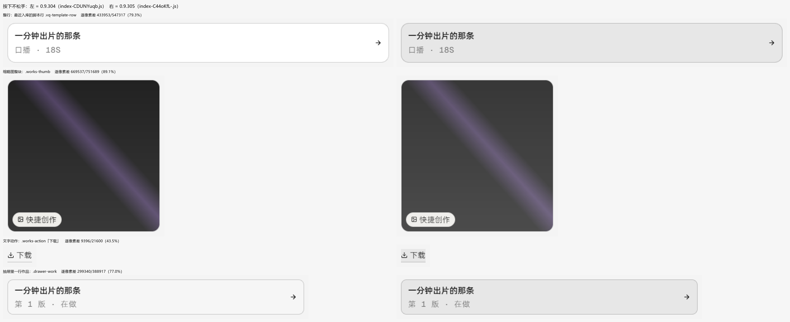

# r333：按下反馈第三批 —— 量具补上 ::after，剩下的一把清空（v0.9.305，2026-11-27）

## 结论

r331 那份「按下去和悬停一模一样」的清单，这一轮**清零**。同一份巡检脚本、同样 10 趟、136 个按钮，
两份产物各跑一通：

| | 产物 | 有反馈 | 候选 | 禁用 | 抖动单列 | 上游调用 | 异常 |
| --- | --- | --- | --- | --- | --- | --- | --- |
| before | 0.9.304 / `index-CDUNYuqb.js`（**从 /opt/visionqa/dist 取回的线上原件**） | 105 | **22** | 9 | 1 | 0 | 0 |
| after | 0.9.305 / `index-C44oKfL-.js` | **127** | **0** | 9 | 0 | 0 | 0 |

22 条候选 = **21 条真没反应 + 1 条采样抖动**（运营位那颗 ✕：同一份 0.9.304 产物上一趟跑是 21 条候选、
抖动 0，这一趟抖动 1 —— r331/r332 记过两次的老朋友，判定仍按两帧那一拍，抖动不混进候选）。

**同时修了量具自己的一个盲区。** r326/r329 给「整卡可点」的按钮定的按下反馈画在 ::after 上
（给它加 transform 会毁掉整卡热区，所以只能用底色），而巡检只读被按元素自身的六个 computed 属性 ——
它在 v0.9.304 产物上把 7 行「其实有反馈」记成了「无反馈」：

* 3 张能力卡上的「去检索 / 去模板库 / 去我的资产」（在两个趟里各量一次 = 6 行）
* 模板卡右上那颗整卡可点的「打开这条」（1 行）

所以 r332 结尾那句「剩 28 条真候选」要拆开：**29 条候选 = 21 条真没反应 + 7 条量具盲区 + 1 条抖动**。
这一轮真修的是 21 行（19 个元素，能力卡那两颗在两个趟里各量一次）。r333 起 readState 连 ::after 一起读
（`content` 为 none 时跳过，不给页面上绝大多数没有伪元素的按钮各添一条空 diff）。

## 一、这一拍改成什么样（本轮定的三档口径）

轻重按目标大小分档，写在各自的样式表里（`shell.css` / `overview.css` / `works.css` / `radar.css`）：

| 档 | 适用 | 按下长什么样 | 家族（行数） |
| --- | --- | --- | --- |
| 位移 1px | 有盒子的小按钮（胶囊 / 药丸 / 小描边按钮，≤40px 高） | `transform: translateY(1px)`，与全站 `.vq-button` 同口径 | `.vq-filter-chip`(4)、`.works-chip`(5)、`.works-gap-retry`(1)、`.template-adapt`(1) |
| 压一层底 | 整行 / 纯文字按钮 | `background: var(--line-faint)`；整行另加深描边 | `.ov-cap-action`(4 行/2 元素)、`.vq-template-row`(1)、`.drawer-work`(1)、`.works-open`(1)、`.works-action`(2) |
| 一档变淡 | 大块图片按钮 | `opacity: .9` | `.works-thumb`(1) |

三条口径背后的理由：

1. **位移这一档不需要抢权重。** 位移是另一条属性，`.is-active` / `.is-danger` 那几条只改配色，
   所以「当前这一项」按下去也有反应。r332 那批之所以要写 `:not(:disabled):active` 压过 `.is-active`，
   是因为它改的就是底色 —— 同一个目的，两条路，这里选省事的那条。
2. **整行与大图不位移。** 一整行（width:100%）挪 1px 看着像布局抖；271px 宽的缩略图挪 1px 等于没动，
   所以一个压底、一个变淡。缩略图那档用 opacity 而不是 `filter` / `transform`：
   后者会给它里面的绝对定位后代（`.works-tag` / `.works-fallback`）另立包含块。
3. **`.ov-cap-action` 上那个 `:not(.vq-card-open)` 是必须的。** 另外三张卡上的同款按钮整卡可点，
   按下反馈画在 ::after 上（r326）；不加这个排除，它们按下去会**双重反馈**（整卡压一层底 + 自己再压一层）。

每一条都把改动到的属性补进了元素自己的 transition（`--dur-1` / `--ease-out`），
位移那几家补了 `prefers-reduced-motion: reduce` 下的 `transform: none`。

## 二、证据

同一份脚本（`scripts/audit-press.mjs`）、同样 10 趟、1440×1000、只发真 mousePressed、
按下之后挪到中性点再松（0 次业务写，2 个 POST 是页面自己的 /api/client-errors 上报）。

逐趟 before → after（分母是「可见可点」的按钮数，禁用单列不计入候选）：

| 趟 | 量了 | before 有反馈 / 候选 | after 有反馈 / 候选 |
| --- | --- | --- | --- |
| shell 外壳 | 18 | 18 / 0 | 18 / 0 |
| overview 工作台 | 24 | 20 / 4 | 24 / 0 |
| overview-cap 四张能力卡 | 5 | 3 / 2 | 5 / 0 |
| admin-promos 运营位 | 11 | 7 / 0（4 禁用） | 7 / 0（4 禁用） |
| templates 模板库 | 9 | 4 / 5 | 9 / 0 |
| templates-drawer 详情抽屉 | 10 | 9 / 1 | 10 / 0 |
| settings 设置 | 17 | 15 / 0（2 禁用） | 15 / 0（2 禁用） |
| projects 作品流 | 12 | 2 / 10 | 12 / 0 |
| agents 智能体 | 11 | 9 / 0（2 禁用） | 9 / 0（2 禁用） |
| agents-presets 对话预设 | 19 | 18 / 0（1 禁用） | 18 / 0（1 禁用） |

逐元素的按下读数（hover 基线 → 还按着的终值；before 那列就是「和悬停一样」）：

| 元素 | before | after |
| --- | --- | --- |
| `button.vq-template-row` | 无变化 | `background-color`: rgb(255,255,255) → **rgba(17,17,17,0.06)** |
| `button.ov-cap-action`（快捷创作 / 视觉评审） | 无变化 | `background-color`: rgba(0,0,0,0) → **rgba(17,17,17,0.06)** |
| `button.vq-filter-chip`（模板库 4 枚筛选） | 无变化 | `transform`: none → **matrix(1, 0, 0, 1, 0, 1)** |
| `button.template-adapt`（用这条改编） | 无变化 | `transform`: none → **matrix(1, 0, 0, 1, 0, 1)** |
| `button.drawer-work`（抽屉里一行作品） | 无变化 | `background-color`: rgb(246,246,246) → **rgba(17,17,17,0.06)** |
| `button.works-chip`（作品流 5 枚筛选） | 无变化 | `transform`: none → **matrix(1, 0, 0, 1, 0, 1)** |
| `button.works-gap-retry`（重新读取） | 无变化 | `transform`: none → **matrix(1, 0, 0, 1, 0, 1)** |
| `button.works-thumb`（缩略图整块） | 无变化 | `opacity`: 1 → **0.9** |
| `button.works-open`（看大图） | 无变化 | `background-color`: rgba(0,0,0,0) → **rgba(17,17,17,0.06)** |
| `button.works-action`（用作参考 / 下载） | 无变化 | `background-color`: rgba(0,0,0,0) → **rgba(17,17,17,0.06)** |
| `button.ov-cap-action.vq-card-open`（3 张能力卡） | `::after background-color` | `::after background-color`（**两份产物一样**：它本来就有反馈，是量具以前看不见） |

四个例子都是**按住不松手**时截的图（`--shots all`，贴元素 8px 裁，×3 放大）。
逐像素差：整行 433953/547317、缩略图 669537/751689、文字动作 9396/21600、抽屉行 299340/388917。
注意**位移那一档（11 行）在这张图里看不见**：裁框跟着元素矩形走，元素自己下移 1px 时裁框也跟着走，
只有相邻行会动 —— 所以那 11 条只认上面的数字（终值恰好是 `matrix(1, 0, 0, 1, 0, 1)`，与 CSS 里声明的 1px 对上）。

## 三、这一轮的两条自查

1. **量具只能加，不能松。** `test/audit-press-after.test.mjs` 钉住四件事：readState 读伪元素、
   `AFTER_PROPS` 四个属性齐全、`content` 为 none 时跳过、三拍（hover / pressed / settled）都把
   ::after 的读数带进产物；5 个反证（把读取改回盲区、删属性、去守卫、丢掉按下那一拍、头部不再自述口径）
   逐个验证会让门禁变红。
2. **before 用的是线上原件，不是本地重编的近似物。** 本地按 r332 的提交（`81e7e25`）重编得到的入口是
   `index-BHM2od3a.js`（873,756 B），与线上 `index-CDUNYuqb.js`（873,536 B）**不一样** ——
   所以 before 那趟是从 `/opt/visionqa/dist` 把线上产物取回来量的（`dist` 字段可查）。
   「入口哈希必须等于发布产物」这条纪律，这一轮是这么兑现的。

## 四、门禁与发布

* `npm test` **2161/2161**（+5：`test/press-r333.test.mjs` 3 条 / 10 个家族 + 11 个反证、
  `test/audit-press-after.test.mjs` 2 条 + 5 个反证）；`tsc -b` 干净；`oxlint` 0 error / 30 warnings（772 文件）；
  密钥扫描 1228 文件无命中。
* 入口 `index-C44oKfL-.js`（873,536 B），产物里含 `0.9.305`——发布前先核对了这一条。
* 发布标签 `20261127-0027-r333press`，回滚点 `releases/20261126-162738-20261127-0027-r333press.tar.gz`
  （它的元数据里写着 `entry: index-CDUNYuqb.js`：回滚点就是 0.9.304 那份产物，已解包核对）。
* 公网 `visionqa.wavisionai.cn`：`/api/version` **0.9.305**、`/api/health` ok templates 27、
  新入口 200（873,536 B）、上一版入口 `index-CDUNYuqb.js` 404；`visionqa` / `visionqa-internal` /
  `visionqa-demo` 三个服务 active。
* 提交与 CI 结果见回执（本文件随提交一起进仓）。

## 五、边界与还没做的

* **只量 1440×1000**，而且只判「按下那一刻这个元素的六 + 四个属性有没有变」，**不判「该不该有反应」**。
* **1px 位移在贴元素裁的对比图里看不见**（裁框跟着元素走）；那 11 条只有数字，上面已经说明白。
* **`.vq-card-open` 的 ::after 按下是硬切**：motion.css 里那条没有 transition。给它补 transition 会让这 7 行的
  两帧采样落进过渡中间值（r332 已经在运营位那 4 颗上见过这个抖动），所以本轮没动，记在这里。
* `.works-action` 按下的下划线变实这一条，hover 时就已经是 `--line-strong` 了，所以按下只有底色一项变化
  （读数里只有 `background-color`）。真正需要那条规则的是**已上膛的删除**：按下必须仍是危险色，
  否则黑字会让人以为上膛被取消了（`test/press-r333.test.mjs` 里有断言 + 反证）。
* 「立」（组织实体 + Agent 共画布）仍未开工；docs 里约 385 张旧生产截图的手机号仍在公开历史，等用户定。
