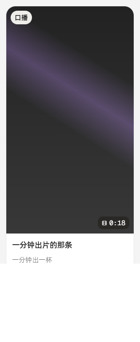

# 进场动效那一层：72 条声明全跑完、全落地；顺手修掉四处「减弱动态效果下还在平滑滚」（r339 / v0.9.312）

日期：2026-11-27。用户这一轮的原话还是那句——「我主要是在一些小的细枝末节上，比如某些小的动效」。
前五层（按下 / 划过按钮 / 划过非按钮面 / 键盘焦点 / 键盘跳转）量的都是**状态变化**（transition）。
这一轮开第六层，量另一件事：**声明出来的 keyframes 动画有没有真的跑、跑完有没有把样式还给元素**，
以及系统开了「减弱动态效果」之后它们到底停不停。

## 一、结论

1. **72 条动画全部跑完、全部落地**：11 屏里声明出来的 keyframes 动画 72 条（切页淡入、运营位与能力卡
   逐条进场、提示条、抽屉滑入），一条都不少地起了、也一条不少地落了；**跑完还半透明 0 条、
   跑完还把 transform 定住 0 条、一次没起 0 条、起过没落地 0 条**。
2. **「减弱动态效果」那道总闸真的管住了**：把系统切成 reduce 再重载 11 屏，页面里
   `matchMedia('(prefers-reduced-motion: reduce)')` 11/11 都是 true（这条先证明了才敢读数），
   而动画**还超过 1ms 的 0 条、还在无限循环的 0 条、还半透明的 0 条**。
3. **量出两个「读法错了」的地方**（都是量具的，不是页面的）：
   - 逐条进场到底是不是 24ms 错峰？**按事件派发时刻读出来是 7/18/18ms，看着像错峰被压扁了**；
     改成读动画自己的 `startTime + delay`（视觉起跑时刻）之后是**干净的 24/24/24ms**——
     动画事件的派发是每帧冲刷一次，差得出一帧。
   - 只按「页面上还存在的元素」数动画，会把**骨架屏 / 转圈 / 后台脉冲**整类漏掉（读的时候元素已被换掉）。
     补成「事件里有、页面里没有」单列（orphans）之后：**8 种 / 37 次**闪现型动画，全部有据可查。
4. **修了两处真东西**（都在这一层里量出来的）：
   - **四处写死 `behavior: 'smooth'` 的滚动在「减弱动态效果」下照样平滑滚**。全局那条
     `* { scroll-behavior: auto !important }` 管不住 JS 显式传的 behavior —— 页面上真滚一次量到：
     同一个容器 `smooth` 用满 **40 帧 / 711ms**，`auto` **4 帧 / 71ms**，而 reduce 开着完全一样。
     把六处滚动收进一个 `scrollToSoft()`（`src/domain/motion.ts`），六处同一条口径。
   - **模板卡封面被白跑一趟代理，每次巡检稳定留下 4 条假的前端异常**：`coverSrc()` 把任何地址都包成
     `/api/cover?url=…`，连 `data:` 与站内地址也包。改成「只有需要代理的才代理」之后，
     同一趟巡检的**写请求 4 → 0**、`client-errors.json` 不再生成。

## 二、读数（第六层：进场动效，11 屏 × 两趟）

同一份脚本 `scripts/audit-press.mjs`，新开关 `--motion`，1440×1000，每屏等 900ms 后读：

| 屏 | 声明 | 读回来 | 闪现型 | 跑完 | 一次没起 | 起过没落地 | 落地后还半透明 | 落地后定着 transform |
| --- | --- | --- | --- | --- | --- | --- | --- | --- |
| 外壳 · 侧栏与顶栏 | 8 | 8 | 0 | 8 | 0 | 0 | 0 | 0 |
| 工作台 | 8 | 8 | 0 | 8 | 0 | 0 | 0 | 0 |
| 工作台 · 四张能力卡 | 8 | 8 | 0 | 8 | 0 | 0 | 0 | 0 |
| 后台 · 运营位卡 | 1 | 1 | 2 种 / 17 次 | 1 | 0 | 0 | 0 | 0 |
| 模板库 | 3 | 3 | 2 种 / 7 次 | 3 | 0 | 0 | 0 | 0 |
| 模板库 · 详情抽屉 | 4 | 4 | 2 种 / 7 次 | 4 | 0 | 0 | 0 | 0 |
| 设置 | 2 | 2 | 0 | 2 | 0 | 0 | 0 | 0 |
| 作品流 | 2 | 2 | 1 种 / 1 次 | 2 | 0 | 0 | 0 | 0 |
| 智能体 | 2 | 2 | 1 种 / 6 次 | 2 | 0 | 0 | 0 | 0 |
| 智能体 · 对话预设 | 2 | 2 | 1 种 / 6 次 | 2 | 0 | 0 | 0 | 0 |
| 本地工作区 · 输入框 | 2 | 2 | 0 | 2 | 0 | 0 | 0 | 0 |
| **合计** | **72** | **72** | **8 种 / 37 次** | **72** | **0** | **0** | **0** | **0** |

闪现型那 8 种是 `vq-skeleton-pulse`（骨架屏，24 次）、`admin-pulse`（后台加载点，10 次）、
`spin`（刷新图标，2 次，带 1 次 cancel）、`vq-spin`（转圈，1 次）——它们的宿主元素在读到的时候
已经被内容替换掉了，所以只有事件能证明它们跑过。

「减弱动态效果」那一趟（同样 11 屏，重载后读）：

| 项 | 读数 |
| --- | --- |
| 页面里 `matchMedia(prefers-reduced-motion)` | **11 / 11 为 true**（先证明系统切过去了，否则整趟作废） |
| 动画条数 | 外壳 / 工作台 / 能力卡 各 7 条（比正常少的那一条是切页淡入：`tokens.css` 的 reduce 块给它的是 `animation: none`，不是压到 1ms），其余 0–2 条 |
| 还超过 1ms 的 | **0** |
| delay 还不是 0 的 | **0** |
| 还在无限循环的 | **0** |
| 动画元素还半透明 / 看不见的 | **0** |
| `html` 的 `scroll-behavior` | `auto`（11/11） |

## 三、量具自己的三处错

1. **事件派发时刻 ≠ 动画的起跑时刻。** `animationstart` 每帧才冲刷一次，同一屏幕里四条卡片的
   24ms 错峰读出来变成 7/18/18ms，看起来像「错峰被压扁」。改成在探针里读
   `Animation.startTime`（文档时间轴上的排定时刻）**再加上这条动画自己的 delay**：
   `ov-cap×4 起跑 82.655/106.655/130.655/154.655ms 间隔 24/24/24 | vq-promo×2 间隔 24`。
2. **`startTime` 单独看也是错的。** 同一个容器里四条卡片的 `startTime` 完全相同（都是 84.244ms）——
   延迟是记在动画内部的，不在时间轴起点上。只看它就会得出「四条一起起跑」的相反结论。
3. **只按页面上还在的元素数动画，会整类漏掉闪现型的**（骨架屏、转圈、后台脉冲）。
   补上 orphans（事件里有、读的时候页面上没有：名字、start/end/cancel 次数、跑完了才走还是没落地就走、
   当时的宿主元素），本轮 8 种 / 37 次，逐条打印。

另外两条纪律一样重要：
- **先证明系统真的切过去了**：reduce 那一趟如果 `matchMedia` 不是 true，整趟作废、不写成「0 条 miss」。
  那种「干净」比脏读数更危险。
- **「还在飞」不算缺陷**：`duration + delay` 还没走完的记 `still-running`，不记「起过没落地」
  （页面长、动画长时最容易误判的一条）。

## 四、修的两处

### 1）四处写死 `behavior: 'smooth'`：减弱动态效果下还在平滑滚

全站六处 JS 滚动，两处自己 `matchMedia` 判过（运行记录页、后台运营位卡），四处没判：
作品页的「落在那一版上就把档案滚到眼前」、评审页的「钉住一条把画面滚进视野」、
智能体页的两处（选预设卡、恢复历史）。

判据不能写进 CSS：`* { scroll-behavior: auto !important }` 管的是「没指定 behavior 时的默认值」，
**JS 显式传的 behavior 优先于它**。这一层在真页面上滚了一次（自建离屏容器，不碰宿主页面自己的滚动位置）：

| 系统设置 | CSS `scroll-behavior` | `behavior: 'smooth'` | `behavior: 'auto'` |
| --- | --- | --- | --- |
| 正常 | auto | **40 帧 / 711ms** | 4 帧 / 71ms |
| 减弱动态效果（matchMedia=true） | auto | **40 帧 / 713ms** | 4 帧 / 72ms |

（`auto` 那 4 帧是采样器要求「连续 3 帧不动」才收工；真的位移只有第一帧，也就是瞬间到位。）

修法：新增 [src/domain/motion.ts](src/domain/motion.ts)——`prefersReducedMotion()` 是全站唯一读系统设置的地方，
`scrollToSoft(target, options)` 按它给 `'auto'` 或 `'smooth'`。六处全部并过来（含原来自己判的那两处），
[src/App.tsx](src/App.tsx) 里提示条退场时那一句 `matchMedia` 也改调 `prefersReducedMotion()`。

### 2）模板卡封面白跑一趟代理：每次巡检 4 条假前端异常

`coverSrc()` 以前是「有地址就包一层 `/api/cover?url=…`」。产品里真实的封面只有两种：
平台地址（http/https，要代理：直连会 403 / mixed content）与站内路径（`/media/…`、`/api/…`，同源，不需要代理），
再加上一种「本身就是一张图」的内嵌数据（`data:`）。后两类再包一层代理只是白跑一趟，代理抓不到还会在页面上
留下一条「资源加载失败」的前端异常。

本轮巡检自己的夹具就带了一个 `data:` 封面，于是每趟稳定留下同一条异常：

> `kind: resource · message: 资源加载失败（img）：/api/cover?url=data%3Aimage%2Fpng%3Bbase64… · page: #/templates · count: 4`

改成「只有需要代理的才代理」之后，同一趟巡检（22 趟、同样的夹具）：
**`POST /api/client-errors` 4 → 0，`client-errors.json` 不再生成**；
模板卡的封面图反而正常显示出来了（以前是 CoverImage 的兜底文案）。



## 五、静态门禁

新增 [test/reduced-motion-scroll.test.mjs](test/reduced-motion-scroll.test.mjs) 5 条：

1. `src` 下所有 .ts/.tsx 里，写死的 `behavior: 'smooth'` 只允许出现在 src/domain/motion.ts
   （扫描器同时自证「扫得出东西」）；
2. 反证：塞一个写死的调用点必须被扫出来、改成 `scrollToSoft()` 之后不再报；
3. 反证：把 helper 里的开关换成恒 `smooth` 必须被发现；
4. `scrollToSoft` 在两种系统设置下分别给 `auto` / `smooth`（stub `matchMedia`）、没有 window 时不炸；
5. 原来四处写死的调用点都改成了 `scrollToSoft`（智能体页两处都在）。

量具守卫 [test/audit-press-motion.test.mjs](test/audit-press-motion.test.mjs) 14 → **17 条测试**
（+18 条针：`--motion` 开关、事件探针与 cancel、`startTime + delay`、四类缺陷判定、
减弱动态效果的 1ms / delay / 循环三条、`matchMedia` 先决条件、orphans、滚动实验、
`Emulation.setEmulatedMedia`、错峰按宿主分组、probe 元数据；+3 条反证：
「一次没起」改恒假、1ms 门槛放到 99999、`matchMedia` 那道闸删掉）。

[test/runs-mobile.test.mjs](test/runs-mobile.test.mjs) 里那条断言跟着改口径：从「这一页自己判 reduce」改成
「这一页用 `scrollToSoft`，判据在 `motion.ts` 里」（判据没有被放宽，位置变了）。

## 六、前五层没被碰

- 动效探针只在 `--motion` 这一层装（`if (MOTION_MODE)` 才有 `addScriptToEvaluateOnNewDocument`），
  别的那五层连一个字节的读数都不动。
- `--motion` 这一趟不按鼠标、不按键盘、**写请求 0**、上游 0（第 22 趟汇总里写明了）。
- 上一轮的 `--focus` / `--links` 读数（423 站 / 9 张面）本轮没有复跑，也没有被这一轮的改动影响：
  这一轮改的是 `src/domain/motion.ts`（新文件）、六处滚动调用、`coverSrc`，以及量具自己的新一层。

## 七、发布与验证

- 版本 **0.9.311 → 0.9.312**；构建入口 `index-8xkM8tsT.js`。
- 门禁：`npm test` **2212 / 2212**、`tsc -b` 干净、`oxlint` 0 error / 30 warning（与 r338 同一条线）、
  密钥扫描 1239 个文件无命中。

- 发布标签 `20261127-0330-r339motion`，快照
  `/opt/visionqa/releases/20261126-192106-20261127-0330-r339motion.tar.gz`
  （上一版 = r338 的 `/opt/visionqa/releases/20261126-185545-20261127-0300-r338skip.tar.gz`，也就是回滚点）。
- 部署输出：三个服务 active、health ok（redfox / vision / llm true、templates 27）、入口 `index-8xkM8tsT.js`。
- 公网 `https://visionqa.wavisionai.cn`：`/api/version` **0.9.312**、health ok、新入口 200、上一版入口
  `index-C_AZkWrt.js` 404；CSS 仍是 `index-CiTxbH4L.css`（439,596 字节，与 r338 同哈希 —— 这一轮没动样式表）；
  live JS 里 `prefers-reduced-motion: reduce`、`data:`、`/api/cover?url=`、`scrollIntoView` 都在。

## 八、边界（如实记）

- **app 层那一下滚动没有在无头浏览器里真按过**：要复现它得真点一张预设卡（会改会话状态、会发读请求），
  这一层是只读的，所以不点。量到的是**机制**（显式 smooth 在 reduce 下照样动 40 帧）、
  **判据位置**（`scrollToSoft` 单测两种系统设置各一条），而不是那四处点击本身。
- **「闪现型」只证明「跑过」，不证明「跑了几帧、好不好看」**：骨架屏的呼吸节奏、转圈的快慢没有量，
  它们在这一层只作为「有这么一批动画存在」被记录下来。
- **只覆盖 keyframes 动画**。CSS transition 那一类由前五层管；`element.animate()` 这种 JS 驱动的动画
  站里目前没有（grep 过 `.animate(`），但这一层也看不见它——真加了要另开一层。
- **一屏只等 900ms 再读**：进场动画最长 260ms + 168ms 错峰，留了余量；但依赖数据的动画
  （等接口回来才挂上的）如果晚于 900ms 才出现，这一层只会把它记成闪现型或干脆看不见。
- **减弱动态效果那一趟只用了 `Emulation.setEmulatedMedia`**：这是 Chrome 的媒体特性模拟，
  不是真去改系统设置；`matchMedia` 读回来是 true，但操作系统的实际开关没有动过。

## 九、证据清单（可复跑）

```
# 第六层：进场动效（正常 + 减弱动态效果各一趟，共 22 趟）
node scripts/audit-press.mjs --motion --dist dist --out .shots339/motion-final --shots all
# 只跑正常那一趟 / 只量两屏
node scripts/audit-press.mjs --motion --nomreduce --only overview,templates --dist dist --out .shots339/motion-one
# 这一轮新增与改动的门禁
node --experimental-sqlite --experimental-strip-types --test test/audit-press-motion.test.mjs test/reduced-motion-scroll.test.mjs test/runs-mobile.test.mjs
```

- 正常那一趟（当前产物）：`.shots339/motion-final/press.json` → `motion.pages`（每屏一条，含 `entries` /
  `orphans` / `scrollCheck` / `probe.events`）。
- 上一版（0.9.311）同一层：`.shots339/motion-before/press.json`，同一份夹具下
  `writeRequests = { total: 4, counts: { 'POST /api/client-errors': 4 } }`，
  `data/client-errors.json` 里那条 `resource` 异常（count 4）。
- 证据图（这几张进了仓库）：[运营位两张卡](r339-motion-promos.png)（进场 `vq-rise`×2，间隔 24ms）、
  [四张能力卡](r339-motion-capabilities.png)（间隔 24/24/24ms）、
  [模板卡封面](r339-motion-template-cover.png)（`data:` 封面不再被代理，直接显示）。
- 都放在 `.shots339/` 下（gitignore，不进仓库）。
