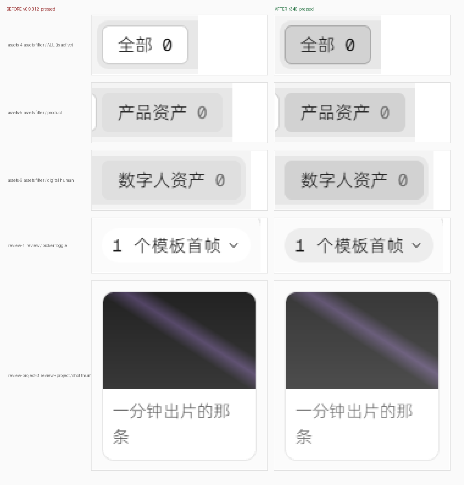

# 主线上从没上过巡检的三屏：资产 / 评审 / 充值，量出 6 处「按下去和悬停一模一样」→ 0（r340 / v0.9.313）

日期：2026-11-27。这一轮接着用户那句「我主要是在一些小的细枝末节上」往下走。

前九轮（r331–r339）的按下巡检只在 **11 趟**上真按过：外壳、工作台、模板库、模板库·详情抽屉、设置、
作品流、智能体、智能体·对话预设、本地工作区·输入框、后台·运营位卡。**复刻主线的产出端（资产）、
评审关（视觉评审），以及全站唯一的钱路（充值），一屏都没被量过。**

这一轮只做一件事：把这三屏（评审分「没选片」与「带作品」两条地址）加进巡检，第一次按下就量出
**6 处「按下两帧空、200ms 稳态也空」**——即按下去和划过、和停着看完全一样；全部修掉后同一份脚本复量
**6 → 0**。



## 一、结论

1. **三屏加进巡检，第一个读数就是 6 处无反馈**：资产的 3 颗筛选项、评审的「N 个模板首帧」折叠开关
   （两条地址上各一次）、带作品评审里的画面缩略图。全部是「划过会变、按下去不变」——鼠标按下去那一刻
   界面没有任何回应。
2. **修完是 0**：同一份脚本、同一批元素、同一套口径，4 趟共 **21 颗可点**，**有反馈 21 / 候选 0**，
   按下硬切 0、划过硬切 0。
3. **量具本身也补了一处**：运营位的位置白名单里有 `recharge` 这一处（r322 才挂上），但巡检夹具
   一直只铺了 `overview` 那两条，**充值页那个挂载点在真页面上一次都没被渲染过**。这一轮补了第三条
   内容，充值页的运营位第一次有真机读数（它与 ✕ 的按下反馈是 r326 做的，本轮复量为「有反馈」）。
4. **这轮 0 次上游调用、0 积分、0 写请求**：临时实例 + 临时账号 + 真 SQLite，只按鼠标不合成 click。

## 二、读数（按下那一层，4 趟，1440×1000）

同一份 `scripts/audit-press.mjs`，改前跑的是**生产上那份构建**（v0.9.312，`--dist` 指向从
`/opt/visionqa/dist` 拉下来的那一份，不是重新构建的），改后跑的是 r340 的构建：

| 趟 | 可见可点 | 量了 | 有反馈（改前） | 候选（改前） | 有反馈（改后） | 候选（改后） |
| --- | --- | --- | --- | --- | --- | --- |
| 资产 · 商品图与数字人 | 8 | 8 | 5 | **3** | 8 | **0** |
| 视觉评审（没选片） | 3 | 3 | 2 | **1** | 3 | **0** |
| 视觉评审 · 带作品 | 4 | 4 | 2 | **2** | 4 | **0** |
| 充值 | 6 | 6 | 6 | 0 | 6 | **0** |
| **合计** | **21** | **21** | **15** | **6** | **21** | **0** |

改前那 6 条（`active=true` 说明 `:active` 规则确实匹配到了元素，不是选择器写漏）：

| 趟 | 元素 | 改前读数 |
| --- | --- | --- |
| 资产 | `button.vq-assets-filter.is-active`（「全部 0」） | `changed=[]` |
| 资产 | `button.vq-assets-filter:nth-of-type(2)`（产品资产） | `changed=[]` |
| 资产 | `button.vq-assets-filter:nth-of-type(3)`（数字人资产） | `changed=[]` |
| 评审 | `button.review-picker-toggle` | `changed=[]` |
| 评审·带作品 | `button.review-picker-toggle`（同一颗控件，另一条地址） | `changed=[]` |
| 评审·带作品 | `button.review-thumb`（画面缩略图） | `changed=[]` |

两趟的「有反馈但还是硬切」与「划过有变化但还是硬切」都是 **0**——这一轮补的是「按下去根本没有变化」，
不是过渡缺失。另有 2 条 `border-color` 连带变化（边框宽为 0 时 computed 的 border-color 就是
currentColor，color 一变它必然跟着变），按 r335 的规则单列，不算反馈、不算硬切。

## 三、改了什么（5 处，两个样式文件）

### 1）资产页三颗筛选项

它们坐在 `--line-faint` 的浅底槽里，划过变一档底色；按下去没有任何一档。补的按下态**压到 `--line`**：

```css
.vq-assets-filter.vq-assets-filter:not(:disabled):active {
  background: var(--line);
  color: var(--ink);
}
```

两处讲究都是前几轮踩出来的：

- **压 `--line` 而不是 `--line-faint`**：槽底本身就是 `--line-faint`，压到同一档等于「和槽底一个颜色」，
  看起来仍然没反应（r331 在运营位那颗 ✕ 上试过一次）。
- **写两遍 `.vq-assets-filter`（0-4-0）**：要把 `.is-active` 的 0-2-0 和悬停态的 0-3-0 一起压过去，
  靠顺序赢不稳（样式表按需加载，先后来不保证）——与 `promos.css` 里
  `.vq-promo-cta.vq-promo-cta:active` 同一条做法。
- 不用 `transform`：这一簇不需要位移，而 transform 会给绝对定位后代另立包含块（r326 的教训）。

### 2）「当前选中的这一项」划过也要有反应

`.vq-assets-filter.is-active`（白底）与 `.vq-assets-filter:hover` 同为 0-2-0、又写在文件后面，
于是**「当前选中的这一项」划过毫无变化**（第 6 条候选之外的第二个毛病，同一趟里量出来的）。
补一条自己的悬停态，rest（白）→ hover（`--line-faint`）→ 按下（`--line`）三级一路加深：

```css
.vq-assets-filter.is-active:hover { background: var(--line-faint); }
```

### 3）评审页的折叠开关（「N 个模板首帧」）

划过变底色，按下去一样。与运营位那颗 ✕ 同一条口径，压一层 `--line-faint`，不位移；
过渡在 r335 补的那条总表里，不会硬切。

```css
.review-picker-toggle:not(:disabled):active { background: var(--line-faint); color: var(--ink); }
```

### 4）评审里的画面缩略图

`.review-thumb` 连悬停都没有，按下与停着看完全一样。与作品流的 `.works-thumb` 同一档：
**大块图片按钮按下变淡一档，不位移**（1px 位移在 127px 宽的图上看不出来；transform 会另立包含块）。
悬停态刻意不加——工作台那排缩略图也只有按下这一档，这一页跟着同一条口径，不单开一套。

```css
.review-thumb { transition: opacity var(--dur-1) var(--ease-out); }
.review-thumb:not(:disabled):active { opacity: 0.9; }
```

## 四、门禁

新增 `test/press-r340.test.mjs` 9 条（4 条断言 + 5 条反证），锁的不是「CSS 里有没有 `:active` 这几个字」，
而是会悄悄让它失效的六件事：选择器真的命中那颗按钮（写错类名 / 漏 `:active` 都不算）、不在窄屏
`@media` 里（量到的 1440 屏与手机端不能各说各话）、`:not(:disabled)` 还在（否则禁用态也跟着按下去）、
权重真的压过各自最高的基线（0-3-0 / 0-2-0）、按下的属性必须是元素自己那条 transition 覆盖得到的、
底色用的 token 必须比槽底深一档。每条反证都是「把真源码改坏，检查必须变红」。

| 门禁 | 结果 |
| --- | --- |
| `npm test` | **2221 / 2221** |
| `tsc -b`（`npm run build`） | 干净 |
| `oxlint` | 0 error / 31 warning |
| `npm run scan:secrets` | 1242 个文件，无命中 |
| `test/press-r340.test.mjs` | 9 / 9 通过 |

入口 `index-B-LH4NLp.js` 873.79 kB（r339 是 866 kB 级，这一轮没有新页面）。

## 五、边界（这一轮没做、也不假装做了）

- **只量了 1440 一档**：手机 / 平板宽度下这三屏的按下态是同一份规则（没有被塞进 `@media`），
  但没有在 390 / 768 上真按过一次。
- **充值页只量了 6 颗**：三档充值按钮 + 返回设置 + 运营位（CTA 与 ✕）。充值页的「返还设置」
  折叠区打开后还有几颗，没进这一趟。
- **资产页的 8 颗**是空状态（0 条资产）下的一屏；有资产时每张卡片的「生成 / 更多」是另一批元素，
  这一轮量不到（需要真跑一次出图，会扣费）。
- **评审页空状态只有 3 颗可点**，真正的界面在「带作品」那条地址上——所以两条地址都进了巡检，
  以后任何一屏都不该只留一条地址。
