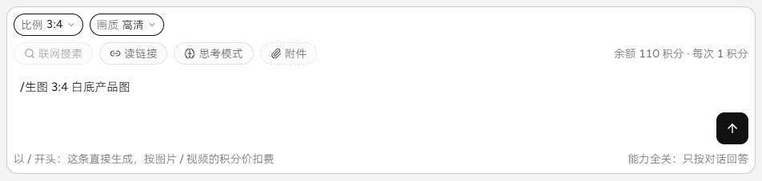
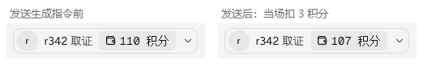
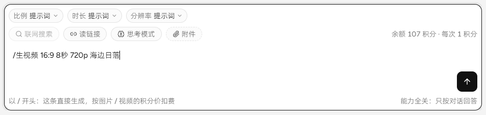
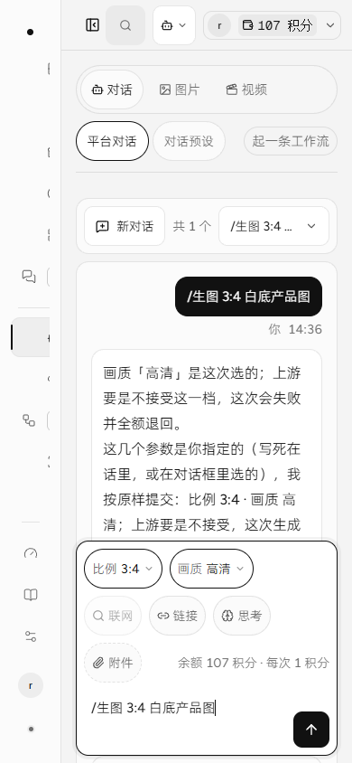

# r342：对话框里生成的参数该跟用户选的走（v0.9.314）

2026-11-27。用户在生产上报了四条，全部先在生产方式里复核，再改：

| # | 用户原话 | 生产上查到的事实 |
| --- | --- | --- |
| 1 | 右上角的积分不是实时扣除 | 外壳只在**换路由**或收到 `vq:credits` 事件时重读余额（`src/App.tsx:356-389`）；对话这条链路自己更新了输入框下方的余额，却没派发事件——右上角一直停着不动 |
| 2 | 生成的图片比例被完全固定了 | 会话 `cmwyhsl8s9d38b8` 第 1 句「生成一张欧美女星带首饰的图 **3：4**的比例」→ 任务 `mgen_kYh89pp_iWka` 记为 `ratio=1:1 size=1024x1024`：**全角冒号**没被认出来 |
| 3 | 质量、分辨率被固定了；参数还写死在提示词里 | 同一个任务的 `prompt` 是「欧美女星带首饰的图 **3 4的比例**」——参数既没生效，又被清洗成「3 4」留在提示词里当画面描述；图片通道根本没有画质参数（`quality`）这一项 |
| 4 | 对话模式下也没有遵循参考图 | 账号 `usr_4ggk91mgd_6_` 在 04:39/04:47 通过对话附件传了两张商品图（`cf_mwyhsn* / cf_mwyi2b*.jpg`），随后的任务 `mgen_fSKl7ZausR2f`、`mgen_D3H1ZwfKm5Jr` 都是 `mode=text`、`assets=[]`——参考图只跟「发它的那一条消息」绑定，下一句「生成…」就成了纯文生图 |

## 改前 → 改后（同一句话跑服务端解析器，不是估计）

| 说这句话 | 改前 | 改后 |
| --- | --- | --- |
| `生成一张欧美女星带首饰的图 3：4的比例` | 比例 1:1 · 1024x1024；提示词「…图 3 4的比例」 | 比例 3:4 · **1152x1536**；提示词「欧美女星带首饰」 |
| `生成一张图 ３：４` | 同上（全角数字也不认） | 3:4 · 1152x1536 |
| `生成一张图 3比4的比例` | 1:1 | 3:4 · 1152x1536 |
| `/生图 1:1 白底产品图` + 对话框选 9:16、高清 | 1:1、无画质 | 9:16 · 1024x1536 · `quality=high`（真的发给上游） |
| `/生图 白底产品图`（画质留「跟随默认」） | 无画质 | 正文里**没有** `quality` 字段，走上游默认档 |
| 上一句带商品图、这一句 `/生图 照这张画成商品主图` | `mode=text`、`assets=[]` | `mode=reference`，按那张图走 `/images/edits`，回答写明用的是哪张 |
| 一次带两张图 + 生成指令 | 直接 400「最多带 1 张参考图」 | 按第 1 张当参考，回答说明是哪张（不再把用户挡在门外） |

## 五块改动

### 1. 参数识别认全角（`server/media-models.mjs` / `server/media-intent.mjs`）

- `halfWidthDigits()`：全角数字、`：`、`∶`、`＊` 归一；`normalizeRatio` / `normalizeSize` 都认全角写法。
- 比例正则收 `[:：∶]` 与「3比4」；秒数 / 清晰度 / 尺寸同样收全角。
- **参数后面的连接词一起吃掉**：`3：4的比例` 整段算参数，抠完不会只剩「…图 的比例」。

### 2. 对话框里选的参数盖过提示词（`parseMediaIntent(text, overrides)`）

`overrides = { ratio, quality, duration, resolution }`，选了就以选的为准；文本里那份照样从提示词里抠掉，只是不再决定实际值。
选了表外的档（3:4 / 4:5 / 12 秒 / 1080p）照旧按 `locked` 处理：原样提交，上游不收就失败全额退回。

### 3. 图片画质（`quality`）从界面贯通到上游

- 白名单 `IMAGE_QUALITIES = ['low','medium','high']`，界面叫 快速 / 标准 / 高清；**默认不传**（空串 = 走上游默认档）。
- 贯通链路：`解析 → resolveSelection → runImage → 任务元数据(quality) → /images/generations 与 /images/edits 的正文`。
- 任务、对话回答里的 `media`、卡片规格都会写出这次是什么画质。

### 4. 参考图沿用（`server/chat-store.mjs` + `server/chat.mjs`）

生成指令这条消息自己没带附件时，回看这条对话里**最近 6 条消息中用户发过的那张图**当参考；回答里写明「按这条对话里你上一条带的那张图「xxx」当参考（这条没带附件）」。
沿用过来的那张不挂回这条消息（它本来没在这条里发过）。多带图时按第 1 张并说明是哪张。

### 5. 右上角余额实时（`src/api/client.ts` + 对话 / 任务卡片）

- 统一请求层：**写请求**的正文里只要带 `cost` / `balance` / `refunded`，就派发一次 `vq:credits`（只读 GET 不派发，避免任务轮询每 2.5 秒白读一次余额；查询余额自己的 `/api/credits` 排除，否则自己触发自己）。
- 对话走流式（`streamChatMessage` 不经 `request()`），单独在发送成功后派发；媒体任务在「processing → succeeded/failed（含退款）」那一次派发。
- 顺带把平台口径写进系统提示词：对话一轮 1 积分、生成按模型标价、失败/空回复/停止全额退回——用户问「每次对话都会扣 1 积分吗」时，模型不必再答「我不确定」。

## 取证：临时实例 + 假上游，5/5（`scripts/shot-r342.mjs`）

同一个临时实例（临时 DATA_DIR、真 SQLite 与真 cookie）里，给账号发 60 积分、把出图 Key 的 baseUrl
指向本机假上游（1x1 PNG），然后用 CDP 真输入走一遍：

| 检查 | 读数 |
| --- | --- |
| 生成设置行出现（图片指令） | 行宽 918 · scrollWidth 918 · 两枚胶囊：`比例 3:4` `画质 高清` |
| 发送一条生成指令后右上角余额 | **110 积分 → 107 积分**（-3，实时） |
| 任务卡片规格 | `VisionQA通用图片模型 · 3:4 · 1152x1536 · 画质 高清 · 3 积分` |
| 视频指令的控件 | `比例 提示词` `时长 提示词` `分辨率 提示词` 三枚 |
| 390×844 窄屏（**图片态**：比例 3:4 / 画质 高清） | 两枚胶囊单行；docScroll 390 = innerWidth 390 = bodyScroll；设置行 clientWidth 272 = scrollWidth 272 |
| 发到上游的正文 | `{"prompt":"白底产品图","size":"1152x1536","quality":"high","n":1,"model":"gpt-image-2.6"}` |
| 真实上游调用 | **0**（假上游命中 1 次，路径 `/v1/images/generations`） |

取证脚本被**独立复核**过一轮（2026-11-27，队友 shots-r342 按同一套骨架重跑）：功能结论一致，
但它指出两件事并已修掉——(a) 上一版 390 那张拍的是**视频态**，数字为真却不是要证的那一屏，现在先回到图片态再量；
(b) 检查条件太松（「行在」就算过、余额只比字符串所以「读取中」也 != 旧值、`rowScroll === null` 自动过、
FAIL 也 exit 0），现在断言具体的胶囊与溢出数字、余额要等于服务端 `/api/credits` 且差值等于卡片 cost，
**任何一条 FAIL 都让进程退 1**；四张图与拼图也搬进脚本（原来靠外部 Pillow 脚本，只跑脚本复现不出 docs）。

## 门禁（2026-11-27 14:10 本机）

- `npm test` **2232 / 2232**（r340 是 2221；本轮新增 11 条：`test/r342-media-params.test.mjs` 7 条纯函数，
  `test/media-gen.test.mjs` 里 4 条端到端——全角 3：4 真的发成 1152x1536、下拉比例/画质盖过提示词、
  没选画质就不发 quality 字段、参考图沿用。另有一条既有用例按新行为改写：带两张图从「报错拦下」
  改成「按第 1 张并说明」）。
- `tsc -b` 干净；`npm run build` 通过（入口 `index-yuUaxeXq.js` 873.79 kB / gzip 260.92 kB）。
- `npm run lint` **0 error / 31 warning**（r340 也是 31 条，全是既有警告）。
- `npm run scan:secrets` 1244 个文件无命中。
- 取证脚本 `node scripts/shot-r342.mjs --dist dist`：**8/8 通过、进程退 0**（FAIL 会退 1），产物 `.shots342/r342.json`；
  四张图由脚本自己复制进 `docs/`（在此之前先删掉旧的，免得把上一版当这次的结果）。
- **反证**：把全角冒号正则改回半角、把「参考图沿用」那一段短路，`node --test` 立刻红了 4 条
  （生产原句 3：4 的两条 + 参考图沿用的两条）；恢复后 45 / 45 绿。

## 发布与线上核验（2026-11-27 14:20）

- 标签 `20261127-1425-r342params`，快照 `/opt/visionqa/releases/20261127-061959-20261127-1425-r342params.tar.gz`；
  上一版 r340 的 `20261127-051332-…-r340press.tar.gz` 就是回滚点（`bash /opt/visionqa/ops/rollback.sh --to 1`）。
- 公网 `/api/version` **0.9.314**、`/api/health` ok templates 27、匿名 `GET /api/promos` 401；
  新入口 `index-yuUaxeXq.js` 200、上一版入口 `index-B-LH4NLp.js` 404。
- 新规则在懒加载的 agents 分片里：`agents-DWL9Q2G9.css` 200，含 `.qc-gen-chip` / `.qc-gen-opt` / `.qc-gen-note`。
  **主包 CSS 这次没变**（`index-WqRcN8-P.css` 与 r340 同名）——`agents.css` 本来就不在主包里，
  这一点以前没人写下来过，这次记一笔，免得下次把「主包没变」当成没发上去。
- 两个服务 active；提交 `4d1b8e6`，CI **45951042095 success**。

## 边界（这轮没做 / 没验的）

- **画质三档没有真调过上游**：`quality` 是按 OpenAI 兼容接口的字段名接的，GeteAPI 到底收不收未知。所以默认不传、选了原样提交、不接受就失败全额退回——回答里先把这句话说在前面。
- **画质暂不加价**：`imageCredits` 仍按张算，三档同价。上游按画质计价的账单还没拿到，不能凭空编倍率。
- 多轮修改（「改成 8 秒」「换个比例」）仍没做：要在对话里接着改参数，现在是重新说一句。
- 参考图沿用只看**这条对话**里用户发过的图（最近 6 条消息内）；跨对话、素材库里的资产仍要在「图片」页签选。
- 其余扣费点（评审 / 复刻 / 对话预设 / 工作流）现在靠统一请求层兜住，没有逐个写用例。
