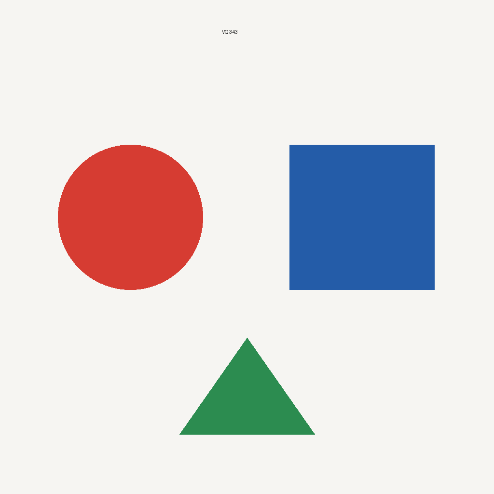
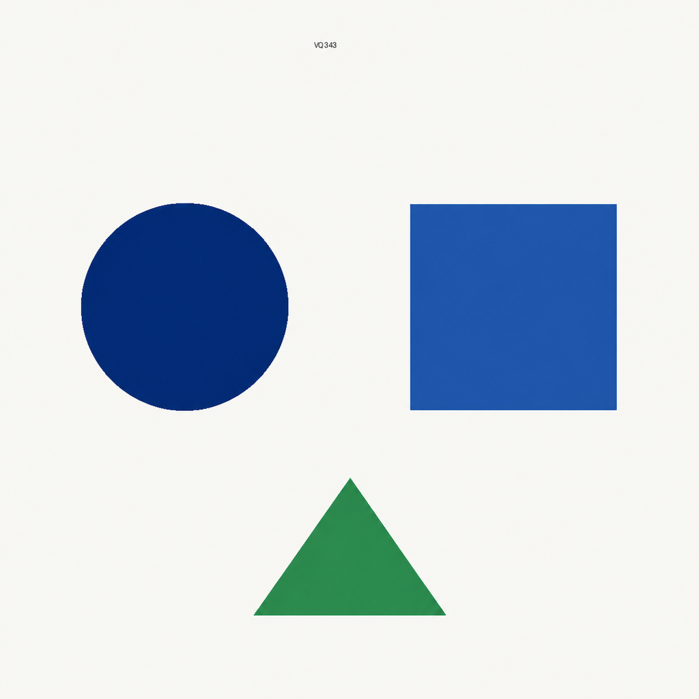

# r343 上游实测：画质三档、参考图遵循（2026-11-27）

用户第 1、2、3 条的现场验证。**在生产服务器上直接调用平台那把 GeteAPI 出图 Key**，
字段与 `server/gateway.mjs` 的 `generateImage` / `generateImageEdit` 完全一致，
但**不经平台记账**（不写 usage、不扣用户积分、不动 Key 的冷却与健康计数）。

## 结论

1. **画质三档上游是接受的**：不传 / 快速(`low`) / 标准(`medium`) / 高清(`high`) 全部 HTTP 200，
   出图 image tokens 依次 **1056 / 272 / 1056 / 4160** —— 档位真的生效，不是被上游丢掉；
   并且「跟随默认（不传）」与「标准」的 token 数**完全相同**，即默认档＝标准档。
2. **画质不加价**：六次真实出图每次扣费都是 **¥0.0157～0.0158**（余额 18.9378 → 18.8433，合计 ¥0.0945），
   与档位、与带不带参考图都无关 —— 上游按张计费。所以「三档同价」不是我们的定价策略，是上游的计费方式。
3. **参考图是真被照着画的**：把一张合成参考图（左红圆 / 右蓝方 / 下绿三角 / 顶部 VQ 343）发给
   `/images/edits`，要求「把左边红色圆形换成深蓝色，其余不动」，回来的图**只有那个圆变了**，
   方形、三角形、背景、文字全在（下面有逐点像素）。

## 测法（可复现）

- 服务器：`/tmp/quality-probe.mjs`（画质）、`/tmp/edit-probe.mjs`（参考图），均已在本机留档于
  本轮提交的脚本说明里；跑法：`cd /opt/visionqa && set -a && . ./.env && set +a && node <脚本>`。
- Key：`k_8a5f31ef3a04`（provider `geteapi`，模型 `gpt-image-2.6`），
  用 `keyMaterial()` 取材料，不打印明文。
- 扣费口径：每次调用**前后**各读一次上游 `/api/user/self`（`checkNewApiBalance`），
  用余额差算这次真实花了多少，不看我们自己的估算。

## 表 1：画质三档（1024×1024，同一句提示词）

| 档位 | 请求里的 quality | HTTP | 出图 image tokens | 耗时 | 这次扣费 |
| --- | --- | --- | --- | --- | --- |
| 跟随默认 | 不传 | 200 | 1056 | 23.2s | ¥0.0157 |
| 快速 | `low` | 200 | 272 | 20.9s | ¥0.0157 |
| 标准 | `medium` | 200 | 1056 | 31.0s | ¥0.0157 |
| 高清 | `high` | 200 | 4160 | 19.8s | ¥0.0158 |

> 结论：三档同价；**「跟随默认」＝标准档**。界面上「跟随默认」的说明可以直接写「≈ 标准」。
> 高清与默认的差距是 4 倍 image tokens，说明上游确实按高档生成，只是不按 token 计价。

## 表 2：参考图遵循（`/images/edits`，multipart 与产品一致）

请求字段：`model=gpt-image-2.6, prompt, n=1, size=1024x1024, response_format=b64_json` +
文件段 `image`（`reference.png`，`image/png`，8.1 KB 合成图）。HTTP 200，25.8s，
上游 usage 里 **input image_tokens = 1659**（证明参考图确实被读进去了），输出 1024×1024 PNG 776 KB。

取同一坐标逐点比（0–255）：

| 位置 | 参考图 | 出图 | 判定 |
| --- | --- | --- | --- |
| 左圆中心 (270,450) | (214,60,50) 红 | (3,44,120) 深蓝 | 按要求改了 |
| 右方中心 (750,450) | (36,92,168) | (31,87,171) | 未动 |
| 下方三角 (512,860) | (44,140,80) | (43,138,78) | 未动 |
| 背景 (60,60) | (246,245,242) | (247,247,242) | 未动 |

## 顺带确认的一件事

上游 `b64_json` 回来的是 **data URI**（`data:image/png;base64,...`），不是裸 base64。
产品这边早就按这个处理了（`server/gateway.mjs:206`：`/^data:/i.test(raw) ? raw : 'data:image/png;base64,' + raw`），
所以这次实测没有暴露新问题——只是第一版探针脚本没剥前缀，自己把图写坏了。记在这里，免得下次再踩。

## 本轮花费

6 次真实出图（画质 4 次 + 参考图 2 次，第一次因为没剥 data URI 前缀重跑了一次），
上游余额 18.9378 → 18.8433，合计 **¥0.0945**。这是用户明确允许的验证花费。

## 产品侧的处置

- 画质：**保持三档同价**（用户第 2 条：收到有变化再改）。上游实测证明现在就不该加价。
- 文案：把「这三档还没真调过上游」「上游不接受会失败并全额退回」这类旧口径换成事实口径
  （档位越高细节越多越慢、三档同价、跟随默认＝标准档），见 r343 前端那一份记录。
