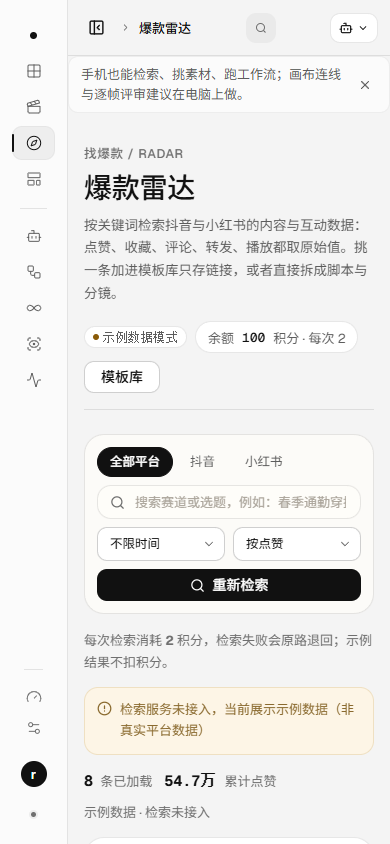
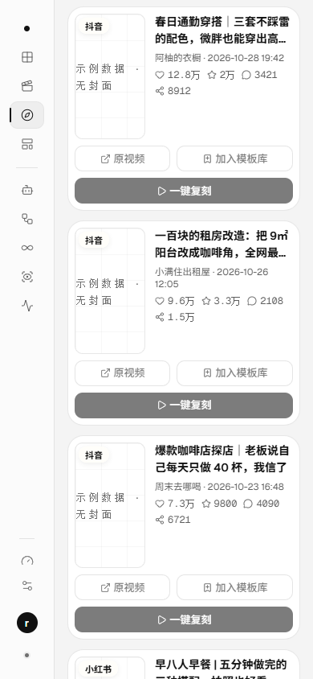
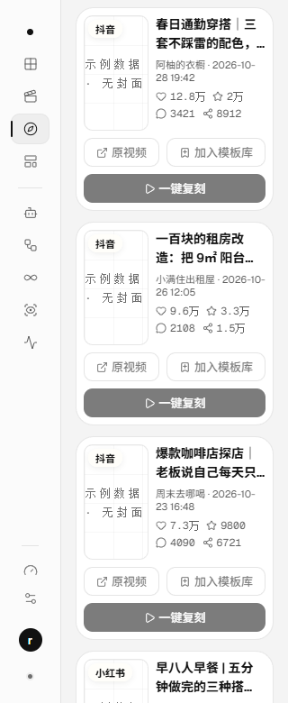
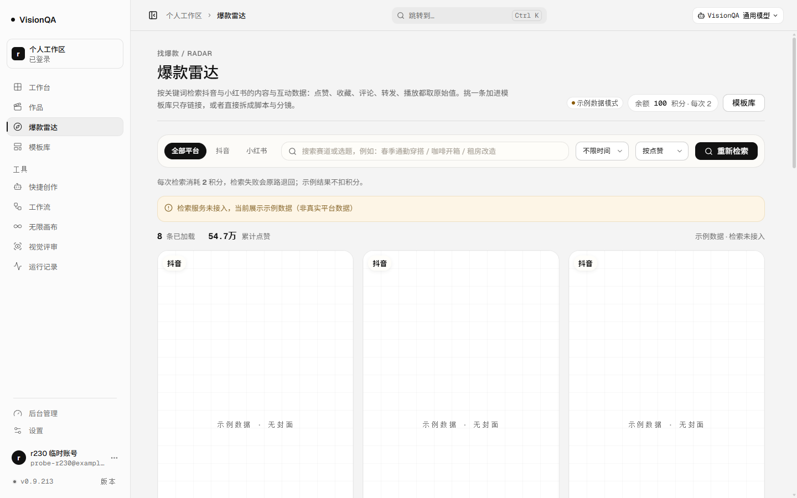

# 爆款雷达手机端：一屏从不到一条变成三条（r230 / v0.9.214）

2026-11-19 · 只改「爆款雷达」一屏的窄屏排版与三处文案/健壮性，不动接口、不动计费、不动检索。

## 结论

手机上「爆款雷达」以前是一张屏放不下一条结果：390 宽每张卡 679px 高、8 条整页 6498px，
封面 288×512 占掉整整一屏；320 宽的检索工具栏还有 14px 横向溢出、两个按钮的文字被截断。
现在 820 以下检索结果改成「左封面 + 右文案 + 整行操作」的紧凑行，390 每张卡 254px、
8 条 3062px（缩短 53%），一屏能看到 3.3 条；320 每张卡 226px、一屏 3.5 条，工具栏不再溢出。

## 四个断点与实测数字

| 现场 | 改之前 | 改之后 |
| --- | --- | --- |
| 820 以下仍是单列海报，9:16 封面铺满整列 | 390：卡 679px、封面 512px、8 条 6498px，一屏 0.84 条 | 390：卡 254px、封面 88×156、8 条 3062px，一屏 3.3 条 |
| 320 的检索工具栏挤出横向滚动 | 工具栏内容 232px 塞进 218px，「加入模板库」70>57、「一键复刻」63>57 被截 | 搜索框/平台整行、两个下拉各半、检索整行；内部溢出 0 处 |
| 320 工具栏高 272px（4 行） | 首屏几乎全是控件 | 180px（390）/ 214px（320） |
| 触屏上没有 hover，但封面那层「一键复刻」浮层仍可点 | 点封面任意位置就弹复刻，用户不知道点到了什么 | 820 以下 display:none，复刻只留整行那颗按钮 |

顺带三处：

- 页头 kicker 与标题都写「爆款雷达」，同一个词一屏出现三次（面包屑 + kicker + 标题）；改成「找爆款 / RADAR」，和「作品 / WORKS」「模板库 / TEMPLATES」同一套写法。
- 封面上的「库里已有 · 2 条作品」在 88px 封面上放不下：把条数单独包一层 `.radar-owned-count`，窄屏只留「库里已有」。
- 标题截断后看不到全名：`.radar-title` 补 `title`。

## 另外两处（不在雷达页，但同一轮发现）

- **未登录实例的失败退款会抛错**：`beginPaid` 的早退分支只返回 `{ cost: 0, release }`，没有 `refund`。演示实例（auth 关）里检索失败走到 `paid.refund()` 会抛 `TypeError: paid.refund is not a function`，用户看到 500 + traceId，真正原因被吞掉——本轮在临时实例上就是这么炸的。补上 `refund: () => {}`，形状与登录分支一致。
- **手机提示和现状矛盾**：全站的「桌面工作台：手机上能查看，检索、拆解与评审建议在电脑上做」还是 r224 的文案。现在手机能检索、能跑工作流（r227），改成「手机也能检索、挑素材、跑工作流；画布连线与逐帧评审建议在电脑上做」。

## 改了什么

| 文件 | 改动 |
| --- | --- |
| `src/styles/radar.css` | 新增 `@media (max-width: 820px)` 两段（结果紧凑行、工具栏两列网格）与 `@media (max-width: 360px)`（封面 72px、字号收一档）。选择器都带 `.page--radar` 前缀，不依赖 CSS 打包顺序 |
| `src/pages/RadarPage.tsx` | kicker 改「找爆款 / RADAR」；「库里已有」条数拆出 `.radar-owned-count`；标题补 `title` |
| `src/App.tsx` | 手机提示文案改成与现状一致 |
| `server/index.mjs` | `beginPaid` 未登录分支补 `refund` |
| `test/radar-mobile.test.mjs` | 新增 6 条：紧凑行结构、悬停层收起、按钮换行不截字、320 工具栏不溢出、kicker 不重复、提示文案、退款形状 |

间距只用 4/8/12/16/32，字号最小 11px，圆角走 token，符合 `test/design-grid.test.mjs` 的硬门槛。

## 实测（本机临时实例 + 示例数据，0 次真实检索）

| 宽 | 页面高 | 卡高 | 封面 | 一屏几条 | 横向溢出 | 容器内被截元素 | 工具栏高 |
| --- | --- | --- | --- | --- | --- | --- | --- |
| 1440 | 2935（未变） | 795（未变） | 353×628 | 1.1 | 0 | 0 | 60 |
| 390 | 6498 → 3062 | 679 → 254 | 288×512 → 88×156 | 0.84 → 3.3 | 0 | 8 → 0 | 192 → 180 |
| 320 | 5889 → 2975 | 580 → 226 | 218×388 → 72×128 | 1.35 → 3.5 | 0 | 8 → 0 | 272 → 214 |

`document.documentElement.scrollWidth` 在 390/320 都等于 `innerWidth`；操作按钮 32px 高（原来 28px），
「加入模板库」「一键复刻」的 `scrollWidth === clientWidth`。

## 边界

- 截图里的 8 条是**示例数据**（临时实例没配检索 Key），封面因此是「示例数据 · 无封面」占位；真实检索时是平台封面图，行高不变。
- 只量了 1440 / 390 / 320 三个宽度，平板 768 没逐屏量（同一套 ≤820 规则，理论一致）。
- 桌面仍是 3 列海报墙，本轮没动；如果要 4 列更密的墙，另开一轮。
- 手机上的「一键复刻」抽屉（ReplicateModal）没有一起量，抽帧与逐帧评审仍建议在电脑上做。
