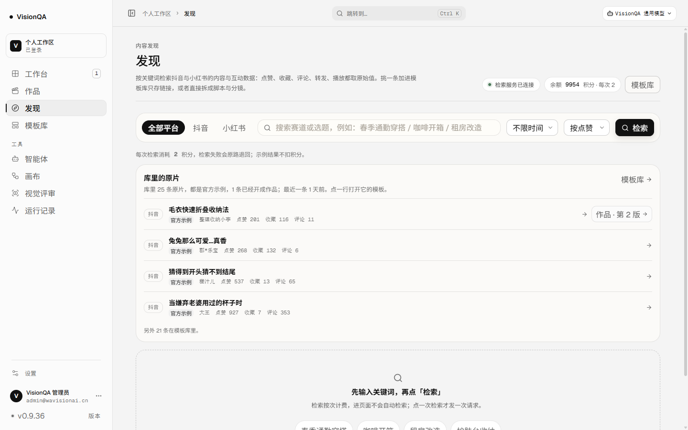
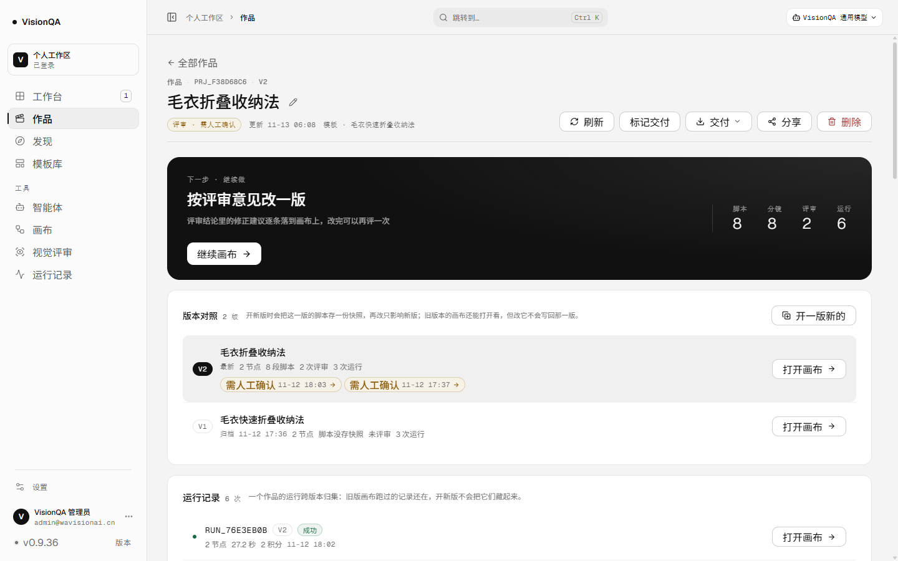
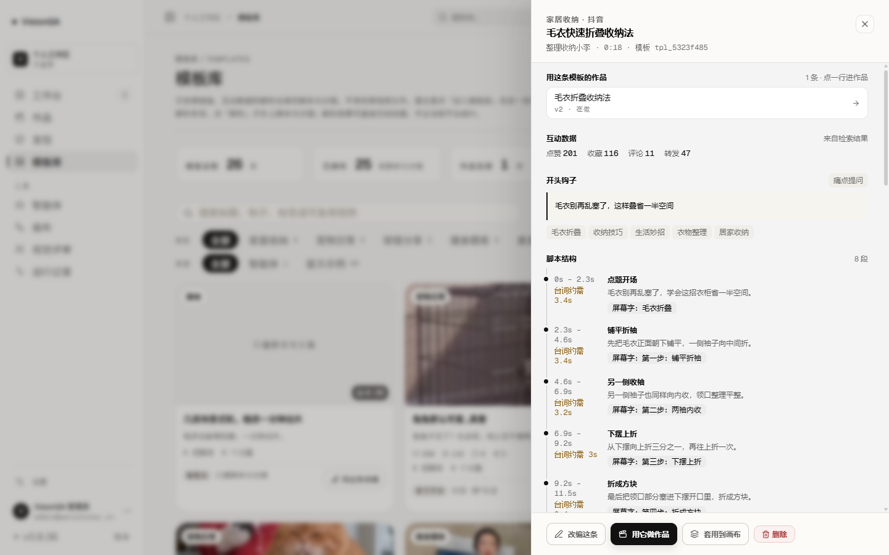
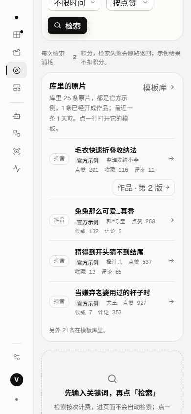
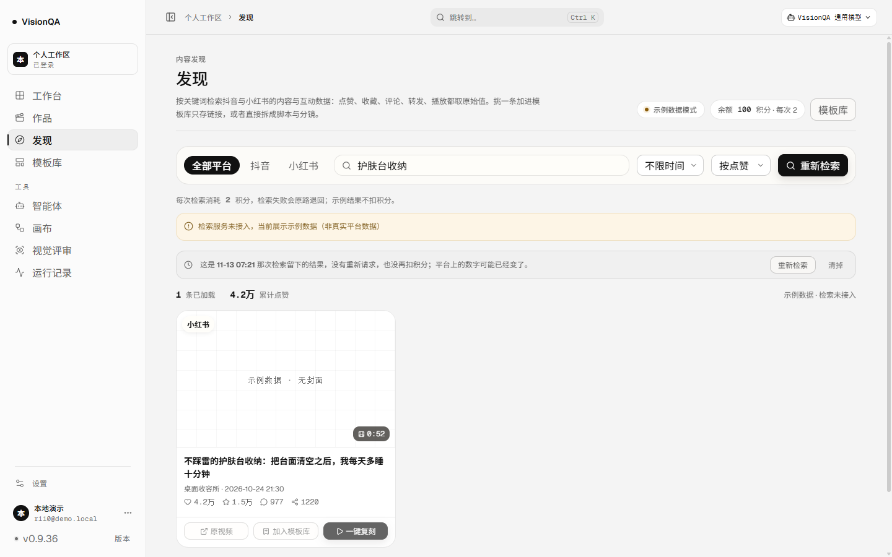

# 发现记得库里有什么：库里的原片 + 上次检索还在（v0.9.36，2026-11-13）

版本 0.9.36 / 发布包 `20261112-232100-2026-11-13-radar-taken.tar.gz` / 入口 `index-sTfLUpyv.js`（498,001 字节）/ 提交 `02b834e` + `bdc8761` / CI run 43328472320 success

结论：**作品主线走到 v0.9.35，作品 ↔ 模板这一头能互相点回去了，但「发现」还是座孤岛**——打开它只有一只搜索框和四个写死的示例词，库里已经存了 25 条原片、其中 1 条已经开成作品，它一个字都不知道；搜一次扣 2 积分，离开页面再回来，条件与结果一起没了，想再看一眼就得再付一次。这一轮做两件事：**发现页开场先说清库里有哪些原片、哪条已经在做作品**（点得进模板、点得进作品），**上次检索的结果留着**（不重新请求、不再扣费）。不新增页面、不落库、不调模型、不扣积分。

## 1. 为什么是「发现」而不是「模板库」

模板库已经把 25 条原片排成卡片，但它回答的是「这条结构能怎么改」；发现页回答的是「今天还有什么值得抄」。两页之间缺的是一次**回头看一眼**：

- 打开发现页，先看到**库里已经收过的原片**（作者、互动数、存成了哪条模板、有没有开成作品），再去检索新的——不用为了「我是不是已经有了」去模板库翻一遍、再回来重查。
- 搜完离开（去看一条模板、去改一条作品）再回来，**上次的检索还在**：条件、条目、翻到第几页都对得上，不重新发请求、不扣第二次检索费。
- 两块都只读现算，**不检索、不扣积分**：这一屏是「看库」，不是「查平台」。

## 2. 三个口径决定

1. **只按「有没有原片链接」算，不按「来源」筛**。第一版按来源 `发现` 筛，生产上直接是 0 条——库里 25 条原片全被标成「官方示例」（`shared`）。筛掉它们等于假装库里没有；把它们写成「你带回来的」又是编。现在照实标：有原片链接就进这块，`shared` 的挂一枚「官方示例」标签，剩下的是自己的。
2. **一条原片只占一行**。以它存下的改编版会继承同一个 `sourceUrl`，所以按原片链接分组（去掉 `#` 片段与末尾斜杠），同一组只出一行，行里写「存成 N 条模板」；作品按 id 去重，行里写「开成几条作品」，入口给最近改过的那条。**有作品的排前面**——这块要回答的第一句是「哪条已经在做了」，不是「最近收了什么」；「最近一条」单独按全量取最大时间，不被这个排序带偏。
3. **上次检索是客户端的记忆，不是服务端的**。存在 `sessionStorage`（标签页内、最多 48 条、超过 7 天丢掉），初始化时读，**不重新请求**；「清掉」只清这一屏结果，服务端检索历史（只存条件）不动；改了筛选条件仍按原规则写「点重新检索才会更新」。原片互动数只认正数，一件都没有写 `null`（界面写「没记互动数据」），不拿一排 0 冒充。

## 3. 改了什么

| 文件 | 改动 |
| --- | --- |
| `server/taken-origins.mjs`（新） | `originKey()` / `originRow()` / `takenOrigins()`：纯函数，去重、排序、作品归并、互动数折算都在这里，测试不用起服务 |
| `server/index.mjs` | 新增只读接口 `GET /api/taken-origins`（登录才给、方法不对 405、`?limit=` 夹在 1–12）；不按来源筛，不写任何文件 |
| `src/pages/RadarPage.tsx` | 开场「库里的原片」块（4 行 + 「另外 N 条在模板库里」）、行内「作品 · 第 N 版」与行点击进模板；上次检索的结果留在 `sessionStorage` 并在回来时原样放回 |
| `src/App.tsx` | 发现页接上「打开模板」「打开作品」两条跳转 |
| `src/styles/radar.css` | `.radar-taken*`、`.radar-restored*`：4/8 栅格、半径 token；390 下有作品的行走两行，不把标题压成 90px |
| `src/domain/radar.ts`、`src/api/radar.ts` | `TakenOrigin` / `TakenOrigins` 类型与 `getTakenOrigins()` |
| `test/taken-origins.test.mjs`（新，9 条） | 去重、官方示例、作品归并、排序与上限、原片键、互动数折算 |

顺手修：**点子里的示例关键词以前搜的是「上一次的关键词」**——`setKeyword(value)` 之后同一个事件里 `runSearch` 读到的还是旧 `keyword`，首屏点「护肤台收纳」实际发的是空关键词。现在 `runSearch(override?)` 直接按点的那个词搜。

## 4. 验收

生产 **v0.9.36**、入口 `index-sTfLUpyv.js`（498,001 字节）、release `20261112-232100-2026-11-13-radar-taken.tar.gz`、`/api/version` 0.9.36、`/api/health` ok（templates 26）、两服务 active。**这一轮生产零写入**：截图前后各取一次 `/api/projects`、`/api/templates`、`/api/flows`，作品的 `version` / `updatedAt`、模板的 `updatedAt`、七块画布的 `updatedAt` 完全一致（1 条作品 / 26 条模板 / 7 块画布）。没有调模型、没有扣积分、没有发起检索。

生产实测：

| 动作 | 结果 |
| --- | --- |
| `GET /api/taken-origins` | total 25 / withProject 1 / works 1 / official 25 / 最近一条 2026-11-11T11:31:48Z；先列出的 4 条：毛衣快速折叠收纳法（整理收纳小李，赞 201）、兔兔那么可爱…真香（郡*乐宝，赞 268）、猜得到开头猜不到结尾（橙汁儿，赞 537）、当嫌弃老婆用过的杯子时（大王，赞 927） |
| 开场原文（1440） | 「库里的原片 · 库里 25 条原片，都是官方示例，1 条已经开成作品；最近一条 1 天前。点一行打开它的模板。」+「另外 21 条在模板库里。」 |
| 点第一行的「作品 · 第 2 版」 | 地址变 `#/projects/prj_f38d68c6`，页头「毛衣折叠收纳法」 |
| 点第一行 | 地址变 `#/templates/tpl_5323f485`，抽屉打开，第一条是「用这条模板的作品 1 条 → 毛衣折叠收纳法 v2 · 在做」 |
| 390 | 4 行都在，有作品的行走两行，`scrollWidth == clientWidth`（390 / 390） |
| 1440 | `scrollWidth == clientWidth`（1440 / 1440），无横向滚动 |

本地演示数据（`.tmp-qa/r116data`，4 条带原片的模板 + 6 条作品，检索走示例数据、不扣积分）把「上次检索还在」走了一遍：

| 动作 | 结果 |
| --- | --- |
| 点示例关键词「护肤台收纳」 | 发出的是这个词（修好那条之前实际搜的是空关键词），结果 1 条，写进 `sessionStorage` |
| 直接重载页面 | 结果还在，条件还是「护肤台收纳」，顶部写「这是 11-13 07:21 那次检索留下的结果，没有重新请求，也没再扣积分；平台上的数字可能已经变了。」 |
| 点「清掉」 | 回到开场（库里的原片 + 检索框），`sessionStorage` 里那条没了；服务端检索历史不动 |

截图：

## 5. 测试与边界

`npm test` **344/344**（新增 9 条 `test/taken-origins.test.mjs`：有链接才算原片、画布 / 智能体 / 空链接不进、删掉的不算、同一原片多条模板只占一行、官方示例照实标、有作品的排前面、排序与上限与「最近一条」按全量、原片键只去 `#` 与末尾斜杠、互动数只认正数且全 0 是 `null`），oxlint **0 error / 6 warning**（都是既有文件）、`tsc -b` 干净、构建通过。

边界：不新增页面（都在发现页里）、不新增存储字段（`takenOrigins` 每次现算）、不改模板的保存口径、不存原片标题（行标题就是模板名，文案里写明「点一行打开它的模板」）、进页面不自动检索、这一轮没花一次检索费；「上次检索」只活在当前标签页，关掉就没有，也不往服务端写。
