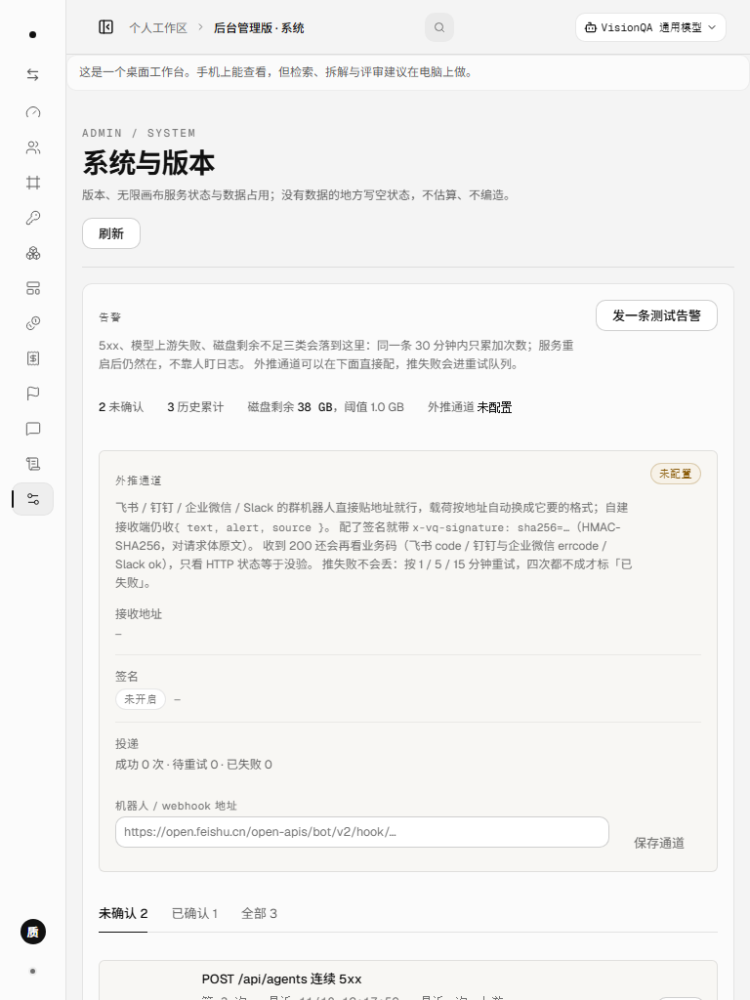
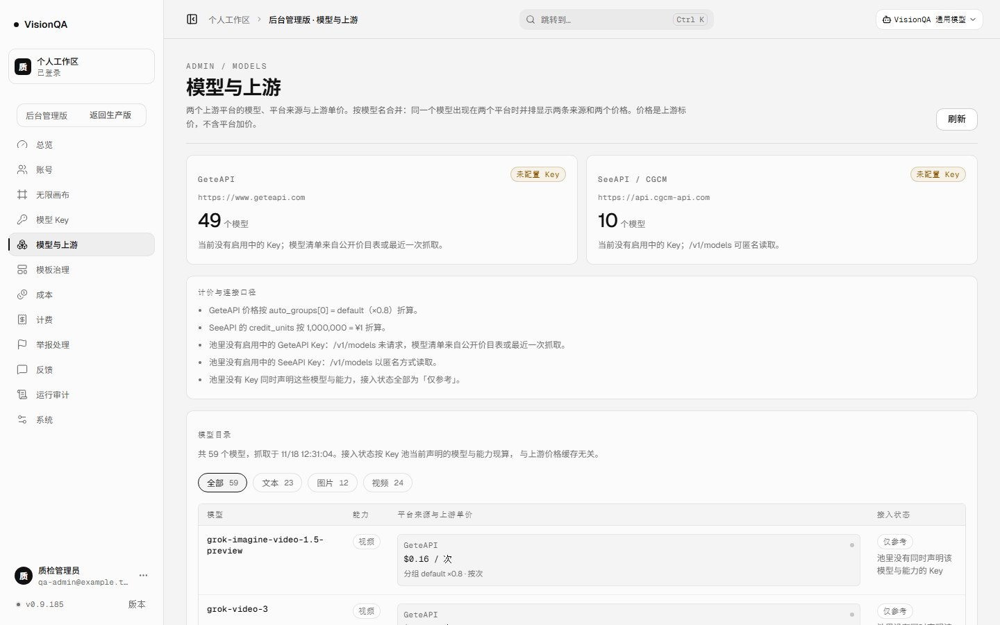

# 平板宽度扫一遍：侧栏那条空边框，其实是「返回生产版」丢了

2026-11-18，0.9.185。上一轮（0.9.184）把 320 / 390 两个窄屏扫干净了，这一轮补上平板：768×1024 竖放与 1024×768 横放，21 个页面（后台 12 个分节 + 用户 9 个页面）逐个量。结论先说：**页面级没有横向溢出、没有越界元素、没有文字截断**，但后台在 ≤900 宽时那条「返回生产版」按钮被压成了一枚空边框——看得见、点不到、也不知道是什么。

## 一、怎么扫

同一份 dist，起一个临时实例（临时 DATA_DIR、假账号、3 条告警、2 条发码记录、1 件作品、2 条生成任务），无头 Chrome 按 768×1024 与 1024×768 打开，逐页量四类东西：

| 口径 | 判据 |
| --- | --- |
| 整页横向溢出 | `documentElement.scrollWidth > innerWidth` |
| 越界元素 | `rect.right > innerWidth + 1` 或 `rect.left < -1`，且祖先里没有横向滚动容器 |
| 文字被裁 | 带文字的叶子元素 `scrollWidth - clientWidth > 2`，且 `overflow-x: hidden/clip` |
| 小点击区 | 交互元素矩形小于 24×24 |

结果：**768 与 1024 各 21 页，页面溢出 0、越界 0、文字截断 0**（1024 后台侧栏账号邮箱 `143/136` 是刻意的省略号，不算）。剩下的只有两处 22px 高的触摸目标和一枚奇怪的空白框。

## 二、那条空边框

768 下后台侧栏被 CSS 收成 68px 宽的一条图标栏（`@media (max-width: 900px)`），侧栏里唯一带文字的控件是形态条 `.vq-edition-bar`：左边「后台管理版」、右边「返回生产版」。宽度只剩 `68 − 12 − 12 = 44px`，再减去自己 12px 的左右外边距，**内容区 20px**：kicker 被 `text-overflow: ellipsis` 压成一条缝，按钮里的「返回生产版」五个字被裁光，只剩 1px 边框和上下 34px 的高度——截图里就是侧栏第一个格子那圈空盒子。

更要紧的是**功能**：`leaveAdmin` 全站只挂在这一个按钮上（`src/App.tsx` 里唯一的入口），也就是说 ≤900 宽时，管理员在界面上找不到「回到生产版」这个动作。

修法两处：

1. `src/App.tsx`：按钮里加一枚 `ArrowLeftRight` 图标与 `返回生产版`，按钮补 `aria-label` 与 `title`；
2. `src/styles/shell.css`：图标默认 `display: none`（宽屏有文字，图标会挤掉左边「后台管理版」——第一版就把 kicker 从 60px 挤到 52px 被裁，退回重建）；`@media (max-width: 900px)` 里去边框、去背景、去 padding，形态条收成居中的一颗方形按钮，藏掉 kicker 与文字，露出图标。

## 三、验收

形态条在 7 个宽度上的实际尺寸（同一份 dist，无头 Chrome 量）：

| 视口宽 | 侧栏 | 形态条 | 按钮 | 图标 | 文字 | 边框 |
| --- | --- | --- | --- | --- | --- | --- |
| 1440 | 236 | 187×34 | 86×28 | 隐藏 | 显示 | 1px |
| 1200 | 236 | 187×34 | 86×28 | 隐藏 | 显示 | 1px |
| 1024 | 236 | 187×34 | 86×28 | 隐藏 | 显示 | 1px |
| 901 | 236 | 187×34 | 86×28 | 隐藏 | 显示 | 1px |
| 900 | 68 | 43×28 | 28×28 | 15px | 隐藏 | 0 |
| 768 | 68 | 43×28 | 28×28 | 15px | 隐藏 | 0 |
| 390 | 68 | 43×28 | 28×28 | 15px | 隐藏 | 0 |

1024 / 901 两个宽度下 kicker 宽 71px、`scrollWidth == clientWidth`（不裁），说明图标藏起来之后宽屏没有回退。

真点一次（CDP 鼠标事件，不是合成 `click()`）：`#/admin/system` → 点侧栏那颗 ⇄ → `#/overview`，形态条消失、回到用户版；按钮 `aria-label` 一直是「返回生产版」，读屏与悬浮提示都有。

## 四、顺带补两处 22px 的触摸目标

扫描里另有 8 + 1 处只有 22px 高的可点元素：总览页那排「全部评审 / 全部作品 / 全部运行 / 全部模板」与页脚三个链接、作品页的「0 个模板首帧」折叠开关。WCAG 2.2 的最小触摸目标是 24×24，这回补到 24。

补法是 `min-height: 24px`，**不是**把 padding 从 2px 改成 3px：`test/design-grid.test.mjs` 管着间距只许走 4/8 栅格，3px 与 5px 立刻被单测拦下（这一轮真被拦了一次，改回 `min-height` 才过）。实测 1440 / 768 / 390 三个宽度下，这几个元素高度都从 22 变成 24，页面 `scrollWidth` 仍等于 `innerWidth`。

## 五、门禁与部署

| 项 | 结果 |
| --- | --- |
| 全量测试 | **1361 / 1361**（纯样式与一处图标，无新增用例） |
| lint / `tsc -b` / 密钥扫描 | 0 error · 16 warning（560 文件）/ 干净 / 850 文件无命中 |
| 构建 | 入口见 README 二百六十三 |

## 六、边界

- 只量了 320 / 390 / 768 / 901 / 900 / 1024 / 1200 / 1440，平板竖放 810、横放 1112 这类中间宽度没逐个扫（形态条只在 900 这一个断点上切换，7 个宽度已覆盖两侧）；
- 1024 后台侧栏里账号邮箱显示省略号是刻意的，没改；
- 后台大表格仍是「容器内横向滚动」，是设计，不是缺陷；
- 本轮没碰任何接口、没有新增字段，也没调上游；截图里的账号、告警、发码记录都是临时实例里的样例数据。
