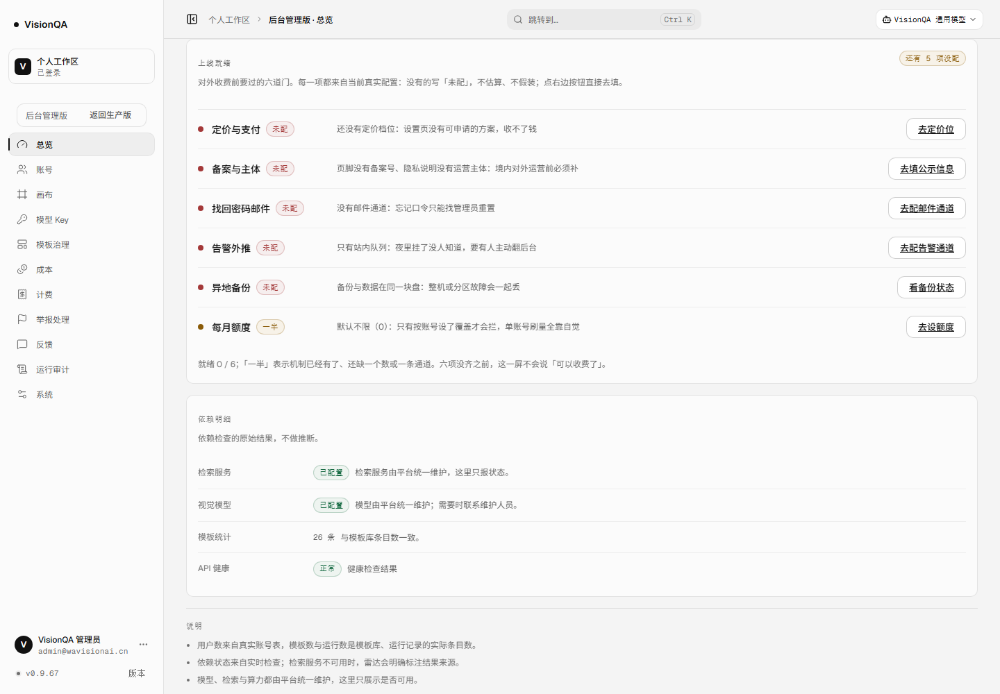
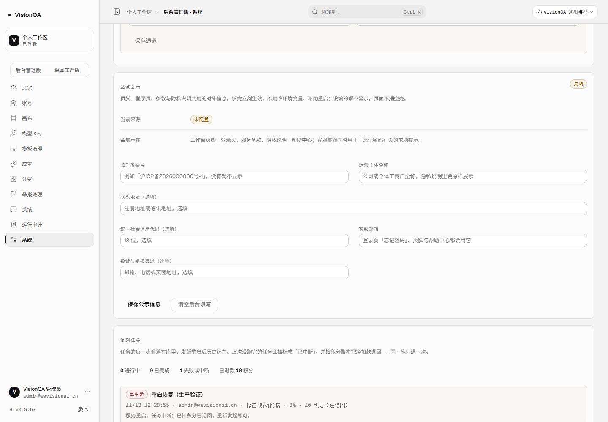
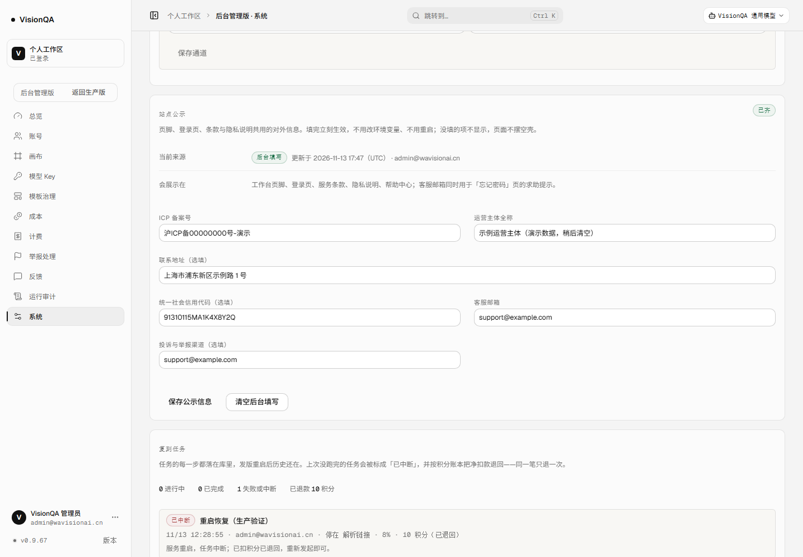
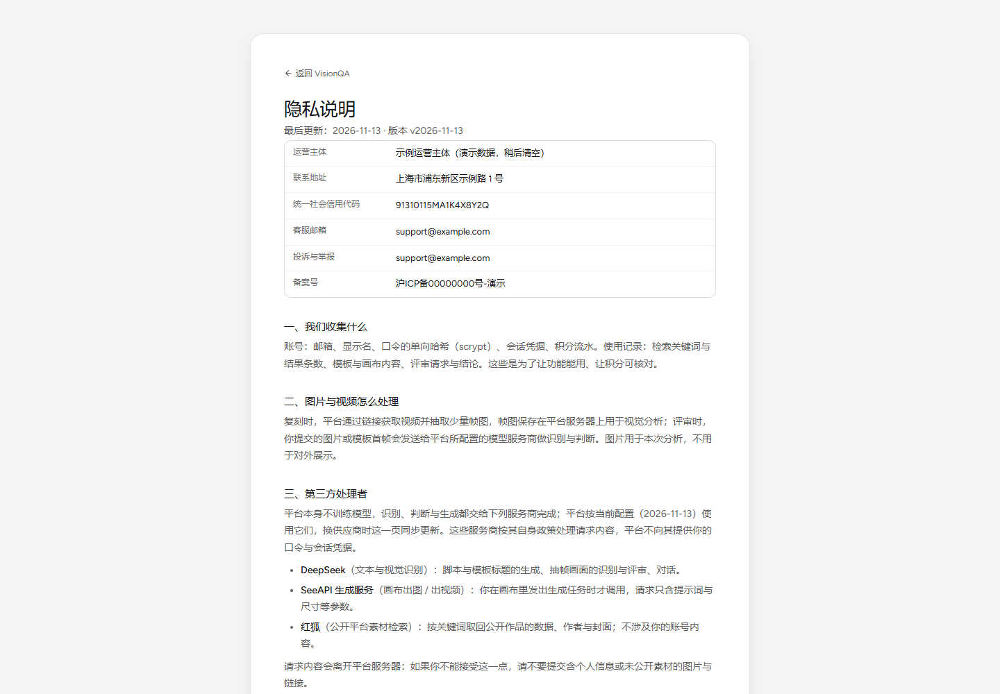
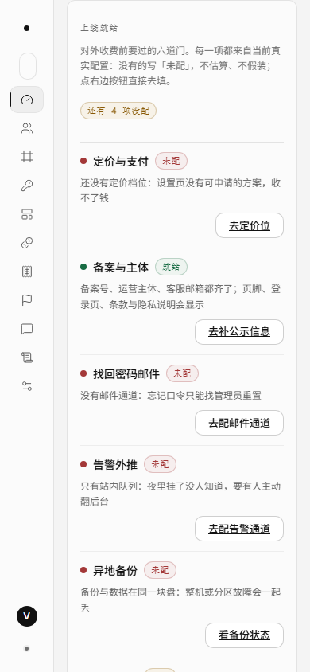

# 上线就绪一屏看清，公示信息自己填（v0.9.67）

这一轮把「还差什么才能对外收费」从一份 Markdown 清单搬进了后台：六道门逐条判、逐条给去向；
再把六道门里唯一「纯数据」的一项（备案号 / 主体 / 客服邮箱 / 投诉渠道）做成后台表单，
填完立刻出现在页脚、登录页、条款与隐私说明里——不用改环境变量、不用发版。

## 一、结论先行

| | 之前（v0.9.66） | 现在（v0.9.67） |
| --- | --- | --- |
| 「还差什么」 | 只在 `docs/launch-readiness-2026-11-12.md` 里，要人去翻文档 | 后台总览一块「上线就绪」：六道门逐条给状态、缺什么、去哪填 |
| 状态怎么来 | 文档里写的，可能过期 | 每次现算：邮件通道、告警通道、备份状态、定价档位、每月额度、公示信息 |
| 会不会报假绿 | 不适用 | 六项没齐就不说「可以收费了」；读不到按「未配」算，异常不会变成就绪 |
| 备案号 / 主体 / 客服邮箱 | 只能改 `VQ_ICP` / `VQ_SUPPORT_EMAIL` 再重启 | 后台「系统 → 站点公示」填，保存即生效；环境变量仍兜底 |
| 隐私说明里的运营主体 | 没有（只有第三方处理者清单） | 有：主体全称、地址、统一社会信用代码、客服邮箱、投诉渠道、备案号，填了才显示 |

## 二、为什么是这一轮

上线清单里的 P0 已经全部做完代码部分，剩下的六项都卡在同一个地方：**数字与外部账号要用户给**。
继续等，项目就停在这里；能做的是把「卡在哪、缺哪一项、去哪填」变成产品自己会回答的问题，
并把不需要凭据的那三项（备案号、主体、客服邮箱）从「改环境变量」降成「填个表单」。

所以这一轮做两件事，共用一套口径：

1. **上线就绪**（`GET /api/admin/readiness`）：六道门各自从真实配置现算，给出 `ready / partial / todo`；
2. **站点公示**（`/api/admin/site` + 公开 `/api/app` 的 `site` 字段）：后台可读写、可清空，公开页只读。

## 三、六道门怎么判

判定是纯函数 `readinessGates()`（`server/readiness.mjs`），取数在 `launchReadiness()`：
任何一处读取失败都回到 `null`，判定时按「未配置」算——**宁可少报就绪，也不报一个假的绿**。

| 门 | 判定依据 | 什么情况算就绪 | 什么情况算一半 / 未配 |
| --- | --- | --- | --- |
| 定价与支付 | `plans.json` 里的档位数 | ——（支付通道未接，最多「一半」） | 0 个档位 = 未配；有档位 = 一半（下单仍 501） |
| 备案与主体 | `site.json` / 环境变量 | 备案号 + 主体全称 + 客服邮箱都有 | 有部分 = 一半（列出缺哪几项）；全空 = 未配 |
| 找回密码邮件 | `mail.json` / `VQ_SMTP_*` | 通道已配且有发件地址 | 否则未配 |
| 告警外推 | `alert-channel.json` / `VQ_ALERT_WEBHOOK` | 有可用地址且未停用 | 否则未配 |
| 异地备份 | 备份状态文件 / `VQ_BACKUP_OFFSITE` | 异地副本已配 | 否则未配（备份与数据同盘） |
| 每月额度 | `quota.json` | 默认每月上限 > 0 | 默认 0（不限）= 一半：按账号覆盖才会拦 |

一句结论（`verdict`）只有六项全 `ready` 才会是 `ready`；否则是 `not-ready`，
文案是「还有 N 项没配」或「还有 N 项只做了一半」。

> 为什么支付这一项永远到不了「就绪」：支付通道确实还没接。把这一项写成绿，等于骗自己。

## 四、站点公示怎么存、怎么显示

`server/site-info.mjs`：

- 六项：`icp` / `operator` / `address` / `creditCode` / `supportEmail` / `complaint`；
- 存 `DATA_DIR/site.json`，临时文件 + rename 原子写，落盘 **0600**；
- 空值折叠、信用代码统一大写；坏邮箱、17 位信用代码、六项全空都拒绝保存（中文原因直接显示）；
- 生效顺序：**后台填的 > 环境变量**（`VQ_ICP` / `VQ_SUPPORT_EMAIL`）；两边都没有 = 空；
- 公开视图 `sitePublicView()` 去掉 `updatedBy` / `source` 这类后台痕迹；
- 每次保存 / 清空都写审计 `site.save` / `site.clear`，detail 只记「填了哪几项」，不把值抄进审计。

显示位置：工作台页脚、登录页（含找回口令的求助提示）、服务条款、隐私说明（运营主体表 + 页脚）、帮助中心。
**没填的项不显示**：页脚不会空着，隐私说明也不会摆一段空壳。

## 五、生产实测（v0.9.67b）

入口 `index-S_o72fkM.js`，`/api/version` = 0.9.67，`/api/health` ok（模板 26），
两次发布快照：`20261113-174426-v0.9.67.tar.gz`、`20261113-174638-v0.9.67b.tar.gz`。

| 检查 | 结果 |
| --- | --- |
| `GET /api/admin/readiness`（未配任何东西） | `verdict=not-ready`、`还有 5 项没配`、`{ready:0, partial:1, todo:5}` |
| 六道门顺序与状态 | 定价 todo / 备案 todo / 邮件 todo / 告警 todo / 备份 todo / 额度 partial |
| 每道门的去向 | `billing` × 3（定价、额度）、`system` × 3（公示、邮件、告警、备份），按钮直接跳到对应页 |
| `GET /api/admin/site` | 六项字段齐全，`source=none`、`missing=[ICP 备案号, 运营主体全称, 客服邮箱]` |
| 保存演示数据（随后清空） | `source=admin`、`complete=true`、`missing=[]`；后台表单回填六个值，胶囊从「未填」变「已齐」 |
| 保存后的就绪判定 | 备案与主体变成 `ready`，结论从「还有 5 项没配」变成「还有 4 项没配」 |
| 公开页（隐私说明） | 运营主体表 6 行（主体 / 地址 / 信用代码 / 客服邮箱 / 投诉 / 备案号），页脚同步显示；`h1` = 隐私说明 |
| `GET /api/app` | `site` 对象六项 + `complete`；顶层 `icp` / `supportEmail` 仍在（老前端不受影响） |
| 清空后 | `source=none`、公开 `icp` 为空、`complete=false`、`missing` 回到三项；演示数据没有留在线上 |
| 窄屏 390 | `docScrollWidth 390`、行数 6、横向溢出 0、卡头 133px（标题与说明竖排） |
| 控制台 | 后台总览 / 系统、公开隐私页 0 异常 |











**关于截图里的演示数据**：备案号写的是「沪ICP备00000000号-演示」、主体写的是「示例运营主体（演示数据，稍后清空）」，
拍完在同一次脚本里 `DELETE /api/admin/site` 清掉并复查 `/api/app` 为空。线上现在没有这条数据。

## 六、改了什么

- 新增 `server/site-info.mjs`：校验、原子写、0600、环境变量兜底、公开视图；
- 新增 `server/readiness.mjs`：`readinessGates()` 纯判定 + `launchReadiness()` 取数；
- `server/routes/admin.mjs`：`GET/PUT/DELETE /api/admin/site`、`GET /api/admin/readiness`，保存与清空进审计；
- `server/index.mjs`：`/api/app` 增加 `site` 对象，顶层 `icp` / `supportEmail` 保留；
- `server/audit.mjs`：`site.save` / `site.clear` 的中文动作名；
- 新增后台组件 `ReadinessCard.tsx`（总览）与 `SiteInfoCard.tsx`（系统页）；
- 公开页：`LegalPage.tsx` 增加运营主体表、`OverviewPage.tsx` 页脚显示主体、`api/app.ts` 增加 `site` 类型；
- 样式：`console.css` 的就绪行与两列表单（720px 以下竖排）、`shell.css` 的 `.vq-legal-facts`。

## 七、测试与提交

- 新增 `test/site-info.test.mjs`（7 条）：空目录、环境变量兜底、保存归一化、0600 与公开视图、
  坏输入拒绝、清空回落、路由 403/读写/审计；
- 新增 `test/readiness.test.mjs`（4 条）：纯判定六道门、缺项文案、读不到不算就绪、逐项配齐后的结论；
- 全仓 **592/592**；`npx tsc -b` 干净；`npx oxlint src server test` **0 error / 7 warning**（既有）；构建通过。

## 八、边界与没做的事

- **这一屏只回答「还差什么」，不替用户做决定**：定价数字、备案号、主体信息、SMTP、webhook、异地目的地仍要用户给；
- 支付通道没接，所以「定价与支付」最多到「一半」——这是事实，不是进度条 bug；
- 额度「一半」也是事实：默认 0 表示不限，只有按账号设了覆盖才拦；
- 公示信息是**展示位**，不是备案代办：填了不等于备案通过；
- 环境变量仍可覆盖显示，但后台一旦保存就以后台为准（清空后回到环境变量）；
- 审计只记「填了哪几项」，不记值——避免审计页变成第二个公示页。

## 九、复验

```bash
curl -s -b cookie.txt https://visionqa.wavisionai.cn/api/admin/readiness | jq '{verdict, verdictText, totals}'
curl -s -b cookie.txt https://visionqa.wavisionai.cn/api/admin/site | jq '.site | {source, complete, missing}'
curl -s https://visionqa.wavisionai.cn/api/app | jq '.site'
# 后台：总览「上线就绪」、系统「站点公示」；公开：/#/legal/privacy 顶部
```

## 十、回滚

纯新增文件与展示位，没有 schema 变更、没有数据迁移：
`bash /opt/visionqa/ops/rollback.sh --to 2` 回到 v0.9.66c 即可（`site.json` 即使留着也不会被旧版读取）。
